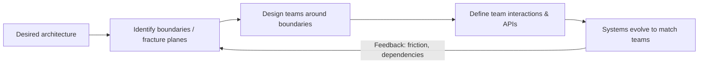
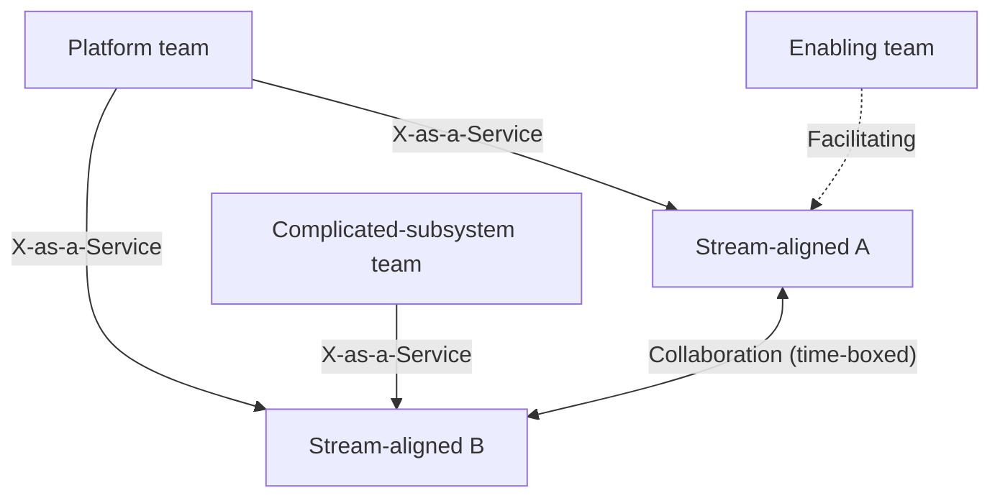
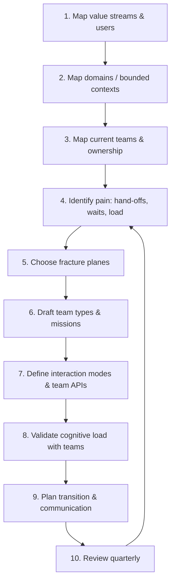

# Team Design and Organizational Structure

> **TL;DR** — Structure teams around the flow of change, not around technologies or org-chart convenience. Use Team Topologies (4 team types, 3 interaction modes) to make team boundaries and interactions explicit, size teams to stay under Dunbar-style trust limits (5–9 people), and limit each team's cognitive load. Org structure and system architecture mirror each other (Conway's Law) — design them together (Inverse Conway Maneuver). Adding people late slows things down (Brooks's Law).

Related: [Team dynamics and culture](team-dynamics-culture.md) · [Decision making](decision-making.md) · [Change management](change-management.md) · [Software architecture](../05-software-architecture/README.md) · [Enterprise architecture](../11-enterprise-architecture-business/README.md) · [Agile/Scrum](../04-agile-kanban-scrum/README.md)

---

## 1. Why team design matters

- Most delivery problems that look technical (slow releases, integration hell, unclear ownership, blame) are often **structural**: too many hand-offs, shared ownership, overloaded teams, mismatched boundaries.
- Team structure determines **communication paths**, which determine **system boundaries**, which determine **how fast changes flow**.
- A good structure makes the right thing easy: a team can design, build, run, and improve its part with few dependencies.

### Design goals checklist

- [ ] Each team has a clear **mission** and a bounded area of ownership.
- [ ] Each team can deliver value **end-to-end** with minimal hand-offs.
- [ ] **Cognitive load** of each team is sustainable.
- [ ] Team size is **5–9** (rarely up to ~12 for some platform/ops teams).
- [ ] Interactions between teams are **explicit and intentional** (not accidental).
- [ ] Teams are **long-lived** and stable (bring work to teams, not teams to work).
- [ ] Architecture boundaries align with team boundaries.
- [ ] There is a known path for evolving the structure as context changes.

---

## 2. Conway's Law and the Inverse Conway Maneuver

**Conway's Law (Melvin Conway, 1968, paraphrased):** organizations that design systems produce designs that copy the organization's communication structure.

| Org structure | Typical resulting architecture |
|---|---|
| Separate frontend, backend, DBA teams | Layered monolith with team-shaped layers, heavy coordination for every feature |
| One team per product line | Separate services/apps per product, possibly duplication |
| Outsourced component vendors | Integration-heavy, contract-heavy interfaces at vendor seams |
| Single big team | Single big codebase / big ball of mud tendency |
| Teams split by geography | Seams at timezone boundaries |

**Inverse Conway Maneuver:** deliberately shape team structure (and communication paths) to encourage the architecture you want.

- Want independent microservices? → Create independent stream-aligned teams owning them end-to-end.
- Want a shared platform? → Create a platform team with a product mindset and clear "X-as-a-Service" offering.
- Want to break a monolith? → Assign team ownership along the target seams first; code follows.

**Caveats**

- Restructuring is costly and disruptive (see [change management](change-management.md)); do it intentionally, not every quarter.
- Communication structure includes **informal** paths (Slack channels, friendships, co-location), not only the org chart.
- Not all communication is bad: Team Topologies argues for **restricting unnecessary** communication, not all communication.



---

## 3. Team Topologies (Skelton & Pais)

Source: [teamtopologies.com](https://teamtopologies.com/) — book *Team Topologies* (2019, 2nd ed. 2025).

### 3.1 Four fundamental team types

| Team type | Purpose | Typical examples | Success signal | Anti-patterns |
|---|---|---|---|---|
| **Stream-aligned** | Aligned to a single, valuable stream of work (product, user journey, customer segment); delivers end-to-end | Checkout team, Mobile onboarding, Claims processing | Fast flow; few blocking dependencies; owns build & run | Becomes a "feature factory" without outcome ownership; waits on other teams |
| **Enabling** | Specialists who help stream-aligned teams acquire missing capabilities; temporary, coaching role | Test automation coaches, Observability guild-as-team, Security enablement | Teams become self-sufficient, then enabling team moves on | Becomes a permanent gatekeeper or does the work for teams |
| **Complicated-subsystem** | Owns a part requiring deep specialist knowledge that would overload a stream-aligned team | Video codec, pricing engine, ML ranking model, payment risk scoring | Reduces cognitive load of stream teams | Created for political reasons; too many of them; becomes bottleneck |
| **Platform** | Provides internal self-service services that accelerate stream-aligned teams | Internal developer platform, data platform, CI/CD platform | Teams use it voluntarily; low support tickets; good DX | Mandated, ticket-driven, ignores users; "build it and they will come" |

Key rule: **stream-aligned teams are the primary type**; the other three exist to reduce their burden. Common rough ratio cited: majority of teams stream-aligned (often 6–9 stream-aligned per 1 of the others), but context dependent.

### 3.2 Three interaction modes

| Mode | Description | When to use | Duration | Smell when misused |
|---|---|---|---|---|
| **Collaboration** | Two teams work closely together on a shared goal; high bandwidth | Discovery, new tech, fuzzy boundaries, rapid learning | Short, time-boxed (weeks–months) | Permanent collaboration = unclear ownership, high cognitive load |
| **X-as-a-Service** | One team consumes something provided by another with minimal collaboration | Boundaries well understood; stable, predictable needs | Long-term | Used too early: the API is wrong and painful to change |
| **Facilitating** | One team helps/coaches another to clear impediments or learn | Capability gap; adoption of new practices | Short to medium | Facilitator starts doing the work itself |

Typical mode by team type:

| Team type | Most common mode(s) |
|---|---|
| Stream-aligned | Collaboration (temporarily), consumes X-as-a-Service |
| Enabling | Facilitating |
| Complicated-subsystem | X-as-a-Service (collaboration during build-up) |
| Platform | X-as-a-Service (collaboration during discovery of new services) |



### 3.3 Evolving interactions

- Interaction modes are **expected to change** over time: collaboration → discover boundary → X-as-a-Service.
- Use **team interaction sensing**: frequent friction, excessive meetings, or "we're blocked on team X" signals the mode or boundary is wrong.
- Revisit team interactions quarterly (e.g., in a cross-team retrospective or ops review).

### 3.4 Cognitive load

Based on cognitive load theory (John Sweller). A team can only hold so much in its collective head.

| Type | Meaning | Strategy |
|---|---|---|
| **Intrinsic** | Inherent difficulty of the domain/skills (e.g., how a language or algorithm works) | Training, pairing, hiring for skills |
| **Extraneous** | Load from the environment that doesn't add value (e.g., how to deploy, wrestling with tooling, manual approvals) | **Eliminate**: platforms, automation, good docs |
| **Germane** | Load related to learning the business domain and producing value | **Maximize room for it** |

**Heuristics for assessing team cognitive load**

- Ask the team (survey 1–5): "How well do you understand the systems you own?", "How confident are you on-call?", "How many domains do you context-switch between?"
- Count domains per team and classify each as simple/complicated/complex. Rule of thumb from the book: a team can handle roughly **2–3 simple** domains, **one complicated**, or **one complex** domain — not a mix of many.
- Count services/repos per team, number of on-call rotations, number of stakeholder groups.
- Watch for: long onboarding, single points of knowledge, chronic overtime, "nobody knows how that works."

**Reducing cognitive load**

- Shrink the team's scope (split the domain).
- Move undifferentiated work to a platform.
- Use enabling teams to accelerate learning.
- Extract complicated subsystems.
- Improve documentation and paved roads.

### 3.5 Team API

A team's "API" describes how other teams should interact with it. Publish it (wiki page, README in the team's repo).

**Team API template**

```markdown
# Team <Name> — Team API
- Team type: stream-aligned | platform | enabling | complicated-subsystem
- Mission (1–2 sentences):
- Owned services / code / data:
- Versioning & API docs: <links>
- Wiki / runbooks: <links>
- Ways of working: (Kanban/Scrum, cadence, WIP limits)
- How to request work: (ticket board, Slack channel, intake form)
- Response expectations / SLA:
- On-call & incident contact:
- Current interactions with other teams:
  | Team | Mode (collab / X-as-a-Service / facilitating) | Expected until | Purpose |
- What we're working on (roadmap link):
- Communication: preferred channels, standup time, demo schedule
- Team members & roles:
```

### 3.6 Fracture planes (where to split)

Natural seams along which to split a system and teams. Prefer splitting so each team gets a coherent, low-coupling slice.

| Fracture plane | Example | Notes |
|---|---|---|
| **Business domain bounded context** (DDD) | Orders, Billing, Inventory | Usually the best default; see [Event Storming](facilitation-methods-catalog.md#event-storming) |
| **Regulatory compliance** | PCI-DSS card handling isolated | Shrinks audit scope |
| **Change cadence** | Rarely changed back-office vs fast-moving web | Fast parts not slowed by slow parts |
| **Team location / time zone** | Team in another time zone gets a self-contained area | Avoid split teams across many TZs |
| **Risk** | High-risk payments vs low-risk marketing pages | Different review and release processes |
| **Performance isolation** | High-throughput ingestion vs reporting | Different scaling needs |
| **Technology** | Legacy mainframe, mobile native, embedded | Use with care — tech splits often create hand-offs |
| **User personas** | Admins vs consumers vs partners | Good for stream alignment |

### 3.7 Other Team Topologies concepts

- **Thinnest Viable Platform (TVP):** start the platform as small as possible — a wiki page of conventions may be enough.
- **Team-first thinking:** the team (not the individual) is the unit of delivery.
- **Team-first boundaries & ownership:** every piece of software has exactly one owning team.
- **Monoliths to watch:** joined-at-the-database, monolithic release, monolithic model, monolithic thinking (standardization), monolithic workplace.
- **Independent service teams' trust boundary:** ~Dunbar layers (below).

---

## 4. Team size and scaling limits

### 4.1 Dunbar's number

Robin Dunbar (anthropologist): humans maintain stable social relationships with roughly **150** people; with layers at about:

| Layer | Approx. size | Org application |
|---|---|---|
| Close support | ~5 | Pairs/triad, closest collaborators |
| Sympathy group | ~15 | Single team high-trust limit (Team Topologies cites ~5–8 for one team, ~15 for deep trust) |
| Band | ~50 | Team-of-teams / tribe working closely |
| Clan / community | ~150 | Department where people know each other |
| ~500, ~1500 | Acquaintances / recognizable faces | Business unit / division |

**Caveats:** the numbers are approximations from primate neocortex studies; later research disputes the precision. Use as a heuristic for when trust and informal coordination break down, not as law.

### 4.2 Two-pizza teams (Amazon)

- A team should be small enough to be fed by two pizzas (~6–10 people).
- Pair with **single-threaded ownership**: a team (or leader) dedicated to one thing.
- The point is **autonomy + ownership + fewer communication paths**, not pizza math.

### 4.3 Communication paths grow quadratically

Number of pairwise links = n(n−1)/2.

| Team size | Links |
|---|---|
| 3 | 3 |
| 5 | 10 |
| 7 | 21 |
| 9 | 36 |
| 12 | 66 |
| 15 | 105 |
| 20 | 190 |

### 4.4 Brooks's Law

Fred Brooks, *The Mythical Man-Month* (1975): **"Adding manpower to a late software project makes it later."**

Why:

1. **Ramp-up time** — new people need onboarding, consuming existing members' time.
2. **Communication overhead** — links grow ~n².
3. **Limited divisibility** — some tasks can't be parallelized ("nine women can't make a baby in one month").

When adding people *can* help:

- Early in the project, not late.
- Work is genuinely partitionable (independent streams).
- Newcomers are experienced with the codebase/domain.
- You add a **whole team** with its own scope rather than individuals into an existing team.

Alternatives when late: cut scope, extend date, remove impediments, reduce WIP, protect the team from interruptions.

### 4.5 Team scaling checklist

- [ ] Before adding people, ask: is the bottleneck capacity, or flow/dependencies/decisions?
- [ ] Split teams at ~9–10; split along fracture planes, not by "frontend vs backend".
- [ ] When splitting, retain knowledge (seed each new team with experienced members).
- [ ] Re-establish working agreements after any membership change (team re-forms — see [Tuckman](team-dynamics-culture.md#1-tuckman-stages-of-group-development)).

---

## 5. Common team structures compared

| Structure | Pros | Cons | Fits when |
|---|---|---|---|
| **Component teams** (by layer/tech) | Deep expertise, consistent tech | Hand-offs for every feature; slow flow | Very specialized components; complicated subsystems |
| **Feature/stream-aligned teams** | End-to-end ownership, fast flow | Needs T-shaped skills; risk of inconsistency | Product development, most cases |
| **Matrix** (functional manager + project lead) | Skill development + delivery focus | Two bosses, conflicting priorities | Consulting/project orgs |
| **Project teams** (temporary) | Flexible allocation | Re-forming costs; knowledge loss; no ownership after handover | Short, one-off initiatives |
| **Pods / squads** | Autonomy; small | Can fragment architecture without alignment | Product orgs with good platform |
| **Feature crews / swarming** | Rapid focus on a goal | Unstable; burnout risk | Short, critical missions |

**Prefer long-lived teams**: "Bring work to teams, not teams to work." Stable teams accumulate domain knowledge and trust.

---

## 6. Spotify model (squads, tribes, chapters, guilds) — with caveats

From Henrik Kniberg & Anders Ivarsson's 2012 paper and the "Spotify Engineering Culture" videos.

| Unit | Description |
|---|---|
| **Squad** | Small cross-functional, autonomous team (~6–12) with a mission; like a Scrum team |
| **Tribe** | Collection of squads in a related area (aim < ~100–150 people — Dunbar) |
| **Chapter** | People with the same skill across squads in a tribe (e.g., all backend devs); chapter lead often line manager |
| **Guild** | Voluntary community of interest across the whole org (e.g., testing guild) |

**Caveats (important):**

- The authors themselves said it was a **snapshot**, not a framework to copy; Spotify itself evolved and reportedly struggled with parts of it (e.g., matrix management via chapters, alignment across autonomous squads).
- Copying the vocabulary ("let's call teams squads") changes nothing without the underlying culture: trust, autonomy with alignment, strong engineering practices, platform support.
- Autonomy without alignment yields fragmentation; Spotify emphasized **"aligned autonomy"**.
- Chapter-lead-as-manager creates a matrix that can confuse accountability.
- Use it as **inspiration**: communities of practice (guilds) and skill-based development (chapters) are broadly useful.

---

## 7. Sociotechnical systems thinking

- Origin: Tavistock Institute studies of British coal mining (Trist & Bamforth, 1950s) — productivity depended on **joint optimization** of social and technical subsystems; autonomous work groups outperformed mechanized, fragmented roles.
- Principle: you cannot optimize technology and people separately; design them together.
- Modern applications: DevOps ("you build it, you run it"), Team Topologies, DDD bounded contexts mapped to teams, sociotechnical architecture (e.g., Nick Tune, Eduardo da Silva writing on this).

**Sociotechnical design questions**

1. What are the value streams / user journeys?
2. What domain boundaries (bounded contexts) exist?
3. Which teams own which boundaries? Any shared ownership?
4. Where are the hand-offs and wait states?
5. Where is cognitive load too high?
6. Which interactions should be collaboration vs service?
7. What platform capabilities would remove extraneous load?
8. How does information/decision authority flow? (see [decision making](decision-making.md))

---

## 8. Link to Accelerate / DORA

*Accelerate* (Forsgren, Humble, Kim, 2018) and DORA research ([dora.dev](https://dora.dev/)) show that organizational capabilities predict software delivery performance (deployment frequency, lead time for changes, change failure rate, time to restore / failed deployment recovery time).

Team-design-relevant capabilities:

| Capability | Team design implication |
|---|---|
| **Loosely coupled architecture** | Teams can test & deploy independently → align teams with boundaries |
| **Team autonomy / empowered teams** | Teams choose tools, change without external approval |
| **Generative culture (Westrum)** | See [team dynamics & culture](team-dynamics-culture.md#5-westrum-organizational-culture-typology) |
| **Lightweight change approval** | Replace CAB with peer review |
| **Visibility of work / WIP limits** | Flow-focused team practices |
| **Transformational leadership** | Vision, intellectual stimulation, inspirational communication, supportive leadership, personal recognition |
| **Platform engineering (later reports)** | Good platforms reduce cognitive load |

---

## 9. Team design process (workshop-ready)



**Inputs to gather:** dependency maps, ticket flow data (where does work wait?), on-call loads, service catalogue, survey on cognitive load, stakeholder map.

**Facilitation tips:** let teams participate in designing their own boundaries (team self-selection / "self-designing teams" approaches exist, e.g., Sandy Mamoli's self-selection). Use [Liberating Structures](facilitation-methods-catalog.md#1-liberating-structures) like 1-2-4-All and Min Specs to co-design.

### Team charter template

```markdown
# Team Charter: <Team name>
## Purpose
Why do we exist? Whom do we serve?
## Mission & outcomes (next 6–12 months)
- Outcome 1 + metric
## Scope / ownership
In scope: ... | Out of scope: ...
## Stakeholders & customers
## Team members & roles
## Working agreements
- Core hours / meeting-free blocks
- Definition of Done / review rules
- How we make decisions (see decision-making.md)
- How we handle disagreements
## Interactions with other teams (Team API)
## Health metrics
- DORA metrics, team health check, cognitive load survey
## Review date
```

---

## 10. When to use / when not

| Approach | Use when | Avoid when |
|---|---|---|
| Team Topologies redesign | Slow flow from dependencies; unclear ownership; growing org | Tiny org (< 2 teams); crisis period where stability matters more |
| Platform team | ≥ 3–4 stream teams duplicating infra work | Too early; no clear consumers |
| Enabling team | Capability gap across several teams | Gap is in only one team (pair/hire instead) |
| Complicated-subsystem team | Genuinely specialist math/algorithms/hardware | Used to "park" legacy or political problems |
| Inverse Conway | Planning target architecture and willing to change org | Org changes not possible; then design architecture around existing teams |

---

## 11. Common mistakes

- Renaming teams (squads/tribes) without changing ownership, interactions, or incentives.
- Splitting by technology layer ("frontend team", "API team") for product work.
- Platform teams that act as ticket queues instead of products with users.
- Permanent "collaboration" between teams — a sign the boundary is wrong.
- Ignoring cognitive load: giving one team 15 microservices and 4 on-call rotations.
- Reorganizing frequently; each reorg resets team formation (Tuckman).
- Assuming Brooks's Law means "never add people" — it means add early, add whole teams, add to partitionable work.
- Matrix structures with unclear accountability.
- Designing teams on paper without asking the people involved.
- Neglecting the informal network (who actually talks to whom).

---

## References

- Team Topologies — key concepts: https://teamtopologies.com/key-concepts
- Team Topologies site: https://teamtopologies.com/
- Conway's Law: https://en.wikipedia.org/wiki/Conway%27s_law
- Melvin Conway's site (original paper "How Do Committees Invent?"): http://www.melconway.com/
- Dunbar's number: https://en.wikipedia.org/wiki/Dunbar%27s_number
- Brooks's Law: https://en.wikipedia.org/wiki/Brooks%27s_law
- The Mythical Man-Month: https://en.wikipedia.org/wiki/The_Mythical_Man-Month
- Sociotechnical system: https://en.wikipedia.org/wiki/Sociotechnical_system
- Cognitive load: https://en.wikipedia.org/wiki/Cognitive_load
- DORA research: https://dora.dev/
- Accelerate (IT Revolution): https://itrevolution.com/
- Domain-driven design: https://en.wikipedia.org/wiki/Domain-driven_design
- Sibling sections: [Software architecture](../05-software-architecture/README.md), [Enterprise architecture & business](../11-enterprise-architecture-business/README.md), [Laws & mental models](../10-laws-principles-mental-models/README.md)
