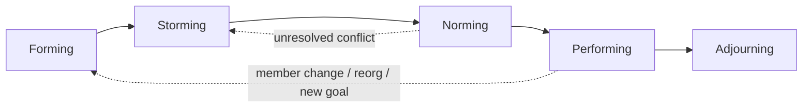
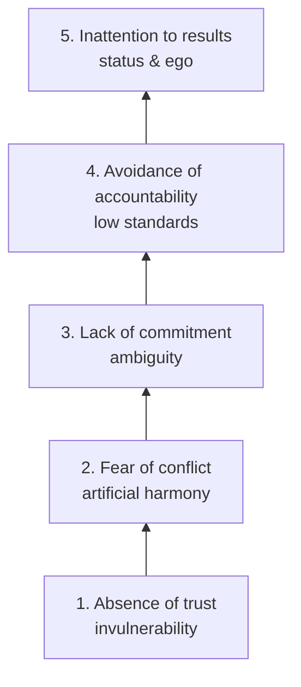

# Team Dynamics, Trust and Culture

> **TL;DR** — Teams move through predictable development stages (Tuckman); every membership change restarts part of the cycle. High-performing teams rest on trust and psychological safety (Lencioni, Edmondson, Google's Project Aristotle). Organizational culture — how information flows — predicts both delivery performance and wellbeing (Westrum, DORA). Leaders shape culture mostly through how they react to bad news, mistakes, and conflict.

Related: [Team design](team-design.md) · [Motivation & leadership](motivation-and-leadership.md) · [Feedback, 1:1s & conflict](feedback-1on1s-conflict.md) · [Agile retrospectives](../04-agile-kanban-scrum/README.md)

---

## 1. Tuckman stages of group development

Bruce Tuckman (1965; "adjourning" added 1977 with Mary Ann Jensen).

| Stage | What it looks like | Team needs | Leader behavior (link to Situational Leadership) | Useful tools |
|---|---|---|---|---|
| **Forming** | Polite, cautious, dependent on leader, unclear roles, low productivity | Purpose, structure, orientation, safety | **Directing**: clarify goals, roles, process | Team charter, personal maps, working agreements, user manuals ("Me in a nutshell") |
| **Storming** | Disagreements, power struggles, challenges to leader/process, frustration | Conflict resolution, voice, clarity on decision rights | **Coaching**: surface conflict, mediate, keep focus on goals | Conflict norms, Thomas-Kilmann, decision rules (DACI), retros |
| **Norming** | Agreements emerge, roles accepted, cohesion, feedback flows | Reinforce norms, build shared ownership | **Supporting**: step back, share decisions | Delegation boards, team health checks |
| **Performing** | High autonomy, trust, self-correction, high output | Challenge, growth, protection from churn | **Delegating**: remove impediments, provide stretch goals | Delegation level 5–7, outcome goals, OKRs |
| **Adjourning** (mourning) | Team ends or members leave; sadness, uncertainty | Closure, recognition, knowledge transfer | Celebrate, reflect, help transitions | Final retro, "lessons learned", celebration |

**Practical notes**

- Storming is **necessary**; suppressing it leads to "artificial harmony" (Lencioni) and the team never reaches performing.
- Adding/removing even one member partially resets the team; plan a short re-forming session.
- Stages are not strictly linear; teams oscillate.

### Team kickoff (forming) agenda — 3 hours

| Time | Block | Method |
|---|---|---|
| 0:00 | Welcome, purpose of the session | Short framing |
| 0:10 | Personal introductions | Personal maps / "journey lines" / user manual |
| 0:40 | Why do we exist? Mission & customers | 1-2-4-All |
| 1:10 | Break | |
| 1:20 | Roles & expectations | Role expectations matrix (each role writes what they expect from others) |
| 1:50 | Working agreements | Brainstorm → dot vote → Fist of Five |
| 2:30 | Decision rules & conflict norms | Delegation board draft |
| 2:50 | Close: hopes & concerns | Round-robin, one word check-out |

### Working agreements — starter list

- Core collaboration hours: …
- We review pull requests within one working day.
- Cameras on/off norms for remote meetings.
- Default to public channels for work discussions.
- Disagree openly in the meeting, not after it.
- If a meeting has no agenda, you may decline.
- We stop the line on broken builds.
- We revisit these agreements every N retros.

---

## 2. Lencioni — The Five Dysfunctions of a Team

Patrick Lencioni (2002). Pyramid: each level depends on the one below.

| Dysfunction | Symptoms | Positive behavior | Interventions |
|---|---|---|---|
| **Absence of trust** | People hide weaknesses/mistakes, don't ask for help | **Vulnerability-based trust** | Personal histories exercise, leader admits mistakes first, behavioral profiles, team effectiveness exercise |
| **Fear of conflict** | Boring meetings, back-channel politics, personal attacks | **Productive ideological conflict** | Mining for conflict, conflict norms, "permission to disagree" in-the-moment |
| **Lack of commitment** | Ambiguity about direction, revisiting decisions, hedging | **Clarity and buy-in** (not consensus) | Cascading communication, deadlines, disagree-and-commit, worst-case analysis |
| **Avoidance of accountability** | Mediocrity tolerated, missed deadlines, leader is sole source of discipline | **Peer accountability** | Publish goals and standards, progress reviews, team rewards |
| **Inattention to results** | Individual/department goals over team; status seeking | **Collective results** | Public declaration of results, results-based rewards |

**Caveat:** a popular fable-based model, not empirically validated as a strict hierarchy; useful as a diagnostic conversation starter.

---

## 3. Psychological safety (Amy Edmondson)

**Definition (paraphrased):** a shared belief that the team is safe for interpersonal risk-taking — speaking up with ideas, questions, concerns, or mistakes without fear of punishment or humiliation.

- Edmondson's 1999 study of hospital teams: better teams **reported more** errors — because they felt safe to report them, not because they made more.
- Psychological safety ≠ being nice, ≠ low standards, ≠ comfort. It enables **candor** and high standards together.

### Safety × standards (Edmondson)

| | Low accountability / standards | High accountability / standards |
|---|---|---|
| **High psychological safety** | Comfort zone | **Learning & high-performance zone** |
| **Low psychological safety** | Apathy zone | Anxiety zone |

### Edmondson's 7-item team survey (paraphrased themes)

Rate 1–7 (some reverse-scored):

1. If you make a mistake on this team, it is held against you. (R)
2. Members are able to bring up problems and tough issues.
3. People sometimes reject others for being different. (R)
4. It is safe to take a risk on this team.
5. It is difficult to ask other members for help. (R)
6. No one would deliberately undermine my efforts.
7. My unique skills and talents are valued and utilized.

### Leader toolkit (Edmondson's three moves)

| Move | Leader actions |
|---|---|
| **Set the stage** | Frame work as learning problems, not execution problems; state uncertainty and interdependence; clarify why voice matters |
| **Invite participation** | Show situational humility ("I may be missing something"); ask genuine questions; create structures (rounds, anonymous input, pre-mortems) |
| **Respond productively** | Express appreciation for speaking up; destigmatize failure; sanction only clear violations (blameworthy vs blameless errors) |

**Phrases that build safety**

- "What am I missing?"
- "Who sees this differently?"
- "Thanks for raising that — that's exactly what we need to hear early."
- "I got this wrong last week; here's what I learned."
- "Let's look at the system, not the person." (blameless postmortems)

**Phrases that kill safety:** "Who did this?", "That's a stupid idea", "We've tried that", sarcasm, eye-rolling, interrupting, punishing messengers.

---

## 4. Google Project Aristotle

Google People Operations study (published ~2015) of 180+ teams. Source: [re:Work](https://rework.withgoogle.com/).

Finding: **who** is on the team matters less than **how** the team works together. Five dynamics, in order of importance:

| # | Dynamic | Question | Team practice |
|---|---|---|---|
| 1 | **Psychological safety** | Can we take risks without feeling insecure or embarrassed? | Blameless retros, leader vulnerability, equal turn-taking |
| 2 | **Dependability** | Can we count on each other to do high-quality work on time? | Clear commitments, visible board, Definition of Done |
| 3 | **Structure & clarity** | Are goals, roles, and execution plans clear? | OKRs, RACI/DACI, team charter |
| 4 | **Meaning** | Are we working on something personally important? | Connect work to individual motivators (Moving Motivators) |
| 5 | **Impact** | Do we believe our work matters? | Show customer outcomes, metrics, user feedback in demos |

Related observations from the research: **equality in conversational turn-taking** and high average **social sensitivity** (reading emotions) correlate with collective intelligence (Woolley et al., 2010).

### Team health check (quick 10-question pulse, 1–5)

1. I feel safe raising concerns or admitting mistakes.
2. I can rely on teammates to deliver what they commit.
3. Our goals are clear and I know how my work contributes.
4. Roles and decision rights are clear.
5. My work is meaningful to me.
6. Our work makes a visible difference to users/business.
7. Our pace is sustainable.
8. We learn and improve continuously.
9. Conflicts are addressed openly and constructively.
10. I'd recommend this team to a friend.

Also see Spotify's "Squad Health Check" model (traffic-light cards: easy to release, suitable process, tech quality, value, speed, mission, fun, learning, support, pawns or players).

---

## 5. Westrum organizational culture typology

Ron Westrum (sociologist, 2004): culture is defined by how organizations **process information**. Adopted by DORA as a predictor of delivery performance and wellbeing.

| Aspect | **Pathological** (power-oriented) | **Bureaucratic** (rule-oriented) | **Generative** (performance-oriented) |
|---|---|---|---|
| Cooperation | Low | Modest | High |
| Messengers | Shot | Neglected | Trained |
| Responsibilities | Shirked | Narrow | Shared risks |
| Bridging between teams | Discouraged | Tolerated | Encouraged |
| Failure leads to | Scapegoating | Justice | Inquiry |
| Novelty | Crushed | Leads to problems | Implemented |

**DORA survey items (paraphrased) — agree/disagree 1–7**

- Information is actively sought.
- Messengers are not punished when they deliver bad news.
- Responsibilities are shared.
- Cross-functional collaboration is encouraged and rewarded.
- Failure causes inquiry.
- New ideas are welcomed.

### Moving toward generative

- Blameless postmortems focused on contributing factors.
- Leaders publicly thank people who raise risks.
- Cross-team rotations, guilds, shared on-call reviews.
- Decentralized decision making with clear guardrails (see [decision making](decision-making.md)).
- Measure: run the Westrum survey quarterly; track trends, not absolute scores.

---

## 6. Accelerate capabilities and culture

From *Accelerate* (2018) and DORA reports ([dora.dev](https://dora.dev/)), ~24 capabilities in 5 groups:

| Group | Capabilities (selection) |
|---|---|
| Continuous delivery | Version control, deployment automation, CI, trunk-based dev, test automation, test data mgmt, shift-left security, continuous delivery |
| Architecture | Loosely coupled architecture, empowered teams choosing tools |
| Product & process | Customer feedback, value stream visibility, small batches, team experimentation |
| Lean management & monitoring | Lightweight change approval, monitoring, proactive notification, WIP limits, visual management |
| Cultural | **Westrum generative culture**, supporting learning, collaboration among teams, job satisfaction, **transformational leadership** |

**Transformational leadership** (Rafferty & Griffin model used in Accelerate):

1. **Vision** — clear understanding of where the org/team is going.
2. **Inspirational communication** — inspires and motivates even in uncertainty.
3. **Intellectual stimulation** — challenges people to think about problems in new ways.
4. **Supportive leadership** — considers others' personal needs and feelings.
5. **Personal recognition** — praises and acknowledges achievement.

Finding: leadership alone doesn't drive performance; it enables the technical and lean practices that do.

---

## 7. Trust building

### Trust models at a glance

| Model | Formula / components | Use |
|---|---|---|
| Trust equation (Maister) | (Credibility + Reliability + Intimacy) / Self-orientation | Client & stakeholder trust — see [coaching & consulting](coaching-and-consulting.md) |
| Mayer, Davis & Schoorman | Ability, Benevolence, Integrity | Diagnosing which trust dimension is missing |
| Covey "Speed of Trust" | Character (integrity, intent) + Competence (capabilities, results) | Leadership behaviors |
| Feltman "Thin Book of Trust" | Care, Sincerity, Reliability, Competence | Team conversations about trust breaches |

### Trust-building practices

- Keep small promises visibly (reliability compounds).
- Share context generously; no information hoarding.
- Admit what you don't know.
- Give credit publicly, take blame publicly.
- Personal maps / "user manual of me" sessions.
- Consistency between words and actions — the most-watched leader behavior.

---

## 8. Team rituals that support healthy dynamics

| Ritual | Purpose | Frequency |
|---|---|---|
| Retrospective | Learning & continuous improvement | Every 1–4 weeks — see [Agile section](../04-agile-kanban-scrum/README.md) |
| Team health check | Detect drift in dynamics | Monthly/quarterly |
| Demo / review | Impact & meaning, feedback | Each iteration |
| Blameless postmortem | Learning from incidents | After incidents |
| Kudos / appreciation round | Recognition | Weekly / in retros |
| Working agreement review | Keep norms alive | Quarterly or on member change |
| Team offsite | Bonding, strategy | 1–2× per year |
| Lean Coffee | Surface topics democratically | As needed |

---

## 9. Diagnosing team issues — quick map

| Symptom | Possible root causes | Look at |
|---|---|---|
| Silence in meetings | Low safety; dominant voices; unclear purpose | Edmondson survey; facilitation (1-2-4-All) |
| Recurring same discussions | Lack of commitment; unclear decision rights | DACI, decision log |
| Missed commitments | Overload; dependencies; unclear priorities | WIP, cognitive load, Team Topologies |
| Blame after incidents | Pathological/bureaucratic culture | Westrum, blameless postmortems |
| Cliques / us-vs-them | Storming unresolved; structure split | Tuckman, working agreements, team boundaries |
| High turnover | Motivation, management, burnout | [Motivation](motivation-and-leadership.md), [burnout](feedback-1on1s-conflict.md#9-burnout-signs-and-response) |
| Hero culture | Low dependability, knowledge silos | Pairing, rotation, bus factor |

---

## 10. When to use / when not

- **Tuckman** — use for explaining to stakeholders why a new/changed team isn't yet performing; not as a rigid timeline.
- **Lencioni** — use as a diagnostic conversation in an offsite; avoid treating the pyramid as scientifically proven sequence.
- **Edmondson survey** — use periodically and anonymously; don't run it if you won't act on results (it erodes trust).
- **Westrum** — use for org-level diagnosis and to frame leadership behavior; don't use it to label individuals.

---

## 11. Common mistakes

- Equating psychological safety with avoiding hard feedback.
- Skipping team formation after reorgs ("they're professionals, they'll figure it out").
- Leader runs the health check, then gets defensive about results.
- Measuring culture only via surveys; ignoring behaviors in incidents.
- Rewarding individual heroics over team outcomes.
- Copying another company's rituals without the underlying intent.

---

## References

- Tuckman's stages: https://en.wikipedia.org/wiki/Tuckman%27s_stages_of_group_development
- The Five Dysfunctions of a Team: https://en.wikipedia.org/wiki/The_Five_Dysfunctions_of_a_Team
- The Table Group (Lencioni): https://www.tablegroup.com/
- Psychological safety: https://en.wikipedia.org/wiki/Psychological_safety
- Amy Edmondson: https://en.wikipedia.org/wiki/Amy_Edmondson
- Google re:Work (Project Aristotle guides): https://rework.withgoogle.com/
- DORA (Westrum culture, capabilities): https://dora.dev/
- Accelerate book publisher: https://itrevolution.com/
- Collective intelligence (Woolley): https://en.wikipedia.org/wiki/Collective_intelligence
- Transformational leadership: https://en.wikipedia.org/wiki/Transformational_leadership
- Books: *The Fearless Organization* (Edmondson), *The Five Dysfunctions of a Team* (Lencioni), *Accelerate* (Forsgren, Humble, Kim)
