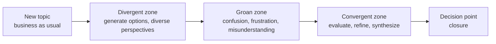
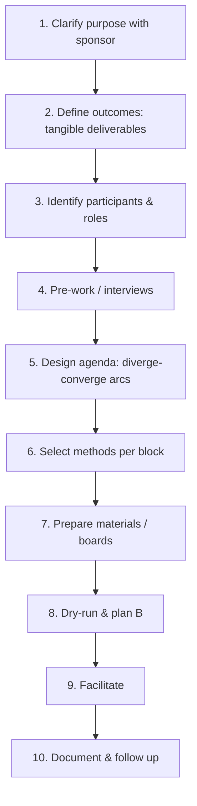

# Workshop Facilitation

> **TL;DR** — A facilitator owns the **process**, the group owns the **content**. Design every workshop backward from the desired outcome: purpose → outcomes → participants → agenda → methods. Expect the Diamond of Participatory Decision-Making: diverge, struggle through the groan zone, then converge. Use structured methods (Liberating Structures, Gamestorming) so every voice is heard, choose convergence tools deliberately (dot voting, Fist of Five), and handle difficult dynamics with neutral, process-based interventions. Remote workshops need more structure, shorter blocks, and prepared boards.

Related: [Facilitation methods catalog](facilitation-methods-catalog.md) · [Decision making](decision-making.md) · [Meetings](meetings-async-and-effectiveness.md) · [Retrospectives (Agile)](../04-agile-kanban-scrum/README.md) · [UX research & workshops](../01-ux-ui/README.md)

---

## 1. The facilitator's role and stance

**Facilitator** (from Latin *facilis*, "easy"): makes it easier for a group to achieve its outcome.

| Responsibility | Description |
|---|---|
| Design | Purpose, outcomes, agenda, methods, materials |
| Hold the space | Psychological safety, energy, inclusion, time |
| Guide the process | Instructions, transitions, timing, structure |
| Stay content-neutral | Don't steer toward your preferred answer |
| Ensure capture | Outputs documented & actionable |
| Read the room | Adapt when energy/understanding drops |
| Close the loop | Next steps, owners, follow-up |

### 1.1 Neutral facilitator vs facilitative leader

| | Neutral facilitator | Facilitative leader / tech lead facilitating own team |
|---|---|---|
| Content stake | None | Has opinions & authority |
| Risk | Little | Group defers to leader; facilitation seen as manipulation |
| Mitigation | — | State which hat you're wearing ("Now I'm speaking as a participant"); share your view last; consider an external facilitator for high-stakes topics; declare decision method upfront |

### 1.2 Facilitator stance (core values, after Roger Schwarz / Kaner)

- **Full participation** — everyone contributes.
- **Mutual understanding** — people understand each other's views.
- **Inclusive solutions** — integrate perspectives.
- **Shared responsibility** — group owns the outcome.
- Curiosity over judgement; transparency about process; trust the group.

### 1.3 Facilitator self-check before starting

- [ ] Do I know the purpose & decision method?
- [ ] Do I have a stake in the outcome? If so, have I disclosed it?
- [ ] Is the sponsor aligned on what is and isn't open for discussion?
- [ ] Do I have a plan B for each block?
- [ ] Am I ready to let go of my agenda if the group needs something else?

---

## 2. Diamond of Participatory Decision-Making (Sam Kaner)

From *Facilitator's Guide to Participatory Decision-Making* (Kaner et al.).



| Zone | What happens | Facilitator moves |
|---|---|---|
| **Business as usual** | Familiar opinions, quick fixes proposed | Ask "Do we want to decide now or explore more?" |
| **Divergent** | Brainstorm, suspend judgement, many ideas | Brainstorming rules, 1-2-4-All, Brainwriting, no evaluation |
| **Groan zone** | Different frames of reference collide; frustration; this is **normal and necessary** | Normalize it, active listening, paraphrase, "stack" speakers, look for shared understanding, take a break |
| **Convergent** | Categorize, evaluate, prioritize | Affinity mapping, criteria, dot voting, gradients of agreement |
| **Closure** | Decision made with known rule | Confirm decision, owners, next steps |

Key insight: groups that skip the groan zone produce shallow decisions; facilitators should **expect and support** it, not shut it down.

### Divergence vs convergence rules

| Divergent thinking | Convergent thinking |
|---|---|
| Defer judgement | Apply judgement |
| Go for quantity | Go for quality |
| Build on others' ideas ("yes, and") | Check against criteria |
| Wild ideas welcome | Summarize key points |
| Separate generating from evaluating | Make tough choices |

---

## 3. Workshop design process



### 3.1 Sponsor intake questions

- Why this workshop, why now? What happens if we don't do it?
- What does success look like at the end of the day? What will exist that doesn't now?
- Which decisions can the group make? Which are already made (non-negotiable constraints)?
- Who must be in the room? Who must not (and why)?
- What's the history — past attempts, conflicts, sensitivities?
- What role will you (sponsor) play in the session?
- How will outputs be used afterward?

### 3.2 Purpose — Outcomes — Process (POP)

| Element | Question | Example |
|---|---|---|
| **Purpose** | Why are we meeting? | Align on the target architecture for the order domain |
| **Outcomes** | What will we have at the end? | (1) Shared map of current pain points; (2) 2–3 candidate options; (3) agreed evaluation criteria; (4) owners for spikes |
| **Process** | How will we get there? | Agenda with methods and timing |

Write outcomes as **nouns** (deliverables), not verbs ("discuss" isn't an outcome).

### 3.3 Workshop planning template

```markdown
# Workshop plan: <title>
**Sponsor:**            **Facilitator(s):**          **Date / location / tool:**
**Purpose (1 sentence):**
**Desired outcomes:**
1.
2.
**Out of scope / constraints:**
**Decision method:** (consultative by X / consent / dot vote + sponsor decides)
**Participants (name, role, why needed, expected stance):**
**Pre-work:** (reading, survey, interviews)
**Materials:** (sticky notes, markers, Miro board link, timer, templates)
**Risks & mitigations:** (dominant voices, conflict, low energy, tech issues)

## Agenda
| Time | Duration | Block | Purpose | Method / instructions | Output | Who |
|---|---|---|---|---|---|---|
| 09:00 | 15 | Opening | Purpose, agenda, agreements | Check-in round | — | Facilitator |
| 09:15 | 30 | Explore pain points | Diverge | 1-2-4-All | Clustered pain list | All |
| 09:45 | 10 | Break | | | | |
| ... | | | | | | |
| 12:15 | 15 | Close | Next steps, check-out | Who/What/When + one-word check-out | Action list | All |

## Follow-up
- Report sent by: <date>     - Action review on: <date>
```

### 3.4 Agenda design principles

- **Start with why**, then outcomes and agenda — visible all the time.
- **Arc**: open (connect) → diverge (explore) → groan → converge (decide) → close (commit).
- Alternate individual, small group, and plenary work.
- Blocks of **45–90 min** in-person, **20–45 min** remote; breaks every 60–90 min in-person, every 45–60 remote.
- Hardest cognitive work after the opening, not after lunch.
- Plan **~20% buffer**; know which blocks to cut.
- Put decisions before the end, not in the last 5 minutes.
- End with clear actions: **who, what, when**.

### 3.5 Agenda for a 2-hour problem-solving workshop

| Time | Block | Method |
|---|---|---|
| 0:00–0:10 | Opening: purpose, outcomes, agreements, check-in | Check-in question |
| 0:10–0:30 | Understand the problem | Impromptu Networking or 1-2-4-All on "What makes this hard?" |
| 0:30–0:55 | Generate ideas | Brainwriting / 1-2-4-All / TRIZ |
| 0:55–1:05 | Break | |
| 1:05–1:25 | Cluster & clarify | Affinity mapping |
| 1:25–1:45 | Prioritize | Dot voting + impact/effort matrix |
| 1:45–1:55 | Commit to actions | 15% Solutions / Who-What-When |
| 1:55–2:00 | Check-out | One word / Fist of Five on confidence |

### 3.6 Opening and closing

**Opening components:** welcome & purpose; outcomes; agenda; roles (facilitator, timekeeper, scribe); decision method; working agreements (e.g., phones away, one conversation at a time, everyone participates, "parking lot" for off-topic items); check-in.

**Check-in questions**

- "In one word, how are you arriving?"
- "What would make today a success for you?"
- "What's one thing you hope we will NOT do today?"
- "Weather report: what's your current weather?"

**Closing components:** recap of outputs; decisions made; actions (who/what/when); parking lot triage; feedback on session (ROTI — Return on Time Invested 1–5); appreciation; check-out ("One word for how you leave").

---

## 4. Facilitation techniques (micro-skills)

| Technique | What | When |
|---|---|---|
| **Paraphrasing** | Repeat in own words to confirm | Unclear contributions, emotional moments |
| **Stacking** | Make a queue of speakers ("Ana, then Ben, then Chris") | Many want to speak |
| **Mirroring** | Repeat speaker's words verbatim | Build trust, speed up |
| **Drawing people out** | "Can you say more?", "What do you mean?" | Vague or partial contributions |
| **Encouraging** | "Who hasn't spoken yet?", "Any other perspective?" | Unequal participation |
| **Balancing** | "Are there other views?" | Apparent premature agreement |
| **Making space** | Directly invite quiet person (gently, with opt-out) | Quiet participants |
| **Tracking** | Name the parallel threads | Conversation fragments |
| **Summarizing** | Recap periodically | Transitions |
| **Parking lot** | Capture off-topic items visibly | Tangents |
| **Timeboxing** | Visible timer | Always |
| **Intentional silence** | Wait 5–10 s after asking | Encourages reflection |
| **Process check** | "Is this approach working for you?" | Energy dropping |

### 4.1 Giving instructions (clear and fast)

1. **What** we'll do and **why** (purpose).
2. **How**: steps, in order (show them visually).
3. **Who** works with whom.
4. **How long** (and how you'll signal time).
5. **Output** expected (format).
6. Check understanding: "What questions do you have?" (not "Any questions?").

Show the instructions on a slide/board during the activity.

---

## 5. Handling difficult dynamics

| Behavior | Possible underlying cause | Interventions (from lightest to strongest) |
|---|---|---|
| **Dominator** (talks a lot) | Expertise, anxiety, enthusiasm, status | Use structures (1-2-4-All, rounds, silent writing); "Let's hear from others first"; body language; talk at break; give them a role (timekeeper/scribe) |
| **Silent participant** | Introversion, low safety, language, hierarchy | Individual writing before discussion; small groups; anonymous input; direct gentle invitation with opt-out |
| **Cynic / naysayer** | Past failures, legitimate concern | Acknowledge; ask for specifics; channel into "risks" or TRIZ; "What would need to be true for this to work?" |
| **Side conversations** | Disengagement or relevant thoughts | "Would you like to share that with the group?"; check if agenda is still relevant |
| **Off-topic / rambler** | Unclear purpose | Refer to purpose & outcomes; parking lot; "How does this connect to X?" |
| **Senior person (HiPPO) steering** | Authority | Agree beforehand they speak last; anonymous voting; small groups without them |
| **Conflict between two participants** | Real disagreement, history | Acknowledge, separate positions from interests, paraphrase each, take offline if personal |
| **Late arrivals / leavers** | Overloaded calendars | Start on time; buddy recap; agreements upfront |
| **Multitasker (laptop)** | Low engagement / urgent work | Device agreement; make activities active; frequent breaks |
| **Know-it-all / lecturer** | Expertise | Thank and summarize; time limits; ask how others see it |
| **Joker** | Tension relief | Appreciate energy; redirect |

**General principles:** address the behavior, not the person; start with process-level interventions (structure), then group-level, then private; use breaks for 1:1 conversations; never shame publicly.

---

## 6. Energizers and connection activities

Use sparingly; match the culture. Offer opt-out.

| Energizer | Duration | Format | Description |
|---|---|---|---|
| Check-in round | 5 min | Any | One question, everyone answers briefly |
| Two truths and a lie | 10 min | Any | Guess which statement is false |
| Desert island | 5 min | Any | "One tool/book you'd bring" |
| Stand up if… | 3 min | In-person/video | Stand (or camera wave) if a statement applies |
| Show and tell | 10 min | Remote | Show an object within reach |
| Rock-paper-scissors tournament | 5 min | In-person | Losers become cheerleaders of winner |
| Count to 20 | 5 min | In-person | Group counts, one at a time, restart on collision |
| Draw your partner | 5 min | Any | Draw without looking at paper |
| Personal maps | 15 min | Any | Mind map of self (Management 3.0) |
| Walk & talk | 15 min | In-person | Pairs walk while discussing a question |
| Quick poll | 2 min | Remote | Poll on something light |

---

## 7. Remote and hybrid facilitation

### 7.1 Principles

- **Prepare more**, talk less: boards and templates ready before the session.
- **Shorter sessions** (max ~3h/day, broken into blocks); split long workshops across days.
- **Cameras on** encouraged (not forced); name norms explicitly.
- **Co-facilitator / producer** handles tech, breakout rooms, chat.
- Use chat, reactions, polls for fast participation ("waterfall chat": everyone types and waits, then all press enter together).
- **Hybrid**: "one remote, all remote" — everyone joins from own laptop to avoid two-class meetings, or assign an in-room advocate for remote participants.

### 7.2 Miro / Mural tips

- One board per workshop; frames per agenda block; a "start here" frame with agenda and instructions.
- Lock background/template elements to prevent accidental moves.
- Pre-create named areas per participant/group ("Ana's sticky area").
- Color-code stickies by participant group or category; agree on colors upfront.
- Use built-in **timer**, **voting** session, and **"bring everyone to me"/follow** features.
- Hide/reveal frames to control pacing (or use presentation mode).
- Provide a 5-minute board warm-up (add sticky, move it, vote) before real work.
- Use templates (retro, impact/effort, story map, Lean Canvas) as starting points.
- Export outputs immediately after (PDF/CSV) and share.
- Mind accessibility: font size, contrast, keyboard alternatives, read aloud key content.

### 7.3 Remote breakout rooms

- Groups of 3–5; assign roles (timekeeper, scribe, reporter).
- Instructions in writing in the room/board.
- Broadcast time warnings.
- Pre-assign rooms when group composition matters.

### 7.4 Remote workshop tech checklist

- [ ] Video tool, breakout rooms tested
- [ ] Board access for all (guest rights, no sign-up friction)
- [ ] Backup channel if tool fails
- [ ] Participants sent link + 1-min tool primer in advance
- [ ] Timer visible
- [ ] Recording consent if recording

---

## 8. Convergence and voting tools

| Tool | How | Pros | Cons / tips |
|---|---|---|---|
| **Dot voting** (dotmocracy) | Each gets N dots (≈ options/3); place on preferred options | Fast, visual | Bandwagon effect — vote silently/simultaneously; define criterion ("most impact") |
| **Weighted dots** | Different colors = different criteria | Multi-criteria | More complex |
| **Fist of Five** | 0–5 fingers to show support | Quick consensus check | Discuss low votes; social pressure — consider anonymous |
| **Thumbs up/sideways/down** | Roman vote | Very fast | Coarse |
| **Gradients of agreement** | 8-point scale | Nuanced | Takes explanation |
| **Impact/effort matrix** | Place options on 2×2 | Visual trade-offs | Subjective; calibrate together |
| **MoSCoW** | Must/Should/Could/Won't | Scope prioritization | Everything becomes "Must" |
| **Buy a feature** | Participants get fake money to buy items | Reveals priorities, negotiation | Prep needed |
| **Forced ranking** | Order all items | Clear | Hard with many items |
| **Consent round** | Any objections? | See [decision making](decision-making.md#31-consent-vs-consensus) | — |
| **25/10 Crowd Sourcing** | Liberating Structure: rate ideas by passing cards | Surfaces strongest ideas fast | In-person energy |

**Affinity mapping (clustering):** silently group stickies by similarity → name each cluster with a headline phrase → discuss clusters, not individual notes.

---

## 9. Documentation and follow-up

- Photograph walls / export boards before leaving.
- Send a **summary within 24–48 h**: purpose, outcomes, decisions, actions (who/what/when), parking lot, raw outputs link.
- Schedule action-review check-in.
- Gather feedback on the session (ROTI, +/Δ) and improve your design.

**Summary template**

```markdown
# <Workshop> — Summary (<date>)
**Purpose:** …
**Participants:** …
## Decisions
1. … (decided by … using …)
## Key insights
- …
## Actions
| What | Who | When |
## Parking lot
- … (owner to follow up)
## Raw outputs: <board link>
## Session feedback: ROTI avg 4.1/5; +: … Δ: …
```

---

## 10. Workshop formats quick reference

| Goal | Format / method | See |
|---|---|---|
| Kick off a team | Team charter, personal maps, working agreements | [Team dynamics](team-dynamics-culture.md) |
| Understand a domain | Event Storming | [Catalog](facilitation-methods-catalog.md#event-storming) |
| Define product scope / MVP | Story mapping, Impact mapping | [Catalog](facilitation-methods-catalog.md) |
| Validate an idea in a week | Design Sprint | [Catalog](facilitation-methods-catalog.md#design-sprint) |
| Explore strategy with many people | Open Space, World Café | [Catalog](facilitation-methods-catalog.md) |
| Improve as a team | Retrospective | [Agile section](../04-agile-kanban-scrum/README.md) |
| Discuss many small topics | Lean Coffee | [Catalog](facilitation-methods-catalog.md#lean-coffee) |
| Decide among options | Decision matrix, consent | [Decision making](decision-making.md) |
| Reduce counterproductive habits | TRIZ, Ecocycle | [Catalog](facilitation-methods-catalog.md) |
| Clarify decision rights | Delegation poker | [Motivation & leadership](motivation-and-leadership.md#3-delegation) |
| Map stakeholders | Stakeholder grid | [Communication](communication-and-stakeholders.md#6-stakeholder-mapping-and-management) |

---

## 11. When to facilitate (vs other formats)

| Use a facilitated workshop when | Use something else when |
|---|---|
| Problem needs diverse knowledge | One expert can decide → consult them |
| Buy-in matters for execution | Pure information sharing → write a doc / async |
| Cross-team alignment needed | Decision already made → communicate honestly, don't pretend to co-create |
| Complex (Cynefin) problems | Simple status → async update |

---

## 12. Common mistakes

- Agenda without outcomes ("discuss architecture").
- Pseudo-participation: decision already made, workshop for show.
- Too many activities; no time to converge.
- Facilitator shares opinions while facilitating, without declaring it.
- Mixing generating and evaluating ideas.
- Open discussion with 15 people instead of structures — 3 people talk.
- Ending without owners and dates.
- No follow-up summary → workshop fatigue ("nothing ever happens").
- Remote workshop designed like an in-person one (8 hours, long plenaries).
- Skipping the groan zone by forcing early votes.

---

## References

- Liberating Structures: https://www.liberatingstructures.com/
- Gamestorming: https://gamestorming.com/
- Facilitation (business): https://en.wikipedia.org/wiki/Facilitation_(business)
- Sam Kaner — *Facilitator's Guide to Participatory Decision-Making* (Jossey-Bass/Wiley)
- Affinity diagram: https://en.wikipedia.org/wiki/Affinity_diagram
- Dot-voting: https://en.wikipedia.org/wiki/Dot-voting
- MoSCoW method: https://en.wikipedia.org/wiki/MoSCoW_method
- Brainstorming: https://en.wikipedia.org/wiki/Brainstorming
- Session Lab (agenda planner & method library): https://www.sessionlab.com/
- Miro: https://miro.com/ · Mural: https://www.mural.co/
- International Association of Facilitators: https://www.iaf-world.org/
- Books: *Facilitator's Guide to Participatory Decision-Making* (Kaner), *The Skilled Facilitator* (Schwarz), *Gamestorming* (Gray, Brown, Macanufo), *The Surprising Power of Liberating Structures* (Lipmanowicz & McCandless), *The Art of Gathering* (Priya Parker), *Collaboration Explained* (Jean Tabaka)
