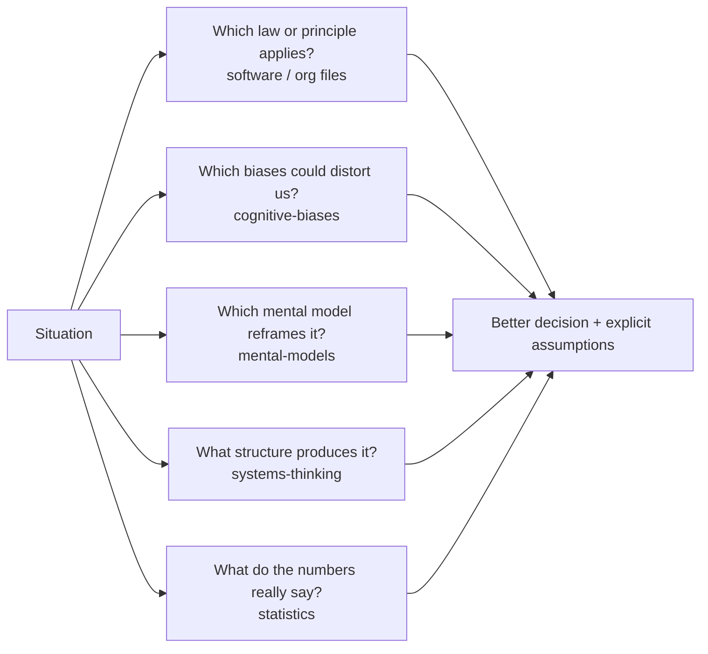

# 10 — Laws, Principles and Mental Models

> **TL;DR** — The cross-cutting cheat sheet of this knowledgebase: ~470 eponymous laws, design principles, cognitive biases, mental models, systems and safety concepts, statistics pitfalls, quality/Lean ideas and economic models, each with statement, origin, practical meaning, example and link. Use it to name a pattern you are seeing, to challenge a plan, or to find the right question to ask. Treat every "law" as a heuristic with known exceptions, not as physics.

## Files in this section

| File | Covers | Typical use |
|---|---|---|
| [software-and-engineering-laws.md](software-and-engineering-laws.md) | Amdahl, Gustafson, Little, Kingman, CAP/PACELC, fallacies of distributed computing, Postel, Hyrum, Spolsky, Gall, Brooks, Hofstadter, ninety-ninety, Murphy, Kernighan, Greenspun, Zawinski, Tesler, Linus, Lehman's 8 laws, SOLID, DRY/KISS/YAGNI, Demeter, Unix philosophy, Zen of Python, security principles, Moore/Wirth/Koomey, Hick/Fitts/Miller/Jakob | Design reviews, performance and scaling, code review, estimation sanity checks |
| [organizational-and-management-laws.md](organizational-and-management-laws.md) | Conway and inverse Conway, Dunbar, Ringelmann, Parkinson, bike-shedding, Peter, Dilbert, Putt, Shirky, Goodhart, Campbell, Cobra effect, Price, Joy, Humphrey, Ziv, Chesterton, Cunningham, Brandolini, Wiio, Sturgeon, team and motivation research | Org design, metrics design, team health, stakeholder communication |
| [cognitive-biases.md](cognitive-biases.md) | ~70 biases (planning fallacy, anchoring, confirmation, sunk cost, survivorship, hindsight, Dunning–Kruger with caveats, automation bias...) plus debiasing techniques | Estimation, decisions, postmortems, hiring, AI-assisted work |
| [mental-models.md](mental-models.md) | First principles, second-order thinking, inversion, razors, Bayesian updating, margin of safety, antifragility, Lindy, ergodicity, OODA, Cynefin, Stacey, Wardley, game theory, McNamara fallacy, steelmanning | Strategy, ambiguous problems, debate and decision quality |
| [systems-thinking-and-complexity.md](systems-thinking-and-complexity.md) | Stocks and flows, feedback loops, Meadows' 12 leverage points, archetypes, Ashby, POSIWID, emergence, Braess, normal accidents, Swiss cheese, Cook's 18 points, resilience engineering, Safety-I/II, drift, cascading and metastable failures | Incident analysis, reliability strategy, change programmes |
| [statistics-for-engineers.md](statistics-for-engineers.md) | Mean/median/percentiles, tail latency, distributions, confidence intervals, p-values, power, Simpson, Berkson, regression to the mean, Benford, Zipf, Anscombe, Monte Carlo | SLOs, dashboards, A/B tests, forecasting |
| [quality-and-lean-thinkers.md](quality-and-lean-thinkers.md) | Shewhart, Deming (14 points, PDSA, SoPK), Juran, Crosby, Ishikawa, Taguchi, Ohno, Shingo, TPS, Goldratt's ToC, Lean software, Taylorism vs Deming | Process improvement, flow, Kanban, DevOps transformation |
| [economics-and-strategy-models.md](economics-and-strategy-models.md) | Opportunity/sunk/marginal cost, Cost of Delay, WSJF, Coase and make-vs-buy, Porter, Jevons, Baumol, Metcalfe/Reed/Sarnoff/Odlyzko, lock-in, information asymmetry, disruption, diffusion | Prioritisation, build vs buy, platform strategy, business cases |
| [a-z-index.md](a-z-index.md) | Alphabetical index of every entry with deep links | Look-up |
| [resources.md](resources.md) | Books, sites and seminal papers by theme | Further study |

## How to use this section

1. **Look up a name** you heard in a meeting: [a-z-index.md](a-z-index.md).
2. **Diagnose a situation** with the quick-pick table below, then read the linked entries.
3. **Run a decision through several lenses**: one law, one bias check, one mental model, one systems view. Disagreement between lenses is where insight lives.
4. **Quote responsibly**: entries note where findings are contested (Dunning–Kruger, Hawthorne, loss aversion magnitude, Dunbar's number, the cobra anecdote, the Drucker misattribution).

## Quick-pick: situation → entries

| Situation | Start with |
|---|---|
| Project is late; someone proposes adding people | [Brooks's law](software-and-engineering-laws.md#brookss-law), [Little's law](software-and-engineering-laws.md#littles-law), [Theory of Constraints](quality-and-lean-thinkers.md#theory-of-constraints), [Sunk cost fallacy](cognitive-biases.md#sunk-cost-fallacy) |
| Estimating a new initiative | [Planning fallacy](cognitive-biases.md#planning-fallacy), [Reference class forecasting](cognitive-biases.md#reference-class-forecasting), [Hofstadter's law](software-and-engineering-laws.md#hofstadters-law), [Monte Carlo simulation](statistics-for-engineers.md#monte-carlo-simulation) |
| Designing team structure | [Conway's law](organizational-and-management-laws.md#conways-law), [Inverse Conway maneuver](organizational-and-management-laws.md#inverse-conway-maneuver), [Team cognitive load](organizational-and-management-laws.md#team-cognitive-load), [Dunbar's number](organizational-and-management-laws.md#dunbars-number) |
| Introducing a KPI or target | [Goodhart's law](organizational-and-management-laws.md#goodharts-law), [Campbell's law](organizational-and-management-laws.md#campbells-law), [McNamara fallacy](mental-models.md#mcnamara-fallacy), [Deming's 14 points](quality-and-lean-thinkers.md#demings-14-points-for-management) |
| Postmortem after an incident | [How complex systems fail](systems-thinking-and-complexity.md#how-complex-systems-fail), [Hindsight bias](cognitive-biases.md#hindsight-bias), [Swiss cheese model](systems-thinking-and-complexity.md#swiss-cheese-model), [Just culture](systems-thinking-and-complexity.md#just-culture) |
| Choosing between build and buy | [Transaction cost economics](economics-and-strategy-models.md#transaction-cost-economics-coase), [Wardley mapping](mental-models.md#wardley-mapping), [Not invented here](cognitive-biases.md#not-invented-here), [Total cost of ownership](economics-and-strategy-models.md#total-cost-of-ownership) |
| Rewrite or big re-platforming | [Gall's law](software-and-engineering-laws.md#galls-law), [Second-system effect](software-and-engineering-laws.md#second-system-effect), [Chesterton's fence](organizational-and-management-laws.md#chestertons-fence), [Lindy effect](mental-models.md#lindy-effect) |
| Changing a public API | [Hyrum's law](software-and-engineering-laws.md#hyrums-law), [Postel's law](software-and-engineering-laws.md#postels-law), [One-way and two-way doors](mental-models.md#one-way-and-two-way-doors) |
| Scaling a system | [Amdahl's law](software-and-engineering-laws.md#amdahls-law), [Universal Scalability Law](software-and-engineering-laws.md#universal-scalability-law), [Kingman's formula](software-and-engineering-laws.md#kingmans-formula), [Tail latency amplification](statistics-for-engineers.md#tail-latency-amplification) |
| Reading a dashboard or A/B result | [Percentiles](statistics-for-engineers.md#percentiles-p50-p95-p99), [Simpson's paradox](statistics-for-engineers.md#simpsons-paradox), [Regression toward the mean](statistics-for-engineers.md#regression-toward-the-mean), [Control chart](quality-and-lean-thinkers.md#control-chart) |
| Uncertain, novel problem | [Cynefin framework](mental-models.md#cynefin-framework), [OODA loop](mental-models.md#ooda-loop), [PDSA cycle](quality-and-lean-thinkers.md#pdsa-cycle), [Optionality and real options](mental-models.md#optionality-and-real-options) |
| Endless debate on a trivial topic | [Law of triviality](organizational-and-management-laws.md#law-of-triviality-bike-shedding), [Sayre's law](organizational-and-management-laws.md#sayres-law), [Satisficing vs maximising](mental-models.md#satisficing-vs-maximising) |
| Prioritising a backlog | [Cost of Delay](economics-and-strategy-models.md#cost-of-delay), [CD3 and WSJF](economics-and-strategy-models.md#cd3-and-wsjf), [Opportunity cost](economics-and-strategy-models.md#opportunity-cost), [Pareto principle](mental-models.md#pareto-principle) |
| Adopting AI tooling | [Automation bias](cognitive-biases.md#automation-bias), [Jevons paradox](economics-and-strategy-models.md#jevons-paradox), [Law of leaky abstractions](software-and-engineering-laws.md#law-of-leaky-abstractions), [Gartner hype cycle](economics-and-strategy-models.md#gartner-hype-cycle) |

## Related sections
- [../01-ux-ui/README.md](../01-ux-ui/README.md) — UX laws in depth (Hick, Fitts, Jakob, Tesler, peak–end)
- [../02-product-management/README.md](../02-product-management/README.md) — prioritisation, Kano, discovery
- [../03-project-management/README.md](../03-project-management/README.md) — estimation, critical chain, risk
- [../04-agile-kanban-scrum/README.md](../04-agile-kanban-scrum/README.md) — Little's law, WIP, flow metrics
- [../05-software-architecture/README.md](../05-software-architecture/README.md) — Conway, coupling, CAP, design principles
- [../06-cloud-architecture/README.md](../06-cloud-architecture/README.md) — distributed-systems fallacies, resilience, cost
- [../07-data-ai-architecture/README.md](../07-data-ai-architecture/README.md) — statistics, automation bias
- [../08-engineering/README.md](../08-engineering/README.md) — craft principles, SRE, postmortems
- [../09-leadership-teams-facilitation/README.md](../09-leadership-teams-facilitation/README.md) — teams, motivation, psychological safety
- [../11-enterprise-architecture-business/README.md](../11-enterprise-architecture-business/README.md) — Porter, Wardley, strategy

## References
- dwmkerr, *Hacker Laws* — https://github.com/dwmkerr/hacker-laws
- Farnam Street, Mental Models — https://fs.blog/mental-models/
- Laws of UX — https://lawsofux.com/
- The Decision Lab — https://thedecisionlab.com/biases
- The Deming Institute — https://deming.org/
- How Complex Systems Fail — https://how.complexsystems.fail/
- Full reading list: [resources.md](resources.md)
