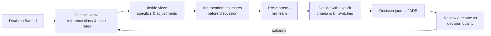

# Cognitive Biases

> **TL;DR** — Systematic errors in judgement that affect estimation, architecture decisions, prioritisation, hiring, incident analysis and stakeholder management. You cannot "know your way out" of biases (bias blind spot); you counter them with *process*: reference classes, pre-mortems, independent estimates, red teams, checklists and decision journals. Several famous findings (Dunning–Kruger, ego depletion, power posing, some priming) have weakened under replication — caveats are noted below.

Entry format: **Statement** / **Origin** / **In practice** / **Example** / **Link**. Further catalogue: https://thedecisionlab.com/biases and https://en.wikipedia.org/wiki/List_of_cognitive_biases.

Contents:
1. [Foundations: two systems and heuristics](#foundations-two-systems-and-heuristics)
2. [Estimation and planning biases](#estimation-and-planning-biases)
3. [Belief and evidence biases](#belief-and-evidence-biases)
4. [Decision and commitment biases](#decision-and-commitment-biases)
5. [Social and group biases](#social-and-group-biases)
6. [Judging people and outcomes](#judging-people-and-outcomes)
7. [More biases (quick table)](#more-biases-quick-table)
8. [Debiasing techniques](#debiasing-techniques)

---

## Foundations: two systems and heuristics

### System 1 and System 2
- **Statement:** Thinking runs in two modes: System 1 is fast, automatic, intuitive and effortless; System 2 is slow, deliberate, effortful and lazy. Most biases come from System 1 answers System 2 fails to check.
- **Origin:** Dual-process theory (Stanovich & West, 2000); popularised by Daniel Kahneman, *Thinking, Fast and Slow*, 2011.
- **In practice:** Important decisions (architecture, hiring, pricing) need structured System 2 processes; routine ones can rely on trained intuition in "kind" environments with fast feedback.
- **Example:** The bat-and-ball problem: the intuitive answer (10 cents) is wrong (5 cents).
- **Link:** https://en.wikipedia.org/wiki/Dual_process_theory

### WYSIATI
- **Statement:** "What you see is all there is" — System 1 builds the most coherent story from available information and ignores what is missing.
- **Origin:** Daniel Kahneman, *Thinking, Fast and Slow*, 2011.
- **In practice:** Explicitly ask "what information would change my mind, and do I have it?" Confidence reflects story coherence, not evidence quality.
- **Example:** A vendor demo looks perfect; nobody asks about data migration, SLAs or exit costs.
- **Link:** https://en.wikipedia.org/wiki/Thinking,_Fast_and_Slow

### Heuristics and biases programme
- **Statement:** People use mental shortcuts (representativeness, availability, anchoring) which are generally useful but cause predictable errors.
- **Origin:** Amos Tversky and Daniel Kahneman, "Judgment under Uncertainty: Heuristics and Biases", *Science*, 1974. Counterpoint: Gerd Gigerenzer's "fast and frugal heuristics" emphasising ecological rationality.
- **In practice:** Heuristics are not bad per se; they fail in unfamiliar, noisy or adversarial environments.
- **Example:** Estimating a project's duration by how similar it "feels" to a memorable past project.
- **Link:** https://en.wikipedia.org/wiki/Heuristics_in_judgment_and_decision-making

### Representativeness heuristic
- **Statement:** Judging probability by how much something resembles a prototype, ignoring base rates and sample size.
- **Origin:** Kahneman & Tversky, 1972.
- **In practice:** "This startup looks like early Stripe" ignores that most startups fail. Ask for the base rate first.
- **Example:** Assuming a candidate who "looks like a senior engineer" is one.
- **Link:** https://en.wikipedia.org/wiki/Representativeness_heuristic

### Availability heuristic
- **Statement:** Judging frequency or probability by how easily examples come to mind.
- **Origin:** Tversky & Kahneman, 1973.
- **In practice:** The last outage dominates risk discussions; vivid security breaches outweigh mundane but frequent config errors. Use incident data, not memory.
- **Example:** After a database outage, the team over-invests in DB redundancy while most incidents are bad deploys.
- **Link:** https://en.wikipedia.org/wiki/Availability_heuristic

### Affect heuristic
- **Statement:** Current emotion (liking/disliking) drives judgements of risk and benefit — liked things seem low-risk and high-benefit.
- **Origin:** Paul Slovic et al., 2000s; Finucane et al., 2000.
- **In practice:** Teams underestimate risks of technologies they love and overestimate risks of those they dislike. Separate the evaluation of risk and benefit.
- **Example:** A favourite language is chosen despite poor hiring market.
- **Link:** https://en.wikipedia.org/wiki/Affect_heuristic

### Attribute substitution
- **Statement:** When faced with a hard question, people unconsciously answer an easier related one.
- **Origin:** Kahneman & Frederick, 2002.
- **In practice:** "Will this architecture scale?" becomes "Does it look like what Netflix uses?". Write the actual question down.
- **Example:** "Is this candidate good?" replaced by "Did I enjoy the interview?"
- **Link:** https://en.wikipedia.org/wiki/Attribute_substitution

---

## Estimation and planning biases

### Planning fallacy
- **Statement:** People underestimate time, cost and risk of future actions and overestimate benefits, even knowing similar past tasks overran.
- **Origin:** Kahneman & Tversky, 1979; Buehler, Griffin & Ross, 1994. Bent Flyvbjerg's megaproject data (cost overruns in ~9/10 projects).
- **In practice:** Use reference class forecasting, throughput-based Monte Carlo forecasts and ranges (p50/p85) instead of single-point estimates. See [../03-project-management/README.md](../03-project-management/README.md).
- **Example:** Every migration is estimated at "three sprints" and takes three quarters.
- **Link:** https://en.wikipedia.org/wiki/Planning_fallacy

### Anchoring
- **Statement:** Initial numbers (even irrelevant ones) bias subsequent estimates towards them.
- **Origin:** Tversky & Kahneman, 1974 (wheel-of-fortune experiment).
- **In practice:** Whoever speaks first anchors estimation sessions; use simultaneous reveal (Planning Poker), independent estimates, and avoid stating "the client expects 3 months" before estimating.
- **Example:** A manager asks "this is about two weeks, right?" and estimates cluster around two weeks.
- **Link:** https://en.wikipedia.org/wiki/Anchoring_effect

### Optimism bias
- **Statement:** People believe they are less likely than others to experience negative events.
- **Origin:** Neil Weinstein, 1980; Tali Sharot, 2011.
- **In practice:** "Our migration won't hit the problems others had." Counter with pre-mortems and explicit risk registers.
- **Example:** Skipping a rollback plan because "it's a small change".
- **Link:** https://en.wikipedia.org/wiki/Optimism_bias

### Overconfidence effect
- **Statement:** Subjective confidence in judgements exceeds their objective accuracy, especially for hard questions.
- **Origin:** Lichtenstein, Fischhoff & Phillips, 1977–1982; calibration studies.
- **In practice:** 90% confidence intervals in estimates contain the true value far less than 90% of the time. Train calibration and widen ranges.
- **Example:** "I'm sure it's a DNS issue" — it wasn't.
- **Link:** https://en.wikipedia.org/wiki/Overconfidence_effect

### Illusion of control
- **Statement:** Overestimating one's ability to control events, especially chance-determined ones.
- **Origin:** Ellen Langer, 1975.
- **In practice:** Detailed Gantt charts create a feeling of control over inherently uncertain work. Plan for variance; track flow metrics.
- **Example:** Believing a launch date can be "held" by working harder despite external dependencies.
- **Link:** https://en.wikipedia.org/wiki/Illusion_of_control

### Student syndrome
- **Statement:** People start tasks at the last possible moment before a deadline, consuming any safety margin.
- **Origin:** Eliyahu Goldratt, *Critical Chain*, 1997.
- **In practice:** Pair with Parkinson's law: remove padding from individual tasks and aggregate it into a shared project buffer.
- **Example:** Work on a two-week task starts on day 9.
- **Link:** https://en.wikipedia.org/wiki/Student_syndrome

### Dunning–Kruger effect
- **Statement:** People with low ability in a domain tend to overestimate their ability; high performers slightly underestimate theirs.
- **Origin:** David Dunning and Justin Kruger, 1999. **Caveats:** a substantial part of the pattern can be produced by regression to the mean and the better-than-average effect (e.g., Nuhfer et al., 2016–17; Gignac & Zajenkowski, 2020). The popular "Mount Stupid" curve is not from the paper.
- **In practice:** Novices need structured feedback to calibrate; don't use the label to dismiss people in debates. Calibration via data (tests, reviews) helps everyone.
- **Example:** A junior estimates a distributed-locking feature at one day.
- **Link:** https://en.wikipedia.org/wiki/Dunning%E2%80%93Kruger_effect

### Base-rate neglect
- **Statement:** Ignoring general prevalence information in favour of specific case information.
- **Origin:** Kahneman & Tversky, 1973 (lawyer–engineer problem); Maya Bar-Hillel, 1980.
- **In practice:** An alert with 99% accuracy for an event occurring 0.1% of the time produces mostly false positives. Always ask "what's the base rate?" See [statistics-for-engineers.md](statistics-for-engineers.md).
- **Example:** A fraud model flags 1,000 transactions; only 90 are fraud.
- **Link:** https://en.wikipedia.org/wiki/Base_rate_fallacy

### Conjunction fallacy
- **Statement:** Judging a specific conjunction of conditions as more probable than a single general one.
- **Origin:** Tversky & Kahneman, 1983 ("Linda problem").
- **In practice:** Detailed scenarios feel more plausible but are less probable; each added "and" in a plan multiplies risk.
- **Example:** A roadmap that requires five independent things to go right.
- **Link:** https://en.wikipedia.org/wiki/Conjunction_fallacy

---

## Belief and evidence biases

### Confirmation bias
- **Statement:** Tendency to search for, interpret and recall information that confirms prior beliefs.
- **Origin:** Peter Wason, 2-4-6 task, 1960; Raymond Nickerson's review, 1998.
- **In practice:** During debugging and incident analysis we test only the favourite hypothesis. Write down disconfirming tests; ask "what would prove me wrong?"
- **Example:** An A/B test result is scrutinised only when it contradicts the PM's expectation.
- **Link:** https://en.wikipedia.org/wiki/Confirmation_bias

### Survivorship bias
- **Statement:** Drawing conclusions from cases that passed a selection process while overlooking those that did not.
- **Origin:** Abraham Wald, Statistical Research Group, WWII aircraft armour analysis (1943).
- **In practice:** "Successful companies use microservices" ignores failed ones that did too. Check the denominator; look at failures, churned users, abandoned funnels.
- **Example:** Surveying current users about pricing misses everyone who left because of pricing.
- **Link:** https://en.wikipedia.org/wiki/Survivorship_bias

### Hindsight bias
- **Statement:** After an outcome is known, people see it as having been predictable ("I knew it all along").
- **Origin:** Baruch Fischhoff, 1975.
- **In practice:** Corrupts postmortems — operators are judged by information they did not have. Reconstruct what was known at the time (Cook, Dekker).
- **Example:** "They should obviously have seen that the disk was filling up."
- **Link:** https://en.wikipedia.org/wiki/Hindsight_bias

### Narrative fallacy
- **Statement:** Our tendency to construct simple causal stories from sequences of facts, overestimating understanding and predictability.
- **Origin:** Nassim Nicholas Taleb, *The Black Swan*, 2007.
- **In practice:** Success stories and root-cause narratives oversimplify; prefer base rates and "contributing factors" over single root causes.
- **Example:** "The company succeeded because the CEO wears turtlenecks."
- **Link:** https://en.wikipedia.org/wiki/The_Black_Swan:_The_Impact_of_the_Highly_Improbable

### Semmelweis reflex
- **Statement:** Reflex-like rejection of new evidence that contradicts established norms or paradigms.
- **Origin:** Ignaz Semmelweis's handwashing findings (1847) were rejected; term coined by Robert Anton Wilson.
- **In practice:** Data contradicting "how we've always done it" (e.g., that code review isn't catching bugs) is dismissed. Create channels where contrary data is welcomed.
- **Example:** Performance data showing the cache makes things slower is discarded as a measurement error.
- **Link:** https://en.wikipedia.org/wiki/Semmelweis_reflex

### Belief perseverance
- **Statement:** Maintaining a belief even after the evidence for it has been discredited.
- **Origin:** Ross, Lepper & Hubbard, 1975.
- **In practice:** Initial impressions of a technology or person linger after being disproven; explicitly revisit decisions with new evidence (ADR reviews).
- **Example:** A library still considered "buggy" years after the issues were fixed.
- **Link:** https://en.wikipedia.org/wiki/Belief_perseverance

### Illusory correlation
- **Statement:** Perceiving a relationship between variables when none exists.
- **Origin:** Loren Chapman, 1967.
- **In practice:** "Deploys on Friday cause incidents" — check data before rules. See correlation vs causation in [statistics-for-engineers.md](statistics-for-engineers.md).
- **Example:** Associating a teammate with outages because they were on call during two memorable ones.
- **Link:** https://en.wikipedia.org/wiki/Illusory_correlation

### Clustering illusion
- **Statement:** Seeing patterns in random data (streaks, clusters).
- **Origin:** Gilovich, 1991.
- **In practice:** Random error spikes look like trends on dashboards; use control charts to separate common from special causes.
- **Example:** Three failures in a row prompt a rewrite of a component with a 2% failure rate.
- **Link:** https://en.wikipedia.org/wiki/Clustering_illusion

### Gambler's fallacy
- **Statement:** Believing that past independent random events change future probabilities ("it's due").
- **Origin:** Documented by Laplace, 1796; Tversky & Kahneman, 1971.
- **In practice:** "We haven't had an outage in months, one is due" — or "we just had one so we're safe". Independent failures don't schedule themselves.
- **Example:** Skipping a test run because the last 20 passed.
- **Link:** https://en.wikipedia.org/wiki/Gambler%27s_fallacy

### Automation bias
- **Statement:** Over-reliance on automated aids and decision support, ignoring contradictory information or failing to notice when automation errs.
- **Origin:** Kathleen Mosier and Linda Skitka, 1990s (aviation).
- **In practice:** Highly relevant to AI assistants, autopilot-like ops tooling and green CI pipelines. Design human-in-the-loop checks that require active verification. See [../07-data-ai-architecture/README.md](../07-data-ai-architecture/README.md).
- **Example:** Accepting AI-generated code that calls a non-existent API because the IDE suggested it.
- **Link:** https://en.wikipedia.org/wiki/Automation_bias

---

## Decision and commitment biases

### Sunk cost fallacy
- **Statement:** Continuing an endeavour because of previously invested resources rather than future value.
- **Origin:** Hal Arkes and Catherine Blumer, 1985; the economic concept of sunk cost is older.
- **In practice:** Evaluate projects on remaining cost vs remaining value only. Stage-gate funding and kill criteria defined upfront help.
- **Example:** "We've spent 18 months on the in-house platform; we can't switch now."
- **Link:** https://en.wikipedia.org/wiki/Sunk_cost

### Escalation of commitment
- **Statement:** Increasing investment in a failing course of action to justify prior decisions.
- **Origin:** Barry Staw, "Knee-deep in the Big Muddy", 1976.
- **In practice:** Rotate decision-makers for continuation reviews; separate those who started a project from those who evaluate it.
- **Example:** Doubling the team on a failing rewrite rather than stopping it.
- **Link:** https://en.wikipedia.org/wiki/Escalation_of_commitment

### Loss aversion
- **Statement:** Losses loom larger than equivalent gains (often cited ~2×).
- **Origin:** Kahneman & Tversky, prospect theory, 1979. Magnitude and generality are debated (e.g., Gal & Rucker, 2018).
- **In practice:** Framing a migration as "avoiding losing customers" moves stakeholders more than "gaining efficiency". Users resist losing features more than they value new ones.
- **Example:** Removing a little-used feature triggers louder complaints than any launch generated praise.
- **Link:** https://en.wikipedia.org/wiki/Loss_aversion

### Prospect theory
- **Statement:** People evaluate outcomes relative to a reference point, are loss-averse, risk-averse for gains and risk-seeking for losses, and overweight small probabilities.
- **Origin:** Kahneman & Tversky, 1979; cumulative version 1992. Kahneman's Nobel prize, 2002.
- **In practice:** Explains why behind-schedule projects take wild gambles (risk-seeking in losses) and why insurance and SLAs sell.
- **Example:** A late team skips testing to "catch up".
- **Link:** https://en.wikipedia.org/wiki/Prospect_theory

### Status quo bias
- **Statement:** Preference for the current state of affairs; change is perceived as loss.
- **Origin:** William Samuelson and Richard Zeckhauser, 1988.
- **In practice:** Legacy choices persist by default. Apply the "reversal test": if we didn't have it today, would we adopt it?
- **Example:** Keeping a deprecated CI system because migration "isn't urgent".
- **Link:** https://en.wikipedia.org/wiki/Status_quo_bias

### Default effect
- **Statement:** People disproportionately stick with the pre-selected option.
- **Origin:** Johnson & Goldstein, organ donation study, 2003.
- **In practice:** Defaults are the most powerful design lever: secure defaults, golden paths in platforms, sensible configs. See [../01-ux-ui/README.md](../01-ux-ui/README.md).
- **Example:** A paved-road template used by 90% of new services because it is the default.
- **Link:** https://en.wikipedia.org/wiki/Default_effect

### Endowment effect
- **Statement:** People value things more highly simply because they own them.
- **Origin:** Richard Thaler, 1980; Kahneman, Knetsch & Thaler (mug experiments), 1990.
- **In practice:** Teams overvalue their own systems in consolidation decisions; use neutral evaluators and criteria.
- **Example:** Each team in a merger insists their CI tool is superior.
- **Link:** https://en.wikipedia.org/wiki/Endowment_effect

### IKEA effect
- **Statement:** People place disproportionately high value on things they partially created.
- **Origin:** Michael Norton, Daniel Mochon and Dan Ariely, 2011/2012.
- **In practice:** Engineers overvalue homegrown frameworks; co-creation increases stakeholder buy-in (use it deliberately in workshops).
- **Example:** An internal ORM defended despite a mature open-source alternative.
- **Link:** https://en.wikipedia.org/wiki/IKEA_effect

### Not invented here
- **Statement:** Aversion to using products, research or knowledge developed outside the group.
- **Origin:** Ralph Katz and Thomas Allen, 1982 (R&D teams).
- **In practice:** Make build-vs-buy explicit with TCO and strategic differentiation (Wardley mapping: build only what differentiates). Opposite failure: "not invented there" over-reliance on vendors.
- **Example:** Writing a custom message queue instead of using a managed one.
- **Link:** https://en.wikipedia.org/wiki/Not_invented_here

### Choice-supportive bias
- **Statement:** Remembering one's chosen option as better than it was and the rejected options as worse.
- **Origin:** Mara Mather and Marcia Johnson, 2000.
- **In practice:** Retrospectives on decisions are distorted; keep decision records (ADRs) with the original rationale and alternatives.
- **Example:** Recalling the rejected vendor as "much more expensive" when it was 5% more.
- **Link:** https://en.wikipedia.org/wiki/Choice-supportive_bias

### Framing effect
- **Statement:** Decisions change depending on how equivalent options are presented (gains vs losses, percentages vs counts).
- **Origin:** Tversky & Kahneman, "Asian disease problem", 1981.
- **In practice:** "99.9% availability" vs "8.8 hours of downtime a year" evoke different decisions. Present options in multiple frames.
- **Example:** "This fix prevents 30% of failures" vs "70% of failures remain".
- **Link:** https://en.wikipedia.org/wiki/Framing_effect_(psychology)

### Zero-risk bias
- **Statement:** Preferring to eliminate a small risk entirely over achieving a greater reduction in a larger risk.
- **Origin:** Baron, Gowda & Kunreuther, 1993.
- **In practice:** Risk budgets (error budgets) force comparing risk reduction per unit cost.
- **Example:** Eliminating a rare edge-case bug while a common timeout issue remains.
- **Link:** https://en.wikipedia.org/wiki/Zero-risk_bias

### Hyperbolic discounting
- **Statement:** Overweighting immediate rewards relative to later ones, in a time-inconsistent way.
- **Origin:** George Ainslie, 1970s; David Laibson, 1997.
- **In practice:** Technical debt accrues because the feature now beats maintainability later. Make long-term costs visible now (debt registers, cost of delay).
- **Example:** Skipping automated tests to ship this week.
- **Link:** https://en.wikipedia.org/wiki/Hyperbolic_discounting

---

## Social and group biases

### Groupthink
- **Statement:** A desire for harmony or conformity in a cohesive group leads to irrational or dysfunctional decisions.
- **Origin:** Irving Janis, 1972 (Bay of Pigs); term from William H. Whyte, 1952.
- **In practice:** Leaders speak last; assign a devil's advocate; collect written opinions before discussion; invite outsiders.
- **Example:** Nobody challenges the CTO's preferred cloud vendor in the architecture review.
- **Link:** https://en.wikipedia.org/wiki/Groupthink

### Abilene paradox
- **Statement:** A group collectively decides on a course of action that no individual member actually wants, because each assumes the others want it.
- **Origin:** Jerry B. Harvey, 1974.
- **In practice:** Use anonymous polls, "fist of five" or explicit check-ins to surface real preferences.
- **Example:** A team keeps a weekly meeting everyone privately considers useless.
- **Link:** https://en.wikipedia.org/wiki/Abilene_paradox

### Bandwagon effect
- **Statement:** Adopting beliefs or behaviours because many others do.
- **Origin:** Political science term from the 19th century; Leibenstein, 1950 (economics).
- **In practice:** Hype-driven technology choices ("everyone is moving to X"). Demand problem-fit evidence; see the Gartner hype cycle.
- **Example:** Adopting a service mesh for three services.
- **Link:** https://en.wikipedia.org/wiki/Bandwagon_effect

### Authority bias
- **Statement:** Attributing greater accuracy to the opinion of an authority figure and being more influenced by it.
- **Origin:** Stanley Milgram, obedience experiments, 1963.
- **In practice:** HiPPO (highest paid person's opinion) decisions; use experiments and data; let juniors speak first.
- **Example:** An architect's offhand comment becomes a "standard".
- **Link:** https://en.wikipedia.org/wiki/Authority_bias

### Curse of knowledge
- **Statement:** Better-informed people find it extremely difficult to think about problems from the perspective of less-informed people.
- **Origin:** Camerer, Loewenstein & Weber, 1989; Elizabeth Newton's "tappers and listeners", 1990.
- **In practice:** Experts write poor onboarding docs and error messages. Test docs and UX with novices.
- **Example:** A README that says "just configure the usual env vars".
- **Link:** https://en.wikipedia.org/wiki/Curse_of_knowledge

### False consensus effect
- **Statement:** Overestimating how much others share one's beliefs and behaviours.
- **Origin:** Lee Ross, David Greene and Pamela House, 1977.
- **In practice:** "Users will obviously understand this" — engineers are not representative users. Do user research.
- **Example:** Shipping keyboard shortcuts as the main navigation because the team loves them.
- **Link:** https://en.wikipedia.org/wiki/False_consensus_effect

### Shared information bias
- **Statement:** Groups spend more time discussing information all members already know and less on information only some members hold.
- **Origin:** Garold Stasser and William Titus, 1985 (hidden profiles).
- **In practice:** Ask each person to share unique information first; use pre-reads and silent writing.
- **Example:** The one SRE who knows of a capacity limit never raises it in a planning meeting.
- **Link:** https://en.wikipedia.org/wiki/Shared_information_bias

### In-group favouritism
- **Statement:** Favouring members of one's own group over outsiders.
- **Origin:** Henri Tajfel, minimal group paradigm, 1970s.
- **In practice:** "Our team vs platform team" dynamics; rotate people, share goals, create cross-team rituals.
- **Example:** Ignoring a bug report because it came from "the other team".
- **Link:** https://en.wikipedia.org/wiki/In-group_favoritism

### Hawthorne effect
- **Statement:** People modify their behaviour when they know they are being observed.
- **Origin:** Western Electric Hawthorne Works studies, 1924–1932; term by Henry Landsberger, 1958. Later reanalyses found the original effects weak or confounded.
- **In practice:** Productivity pilots, observed usability tests and new dashboards produce temporary improvements; measure over longer periods and against control groups.
- **Example:** A new time-tracking tool "improves" output for two weeks.
- **Link:** https://en.wikipedia.org/wiki/Hawthorne_effect

---

## Judging people and outcomes

### Fundamental attribution error
- **Statement:** Over-attributing others' behaviour to personality and under-attributing it to situation.
- **Origin:** Edward Jones and Victor Harris, 1967; named by Lee Ross, 1977.
- **In practice:** "That engineer is careless" vs "the deploy tooling allows unreviewed changes". Blameless postmortems look for system conditions (cf. Deming: a bad system beats a good person).
- **Example:** Blaming an operator for a typo in a command that had no confirmation step.
- **Link:** https://en.wikipedia.org/wiki/Fundamental_attribution_error

### Self-serving bias
- **Statement:** Attributing successes to oneself and failures to external factors.
- **Origin:** Miller & Ross, 1975.
- **In practice:** Team retros credit skill for wins and luck for losses; examine both with the same rigour.
- **Example:** "We launched on time because we're great; the last launch slipped because of the vendor."
- **Link:** https://en.wikipedia.org/wiki/Self-serving_bias

### Halo effect
- **Statement:** A positive impression in one area influences judgement in other areas.
- **Origin:** Edward Thorndike, 1920.
- **In practice:** Interview charisma inflates technical scores; famous companies' practices are assumed good. Use structured interviews and independent scoring per dimension.
- **Example:** A polished slide deck makes a weak proposal look rigorous.
- **Link:** https://en.wikipedia.org/wiki/Halo_effect

### Outcome bias
- **Statement:** Judging a decision by its outcome rather than by the quality of the decision at the time.
- **Origin:** Jonathan Baron and John Hershey, 1988. Annie Duke calls it "resulting" (*Thinking in Bets*, 2018).
- **In practice:** A risky unreviewed deploy that happened to work is not a good decision. Review decisions on process and information available.
- **Example:** Praising a hero who skipped testing because nothing broke.
- **Link:** https://en.wikipedia.org/wiki/Outcome_bias

### Recency bias
- **Statement:** Giving more weight to recent events than earlier ones (serial-position recency effect).
- **Origin:** Serial-position effect, Hermann Ebbinghaus (1885); Bennet Murdock, 1962.
- **In practice:** Annual performance reviews over-weight the last month; keep running notes. Roadmaps chase the latest customer complaint.
- **Example:** A strong year overshadowed by one bad incident in November.
- **Link:** https://en.wikipedia.org/wiki/Serial-position_effect

### Peak–end rule
- **Statement:** People judge an experience largely by how they felt at its peak and at its end, not the sum.
- **Origin:** Daniel Kahneman, Barbara Fredrickson and others, 1993; Redelmeier & Kahneman colonoscopy study, 1996.
- **In practice:** Design product flows and workshops with a strong ending; outage communications should end well (clear resolution, follow-up).
- **Example:** A smooth checkout confirmation softens a clunky catalogue.
- **Link:** https://en.wikipedia.org/wiki/Peak%E2%80%93end_rule

---

## More biases (quick table)

| Bias | Statement | Origin | Engineering/product relevance | Link |
|---|---|---|---|---|
| **Bias blind spot** | Seeing biases in others but not in oneself | Emily Pronin, 2002 | Use process, not self-assessment | https://en.wikipedia.org/wiki/Bias_blind_spot |
| **Law of the instrument** | "If all you have is a hammer, everything looks like a nail" | Abraham Kaplan 1964; Abraham Maslow 1966 | Teams apply favourite tech everywhere | https://en.wikipedia.org/wiki/Law_of_the_instrument |
| **Mere-exposure effect** | Familiarity breeds liking | Robert Zajonc, 1968 | Familiar tools preferred over better ones | https://en.wikipedia.org/wiki/Mere-exposure_effect |
| **Ambiguity effect** | Avoiding options with unknown probabilities | Daniel Ellsberg, 1961 | Unknown-risk innovations avoided even with higher EV | https://en.wikipedia.org/wiki/Ambiguity_effect |
| **Decoy effect** | Adding an inferior option shifts preference between two others | Huber, Payne & Puto, 1982 | Pricing-tier design; vendor proposal framing | https://en.wikipedia.org/wiki/Decoy_effect |
| **Negativity bias** | Negative events have greater impact than positive ones | Rozin & Royzman; Baumeister et al., 2001 | One bad review outweighs ten good ones | https://en.wikipedia.org/wiki/Negativity_bias |
| **Information bias** | Seeking more information even when it cannot affect the decision | Baron, Beattie & Hershey, 1988 | Analysis paralysis; endless spikes | https://en.wikipedia.org/wiki/Information_bias_(psychology) |
| **Normalcy bias** | Underestimating the likelihood and impact of a disaster | Disaster research, 1970s+ | Delayed incident declaration; no DR testing | https://en.wikipedia.org/wiki/Normalcy_bias |
| **Ostrich effect** | Avoiding negative information | Galai & Sade, 2006 | Not looking at error budgets or churn data | https://en.wikipedia.org/wiki/Ostrich_effect |
| **Pro-innovation bias** | Overvaluing an innovation's usefulness, ignoring limitations | Everett Rogers, 1962 | Generative-AI-everywhere roadmaps | https://en.wikipedia.org/wiki/Pro-innovation_bias |
| **Cognitive dissonance** | Discomfort from conflicting beliefs leads to rationalisation | Leon Festinger, 1957 | Defending a failing choice | https://en.wikipedia.org/wiki/Cognitive_dissonance |
| **Reactance** | Resisting perceived restrictions on freedom | Jack Brehm, 1966 | Mandated tools get resisted; paved roads beat mandates | https://en.wikipedia.org/wiki/Reactance_(psychology) |
| **Mental accounting** | Treating money differently depending on its "account" | Richard Thaler, 1985 | CapEx vs OpEx distortions in cloud decisions | https://en.wikipedia.org/wiki/Mental_accounting |
| **Scope neglect** | Valuation insensitive to problem size | Desvousges et al., 1992 | 1k vs 1M affected users treated similarly | https://en.wikipedia.org/wiki/Scope_neglect |
| **Present bias** | Overweighting the present in trade-offs | O'Donoghue & Rabin, 1999 | Deferred security and maintenance | https://en.wikipedia.org/wiki/Present_bias |
| **Spotlight effect** | Overestimating how much others notice us | Thomas Gilovich, 2000 | Fear of asking "dumb" questions | https://en.wikipedia.org/wiki/Spotlight_effect |
| **Zeigarnik effect** | Unfinished tasks are remembered better than finished ones | Bluma Zeigarnik, 1927 (replication mixed) | High WIP creates mental load; progress indicators | https://en.wikipedia.org/wiki/Zeigarnik_effect |
| **Hot-hand fallacy** | Believing streaks continue in random processes | Gilovich, Vallone & Tversky, 1985 (Miller & Sanjurjo, 2018, found a small real hot hand in basketball) | "Star" teams assumed to keep succeeding | https://en.wikipedia.org/wiki/Hot_hand |
| **Choice overload** | Too many options reduce satisfaction or action | Iyengar & Lepper, 2000 (meta-analyses: effect conditional) | Too many plan tiers or config options | https://en.wikipedia.org/wiki/Overchoice |
| **Availability cascade** | A belief gains plausibility through repetition in public discourse | Timur Kuran & Cass Sunstein, 1999 | Tech-Twitter consensus mistaken for evidence | https://en.wikipedia.org/wiki/Availability_cascade |
| **Observer-expectancy effect** | Researcher expectations influence participants | Rosenthal, 1960s ("Clever Hans", 1907) | Leading questions in user interviews | https://en.wikipedia.org/wiki/Observer-expectancy_effect |
| **Selective perception** | Expectations shape what we perceive | Hastorf & Cantril, 1954 | Reading logs to find what you expect | https://en.wikipedia.org/wiki/Selective_perception |
| **Projection bias** | Assuming future preferences will match current ones | Loewenstein, O'Donoghue & Rabin, 2003 | Over-specified future requirements | https://en.wikipedia.org/wiki/Projection_bias |
| **Illusion of explanatory depth** | Believing we understand complex mechanisms better than we do | Rozenblit & Keil, 2002 | Ask people to explain step by step before deciding | https://en.wikipedia.org/wiki/Illusion_of_explanatory_depth |

---

## Debiasing techniques

### Pre-mortem
- **Statement:** Before committing, imagine the project has failed spectacularly and have each person independently write down why.
- **Origin:** Gary Klein, "Performing a Project Premortem", *Harvard Business Review*, 2007 (prospective hindsight, Mitchell, Russo & Pennington, 1989).
- **In practice:** Legitimises dissent and surfaces risks optimism suppresses; convert top reasons into mitigations or kill criteria.
- **Example:** "It's 12 months from now and the migration failed — why?" surfaces an unowned data-quality problem.
- **Link:** https://en.wikipedia.org/wiki/Pre-mortem

### Reference class forecasting
- **Statement:** Predict by looking at the distribution of outcomes for a class of similar past projects, then adjust.
- **Origin:** Kahneman & Tversky, 1979; developed for megaprojects by Bent Flyvbjerg, 2006 (adopted by UK Treasury and APA).
- **In practice:** Use the team's own historical cycle times and throughput as the reference class; forecast p50/p85.
- **Example:** Past data: integrations take 6–14 weeks; forecast 10 weeks at p50, 14 at p85 — not the "2 weeks" inside-view estimate.
- **Link:** https://en.wikipedia.org/wiki/Reference_class_forecasting

### Outside view vs inside view
- **Statement:** The inside view focuses on the specifics of the case; the outside view asks how similar cases turned out. Start outside, then adjust inside.
- **Origin:** Daniel Kahneman and Dan Lovallo, "Timid Choices and Bold Forecasts", 1993.
- **In practice:** Each estimation session starts with "what happened last time we did something like this?"
- **Example:** Kahneman's own curriculum project: insiders estimated 2 years; similar projects took 7–10.
- **Link:** https://en.wikipedia.org/wiki/Reference_class_forecasting

### Red teaming
- **Statement:** An independent group adopts an adversarial perspective to challenge plans, assumptions and defences.
- **Origin:** Military war-gaming (Cold War); security practice.
- **In practice:** Security red teams, architecture "murder boards", adversarial review of strategy documents.
- **Example:** A red team attempts to exfiltrate data before go-live.
- **Link:** https://en.wikipedia.org/wiki/Red_team

### Devil's advocate
- **Statement:** Assign someone to argue against the prevailing view.
- **Origin:** Catholic Church canonisation process, *advocatus diaboli* (1587).
- **In practice:** Rotate the role so it isn't personal; weaker than genuine dissent but cheap.
- **Example:** In an ADR review, one person argues for the rejected option.
- **Link:** https://en.wikipedia.org/wiki/Devil%27s_advocate

### Wisdom of the crowd and Delphi
- **Statement:** Aggregating independent estimates often beats individual experts; the Delphi method iterates anonymous estimates with feedback.
- **Origin:** Francis Galton, ox-weight contest, 1907; RAND Corporation Delphi, 1950s; Wideband Delphi (Boehm, 1970s); Planning Poker (James Grenning, 2002).
- **In practice:** Independence is key — collect estimates before discussion.
- **Example:** Planning Poker with simultaneous reveal.
- **Link:** https://en.wikipedia.org/wiki/Wisdom_of_the_crowd

### Calibration training
- **Statement:** Practising probability estimates with feedback improves the match between confidence and accuracy.
- **Origin:** Lichtenstein & Fischhoff; Douglas Hubbard, *How to Measure Anything*, 2007; Philip Tetlock's Good Judgment Project (superforecasters), 2011–2015.
- **In practice:** Use 90% confidence intervals and track hit rates; score forecasts with Brier scores.
- **Example:** A team tracks forecasted vs actual delivery dates and adjusts.
- **Link:** https://en.wikipedia.org/wiki/Calibrated_probability_assessment

### Decision journal and ADRs
- **Statement:** Record decisions, context, options, expected outcomes and confidence at decision time.
- **Origin:** Decision-journal practice (Kahneman, Farnam Street); Architecture Decision Records (Michael Nygard, 2011).
- **In practice:** Counters hindsight, outcome and choice-supportive biases; enables learning about decision quality.
- **Example:** An ADR notes "we expect < 5 ms p99; revisit if traffic > 10k RPS".
- **Link:** https://en.wikipedia.org/wiki/Architectural_decision

### Checklists
- **Statement:** Simple checklists reduce errors of omission in complex, high-stakes work.
- **Origin:** Boeing B-17 pilot checklist, 1935; Atul Gawande, *The Checklist Manifesto*, 2009; WHO Surgical Safety Checklist, 2008.
- **In practice:** Release, incident, and launch-readiness checklists; keep them short and "killer-item" focused.
- **Example:** A production-readiness checklist covering alerts, runbooks and rollback.
- **Link:** https://en.wikipedia.org/wiki/Checklist

### Cognitive bias mitigation (general)
- **Statement:** Structural interventions (changing incentives, choice architecture, procedures) work better than awareness training.
- **Origin:** Research summarised by Fischhoff (1982), Larrick (2004), Morewedge et al. (2015).
- **In practice:** Change the environment: independent estimation, structured interviews, blind reviews, default options.
- **Example:** Hiring rubric scoring each competency separately before discussion.
- **Link:** https://en.wikipedia.org/wiki/Cognitive_bias_mitigation

---

## References
- Kahneman, D. *Thinking, Fast and Slow* (2011) — https://en.wikipedia.org/wiki/Thinking,_Fast_and_Slow
- Kahneman, Sibony, Sunstein, *Noise: A Flaw in Human Judgment* (2021) — https://en.wikipedia.org/wiki/Noise:_A_Flaw_in_Human_Judgment
- Tversky & Kahneman, "Judgment under Uncertainty: Heuristics and Biases" (1974) — https://en.wikipedia.org/wiki/Heuristics_in_judgment_and_decision-making
- Taleb, N. N. *The Black Swan* (2007)
- Tetlock & Gardner, *Superforecasting* (2015) — https://en.wikipedia.org/wiki/Superforecasting:_The_Art_and_Science_of_Prediction
- Flyvbjerg & Gardner, *How Big Things Get Done* (2023)
- The Decision Lab bias index — https://thedecisionlab.com/biases
- Wikipedia, List of cognitive biases — https://en.wikipedia.org/wiki/List_of_cognitive_biases
- Replication crisis overview — https://en.wikipedia.org/wiki/Replication_crisis
- Related sections: [../02-product-management/README.md](../02-product-management/README.md), [../03-project-management/README.md](../03-project-management/README.md), [../09-leadership-teams-facilitation/README.md](../09-leadership-teams-facilitation/README.md)
