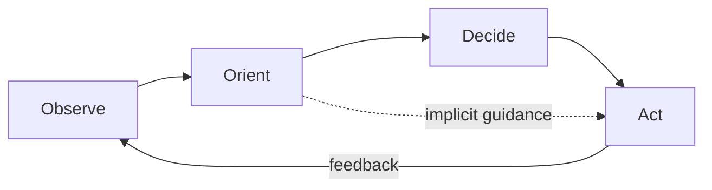
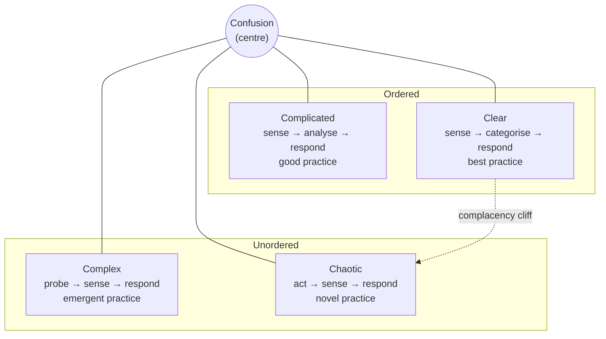

# Mental Models

> **TL;DR** — A latticework of general-purpose thinking tools (in the Charlie Munger / Farnam Street tradition) for reasoning, deciding under uncertainty, sensing context and dealing with strategy and incentives. No single model is sufficient; combine several and look for where they disagree. Systems models (feedback loops, stocks and flows, leverage points) are in [systems-thinking-and-complexity.md](systems-thinking-and-complexity.md); economic models (opportunity cost, comparative advantage, network effects) in [economics-and-strategy-models.md](economics-and-strategy-models.md).

Entry format: **Statement** / **Origin** / **In practice** / **Example** / **Link**.

Contents:
1. [Core thinking tools](#core-thinking-tools)
2. [Razors](#razors)
3. [Probability and uncertainty](#probability-and-uncertainty)
4. [Risk, fragility and time](#risk-fragility-and-time)
5. [Optimisation and choice](#optimisation-and-choice)
6. [Sense-making and decision frameworks](#sense-making-and-decision-frameworks)
7. [Game theory and incentives](#game-theory-and-incentives)
8. [Change dynamics borrowed from science](#change-dynamics-borrowed-from-science)
9. [Measurement traps](#measurement-traps)
10. [Discourse and learning](#discourse-and-learning)

---

## Core thinking tools

### First principles thinking
- **Statement:** Break a problem down to its fundamental truths and reason up from there, rather than by analogy or convention.
- **Origin:** Aristotle's *archai* (Metaphysics); Descartes' methodic doubt; popularised in business by Elon Musk's battery-cost example.
- **In practice:** Ask "what must be true?" and "what are the physical/economic constraints?" — e.g., derive cloud cost from requests × payload × price rather than "it's always expensive". Costly; reserve for important or stuck problems.
- **Example:** Questioning whether a nightly batch is needed at all vs. accepting it and optimising it.
- **Link:** https://en.wikipedia.org/wiki/First_principle

### Second-order thinking
- **Statement:** Consider the consequences of the consequences — "and then what?"
- **Origin:** Popularised by Howard Marks (*The Most Important Thing*, 2011) and Farnam Street.
- **In practice:** A metric target improves the metric (first order) and invites gaming (second order); a free tier grows users and support load. Map effects over time and on other actors.
- **Example:** Adding mandatory approvals reduces risky deploys (1st) → larger, batched, riskier deploys (2nd).
- **Link:** https://fs.blog/mental-models/

### Inversion
- **Statement:** Think about a problem backwards: instead of how to succeed, ask how to fail — and avoid that.
- **Origin:** Carl Jacobi ("invert, always invert"); Charlie Munger.
- **In practice:** Pre-mortems, threat modelling and chaos engineering are institutionalised inversion. "How would we guarantee this platform is never adopted?"
- **Example:** Listing all ways a launch could fail produces the launch checklist.
- **Link:** https://fs.blog/mental-models/

### The map is not the territory
- **Statement:** Models, diagrams, metrics and documents are abstractions of reality and omit things.
- **Origin:** Alfred Korzybski, 1931 (general semantics).
- **In practice:** Architecture diagrams drift from deployed reality; dashboards are not user experience. Go and see (gemba), validate with production data, and refresh maps.
- **Example:** The service diagram shows 12 services; the service mesh shows 31.
- **Link:** https://en.wikipedia.org/wiki/Map%E2%80%93territory_relation

### Circle of competence
- **Statement:** Know the boundaries of what you genuinely understand and operate within them — or knowingly expand them.
- **Origin:** Warren Buffett, Berkshire Hathaway shareholder letter, 1996; Charlie Munger.
- **In practice:** Recognise when to bring in specialists (security, data science, legal); explicitly label decisions made outside the circle as higher risk.
- **Example:** An application team consults a DBA before choosing an isolation level.
- **Link:** https://fs.blog/mental-models/

### Thought experiment
- **Statement:** Explore a hypothesis by reasoning through an imagined scenario rather than physical experiment.
- **Origin:** Ancient Greek philosophy; Galileo, Einstein (Gedankenexperiment).
- **In practice:** "What if traffic were 100×?", "What if this region disappeared?", "What if this team left?" — cheap design reviews.
- **Example:** A game-day walkthrough of a region failure on a whiteboard.
- **Link:** https://en.wikipedia.org/wiki/Thought_experiment

### Fermi estimation
- **Statement:** Make quick order-of-magnitude estimates by decomposing a problem into factors you can guess.
- **Origin:** Enrico Fermi (e.g., estimating the Trinity test yield, 1945).
- **In practice:** Back-of-envelope capacity planning: users × actions/day × bytes/action. Errors partially cancel out.
- **Example:** 10M users × 20 events/day × 1 KB ≈ 200 GB/day ingest.
- **Link:** https://en.wikipedia.org/wiki/Fermi_problem

### Ladder of inference
- **Statement:** People move rapidly from observable data to selected data, interpretations, assumptions, conclusions, beliefs and actions — often unconsciously.
- **Origin:** Chris Argyris, 1970s–1990; popularised by Peter Senge, *The Fifth Discipline*, 1990.
- **In practice:** In conflicts, walk back down the ladder: "what did you actually observe?"
- **Example:** "They didn't reply on Slack" → "they don't care about our deadline".
- **Link:** https://en.wikipedia.org/wiki/Ladder_of_inference

---

## Razors

### Occam's razor
- **Statement:** Entities should not be multiplied beyond necessity — among competing hypotheses, prefer the one with fewest assumptions.
- **Origin:** William of Ockham, 14th century (the phrasing is later).
- **In practice:** In debugging, check recent changes and config before cosmic rays. In design, choose the simplest architecture that fits. Not a proof: simple explanations can be wrong.
- **Example:** A 500 error after a deploy is more likely the deploy than an AWS outage.
- **Link:** https://en.wikipedia.org/wiki/Occam%27s_razor

### Hanlon's razor
- **Statement:** Never attribute to malice that which is adequately explained by stupidity (or, more charitably, by ignorance, haste or bad systems).
- **Origin:** Robert J. Hanlon, submission to *Murphy's Law Book Two*, 1980; earlier variants (Goethe, Heinlein).
- **In practice:** Assume good intent and look for missing information or poor tooling before escalating; keeps cross-team relations healthy. Security is an exception — adversaries do exist.
- **Example:** A team "ignoring" your API deprecation never received the announcement.
- **Link:** https://en.wikipedia.org/wiki/Hanlon%27s_razor

### Hitchens's razor
- **Statement:** What can be asserted without evidence can be dismissed without evidence.
- **Origin:** Christopher Hitchens, 2003.
- **In practice:** The burden of proof is on the claim-maker; sets evidence standards in architecture and vendor discussions (pairs with Brandolini's law).
- **Example:** "Our current DB can't scale" — show the load test.
- **Link:** https://en.wikipedia.org/wiki/Hitchens%27s_razor

### Sagan standard
- **Statement:** Extraordinary claims require extraordinary evidence.
- **Origin:** Carl Sagan, *Cosmos*, 1980 (echoing Laplace and Marcello Truzzi).
- **In practice:** A 10× performance claim from a benchmark blog needs reproducible tests on your workload.
- **Example:** "This model is 99.9% accurate" → ask for the evaluation set.
- **Link:** https://en.wikipedia.org/wiki/Sagan_standard

---

## Probability and uncertainty

### Probabilistic thinking
- **Statement:** Reason in probabilities and distributions rather than certainties and single points.
- **Origin:** Pascal & Fermat, 1654; modern decision theory.
- **In practice:** Forecast delivery as "85% by June 10", risk as likelihood × impact, latency as percentiles. Use Monte Carlo simulations on historical throughput.
- **Example:** "There's a 30% chance this vendor fails our security review" drives a parallel option.
- **Link:** https://en.wikipedia.org/wiki/Probability

### Bayesian updating
- **Statement:** Start with a prior belief, then update it proportionally to the strength of new evidence: posterior ∝ likelihood × prior.
- **Origin:** Thomas Bayes (published 1763); Pierre-Simon Laplace, 1774/1812.
- **In practice:** In debugging and incident response, hold multiple hypotheses with rough probabilities and update as evidence arrives instead of flipping between certainties. Strong priors need strong evidence.
- **Example:** Prior: 60% recent deploy, 30% DB, 10% network. Rollback doesn't fix it → shift weight to DB.
- **Link:** https://en.wikipedia.org/wiki/Bayes%27_theorem

### Expected value
- **Statement:** The probability-weighted average of all outcomes.
- **Origin:** Christiaan Huygens, 1657; Pascal.
- **In practice:** Prioritise by expected value (and cost of delay); but beware ruin — maximising EV is wrong when a bad outcome is unrecoverable (see ergodicity).
- **Example:** A feature with 20% chance of €1M value (EV €200k) vs a sure €100k improvement.
- **Link:** https://en.wikipedia.org/wiki/Expected_value

### Black swan theory
- **Statement:** Rare, high-impact, unpredictable events that are rationalised in hindsight dominate history and outcomes.
- **Origin:** Nassim Nicholas Taleb, *Fooled by Randomness* (2001), *The Black Swan* (2007).
- **In practice:** Do not try to predict black swans; build robustness (backups, isolation, buffers) and optionality to benefit from positive ones. Distinguish from "grey swans" (known but neglected risks).
- **Example:** A global pandemic changes demand patterns overnight.
- **Link:** https://en.wikipedia.org/wiki/Black_swan_theory

### Kelly criterion
- **Statement:** The bet size that maximises long-run growth of wealth is a fraction proportional to your edge; over-betting leads to ruin.
- **Origin:** John L. Kelly Jr., Bell Labs, 1956.
- **In practice:** As a metaphor: allocate investment (e.g., innovation budget) in proportion to confidence; don't bet the company on one initiative.
- **Example:** Allocating 10–20% of capacity to exploratory bets, not 80%.
- **Link:** https://en.wikipedia.org/wiki/Kelly_criterion

---

## Risk, fragility and time

### Margin of safety
- **Statement:** Build in a buffer between expected load and capacity (or price and value) to absorb errors and surprises.
- **Origin:** Engineering safety factors (centuries old); Benjamin Graham, *The Intelligent Investor*, 1949.
- **In practice:** Capacity headroom, error budgets, project buffers, keeping utilisation below ~80% (Kingman). Margins look like waste until needed.
- **Example:** Bridges are designed for several times expected load; databases sized for 2× peak.
- **Link:** https://en.wikipedia.org/wiki/Factor_of_safety

### Antifragility
- **Statement:** Some things benefit from shocks, volatility and stressors (antifragile) — beyond merely resisting them (robust) or breaking (fragile).
- **Origin:** Nassim Nicholas Taleb, *Antifragile*, 2012.
- **In practice:** Chaos engineering, frequent small deploys and game days turn stress into learning. Systems that never experience small failures become fragile.
- **Example:** Netflix's Chaos Monkey (2011) forced services to tolerate instance loss.
- **Link:** https://en.wikipedia.org/wiki/Antifragility

### Via negativa
- **Statement:** Improve by removing rather than adding — subtraction is often more robust than addition.
- **Origin:** Apophatic theology; applied to decisions by Taleb, *Antifragile*, 2012.
- **In practice:** Delete features, dependencies, meetings and process steps; stop doing things before starting new ones. Fewer moving parts, fewer failure modes.
- **Example:** Removing an unused cache layer eliminates a class of consistency bugs.
- **Link:** https://en.wikipedia.org/wiki/Via_negativa

### Skin in the game
- **Statement:** Decision-makers should bear consequences of their decisions; asymmetric risk sharing produces bad decisions.
- **Origin:** Nassim Nicholas Taleb, *Skin in the Game*, 2018 (echoing Hammurabi's code).
- **In practice:** "You build it, you run it" (Werner Vogels, 2006) puts developers on call for their services; architects who design but never operate lose feedback.
- **Example:** A team that pages itself writes better alerts.
- **Link:** https://en.wikipedia.org/wiki/Skin_in_the_Game_(book)

### Lindy effect
- **Statement:** For non-perishable things (ideas, technologies), life expectancy is proportional to current age.
- **Origin:** Albert Goldman, "Lindy's Law", *The New Republic*, 1964; Benoît Mandelbrot; Taleb.
- **In practice:** A 30-year-old technology (SQL, Unix, HTTP) is likely to outlast a 2-year-old one. Favour Lindy-proof tech for core, long-lived systems; experiment at the edges.
- **Example:** PostgreSQL vs this year's hot database.
- **Link:** https://en.wikipedia.org/wiki/Lindy_effect

### Ergodicity
- **Statement:** A process is ergodic if the time average for one individual equals the ensemble average across many; many real-life gambles are non-ergodic because ruin is absorbing.
- **Origin:** Ludwig Boltzmann (statistical mechanics); applied to economics by Ole Peters, 2010s.
- **In practice:** "On average it's fine" doesn't apply when one failure is fatal (data loss, bankruptcy, security breach). Avoid risks of ruin regardless of expected value.
- **Example:** Skipping backups is "usually fine" until the one event that ends the company.
- **Link:** https://en.wikipedia.org/wiki/Ergodicity

### One-way and two-way doors
- **Statement:** Distinguish irreversible (Type 1) decisions requiring care from reversible (Type 2) decisions that should be made quickly by small groups.
- **Origin:** Jeff Bezos, Amazon shareholder letter, 2015 (for 2016: "disagree and commit").
- **In practice:** Spend architecture effort on data models, public APIs and vendor lock-in; decide quickly on internal libraries and UI experiments. Make more decisions reversible (feature flags, abstraction at boundaries).
- **Example:** Choosing a primary datastore is a one-way door; choosing a logging library is two-way.
- **Link:** https://en.wikipedia.org/wiki/Jeff_Bezos

### Optionality and real options
- **Statement:** The right but not the obligation to take an action later has value, especially under uncertainty.
- **Origin:** Black–Scholes (1973); real options (Stewart Myers, 1977); Taleb on optionality.
- **In practice:** Defer irreversible commitments to the last responsible moment; buy options cheaply (spikes, prototypes, abstraction layers at key boundaries).
- **Example:** A thin storage interface keeps the option to switch providers.
- **Link:** https://en.wikipedia.org/wiki/Real_options_valuation

### Barbell strategy
- **Statement:** Combine extreme safety for most resources with small, high-upside bets; avoid the fragile middle.
- **Origin:** Fixed-income investing; Taleb, *The Black Swan* and *Antifragile*.
- **In practice:** Boring, proven tech for core systems + small experimental budget for new tech. Similar to 70/20/10 innovation portfolios.
- **Example:** Payments on a battle-tested stack; a skunkworks team trying an AI feature.
- **Link:** https://en.wikipedia.org/wiki/Antifragility

---

## Optimisation and choice

### Pareto principle
- **Statement:** Roughly 80% of effects come from 20% of causes.
- **Origin:** Vilfredo Pareto, land ownership in Italy, 1896; generalised as "vital few, trivial many" by Joseph Juran, 1940s–1951.
- **In practice:** A few endpoints cause most latency, a few customers most revenue, a few bugs most crashes. The ratio varies — measure (Pareto chart) rather than assume 80/20.
- **Example:** Microsoft reported fixing the top 20% of reported bugs eliminated ~80% of errors and crashes (2002).
- **Link:** https://en.wikipedia.org/wiki/Pareto_principle

### Local vs global optima
- **Statement:** Optimising a part (or making locally best moves) can trap a system in a solution worse than the global best.
- **Origin:** Mathematical optimisation; hill-climbing algorithms; Goldratt's critique of local efficiencies.
- **In practice:** Maximising each team's utilisation lowers overall flow; optimising one service can degrade end-to-end latency. Measure end-to-end; sometimes take a temporary step back (re-architecture) to reach a higher peak.
- **Example:** A dev team ships faster by skipping docs, slowing support and onboarding.
- **Link:** https://en.wikipedia.org/wiki/Local_optimum

### Satisficing vs maximising
- **Statement:** Satisficers pick the first option that meets their criteria; maximisers seek the best possible. Under bounded rationality, satisficing is often optimal.
- **Origin:** Herbert A. Simon, 1956 (bounded rationality); Barry Schwartz, *The Paradox of Choice*, 2004.
- **In practice:** Define "good enough" criteria upfront for tool selection and stop searching when met; maximise only for one-way-door decisions.
- **Example:** Selecting a logging library in an hour against five criteria rather than a month-long bake-off.
- **Link:** https://en.wikipedia.org/wiki/Satisficing

### Bottlenecks
- **Statement:** The throughput of a system is determined by its most constrained step; improvements elsewhere are illusions.
- **Origin:** Operations research; Eliyahu Goldratt, *The Goal*, 1984 (see Theory of Constraints in [quality-and-lean-thinkers.md](quality-and-lean-thinkers.md)).
- **In practice:** Find the queue that grows (code review, QA, a single DBA, approvals) and focus there; an hour lost at the bottleneck is an hour lost for the whole system.
- **Example:** Doubling developers doesn't help when every release waits for one manual test team.
- **Link:** https://en.wikipedia.org/wiki/Bottleneck_(production)

### Leverage
- **Statement:** Small inputs that produce outsized outputs — through tools, code, capital, media or people.
- **Origin:** Archimedes (lever, 3rd century BC); applied to work by Naval Ravikant and Andy Grove (*High Output Management*, 1983: managerial leverage).
- **In practice:** Code and automation scale without marginal cost; platform work, good defaults and docs multiply other teams' output. Also the twelve leverage points of systems (systems file).
- **Example:** A reusable CI template saves 30 teams a day each.
- **Link:** https://en.wikipedia.org/wiki/Lever

### Compounding
- **Statement:** Growth on growth: small consistent rates produce exponential results over time — for knowledge, quality, debt and trust alike.
- **Origin:** Compound interest (ancient; formalised by Jacob Bernoulli, 1683).
- **In practice:** 1% improvement per week ≈ 68% per year. Technical debt compounds too ("interest"). Invest early in automation, learning and relationships.
- **Example:** Fixing flaky tests early prevents compounding distrust in CI.
- **Link:** https://en.wikipedia.org/wiki/Compound_interest

### Eisenhower matrix
- **Statement:** Categorise tasks by urgency and importance: do (urgent+important), schedule (important), delegate (urgent), delete (neither).
- **Origin:** Attributed to Dwight D. Eisenhower (1954 speech); popularised by Stephen Covey, *The 7 Habits*, 1989.
- **In practice:** Important-not-urgent (architecture, tech debt, coaching) is chronically starved; reserve capacity for it.
- **Example:** Blocking Friday mornings for quadrant-2 work.
- **Link:** https://en.wikipedia.org/wiki/Time_management

---

## Sense-making and decision frameworks

### OODA loop
- **Statement:** Observe, Orient, Decide, Act — continuous cycle; the side that cycles faster and orients better gains advantage.
- **Origin:** Col. John Boyd, US Air Force, 1970s–1980s.
- **In practice:** Orientation (mental models, culture, experience) is the key stage. Short feedback loops (CI/CD, observability, rapid experiments) let organisations out-cycle competitors; incident response is an OODA loop.
- **Example:** A team deploying 20×/day learns from users faster than a quarterly releaser.
- **Link:** https://en.wikipedia.org/wiki/OODA_loop

### Cynefin framework
- **Statement:** Contexts differ: *Clear* (sense–categorise–respond; best practice), *Complicated* (sense–analyse–respond; good practice, experts), *Complex* (probe–sense–respond; emergent practice), *Chaotic* (act–sense–respond; novel practice), and *Confusion* (not knowing which domain you are in; formerly "disorder"). Complacency can tip Clear into Chaotic.
- **Origin:** Dave Snowden, IBM, 1999; Snowden & Boone, *HBR*, 2007; "Clear" replaced "Simple/Obvious" around 2019–2020.
- **In practice:** Use analysis and upfront design for complicated problems (a well-understood migration); safe-to-fail experiments for complex ones (new product-market fit); stabilise first in chaos (major outage).
- **Example:** Applying a fixed-scope plan to an unknown market (complex) fails; running a series of probes works.
- **Link:** https://en.wikipedia.org/wiki/Cynefin_framework

### Stacey matrix
- **Statement:** Plot decisions by agreement among stakeholders and certainty about cause and effect; close to both = simple/rational planning; far from both = chaos; between = complex, requiring adaptive approaches.
- **Origin:** Ralph D. Stacey, *Strategic Management and Organisational Dynamics*, 1990s; Stacey later distanced himself from the matrix.
- **In practice:** Used in agile literature to justify iterative methods for uncertain requirements and technology.
- **Example:** Requirements unclear + new tech → empirical process (Scrum/Kanban), not waterfall.
- **Link:** https://en.wikipedia.org/wiki/Ralph_Douglas_Stacey

### Wardley mapping
- **Statement:** Map a value chain of components (from user need downwards) against their evolution stage (genesis → custom-built → product → commodity) to reason about strategy.
- **Origin:** Simon Wardley, 2005 onward (Canonical, Leading Edge Forum).
- **In practice:** Build what is genesis/custom and differentiating; buy products; consume commodities (utility cloud). Anticipate evolution and inertia. See [../11-enterprise-architecture-business/README.md](../11-enterprise-architecture-business/README.md).
- **Example:** Running your own Kafka cluster when managed streaming is a commodity.
- **Link:** https://en.wikipedia.org/wiki/Wardley_map

### Double-loop learning
- **Statement:** Single-loop learning corrects actions within existing assumptions; double-loop learning questions the assumptions and goals themselves.
- **Origin:** Chris Argyris and Donald Schön, 1974–1978.
- **In practice:** Postmortems that only fix the bug are single-loop; asking why the process allowed it is double-loop.
- **Example:** "Add a test" vs "why did our review process accept untested migrations?"
- **Link:** https://en.wikipedia.org/wiki/Double-loop_learning

---

## Game theory and incentives

### Prisoner's dilemma
- **Statement:** Two rational actors may each defect even though mutual cooperation would leave both better off.
- **Origin:** Merrill Flood and Melvin Dresher, RAND, 1950; formalised by Albert Tucker.
- **In practice:** Teams hoarding shared resources (CI capacity, budget, headcount) or skipping shared-library maintenance; fixed by repeated interaction, transparency and shared goals.
- **Example:** Two teams both over-provision cloud capacity "just in case", inflating total cost.
- **Link:** https://en.wikipedia.org/wiki/Prisoner%27s_dilemma

### Nash equilibrium
- **Statement:** A set of strategies where no player can improve their outcome by changing strategy unilaterally.
- **Origin:** John Nash, 1950.
- **In practice:** Bad equilibria (everyone padding estimates, everyone marking tickets urgent) persist because no individual can fix them alone; change the rules, not the players.
- **Example:** Priority inflation: if all tickets are P1, none are.
- **Link:** https://en.wikipedia.org/wiki/Nash_equilibrium

### Zero-sum vs positive-sum games
- **Statement:** In zero-sum games, one party's gain is another's loss; positive-sum games create value for all.
- **Origin:** John von Neumann and Oskar Morgenstern, *Theory of Games and Economic Behavior*, 1944.
- **In practice:** Budget negotiations feel zero-sum; platform investments, shared tooling and open source are positive-sum. Reframe negotiations around expanding value.
- **Example:** Two teams co-funding an internal developer platform.
- **Link:** https://en.wikipedia.org/wiki/Zero-sum_game

### Tit for tat
- **Statement:** In repeated games, start cooperating, then mirror the other player's previous move; it won Axelrod's tournaments.
- **Origin:** Anatol Rapoport; Robert Axelrod, *The Evolution of Cooperation*, 1984.
- **In practice:** Be nice, retaliatory, forgiving and clear in inter-team and vendor relationships; repeated interactions sustain cooperation.
- **Example:** Reciprocal code reviews between teams.
- **Link:** https://en.wikipedia.org/wiki/Tit_for_tat

### Schelling point
- **Statement:** A solution people tend to choose by default without communication because it seems natural or salient.
- **Origin:** Thomas Schelling, *The Strategy of Conflict*, 1960.
- **In practice:** Conventions (default ports, standard directory layouts, ISO dates) coordinate teams without meetings. Create focal points via golden paths and templates.
- **Example:** Everyone puts the health check at `/health`.
- **Link:** https://en.wikipedia.org/wiki/Focal_point_(game_theory)

### Tragedy of the commons
- **Statement:** Individuals acting in self-interest deplete a shared resource, against the group's long-term interest.
- **Origin:** William Forster Lloyd, 1833; Garrett Hardin, *Science*, 1968. Elinor Ostrom (Nobel 2009) showed communities can govern commons with rules.
- **In practice:** Shared databases, shared Kubernetes clusters, shared test environments and open-source maintenance. Apply Ostrom-style governance: clear boundaries, quotas, monitoring, graduated sanctions.
- **Example:** A shared staging environment that nobody cleans up becomes unusable.
- **Link:** https://en.wikipedia.org/wiki/Tragedy_of_the_commons

### Principal–agent problem
- **Statement:** When one party (agent) acts on behalf of another (principal) with different interests and more information, the agent may not act in the principal's best interest.
- **Origin:** Stephen Ross and Barry Mitnick, 1973; Jensen & Meckling, 1976.
- **In practice:** Contractors paid per hour vs outcome; managers optimising their own KPIs; vendors recommending their own products. Align incentives and reduce information asymmetry.
- **Example:** An outsourced team billed by headcount has little incentive to automate.
- **Link:** https://en.wikipedia.org/wiki/Principal%E2%80%93agent_problem

### Incentives (Munger)
- **Statement:** "Show me the incentive and I will show you the outcome" — incentive structures explain most behaviour.
- **Origin:** Charlie Munger, "The Psychology of Human Misjudgment", 1995.
- **In practice:** Before blaming people, map their incentives (bonuses, promotion criteria, metrics). See Goodhart and Cobra effect in [organizational-and-management-laws.md](organizational-and-management-laws.md).
- **Example:** Promotion criteria rewarding "launched new system" produce many systems and no maintenance.
- **Link:** https://en.wikipedia.org/wiki/Incentive

---

## Change dynamics borrowed from science

### Red Queen effect
- **Statement:** You must keep running just to stay in the same place, because competitors and environments co-evolve.
- **Origin:** Leigh Van Valen, evolutionary biology, 1973, after Lewis Carroll's *Through the Looking-Glass*.
- **In practice:** Security (attackers adapt), competitive features and dependency updates require continuous investment just to hold position (cf. Lehman's first law).
- **Example:** Fraud models degrade as fraudsters adapt.
- **Link:** https://en.wikipedia.org/wiki/Red_Queen_hypothesis

### Activation energy
- **Statement:** A reaction needs initial energy to start, even if it releases energy overall.
- **Origin:** Svante Arrhenius, 1889 (chemistry).
- **In practice:** Lower the start cost of desirable behaviours (templates, one-click environments, good onboarding) — catalysts. Raise it for undesirable ones.
- **Example:** A `make dev` command that sets everything up increases contributions.
- **Link:** https://en.wikipedia.org/wiki/Activation_energy

### Critical mass and tipping points
- **Statement:** Beyond a threshold, change becomes self-sustaining.
- **Origin:** Nuclear physics; sociology (Morton Grodzins, Thomas Schelling); Malcolm Gladwell, *The Tipping Point*, 2000.
- **In practice:** Platform and standards adoption needs a critical mass of early teams; then network effects take over. Target early adopters first.
- **Example:** Once 30% of services use the new observability stack, others follow by default.
- **Link:** https://en.wikipedia.org/wiki/Tipping_point_(sociology)

### Entropy
- **Statement:** Closed systems tend toward disorder; maintaining order requires continuous energy input.
- **Origin:** Rudolf Clausius, 1865 (second law of thermodynamics).
- **In practice:** Codebases, docs, wikis, cloud accounts and team agreements decay without upkeep ("software entropy", Lehman II). Schedule gardening.
- **Example:** An unowned Confluence space becomes misleading within a year.
- **Link:** https://en.wikipedia.org/wiki/Software_entropy

### Path dependence
- **Statement:** Present options are constrained by past decisions, even if past circumstances no longer apply.
- **Origin:** Paul David (QWERTY, 1985); Brian Arthur (increasing returns, 1989).
- **In practice:** Early tech choices lock in (language, data model, cloud provider); make key early decisions consciously and keep exit options.
- **Example:** A 1990s data schema still shapes a 2020s product.
- **Link:** https://en.wikipedia.org/wiki/Path_dependence

---

## Measurement traps

### McNamara fallacy
- **Statement:** Making decisions based only on what is easily quantified and ignoring (or denying the importance of) everything else.
- **Origin:** Robert McNamara's body-count metrics in the Vietnam War; named by sociologist Daniel Yankelovich, 1972.
- **In practice:** Velocity, lines of code and ticket counts are easy; customer value, maintainability and team health are not. Combine quantitative and qualitative signals.
- **Example:** A team "winning" on story points while customer satisfaction falls.
- **Link:** https://en.wikipedia.org/wiki/McNamara_fallacy

### Streetlight effect
- **Statement:** Searching for something only where it is easiest to look (the drunk looking for keys under the streetlight).
- **Origin:** Old parable; named in the 20th century (Abraham Kaplan, 1964).
- **In practice:** Debugging where logs exist rather than where the bug is; user research only with easy-to-reach users. Instrument the dark corners.
- **Example:** Investigating the API layer (well instrumented) while the issue is in an un-instrumented batch job.
- **Link:** https://en.wikipedia.org/wiki/Streetlight_effect

### Cargo cult
- **Statement:** Imitating the visible forms of a successful practice without its underlying causal mechanism.
- **Origin:** Richard Feynman, "Cargo Cult Science", Caltech commencement, 1974.
- **In practice:** Stand-ups without collaboration, microservices without autonomy, OKRs without strategy. Ask what problem the practice solved where it originated.
- **Example:** Copying Spotify's "squads and tribes" naming without its engineering culture.
- **Link:** https://en.wikipedia.org/wiki/Cargo_cult_science

---

## Discourse and learning

### Strong opinions, weakly held
- **Statement:** Form a clear hypothesis quickly to drive action, but readily change it in the face of evidence.
- **Origin:** Paul Saffo, Institute for the Future, 2008. Criticised for enabling loud overconfidence; some prefer stating confidence levels explicitly.
- **In practice:** Write a strawman proposal with explicit confidence ("70% sure") and invite challenge.
- **Example:** "I propose Postgres; I'd change my mind if write volume exceeds X."
- **Link:** https://en.wikipedia.org/wiki/Paul_Saffo

### Steelmanning
- **Statement:** Represent the opposing argument in its strongest form before responding — the opposite of a straw man.
- **Origin:** Rationalist community usage; rooted in the principle of charity and Rapoport's rules (Daniel Dennett, 2013).
- **In practice:** In ADRs, describe rejected options as their best advocate would; in disagreements, restate the other side until they agree with your summary.
- **Example:** "The strongest case for the monolith is that our team is 6 people and our domain is still changing."
- **Link:** https://en.wikipedia.org/wiki/Straw_man

### Principle of charity
- **Statement:** Interpret others' statements in their most rational, reasonable form.
- **Origin:** Neil L. Wilson, 1958–1959; Donald Davidson; Willard Quine.
- **In practice:** Reduces unproductive conflict in code review and stakeholder discussions; pairs with Hanlon's razor.
- **Example:** Reading a terse review comment as concern about risk, not personal criticism.
- **Link:** https://en.wikipedia.org/wiki/Principle_of_charity

### Overton window
- **Statement:** The range of ideas considered acceptable in public (or organisational) discourse at a given time; it can shift.
- **Origin:** Joseph P. Overton, Mackinac Center, 1990s.
- **In practice:** Organisational change often requires first making an idea discussable (pilots, talks, external examples) before proposing it formally.
- **Example:** "Moving off our on-prem data centre" goes from unthinkable to roadmap after a few successful cloud pilots.
- **Link:** https://en.wikipedia.org/wiki/Overton_window

### Gell-Mann amnesia effect
- **Statement:** Noticing that media coverage of your area of expertise is wrong, then trusting the same media on other topics.
- **Origin:** Michael Crichton, 2002 talk, named after physicist Murray Gell-Mann.
- **In practice:** Apply the scepticism you have for bad technical journalism (or AI-generated answers) to domains you know less well.
- **Example:** Trusting a vendor's market analysis after seeing their technical claims were wrong.
- **Link:** https://en.wikipedia.org/wiki/Michael_Crichton

### Rubber duck debugging
- **Statement:** Explaining a problem step by step (even to an inanimate object) often reveals the solution.
- **Origin:** Hunt & Thomas, *The Pragmatic Programmer*, 1999.
- **In practice:** Writing the issue description, an ADR or a question frequently solves it; also counters the illusion of explanatory depth.
- **Example:** Halfway through writing a support ticket, you find the misconfigured env var.
- **Link:** https://en.wikipedia.org/wiki/Rubber_duck_debugging

---

## References
- Farnam Street, Mental Models — https://fs.blog/mental-models/
- Munger, C. "The Psychology of Human Misjudgment" (1995); *Poor Charlie's Almanack* (2005)
- Taleb, N. N. *Incerto* series (2001–2018) — https://en.wikipedia.org/wiki/Antifragility
- Snowden, D. & Boone, M. "A Leader's Framework for Decision Making", HBR (2007) — https://en.wikipedia.org/wiki/Cynefin_framework
- Boyd, J. — https://en.wikipedia.org/wiki/OODA_loop
- Axelrod, R. *The Evolution of Cooperation* (1984) — https://en.wikipedia.org/wiki/The_Evolution_of_Cooperation
- Ostrom, E. *Governing the Commons* (1990) — https://en.wikipedia.org/wiki/Elinor_Ostrom
- Wardley, S. *Wardley Maps* — https://en.wikipedia.org/wiki/Wardley_map
- Related sections: [../02-product-management/README.md](../02-product-management/README.md), [../09-leadership-teams-facilitation/README.md](../09-leadership-teams-facilitation/README.md), [../11-enterprise-architecture-business/README.md](../11-enterprise-architecture-business/README.md)
