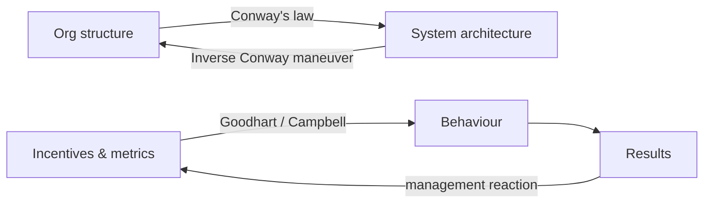

# Organizational and Management Laws

> **TL;DR** — How organizations shape systems, how bureaucracies grow, how metrics get gamed, how talent and contribution are distributed, how information degrades, and what research says about teams and motivation. The recurring lesson: structure and incentives beat individual intent. Leadership practice is covered in [../09-leadership-teams-facilitation/README.md](../09-leadership-teams-facilitation/README.md); quality-management thinkers (Deming, Juran, Goldratt) in [quality-and-lean-thinkers.md](quality-and-lean-thinkers.md).

Entry format: **Statement** / **Origin** / **In practice** / **Example** / **Link**.

Contents:
1. [Structure and communication](#structure-and-communication)
2. [Bureaucracy, hierarchy and incentives](#bureaucracy-hierarchy-and-incentives)
3. [Measurement and metrics](#measurement-and-metrics)
4. [Talent and contribution](#talent-and-contribution)
5. [Requirements and knowledge](#requirements-and-knowledge)
6. [Information, discourse and communication](#information-discourse-and-communication)
7. [Teams, motivation and culture](#teams-motivation-and-culture)

---

## Structure and communication

### Conway's law
- **Statement:** Organisations which design systems are constrained to produce designs that are copies of their communication structures.
- **Origin:** Melvin Conway, "How Do Committees Invent?", *Datamation*, 1968 (named by Fred Brooks).
- **In practice:** Team boundaries become module/service boundaries. Design org and architecture together; mismatched ownership yields shared, slow-changing components. See [../05-software-architecture/README.md](../05-software-architecture/README.md).
- **Example:** Three teams building a compiler produce a three-pass compiler; a separate "API team" produces an API layer every change must queue for.
- **Link:** https://en.wikipedia.org/wiki/Conway%27s_law

### Inverse Conway maneuver
- **Statement:** Deliberately shape team structure to encourage the desired architecture.
- **Origin:** Jonny LeRoy and Matt Simons, *Cutter IT Journal*, 2010; popularised by Thoughtworks and *Team Topologies* (Skelton & Pais, 2019).
- **In practice:** Stream-aligned teams owning end-to-end slices produce loosely coupled services; platform teams reduce cognitive load. Reorgs are architecture decisions.
- **Example:** Splitting a monolith team into teams per business capability before splitting the codebase.
- **Link:** https://teamtopologies.com/

### Dunbar's number
- **Statement:** Humans can maintain stable social relationships with roughly 150 people; nested layers at ~5, 15, 50, 150.
- **Origin:** Robin Dunbar, 1992, extrapolating from primate neocortex size. Contested by later studies (e.g., Lindenfors et al., 2021) as having wide confidence intervals.
- **In practice:** A heuristic for organisational units: teams of 5–9, tribes/departments up to ~150 before formal coordination is required.
- **Example:** Gore & Associates historically split plants at around 150 people.
- **Link:** https://en.wikipedia.org/wiki/Dunbar%27s_number

### Ringelmann effect
- **Statement:** Individual productivity decreases as group size increases.
- **Origin:** Maximilien Ringelmann, rope-pulling experiments, published 1913.
- **In practice:** Causes are coordination losses and motivation losses (social loafing). Keep teams small, make individual contributions visible, define clear ownership.
- **Example:** Eight people pulling a rope exert far less than eight times individual force.
- **Link:** https://en.wikipedia.org/wiki/Ringelmann_effect

### Social loafing
- **Statement:** People exert less effort when working collectively than when working individually.
- **Origin:** Bibb Latané, Kipling Williams and Stephen Harkins, 1979.
- **In practice:** Reduced when contributions are identifiable, tasks are meaningful and groups are cohesive. Shared on-call rotations without named owners suffer from it.
- **Example:** "Someone will look at the alert" in a 40-person channel.
- **Link:** https://en.wikipedia.org/wiki/Social_loafing

### Bus factor
- **Statement:** The minimum number of team members who would have to disappear before a project stalls for lack of knowledge.
- **Origin:** Software folklore, 1990s (also "truck factor").
- **In practice:** Raise it via pairing, rotation, documentation and collective ownership; a bus factor of 1 is an operational risk.
- **Example:** Only one person knows how to rotate the production certificates.
- **Link:** https://en.wikipedia.org/wiki/Bus_factor

### Two-pizza team
- **Statement:** A team should be small enough to be fed by two pizzas (roughly 6–10 people).
- **Origin:** Attributed to Jeff Bezos, Amazon, early 2000s.
- **In practice:** Small autonomous teams reduce communication paths (Brooks) and loafing (Ringelmann); requires clear interfaces between teams.
- **Example:** A service owned end to end by a team of seven.
- **Link:** https://en.wikipedia.org/wiki/Amazon_(company)

---

## Bureaucracy, hierarchy and incentives

### Parkinson's law
- **Statement:** Work expands so as to fill the time available for its completion.
- **Origin:** C. Northcote Parkinson, essay in *The Economist*, 1955; book 1957. Original focus: growth of bureaucracies regardless of work.
- **In practice:** Generous deadlines and buffers get consumed (see also student syndrome). Use short timeboxes, WIP limits and project buffers held centrally (critical chain) rather than padded tasks.
- **Example:** A two-week task with a four-week deadline is delivered on day 27.
- **Link:** https://en.wikipedia.org/wiki/Parkinson%27s_law

### Law of triviality (bike-shedding)
- **Statement:** Organisations give disproportionate weight to trivial issues because everyone can understand and has an opinion on them.
- **Origin:** C. Northcote Parkinson, 1957 (committee approving a nuclear plant quickly but debating a bicycle shed); "bikeshed" term popularised by Poul-Henning Kamp, FreeBSD mailing list, 1999.
- **In practice:** Timebox low-impact decisions, delegate them, or use defaults/linters (style guides end formatting debates). Spend review energy on reversible-vs-irreversible risk.
- **Example:** 40 comments on a button colour; none on the database migration in the same PR.
- **Link:** https://en.wikipedia.org/wiki/Law_of_triviality

### Peter principle
- **Statement:** In a hierarchy, every employee tends to rise to their level of incompetence.
- **Origin:** Laurence J. Peter and Raymond Hull, *The Peter Principle*, 1969. Empirical support: Benson, Li and Shue (2019) on sales managers.
- **In practice:** Promoting the best engineer into management loses an engineer and may gain a poor manager. Offer dual career ladders (IC/manager), trial periods and training before promotion.
- **Example:** A top salesperson promoted to sales manager underperforms in the new role.
- **Link:** https://en.wikipedia.org/wiki/Peter_principle

### Dilbert principle
- **Statement:** Companies tend to systematically promote incompetent employees to management to get them out of the workflow.
- **Origin:** Scott Adams, *Dilbert* comic and *The Dilbert Principle*, 1995–1996.
- **In practice:** Satire, but a reminder that management roles need explicit criteria, not a pressure-release valve.
- **Example:** A poor coder made "coordinator" to limit damage to the codebase.
- **Link:** https://en.wikipedia.org/wiki/Dilbert_principle

### Putt's law
- **Statement:** Technology is dominated by two types of people: those who understand what they do not manage and those who manage what they do not understand.
- **Origin:** "Archibald Putt" (pseudonym), *Putt's Law and the Successful Technocrat*, 1981.
- **In practice:** Bridge roles (staff engineers, architects, technical PMs) exist to close this gap; managers should invest in technical literacy and engineers in business literacy.
- **Example:** A steering committee approves a deadline that ignores a known data-migration constraint.
- **Link:** https://github.com/dwmkerr/hacker-laws

### Pournelle's iron law of bureaucracy
- **Statement:** In any bureaucracy, people devoted to the organisation itself eventually gain control over those devoted to its goals.
- **Origin:** Jerry Pournelle, science-fiction author and columnist, 1970s–2000s.
- **In practice:** Watch for process owners optimising the process over outcomes (governance boards, PMOs, platform teams without customers). Tie support functions to customer outcomes.
- **Example:** A change advisory board whose KPI is "number of changes reviewed".
- **Link:** https://en.wikipedia.org/wiki/Jerry_Pournelle

### Iron law of oligarchy
- **Statement:** All complex organisations, regardless of how democratic at the start, eventually develop into oligarchies.
- **Origin:** Robert Michels, *Political Parties*, 1911.
- **In practice:** Open-source projects and communities of practice drift towards core groups; design governance (rotation, RFC processes) consciously.
- **Example:** An "open" architecture guild where decisions are made by the same three people.
- **Link:** https://en.wikipedia.org/wiki/Iron_law_of_oligarchy

### Shirky principle
- **Statement:** Institutions will try to preserve the problem to which they are the solution.
- **Origin:** Clay Shirky's ideas, named by Kevin Kelly, 2010.
- **In practice:** Teams whose existence depends on a manual process resist automating it. Reframe missions around outcomes ("reduce incidents") rather than activities ("process tickets").
- **Example:** A release-management team resists continuous delivery.
- **Link:** https://en.wikipedia.org/wiki/Clay_Shirky

### Hutber's law
- **Statement:** Improvement means deterioration.
- **Origin:** Patrick Hutber, British financial journalist, 1970s.
- **In practice:** Every "improvement" has hidden costs for someone (a new feature slows the app, a new process burdens a team). Check second-order effects and losers of a change.
- **Example:** A redesign improves new-user onboarding but breaks power users' muscle memory.
- **Link:** https://github.com/dwmkerr/hacker-laws

### Sayre's law
- **Statement:** In any dispute the intensity of feeling is inversely proportional to the value of the issues at stake.
- **Origin:** Wallace Sayre, Columbia University political scientist, 1950s–70s (academic politics).
- **In practice:** Low-stakes disputes (naming, tabs vs spaces) generate the most heat; resolve them by convention or a decider. Related to bike-shedding.
- **Example:** A month-long debate about repository naming conventions.
- **Link:** https://en.wikipedia.org/wiki/Sayre%27s_law

### Cobra effect
- **Statement:** An incentive intended to solve a problem makes it worse (a perverse incentive).
- **Origin:** Anecdote about bounties on cobras in colonial Delhi, which led to cobra breeding; term coined by Horst Siebert, 2001. Historical accuracy of the anecdote is uncertain; the Hanoi rat bounty (1902) is better documented.
- **In practice:** Paying for bugs found or lines written invites gaming. Before launching an incentive, ask "how would a clever person game this?"
- **Example:** A bonus per closed ticket encourages splitting tickets and closing without fixing.
- **Link:** https://en.wikipedia.org/wiki/Perverse_incentive

### Lucas critique
- **Statement:** Relationships observed in historical data change when policy changes, because people adapt their behaviour to the new policy.
- **Origin:** Robert Lucas, 1976 (macroeconomics).
- **In practice:** Productivity relationships measured before introducing a metric-based target will not hold after it. Applies to forecasting models used for decisions.
- **Example:** Story points correlated with effort until they became a performance target.
- **Link:** https://en.wikipedia.org/wiki/Lucas_critique

---

## Measurement and metrics

### Goodhart's law
- **Statement:** When a measure becomes a target, it ceases to be a good measure (Marilyn Strathern's 1997 phrasing of Goodhart's point).
- **Origin:** Charles Goodhart, monetary policy paper, 1975.
- **In practice:** Use metrics for learning, not targets; balance metric pairs (speed + quality, e.g., DORA's deployment frequency with change failure rate); rotate and review; combine with qualitative judgement.
- **Example:** Targeting 80% test coverage produces assertion-free tests.
- **Link:** https://en.wikipedia.org/wiki/Goodhart%27s_law

### Campbell's law
- **Statement:** The more any quantitative social indicator is used for social decision-making, the more subject it will be to corruption pressures and the more apt it will be to distort the processes it is intended to monitor.
- **Origin:** Donald T. Campbell, "Assessing the Impact of Planned Social Change", 1976/1979.
- **In practice:** High-stakes metrics (bonuses, rankings, layoffs) corrupt both data and process; keep stakes on metrics low or use many indicators.
- **Example:** Teaching to the test after school rankings were tied to test scores.
- **Link:** https://en.wikipedia.org/wiki/Campbell%27s_law

### "What gets measured gets managed"
- **Statement:** Measurement focuses attention; widely attributed to Peter Drucker, though no source in his writings has been found (the idea traces to V. F. Ridgway's 1956 paper, which actually warned about dysfunctional consequences of measurement).
- **Origin:** Misattribution; V. F. Ridgway, "Dysfunctional Consequences of Performance Measurements", *Administrative Science Quarterly*, 1956.
- **In practice:** Measuring something does focus effort — which is exactly why choosing metrics is dangerous. Pair with Goodhart and McNamara fallacy.
- **Example:** Measuring only velocity optimises for points, not outcomes.
- **Link:** https://en.wikipedia.org/wiki/Peter_Drucker

### Drucker's management maxims
- **Statement:** Key ideas: the purpose of a business is to create a customer; knowledge workers must manage themselves; management by objectives (MBO); efficiency is doing things right, effectiveness is doing the right things.
- **Origin:** Peter F. Drucker, *The Practice of Management* (1954), *The Effective Executive* (1967).
- **In practice:** Focus teams on outcomes for customers; treat knowledge workers as volunteers whose autonomy matters. Note Deming's critique of MBO and numeric targets. "Culture eats strategy for breakfast" is commonly but unreliably attributed to Drucker.
- **Example:** OKRs (Intel/Google) descend from MBO.
- **Link:** https://en.wikipedia.org/wiki/Peter_Drucker

### Gilb's law
- **Statement:** Anything you need to quantify can be measured in some way that is superior to not measuring it at all.
- **Origin:** Tom Gilb, quoted in DeMarco & Lister, *Peopleware*, 1987; Gilb's "Planguage" for quantified requirements.
- **In practice:** Imperfect measurement beats none for qualities like "usability" or "maintainability" — state a scale and meter. Counterbalance with Goodhart.
- **Example:** "Usable" becomes "80% of first-time users complete checkout in < 3 minutes".
- **Link:** https://en.wikipedia.org/wiki/Tom_Gilb

---

## Talent and contribution

### Price's law
- **Statement:** Half of the contributions in a domain come from the square root of the number of contributors.
- **Origin:** Derek J. de Solla Price, *Little Science, Big Science*, 1963 (derived from Lotka's law on scientific productivity).
- **In practice:** Contribution is highly skewed; in a 100-person organisation ~10 people produce half the output. Losing them hurts disproportionately; growing headcount grows the "rest" faster. Empirical fit is approximate.
- **Example:** In many open-source projects a handful of maintainers author most commits.
- **Link:** https://en.wikipedia.org/wiki/Lotka%27s_law

### Matthew effect
- **Statement:** Accumulated advantage: those who already have status or resources tend to gain more.
- **Origin:** Robert K. Merton, 1968, named after the Gospel of Matthew.
- **In practice:** Popular repositories, senior engineers and well-known teams attract more attention and resources; deliberately sponsor under-recognised people and projects.
- **Example:** Established researchers receive credit for jointly made discoveries.
- **Link:** https://en.wikipedia.org/wiki/Matthew_effect

### Joy's law
- **Statement:** No matter who you are, most of the smartest people work for someone else.
- **Origin:** Bill Joy, Sun Microsystems co-founder, 1990.
- **In practice:** Argues for open innovation, open source, partnerships, community and buying rather than building everything (cf. not-invented-here).
- **Example:** Adopting an open-source library maintained by world experts instead of a homegrown one.
- **Link:** https://en.wikipedia.org/wiki/Joy%27s_law_(management)

---

## Requirements and knowledge

### Humphrey's law
- **Statement:** Users will not know exactly what they want until they see working software.
- **Origin:** Watts S. Humphrey, Carnegie Mellon SEI; widely cited in agile literature (e.g., Jeff Sutherland).
- **In practice:** Justifies iterative delivery, prototypes and early user feedback over big upfront requirements. See [../02-product-management/README.md](../02-product-management/README.md).
- **Example:** A signed-off spec yields a product users reject at UAT.
- **Link:** https://en.wikipedia.org/wiki/Watts_Humphrey

### Ziv's law
- **Statement:** Software development is unpredictable, and documented artefacts such as specifications and requirements will never be fully understood.
- **Origin:** Hadar Ziv and Debra Richardson, "The Uncertainty Principle in Software Engineering", 1997.
- **In practice:** Accept uncertainty; reduce it with feedback loops and short iterations rather than more documentation.
- **Example:** Two teams interpret the same requirement differently despite a 60-page spec.
- **Link:** https://en.wikipedia.org/wiki/Requirements_engineering

### Chesterton's fence
- **Statement:** Do not remove a fence until you know why it was put up.
- **Origin:** G. K. Chesterton, *The Thing*, 1929.
- **In practice:** Before deleting "obviously useless" code, configuration or process, find out its purpose (git history, ADRs, ask). Equally: document your fences so others can safely remove them later.
- **Example:** A "pointless" retry with sleep was compensating for an upstream rate limit.
- **Link:** https://en.wikipedia.org/wiki/G._K._Chesterton

---

## Information, discourse and communication

### Cunningham's law
- **Statement:** The best way to get the right answer on the internet is not to ask a question; it's to post the wrong answer.
- **Origin:** Attributed by Steven McGeady to Ward Cunningham, early 1980s; Cunningham has disowned it as misquotation.
- **In practice:** Draft proposals (strawman RFCs, rough diagrams) elicit more and better feedback than open questions.
- **Example:** Posting a strawman architecture decision triggers detailed corrections from experts.
- **Link:** https://meta.wikimedia.org/wiki/Cunningham%27s_Law

### Brandolini's law
- **Statement:** The amount of energy needed to refute nonsense is an order of magnitude bigger than that needed to produce it ("bullshit asymmetry principle").
- **Origin:** Alberto Brandolini, 2013.
- **In practice:** Do not try to rebut every poor claim; set evidence standards up front, require claims to come with data, and pick battles.
- **Example:** A single unsupported "Kubernetes is always cheaper" slide takes a week of cost modelling to rebut.
- **Link:** https://en.wikipedia.org/wiki/Brandolini%27s_law

### Wiio's laws
- **Statement:** Communication usually fails, except by accident (plus humorous corollaries: if it can be misunderstood it will be; the more communication there is, the more difficult it is to succeed).
- **Origin:** Osmo Antero Wiio, Finnish communications researcher, 1978.
- **In practice:** Assume misunderstanding: confirm understanding by read-backs, examples and written decisions; prefer conversations plus artefacts.
- **Example:** An email "approval" each party reads as approving something different.
- **Link:** https://en.wikipedia.org/wiki/Wiio%27s_laws

### Betteridge's law of headlines
- **Statement:** Any headline that ends in a question mark can be answered by the word "no".
- **Origin:** Ian Betteridge, technology journalist, 2009 (older journalistic adage).
- **In practice:** Be sceptical of question-headline hype ("Is X the end of SQL?"); evaluate the evidence.
- **Example:** "Will this framework replace React?"
- **Link:** https://en.wikipedia.org/wiki/Betteridge%27s_law_of_headlines

### Sturgeon's law
- **Statement:** Ninety percent of everything is crap (crud).
- **Origin:** Theodore Sturgeon, defending science fiction, 1951/1957.
- **In practice:** Most libraries, frameworks, blog posts and ideas are mediocre; curation and filters matter. Don't judge a category by its worst examples — or its best.
- **Example:** Most npm packages for a given task are abandoned; choose by maintenance signals.
- **Link:** https://en.wikipedia.org/wiki/Sturgeon%27s_law

### Streisand effect
- **Statement:** Attempting to hide, remove or censor information draws more attention to it.
- **Origin:** Barbra Streisand's 2003 lawsuit over an aerial photo of her house; named by Mike Masnick, 2005.
- **In practice:** Heavy-handed takedowns of vulnerability disclosures or bad reviews backfire; respond transparently.
- **Example:** Legal threats against a security researcher make the bug front-page news.
- **Link:** https://en.wikipedia.org/wiki/Streisand_effect

### Littlewood's law
- **Statement:** A person can expect to experience events with odds of one in a million about once a month.
- **Origin:** J. E. Littlewood, *A Mathematician's Miscellany*, 1953 (named by Freeman Dyson).
- **In practice:** At scale, "impossible" events are routine: a service handling 1M requests/day sees one-in-a-million bugs daily. Design for rare cases; don't treat coincidences as signals.
- **Example:** A hash collision or bit flip that "never happens" appears in a large fleet.
- **Link:** https://en.wikipedia.org/wiki/Littlewood%27s_law

---

## Teams, motivation and culture

### Tuckman's stages of group development
- **Statement:** Teams go through forming, storming, norming and performing (adjourning added 1977).
- **Origin:** Bruce Tuckman, 1965; with Mary Ann Jensen, 1977.
- **In practice:** Stable teams outperform constantly reshuffled ones; expect conflict as a normal phase and facilitate it. See [../09-leadership-teams-facilitation/README.md](../09-leadership-teams-facilitation/README.md).
- **Example:** Productivity dips after merging two teams before improving.
- **Link:** https://en.wikipedia.org/wiki/Tuckman%27s_stages_of_group_development

### Psychological safety
- **Statement:** A shared belief that the team is safe for interpersonal risk-taking — speaking up, admitting mistakes, asking questions.
- **Origin:** Amy Edmondson, 1999; Google's Project Aristotle (2015) found it the top predictor of team effectiveness.
- **In practice:** Enables blameless postmortems, honest estimates and early bad news. Leaders model fallibility and respond to bad news with curiosity.
- **Example:** An engineer reports their own production mistake within minutes.
- **Link:** https://en.wikipedia.org/wiki/Psychological_safety

### Westrum organisational culture
- **Statement:** Organisational cultures can be pathological (power-oriented), bureaucratic (rule-oriented) or generative (performance-oriented), distinguished by how they process information.
- **Origin:** Ron Westrum, 2004 (healthcare/aviation safety); adopted by DORA's *Accelerate* research (Forsgren, Humble, Kim, 2018) as predicting delivery performance.
- **In practice:** Generative cultures: high cooperation, messengers trained, risks shared, failure leads to inquiry, novelty implemented.
- **Example:** Asking survey questions like "failures are treated as opportunities to improve".
- **Link:** https://dora.dev/capabilities/generative-organizational-culture/

### Theory X and Theory Y
- **Statement:** Managers either assume people dislike work and need control (X) or that people seek responsibility and are self-motivated (Y); assumptions become self-fulfilling.
- **Origin:** Douglas McGregor, *The Human Side of Enterprise*, 1960.
- **In practice:** Micromanagement and time tracking signal X; autonomy and outcome goals signal Y.
- **Example:** Requiring screenshots of activity vs agreeing goals and reviewing outcomes.
- **Link:** https://en.wikipedia.org/wiki/Theory_X_and_Theory_Y

### Herzberg's two-factor theory
- **Statement:** Hygiene factors (pay, policy, conditions) prevent dissatisfaction; motivators (achievement, recognition, responsibility, growth) create satisfaction.
- **Origin:** Frederick Herzberg, 1959.
- **In practice:** Fixing hygiene stops attrition but doesn't create engagement; interesting problems and growth do.
- **Example:** A salary raise doesn't fix morale on a team doing endless toil.
- **Link:** https://en.wikipedia.org/wiki/Two-factor_theory

### Autonomy, mastery, purpose
- **Statement:** For cognitive work, intrinsic motivation is driven by autonomy, mastery and purpose; contingent "if–then" rewards can reduce performance.
- **Origin:** Daniel Pink, *Drive*, 2009, synthesising self-determination theory (Deci & Ryan, 1985).
- **In practice:** Pay fairly to take money off the table; then provide ownership, learning and meaning.
- **Example:** Teams given problem ownership outperform teams given feature lists.
- **Link:** https://en.wikipedia.org/wiki/Drive:_The_Surprising_Truth_About_What_Motivates_Us

### Pygmalion effect
- **Statement:** Higher expectations lead to improved performance.
- **Origin:** Robert Rosenthal and Lenore Jacobson, 1968 (classroom study; effect sizes debated). Golem effect is the negative counterpart.
- **In practice:** Managers' expectations shape behaviour and opportunities; be deliberate about who gets stretch assignments.
- **Example:** Juniors labelled "high potential" get more mentoring and grow faster.
- **Link:** https://en.wikipedia.org/wiki/Pygmalion_effect

### Team cognitive load
- **Statement:** A team can only own as much software as its collective cognitive capacity allows; exceeding it reduces flow and quality.
- **Origin:** John Sweller's cognitive load theory (1988), applied to teams by Matthew Skelton and Manuel Pais, *Team Topologies*, 2019.
- **In practice:** Size service ownership to team capacity; use platform teams and enabling teams to reduce extraneous load.
- **Example:** A team owning 14 microservices plus infra spends most time context switching.
- **Link:** https://en.wikipedia.org/wiki/Cognitive_load

### Open space "law of two feet"
- **Statement:** If you are neither learning nor contributing, use your two feet and go somewhere you can.
- **Origin:** Harrison Owen, Open Space Technology, 1985.
- **In practice:** Normalise leaving meetings that do not need you; makes meeting value visible.
- **Example:** Engineers drop out of a status meeting after their item.
- **Link:** https://en.wikipedia.org/wiki/Open_space_technology

---

## References
- dwmkerr, *Hacker Laws* — https://github.com/dwmkerr/hacker-laws
- Conway, M. "How Do Committees Invent?" (1968) — https://en.wikipedia.org/wiki/Conway%27s_law
- Skelton, M. & Pais, M. *Team Topologies* (2019) — https://teamtopologies.com/
- Forsgren, Humble, Kim, *Accelerate* (2018) — https://dora.dev/
- DeMarco, T. & Lister, T. *Peopleware* (1987) — https://en.wikipedia.org/wiki/Peopleware:_Productive_Projects_and_Teams
- Parkinson, C. N. *Parkinson's Law* (1957) — https://en.wikipedia.org/wiki/Parkinson%27s_law
- Edmondson, A. *The Fearless Organization* (2018) — https://en.wikipedia.org/wiki/Psychological_safety
- Related sections: [../09-leadership-teams-facilitation/README.md](../09-leadership-teams-facilitation/README.md), [../04-agile-kanban-scrum/README.md](../04-agile-kanban-scrum/README.md), [../03-project-management/README.md](../03-project-management/README.md), [../11-enterprise-architecture-business/README.md](../11-enterprise-architecture-business/README.md)
