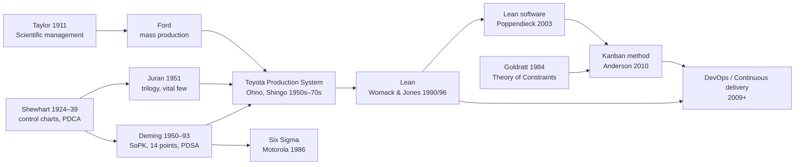
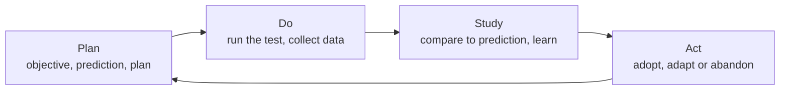
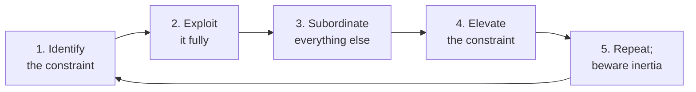

# Quality and Lean Thinkers

> **TL;DR** — The intellectual roots of Lean, Agile, Kanban, DevOps and SRE: Shewhart (variation and control charts), Deming (systems, variation, PDSA, "a bad system will beat a good person every time"), Juran (vital few, quality trilogy), Ishikawa, Crosby, Taguchi, Ohno and Shingo (Toyota Production System, waste, flow, jidoka, poka-yoke) and Goldratt (Theory of Constraints). Their central claim: most performance is determined by the system, not individual effort, so management's job is to improve the system using knowledge of variation and fast learning cycles. Contrast with Taylorism's separation of thinking from doing.

Entry format: **Statement** / **Origin** / **In practice** / **Example** / **Link**. Applied Kanban/Agile material: [../04-agile-kanban-scrum/README.md](../04-agile-kanban-scrum/README.md).

Contents:
1. [Lineage](#lineage)
2. [Walter Shewhart](#walter-shewhart)
3. [W. Edwards Deming](#w-edwards-deming)
4. [Joseph Juran and other quality pioneers](#joseph-juran-and-other-quality-pioneers)
5. [Taiichi Ohno, Shigeo Shingo and the Toyota Production System](#taiichi-ohno-shigeo-shingo-and-the-toyota-production-system)
6. [Eliyahu Goldratt and the Theory of Constraints](#eliyahu-goldratt-and-the-theory-of-constraints)
7. [Lean in software and product development](#lean-in-software-and-product-development)
8. [Taylorism vs Deming](#taylorism-vs-deming)

---

## Lineage

---

## Walter Shewhart

### Walter A. Shewhart
- **Statement:** Father of statistical quality control: processes show variation, which must be understood statistically before it can be managed.
- **Origin:** Bell Telephone Laboratories; control chart memo, 16 May 1924; *Economic Control of Quality of Manufactured Product*, 1931; *Statistical Method from the Viewpoint of Quality Control*, 1939 (edited by Deming).
- **In practice:** The foundation of SPC, Six Sigma, SRE error budgets and process-behaviour charts for delivery metrics.
- **Example:** Using a control chart to judge whether a rise in deployment failures is signal or noise.
- **Link:** https://en.wikipedia.org/wiki/Walter_A._Shewhart

### Control chart
- **Statement:** A time-series plot with a centre line and statistically derived control limits (typically ±3 sigma) that separates routine variation from exceptional signals.
- **Origin:** Walter Shewhart, 1924. Popularised as "process behaviour charts" (XmR charts) by Donald Wheeler.
- **In practice:** Plot cycle time, incident counts or error rates; react to points outside limits or runs (special causes), not to every up-and-down. Prevents tampering.
- **Example:** Lead time stays within 2–14 days for months; one item at 40 days is a special cause worth investigating.
- **Link:** https://en.wikipedia.org/wiki/Control_chart

### Common cause vs special cause variation
- **Statement:** Common-cause variation is inherent to the system (noise); special-cause variation comes from specific, identifiable events (signal). Shewhart used "chance" vs "assignable" causes.
- **Origin:** Shewhart, 1920s–30s; Deming's terminology, 1940s.
- **In practice:** Treating common cause as special (blaming individuals for random variation) is *tampering* and makes things worse; reducing common-cause variation requires changing the system (a management responsibility).
- **Example:** Questioning an engineer about a slower week that is within normal variation.
- **Link:** https://en.wikipedia.org/wiki/Common_cause_and_special_cause_(statistics)

### Shewhart cycle (PDCA)
- **Statement:** Plan–Do–Check–Act: an iterative cycle for learning and improvement, rooted in the scientific method.
- **Origin:** Shewhart's specification–production–inspection cycle, 1939; presented by Deming in Japan, 1950; Japanese managers formalised PDCA.
- **In practice:** The ancestor of sprints, retrospectives, build–measure–learn and Toyota Kata. See PDSA below.
- **Example:** Each sprint plans an improvement experiment and checks its effect at the retrospective.
- **Link:** https://en.wikipedia.org/wiki/PDCA

---

## W. Edwards Deming

### W. Edwards Deming
- **Statement:** Quality and productivity come from improving the system; around 94% of problems and possibilities for improvement belong to the system (management's responsibility), ~6% to special causes.
- **Origin:** Statistician; lectures to Japanese industry from 1950 (JUSE; Deming Prize, 1951); *Out of the Crisis* (1982/1986); *The New Economics* (1993).
- **In practice:** Stop blaming individuals for system outcomes; drive out fear; improve continually with knowledge of variation. Deeply influential on Lean, Agile and DevOps.
- **Example:** Instead of ranking engineers by tickets closed, fix the slow CI and unclear requirements that limit everyone.
- **Link:** https://deming.org/

### A bad system will beat a good person
- **Statement:** "A bad system will beat a good person every time" — individual excellence cannot overcome a poorly designed system.
- **Origin:** W. Edwards Deming, seminar remark, February 1993.
- **In practice:** When multiple people fail in the same way, change the system (tooling, process, incentives). Blameless postmortems, platform engineering and paved roads apply this.
- **Example:** A manual 40-step release process causes errors regardless of who runs it; automating it fixes the problem.
- **Link:** https://deming.org/a-bad-system-will-beat-a-good-person-every-time/

### Deming's 14 points for management
- **Statement:** Fourteen principles for transforming management, paraphrased in the table below.
- **Origin:** W. Edwards Deming, *Out of the Crisis*, 1982/1986.
- **In practice:** Many map directly to modern software practices: built-in quality (CI/testing), drive out fear (psychological safety), break down barriers (DevOps), eliminate numerical quotas (avoid velocity targets).
- **Example:** See table.
- **Link:** https://en.wikipedia.org/wiki/W._Edwards_Deming

| # | Point (paraphrased) | Software/product interpretation |
|---|---|---|
| 1 | Create constancy of purpose toward improving products and services | Long-lived product teams with stable missions |
| 2 | Adopt the new philosophy; management must lead change | Leadership owns transformation, not a "DevOps team" |
| 3 | Cease dependence on mass inspection; build quality in | Test automation, CI, pairing — not end-of-line QA gates |
| 4 | Don't award business on price alone; build long-term supplier relationships | Choose vendors and partners on total cost and quality |
| 5 | Improve constantly and forever the system of production and service | Continuous improvement; retros with real follow-through |
| 6 | Institute training on the job | Onboarding, pairing, mentoring, learning time |
| 7 | Institute leadership (help people do a better job) | Servant leadership; managers remove impediments |
| 8 | Drive out fear | Psychological safety; blameless culture |
| 9 | Break down barriers between departments | Cross-functional teams; DevOps; shared goals |
| 10 | Eliminate slogans, exhortations and targets for the workforce | No "zero bugs!" posters; fix the system |
| 11 | Eliminate numerical quotas and management by numbers/objectives alone | No velocity or ticket quotas |
| 12 | Remove barriers to pride of workmanship (incl. annual merit rating) | Let people do good work; reconsider stack ranking |
| 13 | Institute a vigorous programme of education and self-improvement | Conferences, guilds, learning budgets |
| 14 | Put everybody to work to accomplish the transformation | Transformation is everyone's job |

### Deming's seven deadly diseases
- **Statement:** Seven management practices Deming considered most harmful: lack of constancy of purpose; emphasis on short-term profits; evaluation by performance, merit rating or annual review; mobility of management (job hopping); running a company on visible figures alone; excessive medical costs; excessive costs of liability.
- **Origin:** W. Edwards Deming, *Out of the Crisis*, 1986.
- **In practice:** "Visible figures alone" anticipates the McNamara fallacy; the most important figures are unknown or unknowable (e.g., the value of a satisfied customer).
- **Example:** Cutting a reliability team to hit quarterly cost targets.
- **Link:** https://en.wikipedia.org/wiki/W._Edwards_Deming

### System of Profound Knowledge
- **Statement:** Four interrelated lenses for management: appreciation for a system, knowledge about variation, theory of knowledge (epistemology: prediction and learning), and psychology (intrinsic motivation).
- **Origin:** W. Edwards Deming, *The New Economics*, 1993.
- **In practice:** A compact checklist for any improvement initiative: do we see the whole system, understand its variation, have a testable theory, and respect human motivation?
- **Example:** Before introducing a productivity metric: is the variation common cause? What's our theory? How will people feel about being measured?
- **Link:** https://deming.org/explore/sopk/

### PDSA cycle
- **Statement:** Plan–Do–Study–Act; Deming preferred "Study" over "Check" to emphasise learning and comparing results with predictions.
- **Origin:** W. Edwards Deming, 1986–1993 (derived from the Shewhart cycle).
- **In practice:** Write a prediction before each experiment; study the gap between prediction and outcome. Foundation of hypothesis-driven development.
- **Example:** "We predict WIP limit 3 will cut cycle time by 30%" → run 4 weeks → study → adopt/adapt/abandon.
- **Link:** https://deming.org/explore/pdsa/

### Red bead experiment
- **Statement:** A teaching exercise where "workers" scoop beads from a mix containing red (defective) beads; results vary randomly and are entirely determined by the system, yet management rewards and punishes workers.
- **Origin:** W. Edwards Deming, four-day seminars, 1980s–1993.
- **In practice:** Demonstrates the futility of rating people on outcomes determined by the system, and of slogans and incentives.
- **Example:** Ranking support agents on resolution times dominated by ticket mix.
- **Link:** https://deming.org/explore/red-bead-experiment/

### Funnel experiment (tampering)
- **Statement:** Adjusting a stable process in response to each individual result (tampering) increases variation.
- **Origin:** Demonstrated by Deming (after Lloyd Nelson), 1980s.
- **In practice:** Re-planning after every sprint, constantly tweaking alert thresholds, or changing process after every incident adds variability.
- **Example:** Tuning autoscaling parameters after each spike makes the system less stable.
- **Link:** https://en.wikipedia.org/wiki/W._Edwards_Deming

---

## Joseph Juran and other quality pioneers

### Joseph M. Juran
- **Statement:** Quality is "fitness for use"; quality management consists of the trilogy of planning, control and improvement; most problems come from the "vital few" causes.
- **Origin:** *Quality Control Handbook*, 1951; lectures in Japan, 1954; Juran Trilogy, 1986.
- **In practice:** Prioritise defects by Pareto analysis; treat quality as a managerial process, not just inspection; build improvement into annual planning.
- **Example:** Pareto chart of incident causes shows two config systems drive 60% of outages.
- **Link:** https://en.wikipedia.org/wiki/Joseph_M._Juran

### Juran trilogy
- **Statement:** Quality planning (design products/processes to meet needs), quality control (hold gains, detect deviations), quality improvement (breakthrough to new levels).
- **Origin:** Joseph Juran, 1986.
- **In practice:** Analogous to product discovery, SLO monitoring and reliability improvement projects.
- **Example:** Define SLOs (planning), alert on burn rate (control), run reliability sprints (improvement).
- **Link:** https://en.wikipedia.org/wiki/Joseph_M._Juran

### Cost of quality
- **Statement:** Total cost of quality = prevention + appraisal + internal failure + external failure; prevention is cheapest, external failure most expensive.
- **Origin:** Armand Feigenbaum, 1956; Juran's "gold in the mine", 1951.
- **In practice:** Bugs found in production cost much more (support, reputation, hotfix) than those prevented by design and tests; justify investment in prevention.
- **Example:** A customer-facing data leak (external failure) dwarfs the cost of a security review.
- **Link:** https://en.wikipedia.org/wiki/Cost_of_quality

### Philip Crosby
- **Statement:** "Quality is free" — the cost of doing things wrong exceeds the cost of doing them right; the performance standard is zero defects.
- **Origin:** Philip B. Crosby, *Quality Is Free*, 1979.
- **In practice:** Influential but criticised (by Deming) for relying on exhortation; useful framing for prevention ROI.
- **Example:** Building a release checklist pays for itself after the first prevented rollback.
- **Link:** https://en.wikipedia.org/wiki/Philip_B._Crosby

### Armand Feigenbaum
- **Statement:** Total quality control: quality is everyone's job across the entire organisation, not just inspection.
- **Origin:** Armand V. Feigenbaum, *Total Quality Control*, 1951/1961.
- **In practice:** Precursor of TQM and "quality is a whole-team responsibility" in agile teams.
- **Example:** Product, design, dev and ops share quality goals.
- **Link:** https://en.wikipedia.org/wiki/Armand_V._Feigenbaum

### Kaoru Ishikawa
- **Statement:** Democratised quality tools; introduced quality circles and the cause-and-effect (fishbone) diagram; promoted the seven basic tools of quality.
- **Origin:** Kaoru Ishikawa, 1960s; *Guide to Quality Control*, 1968.
- **In practice:** Fishbone diagrams for incident analysis (people, process, technology, environment...); quality circles ≈ communities of practice.
- **Example:** A fishbone of contributing factors to slow onboarding.
- **Link:** https://en.wikipedia.org/wiki/Ishikawa_diagram

### Seven basic tools of quality
- **Statement:** Cause-and-effect diagram, check sheet, control chart, histogram, Pareto chart, scatter diagram, stratification (or flowchart).
- **Origin:** Kaoru Ishikawa, 1960s (JUSE).
- **In practice:** Simple, visual tools sufficient for most improvement problems — usable in retrospectives and ops reviews.
- **Example:** Pareto chart of flaky test causes followed by a scatter plot of test duration vs failure rate.
- **Link:** https://en.wikipedia.org/wiki/Seven_basic_tools_of_quality

### Genichi Taguchi
- **Statement:** Any deviation from the target value incurs a loss that grows quadratically (Taguchi loss function), even within specification limits; design products to be robust to variation.
- **Origin:** Genichi Taguchi, 1950s–1980s (robust design).
- **In practice:** "Within SLO" isn't the same as "no cost": latency creeping toward the threshold already hurts users. Design for robustness to noise factors.
- **Example:** A p99 of 290 ms against a 300 ms SLO is not "fine".
- **Link:** https://en.wikipedia.org/wiki/Taguchi_loss_function

### Total quality management
- **Statement:** Organisation-wide management approach to long-term success through customer satisfaction, with all members improving processes, products, services and culture.
- **Origin:** US Naval Air Systems Command, 1980s, synthesising Deming, Juran, Feigenbaum and Ishikawa.
- **In practice:** Antecedent of modern operational excellence programmes; often failed when reduced to slogans and certification.
- **Example:** ISO 9001 certification without changing how work is done.
- **Link:** https://en.wikipedia.org/wiki/Total_quality_management

### Six Sigma and DMAIC
- **Statement:** A data-driven methodology to reduce defects and variation (target 3.4 defects per million opportunities), structured as Define–Measure–Analyse–Improve–Control.
- **Origin:** Bill Smith, Motorola, 1986; popularised by Jack Welch at GE, 1995.
- **In practice:** Useful statistical toolkit for high-volume repeatable processes; heavyweight for creative product work. "Lean Six Sigma" combines it with flow thinking.
- **Example:** DMAIC applied to reduce payment-processing failure rate.
- **Link:** https://en.wikipedia.org/wiki/Six_Sigma

---

## Taiichi Ohno, Shigeo Shingo and the Toyota Production System

### Toyota Production System
- **Statement:** A socio-technical production system resting on two pillars — just-in-time and jidoka (automation with a human touch) — built on standardised work, heijunka (levelling) and kaizen.
- **Origin:** Taiichi Ohno, Shigeo Shingo, Eiji Toyoda, 1948–1975; Ohno's *Toyota Production System: Beyond Large-Scale Production*, 1978 (English 1988). Term "lean" from Krafcik (1988) and Womack, Jones & Roos, *The Machine That Changed the World*, 1990.
- **In practice:** Source of Kanban, continuous flow, stop-the-line quality and respect for people in software delivery.
- **Example:** A failing build stops all merges until fixed (stop the line).
- **Link:** https://en.wikipedia.org/wiki/Toyota_Production_System

### Taiichi Ohno
- **Statement:** Architect of TPS; focused on eliminating waste and shortening the timeline from order to cash.
- **Origin:** Toyota engineer and executive, 1940s–1970s.
- **In practice:** Value-stream thinking: measure lead time from idea to production and remove non-value-adding steps.
- **Example:** Mapping the path from commit to production reveals 3 days of waiting for approvals.
- **Link:** https://en.wikipedia.org/wiki/Taiichi_Ohno

### Seven wastes (muda)
- **Statement:** Transport, inventory, motion, waiting, overproduction, over-processing and defects (TIMWOOD); "unused talent/skills" is often added as an eighth.
- **Origin:** Taiichi Ohno, TPS.
- **In practice:** Software equivalents (Poppendieck): partially done work (inventory), extra features (overproduction), relearning, handoffs (transport), task switching (motion), delays (waiting), defects.
- **Example:** 40 PRs awaiting review = inventory; features nobody uses = overproduction.
- **Link:** https://en.wikipedia.org/wiki/Muda_(Japanese_term)

### Muda, mura, muri
- **Statement:** Three types of deviation from optimal flow: muda (waste), mura (unevenness) and muri (overburden).
- **Origin:** Toyota Production System.
- **In practice:** Uneven arrival of work (mura) and overloaded teams (muri) create waste (muda); level the load and limit WIP before chasing waste.
- **Example:** Quarter-end release crunches (mura) cause burnout (muri) and defects (muda).
- **Link:** https://en.wikipedia.org/wiki/Muda_(Japanese_term)

### Just-in-time
- **Statement:** Produce only what is needed, when it is needed, in the amount needed — pull rather than push.
- **Origin:** Kiichiro Toyoda, 1930s; Taiichi Ohno, 1950s.
- **In practice:** Pull systems and WIP limits; just-in-time requirements refinement; avoid large up-front backlogs that go stale.
- **Example:** Stories refined one or two sprints ahead, not a year.
- **Link:** https://en.wikipedia.org/wiki/Just-in-time_manufacturing

### Kanban (pull system)
- **Statement:** A signalling system (cards) that authorises production only when downstream consumption creates demand, limiting inventory.
- **Origin:** Taiichi Ohno, Toyota, ~1953 (inspired by supermarket restocking). Software Kanban method: David J. Anderson, 2010.
- **In practice:** Visualise work, limit WIP, manage flow, make policies explicit, implement feedback loops, improve collaboratively. See [../04-agile-kanban-scrum/README.md](../04-agile-kanban-scrum/README.md).
- **Example:** A WIP limit of 3 in "Review" forces swarming on reviews.
- **Link:** https://en.wikipedia.org/wiki/Kanban

### Jidoka (autonomation)
- **Statement:** Machines and people stop automatically when an abnormality occurs so defects never pass downstream; humans then fix the root cause.
- **Origin:** Sakichi Toyoda's automatic loom that stopped when a thread broke, 1896/1924.
- **In practice:** Failing tests block the pipeline; canary analysis halts rollouts automatically; linters fail builds.
- **Example:** Automated rollback when error rates rise during a deploy.
- **Link:** https://en.wikipedia.org/wiki/Autonomation

### Andon
- **Statement:** A visual signal (cord, light) that any worker can trigger to flag a problem and stop the line.
- **Origin:** Toyota Production System.
- **In practice:** Anyone can declare an incident or stop a release; a red build radiator; "stop the line" culture.
- **Example:** A junior engineer halts a rollout after noticing anomalous metrics, and is thanked.
- **Link:** https://en.wikipedia.org/wiki/Andon_(manufacturing)

### Five whys
- **Statement:** Ask "why?" repeatedly (about five times) to move from symptom toward underlying causes.
- **Origin:** Sakichi Toyoda; used in TPS by Taiichi Ohno.
- **In practice:** Quick and useful, but linear: it tends to yield a single "root cause" and depends on the asker. In complex systems, explore multiple branches and contributing factors (Cook, point 7).
- **Example:** Outage → bad config → no validation → schema not defined → no owner for config format.
- **Link:** https://en.wikipedia.org/wiki/Five_whys

### Gemba
- **Statement:** "The actual place" — go and see where the work happens to understand it (genchi genbutsu).
- **Origin:** Toyota Production System.
- **In practice:** Observe developers onboarding, watch users in context, sit with on-call during incidents, read production logs — rather than relying on reports.
- **Example:** A leader shadows support for a day and discovers the top customer pain.
- **Link:** https://en.wikipedia.org/wiki/Gemba

### Kaizen
- **Statement:** Continuous, incremental improvement involving everyone.
- **Origin:** Japanese post-war industry; popularised by Masaaki Imai, *Kaizen*, 1986.
- **In practice:** Retrospectives with small experiments; improvement time as part of every sprint, not a separate project.
- **Example:** Each week, the team removes one source of friction from local development.
- **Link:** https://en.wikipedia.org/wiki/Kaizen

### Heijunka
- **Statement:** Level the type and quantity of production over time to reduce unevenness.
- **Origin:** Toyota Production System.
- **In practice:** Mix work types steadily (features, debt, bugs) using classes of service rather than lurching between "feature quarters" and "stability quarters".
- **Example:** 70/20/10 allocation applied every sprint.
- **Link:** https://en.wikipedia.org/wiki/Heijunka

### Shigeo Shingo
- **Statement:** Industrial engineer who co-developed TPS and created SMED and poka-yoke; emphasised eliminating the causes of defects at the source.
- **Origin:** 1950s–1980s; *A Study of the Toyota Production System*, 1981.
- **In practice:** Make small batches economical by reducing setup cost; prevent errors rather than inspect for them.
- **Example:** Fast, cheap deployments make small batches viable.
- **Link:** https://en.wikipedia.org/wiki/Shigeo_Shingo

### Poka-yoke
- **Statement:** Mistake-proofing: design processes or devices so errors are impossible or immediately evident.
- **Origin:** Shigeo Shingo, 1960s.
- **In practice:** Type systems, schema validation, required fields, confirmation by typing the resource name, guard rails in IaC, protected branches.
- **Example:** A CLI that requires typing the production cluster name before destructive operations.
- **Link:** https://en.wikipedia.org/wiki/Poka-yoke

### SMED
- **Statement:** Single-Minute Exchange of Die — reduce setup/changeover time to under ten minutes, enabling small batches.
- **Origin:** Shigeo Shingo, 1950s–1969.
- **In practice:** Reducing the transaction cost of a deployment (automation, CI/CD) makes small, frequent releases economical — the essence of continuous delivery.
- **Example:** Deployment time cut from a day to 10 minutes enables daily releases.
- **Link:** https://en.wikipedia.org/wiki/Single-minute_exchange_of_die

### Value-stream mapping
- **Statement:** Visualise all steps (value-adding and not) and wait times needed to deliver a product from request to customer.
- **Origin:** Toyota "material and information flow" diagrams; Rother & Shook, *Learning to See*, 1998.
- **In practice:** Typically reveals flow efficiency (active time / lead time) of 5–15% in knowledge work: most time is waiting.
- **Example:** Idea-to-production lead time 60 days, of which 4 days of active work.
- **Link:** https://en.wikipedia.org/wiki/Value-stream_mapping

### Hoshin kanri
- **Statement:** Strategy deployment: align goals at all levels through iterative "catchball" between management layers, linked to PDCA.
- **Origin:** Japanese companies, 1950s–60s (Bridgestone, Toyota).
- **In practice:** An ancestor of OKRs with stronger emphasis on dialogue and few breakthrough objectives.
- **Example:** Teams propose how they will contribute to a company objective and negotiate scope.
- **Link:** https://en.wikipedia.org/wiki/Hoshin_Kanri

### Toyota Kata
- **Statement:** Improvement kata (understand direction, grasp current condition, establish next target condition, experiment toward it) plus coaching kata to build scientific thinking habits.
- **Origin:** Mike Rother, *Toyota Kata*, 2009.
- **In practice:** Structure retros and team coaching around target conditions and small experiments.
- **Example:** Target: "deploy any commit within 1 hour by end of quarter"; weekly experiments toward it.
- **Link:** https://en.wikipedia.org/wiki/Toyota_Kata

---

## Eliyahu Goldratt and the Theory of Constraints

### Theory of Constraints
- **Statement:** Every system has at least one constraint limiting its throughput; improving anything other than the constraint is an illusion.
- **Origin:** Eliyahu M. Goldratt, *The Goal*, 1984 (with Jeff Cox). *The Phoenix Project* (2013) adapts it to IT.
- **In practice:** Identify the bottleneck in your delivery flow (often testing, review, environments or a specialist), and focus improvement there. Map end-to-end flow first.
- **Example:** A security review team that takes three weeks is the constraint; faster developers just grow the queue.
- **Link:** https://en.wikipedia.org/wiki/Theory_of_constraints

### Five focusing steps
- **Statement:** (1) Identify the constraint; (2) exploit it (maximise its output); (3) subordinate everything else to it; (4) elevate it (invest to raise capacity); (5) repeat — don't let inertia become the constraint.
- **Origin:** Eliyahu Goldratt, *The Goal*, 1984 / *What Is This Thing Called Theory of Constraints*, 1990.
- **In practice:** Exploit = never let the bottleneck wait (prepared work, no meetings); subordinate = others pace work to it; elevate = automate or hire only after exploiting.
- **Example:** QA bottleneck: prioritise test-ready items (exploit), developers write tests (subordinate), automate regression (elevate).
- **Link:** https://en.wikipedia.org/wiki/Theory_of_constraints

### Drum-buffer-rope
- **Statement:** The constraint sets the pace (drum); a time buffer protects it from starvation; the rope releases work into the system only at the drum's pace.
- **Origin:** Eliyahu Goldratt and Robert Fox, *The Race*, 1986.
- **In practice:** WIP limits upstream of the bottleneck; keep a small ready queue in front of it.
- **Example:** Only start new stories when the review column has capacity.
- **Link:** https://en.wikipedia.org/wiki/Theory_of_constraints

### Critical chain project management
- **Statement:** Schedule on the longest chain of dependent tasks *and* resources; remove safety from individual tasks and aggregate it into project and feeding buffers; manage via buffer consumption.
- **Origin:** Eliyahu Goldratt, *Critical Chain*, 1997.
- **In practice:** Counters Parkinson's law and student syndrome; buffer burn charts give early warning. See [../03-project-management/README.md](../03-project-management/README.md).
- **Example:** Tasks estimated at 50% confidence with a shared 30% project buffer.
- **Link:** https://en.wikipedia.org/wiki/Critical_chain_project_management

### Thinking processes
- **Statement:** Logic tools for diagnosing and solving system problems: current reality tree, evaporating cloud (conflict resolution), future reality tree, prerequisite tree, transition tree.
- **Origin:** Eliyahu Goldratt, *It's Not Luck*, 1994.
- **In practice:** The evaporating cloud surfaces hidden assumptions behind apparent trade-offs (e.g., "speed vs quality").
- **Example:** Resolving "we need fast releases" vs "we need stable releases" by challenging the assumption that releases must be big.
- **Link:** https://en.wikipedia.org/wiki/Thinking_processes_(theory_of_constraints)

### Throughput accounting
- **Statement:** Manage by throughput (rate of generating money through sales), inventory/investment and operating expense, rather than local cost efficiencies.
- **Origin:** Eliyahu Goldratt, 1980s.
- **In practice:** Challenges utilisation-based thinking: idle non-bottleneck capacity is fine; local efficiency metrics mislead.
- **Example:** Rejecting a "keep every developer 100% busy" goal.
- **Link:** https://en.wikipedia.org/wiki/Throughput_accounting

---

## Lean in software and product development

### Lean software development
- **Statement:** Seven principles: eliminate waste, amplify learning, decide as late as possible, deliver as fast as possible, empower the team, build integrity in, see the whole.
- **Origin:** Mary and Tom Poppendieck, *Lean Software Development*, 2003.
- **In practice:** Small batches, fast feedback, last responsible moment for irreversible decisions, end-to-end optimisation.
- **Example:** Decoupling deploy from release with feature flags to deliver fast and learn.
- **Link:** https://en.wikipedia.org/wiki/Lean_software_development

### Lean thinking principles
- **Statement:** Specify value from the customer's view; identify the value stream; make value flow; let the customer pull; pursue perfection.
- **Origin:** James Womack and Daniel Jones, *Lean Thinking*, 1996.
- **In practice:** A compact strategy for any service-improvement effort.
- **Example:** Redesigning onboarding by starting from the customer's definition of "first value".
- **Link:** https://en.wikipedia.org/wiki/Lean_manufacturing

### Principles of product development flow
- **Statement:** Economic framework for product development: quantify cost of delay, manage queues, reduce batch size, apply WIP constraints, control flow under uncertainty, use fast feedback, decentralise control.
- **Origin:** Donald G. Reinertsen, *The Principles of Product Development Flow*, 2009 (175 principles).
- **In practice:** "If you only quantify one thing, quantify the cost of delay." Queues are the root cause of most economic waste in product development. See [economics-and-strategy-models.md](economics-and-strategy-models.md).
- **Example:** Prioritising by CD3 rather than by stakeholder volume.
- **Link:** https://en.wikipedia.org/wiki/Cost_of_delay

---

## Taylorism vs Deming

### Scientific management (Taylorism)
- **Statement:** Optimise work by scientific study of tasks, standardisation, separation of planning (management) from execution (workers), and incentive pay.
- **Origin:** Frederick Winslow Taylor, *The Principles of Scientific Management*, 1911.
- **In practice:** Productive for repetitive manual work; harmful in knowledge work when it creates command-and-control, utilisation targets and individual piece-rate metrics.
- **Example:** Measuring developers by lines of code or tickets per day.
- **Link:** https://en.wikipedia.org/wiki/Scientific_management

| Dimension | Taylorism | Deming / Lean |
|---|---|---|
| Unit of improvement | Individual task and worker | Whole system / value stream |
| Who thinks | Managers and planners | Everyone, especially those doing the work |
| Variation | Worker's fault; enforce standards | Mostly common cause; management must change the system |
| Quality | Inspected in at the end | Built in at the source (jidoka, CI) |
| Motivation | Extrinsic: piece rates, incentives | Intrinsic: pride of workmanship, drive out fear |
| Metrics | Individual output, utilisation | Flow, throughput, customer value, process behaviour |
| Targets | Numeric quotas | Eliminate quotas; understand capability |
| Supplier relations | Lowest price | Long-term partnership, total cost |
| Learning | Fixed "one best way" | Continuous PDSA |
| Software analogue | Ticket factories, resource utilisation charts | Product teams, flow metrics, continuous delivery |

---

## References
- Deming, W. E. *Out of the Crisis* (1986); *The New Economics* (1993) — https://deming.org/
- Shewhart, W. A. *Economic Control of Quality of Manufactured Product* (1931) — https://en.wikipedia.org/wiki/Walter_A._Shewhart
- Juran, J. M. *Quality Control Handbook* (1951) — https://en.wikipedia.org/wiki/Joseph_M._Juran
- Ohno, T. *Toyota Production System* (1978/1988) — https://en.wikipedia.org/wiki/Toyota_Production_System
- Goldratt, E. M. *The Goal* (1984), *Critical Chain* (1997) — https://en.wikipedia.org/wiki/The_Goal_(novel)
- Womack, Jones & Roos, *The Machine That Changed the World* (1990) — https://en.wikipedia.org/wiki/The_Machine_That_Changed_the_World_(book)
- Poppendieck, M. & T. *Lean Software Development* (2003) — https://en.wikipedia.org/wiki/Lean_software_development
- Reinertsen, D. *The Principles of Product Development Flow* (2009)
- Wheeler, D. *Understanding Variation* (1993)
- Kim, Behr, Spafford, *The Phoenix Project* (2013) — https://en.wikipedia.org/wiki/The_Phoenix_Project
- Related sections: [../04-agile-kanban-scrum/README.md](../04-agile-kanban-scrum/README.md), [../03-project-management/README.md](../03-project-management/README.md), [../08-engineering/README.md](../08-engineering/README.md)
