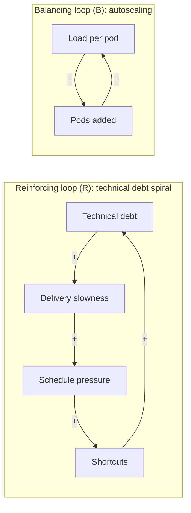
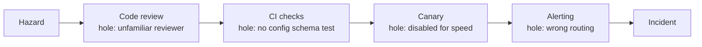

# Systems Thinking and Complexity

> **TL;DR** — Behaviour arises from structure: stocks, flows, feedback loops and delays. Complex socio-technical systems (production software plus the people operating it) are always partly broken, run in degraded mode, and are kept safe by human adaptation. Failures have multiple contributing causes, not a single root cause. Intervene at high-leverage points (goals, rules, information flows) rather than parameters, and learn from what goes right as well as what goes wrong.

Entry format: **Statement** / **Origin** / **In practice** / **Example** / **Link**. Related: Gall's law and Hyrum's law in [software-and-engineering-laws.md](software-and-engineering-laws.md); Conway's law in [organizational-and-management-laws.md](organizational-and-management-laws.md); Cynefin in [mental-models.md](mental-models.md).

Contents:
1. [Systems thinking fundamentals](#systems-thinking-fundamentals)
2. [Leverage points](#leverage-points)
3. [System archetypes](#system-archetypes)
4. [Cybernetics and control](#cybernetics-and-control)
5. [Complexity and emergence](#complexity-and-emergence)
6. [Accidents, safety and resilience](#accidents-safety-and-resilience)
7. [How complex systems fail (Cook's 18 points)](#how-complex-systems-fail-cooks-18-points)
8. [Failure dynamics in distributed systems](#failure-dynamics-in-distributed-systems)

---

## Systems thinking fundamentals

### Systems thinking
- **Statement:** Understand behaviour by looking at the whole system — its elements, interconnections and purpose — rather than isolated parts or events.
- **Origin:** Ludwig von Bertalanffy (general systems theory, 1940s–1968); Jay Forrester (system dynamics, MIT, 1956–1961); Donella Meadows, *Thinking in Systems*, 2008; Peter Senge, *The Fifth Discipline*, 1990.
- **In practice:** Move from events ("the deploy failed") to patterns ("deploys fail on Fridays") to structure ("we batch changes before weekends because of a freeze policy"). Fix structure.
- **Example:** Recurring incidents traced to an incentive that rewards shipping over operability.
- **Link:** https://en.wikipedia.org/wiki/Systems_thinking

### Stocks and flows
- **Statement:** A stock is an accumulation (backlog, technical debt, users, trust, cash); flows are rates that fill or drain it. Stocks change only through flows and act as buffers that create delays.
- **Origin:** Jay Forrester, *Industrial Dynamics*, 1961; Meadows, 2008.
- **In practice:** A backlog grows whenever inflow (requests) > outflow (throughput); hiring adds to the "skilled people" stock only after a ramp-up delay. Model key stocks explicitly.
- **Example:** Bug stock = bugs created − bugs fixed; adding QA alone increases the found-bug inflow.
- **Link:** https://en.wikipedia.org/wiki/Stock_and_flow

### Reinforcing feedback loop
- **Statement:** A loop where change in one direction produces more change in the same direction (exponential growth or collapse).
- **Origin:** Cybernetics (Norbert Wiener, 1948); system dynamics.
- **In practice:** Network effects, compounding technical debt, burnout spirals, retry storms. Find the loop, then add a balancing loop or break the link.
- **Example:** More debt → slower delivery → more pressure → more shortcuts → more debt.
- **Link:** https://en.wikipedia.org/wiki/Positive_feedback

### Balancing feedback loop
- **Statement:** A goal-seeking loop that counteracts change and moves a stock towards a target (stability, resistance to change).
- **Origin:** Cybernetics; thermostats as the canonical example.
- **In practice:** Autoscaling, rate limiting, backpressure, WIP limits and error budgets are designed balancing loops. Organisational resistance to change is often an unseen balancing loop.
- **Example:** An autoscaler adds pods as CPU rises, bringing CPU back to target.
- **Link:** https://en.wikipedia.org/wiki/Negative_feedback

### Delays
- **Statement:** Time lags between action and effect cause oscillation, overshoot and wrong attributions.
- **Origin:** Forrester; Senge's "cause and effect are not closely related in time and space".
- **In practice:** Hiring takes months to affect throughput; autoscaling with slow startup overshoots; metrics with lag mislead. Shorten delays or act more gently.
- **Example:** A team over-hires during a crunch, then has too many people when they finally ramp up.
- **Link:** https://en.wikipedia.org/wiki/System_dynamics

### Bullwhip effect
- **Statement:** Small demand fluctuations amplify as they move up a supply chain because each stage over-reacts with delays.
- **Origin:** Jay Forrester, 1961; Lee, Padmanabhan & Whang, 1997; demonstrated by the MIT Beer Distribution Game.
- **In practice:** Upstream services and teams see amplified load from retries, cache misses and batching; share real demand signals and reduce batch sizes and delays.
- **Example:** A 10% traffic spike becomes a 3× database spike after retries at three layers.
- **Link:** https://en.wikipedia.org/wiki/Bullwhip_effect

### Senge's laws of the fifth discipline
- **Statement:** Eleven systems "laws" (paraphrased): today's problems come from yesterday's solutions; the harder you push, the harder the system pushes back; behaviour grows better before it grows worse; the easy way out usually leads back in; the cure can be worse than the disease; faster is slower; cause and effect are not closely related in time and space; small changes can produce big results but leverage is non-obvious; you can have both trade-offs, just not at once; dividing an elephant in half does not produce two small elephants; there is no blame.
- **Origin:** Peter Senge, *The Fifth Discipline*, 1990.
- **In practice:** A compact checklist for reviewing proposed fixes, reorganisations and process changes.
- **Example:** A hiring freeze to cut costs (yesterday's solution) causes today's contractor overspend.
- **Link:** https://en.wikipedia.org/wiki/The_Fifth_Discipline

### The purpose of a system is what it does
- **Statement:** (POSIWID) A system's purpose is best inferred from what it actually does, not from stated intentions.
- **Origin:** Stafford Beer, 2001 (cybernetics).
- **In practice:** If the approval process mostly delays changes without catching defects, its de facto purpose is delay and blame-shifting. Judge processes by outcomes.
- **Example:** A "quality gate" that never fails anything is a ritual.
- **Link:** https://en.wikipedia.org/wiki/The_purpose_of_a_system_is_what_it_does

---

## Leverage points

### Meadows' twelve leverage points
- **Statement:** Places to intervene in a system, from least to most effective: numbers are weakest; goals, paradigms and the power to transcend paradigms are strongest.
- **Origin:** Donella Meadows, "Leverage Points: Places to Intervene in a System", 1997/1999.
- **In practice:** Organisations default to tweaking parameters (budgets, targets, headcount). Higher leverage: change information flows (make cost visible to teams), rules (who can deploy), goals (outcomes not outputs) and mindsets.
- **Example:** Showing each team its cloud bill (information flow, #6) cuts spend more than a cost-cutting target (#12).
- **Link:** https://en.wikipedia.org/wiki/Twelve_leverage_points

| Rank | Leverage point (paraphrased) | Software/organisation example |
|---|---|---|
| 12 (weakest) | Constants, parameters, numbers | Timeout values, budget amounts, sprint length |
| 11 | Size of buffers and stabilising stocks relative to flows | Queue sizes, capacity headroom, cash reserve |
| 10 | Structure of material stocks and flows | Network topology, data pipelines, physical infrastructure |
| 9 | Length of delays relative to rate of change | CI time, deployment lead time, feedback latency |
| 8 | Strength of balancing feedback loops | Monitoring, alerting, error budgets, circuit breakers |
| 7 | Gain of reinforcing feedback loops | Growth loops, viral mechanics, debt spirals |
| 6 | Structure of information flows (who knows what) | Cost visibility, open dashboards, transparent roadmaps |
| 5 | Rules of the system (incentives, constraints) | Deployment policies, promotion criteria, SLAs |
| 4 | Power to add, change or self-organise structure | Team autonomy, internal platforms, inner source |
| 3 | Goals of the system | "Customer outcomes" vs "features shipped" |
| 2 | Mindset or paradigm | "Ops is a cost centre" vs "reliability is a feature" |
| 1 (strongest) | Power to transcend paradigms | Recognising no paradigm is "true"; staying flexible |

---

## System archetypes

### System archetypes
- **Statement:** Recurring structures of feedback loops that produce characteristic behaviour patterns across domains.
- **Origin:** Peter Senge, *The Fifth Discipline*, 1990; Daniel Kim and colleagues at Innovation Associates.
- **In practice:** Recognising an archetype suggests its known intervention.
- **Example:** See table.
- **Link:** https://en.wikipedia.org/wiki/System_archetype

| Archetype | Pattern | Engineering example | Intervention |
|---|---|---|---|
| **Fixes that fail** | A quick fix relieves a symptom but has delayed side effects that worsen the problem | Restarting a leaking service via cron | Address root structure; watch for delayed effects |
| **Shifting the burden** | Symptomatic solution erodes capacity for the fundamental solution | Heroes firefighting means nobody fixes reliability | Strengthen the fundamental solution; wean off the symptomatic one |
| **Limits to growth** | Growth hits a balancing constraint | Adoption stalls because onboarding requires a single expert | Remove the limit before pushing growth |
| **Success to the successful** | Winner gets more resources, loser starves | One product line gets all senior engineers | Allocate resources by strategy, not past success |
| **Escalation** | Two parties each respond to the other's threat with more | Teams escalate priorities against each other | Unilateral de-escalation; shared goals |
| **Eroding goals** | Gap between goal and reality closed by lowering the goal | SLO quietly relaxed every quarter | Anchor goals to external standards |
| **Tragedy of the commons** | Individually rational use depletes a shared resource | Shared cluster overloaded | Governance, quotas, visibility |
| **Growth and underinvestment** | Growth slows because capacity investment lags | Platform underfunded until it blocks product teams | Invest ahead of demand using leading indicators |
| **Accidental adversaries** | Partners' local fixes undermine each other | Dev team speeds up by bypassing ops controls; ops adds more gates | Joint goals, shared ownership |

---

## Cybernetics and control

### Cybernetics
- **Statement:** The study of control and communication in animals and machines — goals, sensing, feedback and regulation.
- **Origin:** Norbert Wiener, *Cybernetics*, 1948; Macy conferences 1946–1953.
- **In practice:** Control loops underpin Kubernetes reconcilers, autoscaling, SRE error-budget policies and OKR check-ins.
- **Example:** A Kubernetes controller continuously reconciles actual state to desired state.
- **Link:** https://en.wikipedia.org/wiki/Cybernetics

### Ashby's law of requisite variety
- **Statement:** Only variety can absorb variety: a regulator must have at least as many possible responses as the disturbances it must counter.
- **Origin:** W. Ross Ashby, *An Introduction to Cybernetics*, 1956.
- **In practice:** A rigid central process cannot govern a diverse portfolio of teams; give teams autonomy (variety) within guardrails. A one-size runbook cannot handle novel incidents — skilled humans can.
- **Example:** A single enterprise template for all products fails for ML workloads.
- **Link:** https://en.wikipedia.org/wiki/Variety_(cybernetics)

### Good regulator theorem
- **Statement:** Every good regulator of a system must be (contain) a model of that system.
- **Origin:** Roger Conant and W. Ross Ashby, 1970.
- **In practice:** You can't operate what you can't model: observability, service catalogues and accurate architecture docs are prerequisites for control.
- **Example:** An on-call team without dependency maps can't predict blast radius.
- **Link:** https://en.wikipedia.org/wiki/Good_regulator

### Viable system model
- **Statement:** Any viable (self-sustaining) organisation has five interacting subsystems: operations (S1), coordination (S2), control (S3, with audit S3*), intelligence/environment scanning (S4) and policy/identity (S5).
- **Origin:** Stafford Beer, *Brain of the Firm*, 1972.
- **In practice:** A lens for diagnosing missing functions: e.g., no S2 (inter-team coordination) causes oscillation; no S4 means nobody watches the market or tech landscape.
- **Example:** Platform engineering acting as S2/S3 for product teams.
- **Link:** https://en.wikipedia.org/wiki/Viable_system_model

### Le Chatelier's principle
- **Statement:** A system at equilibrium responds to a disturbance by shifting to counteract it.
- **Origin:** Henry Louis Le Chatelier, chemistry, 1884. Applied loosely to organisations and economics.
- **In practice:** Organisations absorb change initiatives and drift back; adding a gate prompts workarounds. Expect counter-reaction and design for it.
- **Example:** Tighter change approval leads teams to bundle changes into larger releases.
- **Link:** https://en.wikipedia.org/wiki/Le_Chatelier%27s_principle

---

## Complexity and emergence

### Emergence
- **Statement:** System-level properties and behaviours arise from interactions among parts and are not present in, nor predictable from, the parts alone.
- **Origin:** G. H. Lewes, 1875; complexity science (Santa Fe Institute, 1984 onward).
- **In practice:** Reliability, security, performance and culture are emergent — they can't be fully verified component by component. Test the whole system (load tests, game days).
- **Example:** Individually fine retry policies produce a retry storm together.
- **Link:** https://en.wikipedia.org/wiki/Emergence

### Complex adaptive systems
- **Statement:** Systems of many interacting agents that adapt and learn, producing non-linear, emergent and path-dependent behaviour.
- **Origin:** John Holland, Murray Gell-Mann and the Santa Fe Institute, 1980s–1990s.
- **In practice:** Organisations and markets are CAS: use experiments, short feedback loops and boundaries rather than detailed predictions.
- **Example:** A reorganisation produces informal networks nobody designed.
- **Link:** https://en.wikipedia.org/wiki/Complex_adaptive_system

### Butterfly effect
- **Statement:** In chaotic systems, small differences in initial conditions lead to vastly different outcomes.
- **Origin:** Edward Lorenz, weather models, 1963/1972.
- **In practice:** Long-range forecasts of complex systems are unreliable; tiny config differences across environments matter (drift). Prefer reproducibility (IaC, immutable images).
- **Example:** A one-character config difference between staging and production.
- **Link:** https://en.wikipedia.org/wiki/Butterfly_effect

### Braess's paradox
- **Statement:** Adding capacity (e.g., a road) to a network can make overall performance worse when users choose routes selfishly.
- **Origin:** Dietrich Braess, 1968.
- **In practice:** Adding a shortcut route, cache tier or load-balancing path can reduce overall throughput; selfish client behaviour (greedy retries) can degrade shared networks. Measure end to end.
- **Example:** Road closures in Seoul and New York reportedly improved traffic flow.
- **Link:** https://en.wikipedia.org/wiki/Braess%27s_paradox

---

## Accidents, safety and resilience

### Normal accidents
- **Statement:** In systems with interactive complexity and tight coupling, multiple failures will inevitably interact in unexpected ways — accidents are "normal".
- **Origin:** Charles Perrow, *Normal Accidents*, 1984 (after Three Mile Island, 1979).
- **In practice:** Reduce coupling (async messaging, bulkheads, timeouts) and interactive complexity (fewer hidden dependencies) rather than adding more safety layers that themselves add complexity.
- **Example:** A monitoring system overloaded by the outage it should report.
- **Link:** https://en.wikipedia.org/wiki/Normal_Accidents

### Swiss cheese model
- **Statement:** Defences are layers with holes (latent conditions and active failures); accidents happen when holes in successive layers momentarily align.
- **Origin:** James Reason, *Human Error*, 1990; refined in *Managing the Risks of Organizational Accidents*, 1997.
- **In practice:** Ask which layers failed and why the holes existed (latent conditions), not just who made the last error. Caveat: layers aren't independent, and the model can imply linear causality.
- **Example:** A bad config passed code review, CI didn't validate it, canary was disabled, and alerting was misrouted.
- **Link:** https://en.wikipedia.org/wiki/Swiss_cheese_model

### Resilience engineering
- **Statement:** Safety comes from a system's capacity to anticipate, monitor, respond and learn — adapting to variability — rather than from eliminating all failure.
- **Origin:** Erik Hollnagel, David Woods, Nancy Leveson et al., *Resilience Engineering*, 2006.
- **In practice:** Invest in adaptive capacity: skilled on-call, good tooling, slack, observability, learning reviews. Study normal work, not just failures.
- **Example:** Operators improvise a manual failover the runbook didn't cover.
- **Link:** https://en.wikipedia.org/wiki/Resilience_engineering

### Safety-I and Safety-II
- **Statement:** Safety-I defines safety as the absence of failures and focuses on what goes wrong; Safety-II defines it as the ability to succeed under varying conditions and studies what goes right.
- **Origin:** Erik Hollnagel, *Safety-I and Safety-II*, 2014.
- **In practice:** Complement incident postmortems with studies of successful work ("how do deploys usually go right?"), near misses and workarounds. Performance variability is the source of both success and failure.
- **Example:** Interviewing on-call engineers about how they avoid incidents reveals undocumented checks.
- **Link:** https://en.wikipedia.org/wiki/Erik_Hollnagel

### ETTO principle
- **Statement:** People and organisations constantly trade efficiency against thoroughness; they cannot maximise both.
- **Origin:** Erik Hollnagel, *The ETTO Principle*, 2009.
- **In practice:** Under time pressure, people rationally cut thoroughness; blaming them after failure ignores that the same trade-off is praised when it succeeds.
- **Example:** Skipping a staging test is "efficient" until it isn't.
- **Link:** https://en.wikipedia.org/wiki/Erik_Hollnagel

### Drift into failure
- **Statement:** Organisations slowly drift towards failure through a sequence of small, locally rational decisions that erode safety margins, each seeming normal at the time.
- **Origin:** Sidney Dekker, *Drift into Failure*, 2011 (building on Jens Rasmussen's 1997 model of migration toward the boundary of acceptable performance).
- **In practice:** Track margin erosion: growing alert noise, rising utilisation, more exceptions to policy. Periodically re-examine "normal".
- **Example:** Disk headroom drops from 50% to 5% over two years without anyone deciding it.
- **Link:** https://en.wikipedia.org/wiki/Sidney_Dekker

### Normalisation of deviance
- **Statement:** Repeated acceptance of deviations from standards without bad outcomes leads people to treat the deviation as normal.
- **Origin:** Diane Vaughan, *The Challenger Launch Decision*, 1996.
- **In practice:** Flaky tests ignored, warnings suppressed, alerts snoozed — each normalised. Treat recurring deviations as signals.
- **Example:** "That alert always fires, ignore it" — until the day it was real.
- **Link:** https://en.wikipedia.org/wiki/Normalization_of_deviance

### Just culture
- **Statement:** Distinguish human error (console), at-risk behaviour (coach) and reckless behaviour (sanction); most errors are system-induced and should not be punished.
- **Origin:** James Reason, 1997; David Marx, 2001; Sidney Dekker, *Just Culture*, 2007.
- **In practice:** Encourages reporting; enables learning. Pairs with psychological safety and blameless postmortems.
- **Example:** An engineer who ran a destructive command lacking safeguards is not disciplined; the tooling is fixed.
- **Link:** https://en.wikipedia.org/wiki/Just_culture

### Blameless postmortems
- **Statement:** Incident reviews focus on contributing factors and systemic improvements, assuming everyone acted with good intentions on the information they had.
- **Origin:** Aviation and medicine; adopted by Etsy (John Allspaw, 2012) and Google SRE (*Site Reliability Engineering*, 2016).
- **In practice:** Timeline, contributing factors, what went well, action items with owners; avoid "root cause" singular and counterfactuals ("should have"). See [../08-engineering/README.md](../08-engineering/README.md).
- **Example:** A review asks "what made this action seem reasonable at the time?"
- **Link:** https://sre.google/sre-book/postmortem-culture/

---

## How complex systems fail (Cook's 18 points)

### How complex systems fail
- **Statement:** Eighteen short observations about failure in complex systems, originally from medicine, now foundational for SRE and incident analysis.
- **Origin:** Richard I. Cook, MD, University of Chicago Cognitive Technologies Laboratory, 1998 (revised 2000).
- **In practice:** Use the list to frame postmortems, design reviews and on-call training. Paraphrased below.
- **Example:** See table.
- **Link:** https://how.complexsystems.fail/

| # | Point (paraphrased) | Implication for software operations |
|---|---|---|
| 1 | Complex systems are intrinsically hazardous | Risk never reaches zero; manage it |
| 2 | They are heavily and successfully defended against failure | Many layers of defence exist and mostly work |
| 3 | Catastrophe requires multiple failures; single points are not enough | Major incidents are combinations of small issues |
| 4 | They contain changing mixtures of latent failures | Bugs and misconfigurations always lurk; you can't fix them all |
| 5 | They run in degraded mode | Something is always partly broken; production is never "clean" |
| 6 | Catastrophe is always just around the corner | Don't mistake quiet for safety |
| 7 | Attributing an accident to a single "root cause" is fundamentally wrong | Look for contributing factors |
| 8 | Hindsight biases post-accident assessment of human performance | Judge by what was knowable then |
| 9 | Operators have dual roles: producers and defenders against failure | Pressure to deliver and to be safe coexist |
| 10 | All practitioner actions are gambles | Decisions under uncertainty; outcomes aren't proof of quality |
| 11 | Actions at the sharp end resolve all ambiguity | Policies conflict; operators resolve them in the moment |
| 12 | Human practitioners are the adaptable element | People create safety by adapting |
| 13 | Human expertise is constantly changing | Turnover and new tech demand continuous training |
| 14 | Change introduces new forms of failure | Every deploy, migration and "safety fix" adds risk |
| 15 | Views of "cause" limit the effectiveness of defences | Narrow causal stories yield narrow fixes |
| 16 | Safety is a property of systems, not components | Can't buy safety by hardening one part |
| 17 | People continuously create safety | Safety is an activity, not a state |
| 18 | Failure-free operation requires experience with failure | Practise: game days, chaos engineering, drills |

---

## Failure dynamics in distributed systems

### Cascading failure
- **Statement:** Failure of one component increases load on others, causing them to fail in turn.
- **Origin:** Power-grid engineering (e.g., Northeast blackout of 2003); distributed systems practice.
- **In practice:** Use load shedding, circuit breakers, bulkheads, timeouts and retry budgets; size for N+1 with failover load in mind.
- **Example:** One overloaded replica fails, traffic shifts to two others, which then fail.
- **Link:** https://en.wikipedia.org/wiki/Cascading_failure

### Thundering herd problem
- **Statement:** Many processes waiting for an event wake up at once and compete for a resource, overwhelming it.
- **Origin:** Operating systems (process scheduling); applies to caches and clients.
- **In practice:** Add jitter to retries and cron jobs, use request coalescing ("single flight") for cache misses, stagger cache TTLs.
- **Example:** A cache expiry at midnight sends every request to the database simultaneously.
- **Link:** https://en.wikipedia.org/wiki/Thundering_herd_problem

### Metastable failures
- **Statement:** A system enters a bad state triggered by a temporary event and stays there even after the trigger is removed, sustained by a feedback loop (e.g., retries, cache misses).
- **Origin:** Bronson, Aghayev, Charapko & Zhu, "Metastable Failures in Distributed Systems", HotOS 2021.
- **In practice:** Recovery may require shedding load or disabling retries; design retry budgets and admission control so the system can return to the stable state.
- **Example:** A brief network blip triggers retries that keep the service at 100% utilisation indefinitely.
- **Link:** https://en.wikipedia.org/wiki/Cascading_failure

---

## References
- Meadows, D. *Thinking in Systems: A Primer* (2008) — https://en.wikipedia.org/wiki/Thinking_In_Systems:_A_Primer
- Meadows, D. "Leverage Points: Places to Intervene in a System" (1999) — https://en.wikipedia.org/wiki/Twelve_leverage_points
- Senge, P. *The Fifth Discipline* (1990) — https://en.wikipedia.org/wiki/The_Fifth_Discipline
- Cook, R. I. *How Complex Systems Fail* (1998) — https://how.complexsystems.fail/
- Perrow, C. *Normal Accidents* (1984) — https://en.wikipedia.org/wiki/Normal_Accidents
- Reason, J. *Human Error* (1990) — https://en.wikipedia.org/wiki/Swiss_cheese_model
- Dekker, S. *Drift into Failure* (2011), *The Field Guide to Understanding 'Human Error'* (2006/2014)
- Hollnagel, E. *Safety-I and Safety-II* (2014)
- Ashby, W. R. *An Introduction to Cybernetics* (1956) — https://en.wikipedia.org/wiki/W._Ross_Ashby
- Google, *Site Reliability Engineering* (2016) — https://sre.google/sre-book/postmortem-culture/
- Related sections: [../05-software-architecture/README.md](../05-software-architecture/README.md), [../06-cloud-architecture/README.md](../06-cloud-architecture/README.md), [../08-engineering/README.md](../08-engineering/README.md)
