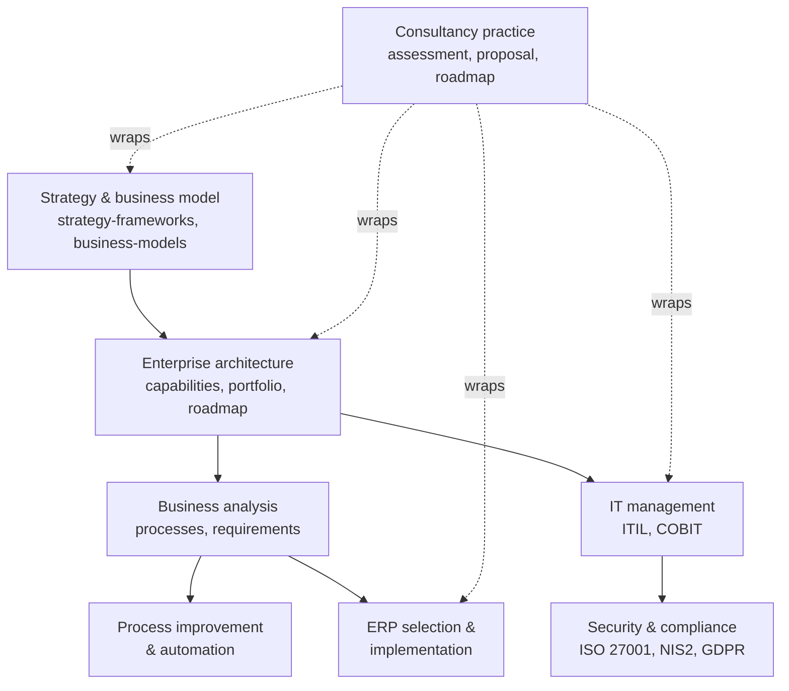

# 11 — Enterprise Architecture & Business

> **TL;DR** Everything between business strategy and the IT landscape: enterprise architecture frameworks (TOGAF 10, ArchiMate 3.2, Zachman), the practical EA toolkit (capability maps, value streams, TIME, pace layers, governance, radar), business analysis (BABOK, BPMN, process mining, root cause), process improvement and automation (Lean Six Sigma, Power Platform, RPA), ERP (modules, end-to-end processes, vendors, clean core, selection, implementation), IT management (ITIL 4, COBIT), security and compliance (ISO 27001, NIS2/Cbw, GDPR, BIO), strategy tools, business cases, and consultancy practice — plus ready-to-use templates.

## Files

| File | What's in it |
|---|---|
| [ea-frameworks-togaf-archimate-zachman.md](ea-frameworks-togaf-archimate-zachman.md) | TOGAF 10 ADM phases, content framework, Enterprise Continuum, principles template; ArchiMate 3.2 layers, elements, relationships, viewpoints; Zachman 6x6 |
| [ea-practice-capabilities-portfolio.md](ea-practice-capabilities-portfolio.md) | Architect roles, capability maps and heat-mapping, value streams, pace layers, application portfolio & TIME, reference architectures, governance, tech radar, EA tools |
| [business-analysis.md](business-analysis.md) | BABOK v3 (6 knowledge areas), SIPOC, BPMN 2.0 and common mistakes, DMN, process mining, current vs future state, gap analysis, VSM, 5 Whys / Ishikawa / Pareto, elicitation, use cases |
| [process-improvement-automation.md](process-improvement-automation.md) | Lean Six Sigma (DMAIC, DMADV, belts, sigma table, Cp/Cpk), BPM lifecycle, RPA vs API vs low-code decision guide, Power Platform & Logic Apps, candidate scoring, hyperautomation, AI-assisted automation |
| [erp-modules-processes-vendors.md](erp-modules-processes-vendors.md) | ERP modules (finance, procurement, inventory, MRP/MRP II, production, sales), O2C/P2P/R2R/plan-to-produce/H2R flows, vendor comparison (SAP, Dynamics, NetSuite, Exact, AFAS, Odoo, Infor), Dutch localization, HRIS & payroll |
| [erp-implementation-selection.md](erp-implementation-selection.md) | Clean core, fit-to-standard, build/buy/configure, two-tier ERP, selection process, master data, integration patterns, ERP UX, implementation phases, failure causes |
| [it-management-itil-cobit.md](it-management-itil-cobit.md) | ITIL 4 (SVS, value chain, 7 principles, 34 practices, 4 dimensions), COBIT 2019, ISO/IEC 20000, ITSM for small teams, vendor management, IT budgeting, shadow IT & SaaS, endpoint, joiner-mover-leaver, IT strategy on a page |
| [security-compliance-iso27001-nis2-gdpr.md](security-compliance-iso27001-nis2-gdpr.md) | ISO/IEC 27001:2022 clauses and all 93 Annex A controls, NIS2 scope and duties, Dutch Cyberbeveiligingswet, GDPR/AVG for IT, BIO, integrated control mapping |
| [strategy-frameworks.md](strategy-frameworks.md) | PESTLE, Five Forces, generic strategies, value chain, SWOT/TOWS, Ansoff, BCG, 7S, Three Horizons, Wardley Mapping, Blue Ocean (ERRC), Rumelt's kernel, Playing to Win, balanced scorecard, OKRs, digital transformation |
| [business-models-and-business-cases.md](business-models-and-business-cases.md) | Business Model Canvas, Lean & Value Proposition Canvas, operating model matrix, build/buy/partner, TCO, business case structure and financials |
| [consultancy-practice.md](consultancy-practice.md) | Engagement lifecycle, discovery workshop, proposal/SOW, pricing models, current-state assessment, maturity models (CMMI, data, DevOps), roadmaps, executive presentation, handover |
| [templates.md](templates.md) | 15 architecture principles, capability map skeleton, application inventory columns, ERP selection scoring matrix, IT assessment checklist, business case one-pager, RACI |
| [resources.md](resources.md) | Books, standards, websites, tools and certifications |

## How the topics connect

## Where to start for…

| Situation | Start here |
|---|---|
| New client / organization: understand the IT situation | [consultancy-practice.md](consultancy-practice.md#4-current-state-assessment-checklist) → [templates.md](templates.md#5-it-assessment-checklist) |
| Replace or select an ERP | [erp-implementation-selection.md](erp-implementation-selection.md#5-erp-selection-process) → [templates.md](templates.md#4-erp-selection-scoring-matrix) |
| Rationalize applications / cut IT cost | [ea-practice-capabilities-portfolio.md](ea-practice-capabilities-portfolio.md#5-application-portfolio-management-apm) |
| Automate a manual process | [process-improvement-automation.md](process-improvement-automation.md#32-decision-guide) |
| Model a process correctly | [business-analysis.md](business-analysis.md#3-bpmn-20) |
| NIS2 / ISO 27001 readiness | [security-compliance-iso27001-nis2-gdpr.md](security-compliance-iso27001-nis2-gdpr.md#34-nis2-readiness-checklist) |
| Set up IT operations in a small team | [it-management-itil-cobit.md](it-management-itil-cobit.md#4-itsm-for-small-it-teams-2-10-people) |
| Write an investment proposal | [business-models-and-business-cases.md](business-models-and-business-cases.md#7-business-case) → [templates.md](templates.md#6-business-case-one-pager) |
| Write or test a strategy | [strategy-frameworks.md](strategy-frameworks.md#13-good-strategy--bad-strategy-richard-rumelt-2011) |
| Define architecture principles | [templates.md](templates.md#1-architecture-principles-15-examples) |

## Related sections

- [../01-ux-ui/README.md](../01-ux-ui/README.md) — enterprise UX, forms, internal tools
- [../02-product-management/README.md](../02-product-management/README.md) — discovery, user stories, MoSCoW, OKRs
- [../03-project-management/README.md](../03-project-management/README.md) — PRINCE2/PMBOK, business case financials, ERP project delivery
- [../04-agile-kanban-scrum/README.md](../04-agile-kanban-scrum/README.md) — Lean, flow, Kanban
- [../05-software-architecture/README.md](../05-software-architecture/README.md) — integration patterns, ADRs
- [../06-cloud-architecture/README.md](../06-cloud-architecture/README.md) — landing zones, FinOps
- [../07-data-ai-architecture/README.md](../07-data-ai-architecture/README.md) — data governance, BI, AI
- [../08-engineering/README.md](../08-engineering/README.md) — DORA, CI/CD
- [../09-leadership-teams-facilitation/README.md](../09-leadership-teams-facilitation/README.md) — workshops, communication, change
- [../10-laws-principles-mental-models/README.md](../10-laws-principles-mental-models/README.md) — Pareto, systems thinking, biases

## References

- The Open Group (TOGAF, ArchiMate): https://www.opengroup.org/
- OMG (BPMN, DMN): https://www.omg.org/
- IIBA (BABOK): https://www.iiba.org/
- AXELOS / PeopleCert (ITIL): https://www.axelos.com/
- ISACA (COBIT): https://www.isaca.org/
- ISO: https://www.iso.org/
- European Commission — NIS2: https://digital-strategy.ec.europa.eu/en/policies/nis2-directive
