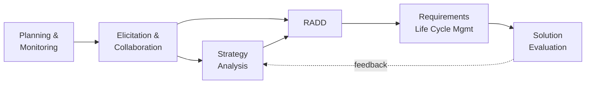
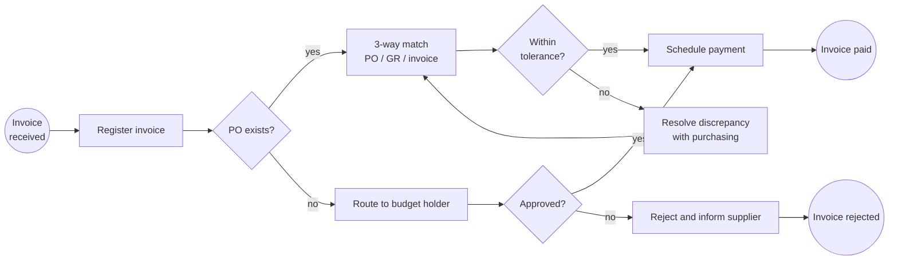
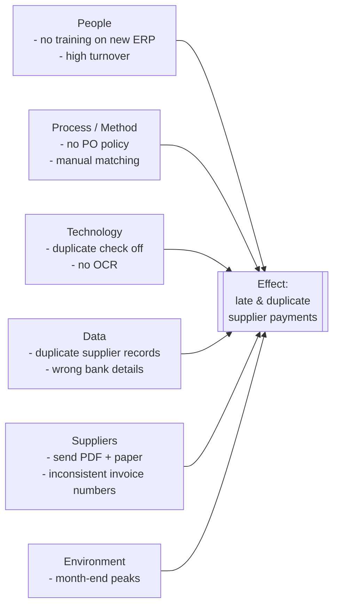
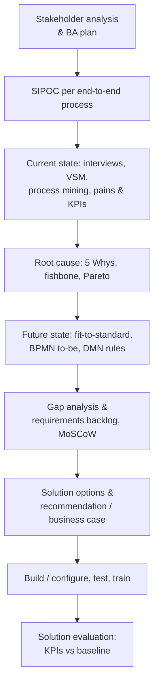

# Business Analysis: BABOK, BPMN, Process Analysis, Root Cause, Requirements

> **TL;DR** Business analysis is the discipline of enabling change by defining needs and recommending solutions that deliver value. BABOK v3 gives the vocabulary (6 knowledge areas, BACCM, 50 techniques). In practice: scope with **SIPOC**, model **current state** in **BPMN 2.0** (or mine it with **process mining**), find waste with **value stream mapping**, find causes with **5 Whys / Ishikawa / Pareto**, design the **future state**, run a **gap analysis**, and elicit and manage **requirements** (use cases, user stories, MoSCoW) traceably to the solution.

---

## 1. BABOK Guide v3 (IIBA)

Published by the International Institute of Business Analysis (2015). Certifications: ECBA, CCBA, CBAP; specializations (Agile analysis AAC, data analytics CBDA, cybersecurity CCA, product ownership CPOA).

### 1.1 Business Analysis Core Concept Model (BACCM)

| Concept | Meaning | Question |
|---|---|---|
| **Change** | Act of transformation in response to a need | What kind of change are we doing? |
| **Need** | Problem or opportunity to be addressed | What are the needs we are trying to satisfy? |
| **Solution** | Specific way of satisfying needs in a context | What are the solutions we are creating or changing? |
| **Stakeholder** | Group or individual with a relationship to the change | Who are the stakeholders involved? |
| **Value** | Worth, importance or usefulness to a stakeholder | What do stakeholders consider to be of value? |
| **Context** | Circumstances that influence and are influenced by the change | What are the contexts we and the solution are in? |

All six are interdependent: changing one forces reassessment of the others.

### 1.2 Six knowledge areas

| # | Knowledge area | Purpose | Tasks (paraphrased) |
|---|---|---|---|
| 1 | **Business Analysis Planning and Monitoring** | Organize and coordinate BA work | Plan BA approach; plan stakeholder engagement; plan BA governance (decision making, change control, approvals); plan BA information management; identify BA performance improvements |
| 2 | **Elicitation and Collaboration** | Obtain information from stakeholders and confirm it | Prepare for elicitation; conduct elicitation; confirm elicitation results; communicate BA information; manage stakeholder collaboration |
| 3 | **Requirements Life Cycle Management** | Manage requirements from inception to retirement | Trace requirements; maintain requirements; prioritize requirements; assess requirements changes; approve requirements |
| 4 | **Strategy Analysis** | Define the need and the strategy for change | Analyze current state; define future state; assess risks; define change strategy |
| 5 | **Requirements Analysis and Design Definition (RADD)** | Structure, specify, validate requirements and design options | Specify and model requirements; verify requirements; validate requirements; define requirements architecture; define design options; analyze potential value and recommend solution |
| 6 | **Solution Evaluation** | Assess performance and value of solutions in use | Measure solution performance; analyze performance measures; assess solution limitations; assess enterprise limitations; recommend actions to increase solution value |



### 1.3 Requirements classification (BABOK)

| Type | Description | Example |
|---|---|---|
| **Business requirements** | Goals, objectives, outcomes of the organization | "Reduce days sales outstanding from 55 to 40" |
| **Stakeholder requirements** | Needs of stakeholders the solution must meet | "Credit controller needs a daily overview of overdue invoices by risk" |
| **Solution requirements – functional** | Capabilities/behavior of the solution | "System sends dunning letter level 2 at 14 days overdue" |
| **Solution requirements – non-functional** | Quality conditions | "Overview loads < 2 s for 50k open items"; "Data stored in EU" |
| **Transition requirements** | Temporary, needed to move from current to future | "Migrate open AR items with original due dates"; "Train 12 users" |

### 1.4 Selected BABOK techniques (of 50)

Acceptance and evaluation criteria · Backlog management · Balanced scorecard · Benchmarking · Brainstorming · Business capability analysis · Business cases · Business model canvas · Business rules analysis · Collaborative games · Concept modelling · Data dictionary · Data flow diagrams · Data mining · Data modelling · Decision analysis · Decision modelling · Document analysis · Estimation · Financial analysis · Focus groups · Functional decomposition · Glossary · Interface analysis · Interviews · Item tracking · Lessons learned · Metrics and KPIs · Mind mapping · Non-functional requirements analysis · Observation · Organizational modelling · Prioritization · Process analysis · Process modelling · Prototyping · Reviews · Risk analysis and management · Roles and permissions matrix · Root cause analysis · Scope modelling · Sequence diagrams · Stakeholder list, map, or personas · State modelling · Survey or questionnaire · SWOT analysis · Use cases and scenarios · User stories · Vendor assessment · Workshops.

---

## 2. Scoping: SIPOC

**SIPOC** = Suppliers, Inputs, Process, Outputs, Customers. High-level (5–7 steps) scoping tool from Six Sigma, used at the start of process work to agree boundaries.

| Suppliers | Inputs | Process (5–7 steps) | Outputs | Customers |
|---|---|---|---|---|
| Suppliers | Supplier invoice (PDF/e-invoice), PO, goods receipt | 1. Receive invoice | Registered invoice | AP clerk |
| Purchasing | Purchase order | 2. Register & code | Coded invoice | Controller |
| Warehouse | Goods receipt | 3. Match (2/3-way) | Matched invoice / exception | Budget holder |
| Budget holders | Approval | 4. Approve | Approved invoice | Treasury |
| Bank | Payment file status | 5. Pay | Payment, posted ledger entry | Supplier, auditor |

**How to run it (60 min):** agree process name, start trigger and end point → write the 5–7 process steps first → outputs → customers → inputs → suppliers. Add CTQs (critical-to-quality requirements) for key customers.

---

## 3. BPMN 2.0

Business Process Model and Notation, OMG standard (version 2.0 in 2011; 2.0.2 published as ISO/IEC 19510:2013). Defines process (orchestration), collaboration, choreography and conversation diagrams. In practice most work uses **process and collaboration diagrams**.

### 3.1 Core elements

| Category | Element | Notation | Meaning |
|---|---|---|---|
| **Flow objects** | Event | Circle | Something that happens: **start** (thin border), **intermediate** (double border), **end** (thick border) |
| | Activity | Rounded rectangle | Work performed: **task** (atomic) or **sub-process** (with + marker) |
| | Gateway | Diamond | Divergence/convergence of flows |
| **Connecting objects** | Sequence flow | Solid line, filled arrow | Order of activities **within** a pool |
| | Message flow | Dashed line, open circle start, open arrow | Communication **between** pools |
| | Association | Dotted line | Links artifacts/data to flow objects |
| | Data association | Dotted line with arrow | Data input/output |
| **Swimlanes** | Pool | Large rectangle | A participant (organization, external party, system) — owns one process |
| | Lane | Subdivision of pool | Role, department or system within participant |
| **Data** | Data object, data input/output, data store | Document / cylinder | Information used or produced |
| **Artifacts** | Group, text annotation | Dashed rounded rectangle / bracket | Documentation |

### 3.2 Event types (triggers/results)

| Trigger | Start | Intermediate catching | Intermediate throwing | Boundary | End |
|---|---|---|---|---|---|
| None | yes | — | yes | — | yes |
| **Message** | yes | yes | yes | yes | yes |
| **Timer** | yes | yes | — | yes | — |
| **Error** | (event sub-process) | — | — | yes (interrupting) | yes |
| **Escalation** | (event sub-process) | yes | yes | yes | yes |
| **Signal** | yes | yes | yes | yes | yes |
| **Conditional** | yes | yes | — | yes | — |
| **Compensation** | (event sub-process) | yes | yes | yes | yes |
| **Link** | — | yes | yes | — | — |
| **Cancel** | — | — | — | yes (transaction) | yes |
| **Terminate** | — | — | — | — | yes (ends all paths) |
| Multiple / Parallel multiple | yes | yes | yes | yes | yes (multiple) |

Boundary events may be **interrupting** (solid border) or **non-interrupting** (dashed border) — e.g. a non-interrupting timer to send a reminder while approval continues.

### 3.3 Task types

| Task | Marker | Use |
|---|---|---|
| User task | Person | Human performs with software support (workflow inbox) |
| Manual task | Hand | Performed without IT (physical) |
| Service task | Gears | Automated by a system/service call |
| Send / Receive task | Filled / empty envelope | Send/wait for a message |
| Business rule task | Table | Invokes a decision (DMN) |
| Script task | Scroll | Script executed by process engine |
| Call activity | Thick border | Calls a reusable global process |

Markers: loop (arrow), multi-instance parallel (three vertical bars), sequential (three horizontal bars), ad hoc (~), compensation (rewind).

### 3.4 Gateways

| Gateway | Symbol | Split semantics | Join semantics |
|---|---|---|---|
| **Exclusive (XOR)** | Diamond, empty or X | Exactly one outgoing path based on condition | Passes through first arriving token |
| **Inclusive (OR)** | Diamond with O | One or more paths whose conditions are true | Waits for all **activated** paths |
| **Parallel (AND)** | Diamond with + | All paths unconditionally | Waits for **all** incoming paths |
| **Event-based** | Diamond with pentagon in circle | Path chosen by first event that occurs (e.g. message vs timer) | — |
| **Complex** | Diamond with * | Custom conditions | Custom (e.g. 2 of 3) |

### 3.5 Example: purchase-to-pay invoice approval



*(Mermaid has no native BPMN; use Camunda Modeler, bpmn.io, Signavio, Visio or Bizagi for real BPMN.)*

### 3.6 Modeling levels (Bruce Silver's "Method and Style" approach)

| Level | Audience | Content |
|---|---|---|
| Descriptive | Business stakeholders | Happy path + main exceptions, limited palette (tasks, XOR/AND gateways, start/end, pools/lanes, message flows) |
| Analytical | BAs, architects | Full exceptions, events, boundary events, sub-processes; precise semantics |
| Executable | Developers / process engines | Data, service bindings, expressions (Camunda, Flowable, etc.) |

### 3.7 Common BPMN mistakes

| Mistake | Correct |
|---|---|
| Sequence flow crossing pool boundaries | Use **message flow** between pools; sequence flow stays inside a pool |
| Message flow inside a single pool between lanes | Lanes share the same process: use sequence flow |
| Gateways that both split and merge in one symbol | Separate split and join gateways |
| Merging parallel paths with XOR gateway | Use parallel join (AND) — otherwise downstream runs twice |
| Gateway used to make a decision ("Check credit?") | Decision is made in a task ("Check credit"); the gateway only routes on the outcome ("Credit OK?") |
| Missing start or end events; multiple unclear end states | One start; named end events per outcome ("Order shipped", "Order cancelled") |
| Activity names as nouns ("Invoice") | Verb + object ("Approve invoice") |
| Lanes for systems and people mixed inconsistently | Decide convention: lanes = roles; systems as separate pools or annotations |
| Modeling the org chart | Model the flow of work for one case (instance) |
| Gigantic single diagram | Hierarchical: top-level with collapsed sub-processes, max ~15–20 activities per diagram |
| Conditions missing on outgoing XOR flows | Label every outgoing flow; mark a default flow |
| Using intermediate events as activities | Events represent occurrences, not work |

### 3.8 DMN

**Decision Model and Notation** (OMG): decision tables with hit policies (Unique, First, Priority, Any, Collect, Rule order, Output order). Separate volatile business rules (approval limits, discount rules, tolerance thresholds) from process flow. Business rule task in BPMN invokes a DMN decision.

| Invoice amount | Has PO | Cost center type | → Approver |
|---|---|---|---|
| ≤ 1,000 | yes | any | Auto-approve |
| ≤ 5,000 | any | operational | Budget holder |
| > 5,000 | any | any | Budget holder + controller |
| any | no | capex | CFO |

---

## 4. Process mining

Data-driven discovery and analysis of real processes from **event logs** in IT systems (ERP, CRM, workflow). Pioneered by Wil van der Aalst (TU Eindhoven).

### 4.1 Event log minimum

| Case ID | Activity | Timestamp | (Optional) Resource, cost, attributes |
|---|---|---|---|
| PO-4711 | Create purchase requisition | 2026-03-01 09:12 | J. Smit |
| PO-4711 | Approve requisition | 2026-03-02 14:40 | M. de Vries |
| PO-4711 | Create PO | 2026-03-03 08:05 | Purchasing bot |

### 4.2 Types

| Type | What it does |
|---|---|
| **Discovery** | Build a process model from the log (alpha, heuristic, inductive miner); shows variants and frequencies |
| **Conformance checking** | Compare log to a reference model; find deviations (e.g. maverick buying, skipped approvals) |
| **Enhancement** | Enrich model with performance (throughput times, bottlenecks, rework loops) |
| **Task mining** | Desktop interaction capture to understand user-level steps (useful for RPA candidates) |
| **Object-centric process mining (OCPM)** | Multiple case notions (order, item, delivery, invoice) to handle ERP's many-to-many objects |

### 4.3 Tools

Celonis, SAP Signavio Process Intelligence, Microsoft Power Automate Process Mining, UiPath Process Mining, Apromore, Disco (Fluxicon, NL), ProM (open source, academic), PM4Py (Python library).

### 4.4 Typical findings in ERP processes

- P2P: invoices without PO ("PO after invoice"), price changes after GR, duplicate payments, late payments losing discounts.
- O2C: manual credit block releases, order changes after confirmation, rework loops in delivery, high DSO segments.
- Automation rate (% of activities by batch/system users).

**Pitfalls**: extracting the log is 60–80% of the effort; ERP data models (SAP tables, D365 entities) need care; GDPR — pseudonymize user names; don't confuse variants with errors.

---

## 5. Current state vs future state

| Aspect | Current state (as-is) | Future state (to-be) |
|---|---|---|
| Goal | Understand reality, pains, baseline metrics | Design improved process meeting objectives |
| Depth | Just enough to understand problems and measure baseline | Detailed enough to build/configure and train |
| Sources | Interviews, observation (gemba), documents, system data, process mining | Workshops, reference processes (ERP standard, APQC), benchmarks |
| Pitfall | Over-documenting a process you will replace | Designing in a vacuum ignoring constraints; recreating the old process in the new system |

**Rule:** for a standard ERP implementation, keep the as-is short (pains, volumes, exceptions, KPIs) and spend effort on **fit-to-standard** to-be design (see [erp-implementation-selection.md](erp-implementation-selection.md#2-fit-to-standard-vs-fit-gap)).

### Gap analysis

| Area | Current | Target | Gap | Action | Priority | Owner |
|---|---|---|---|---|---|---|
| Invoice capture | Manual keying from PDF | E-invoice (UBL/Peppol) + OCR | No e-invoicing | Connect Peppol access point, OCR service | Must | AP lead |
| Approval | E-mail | Workflow in ERP with DMN rules | No workflow | Configure approval workflow | Must | Finance IT |
| KPI | No measurement | Cycle time, touchless rate | No data | Process mining dashboard | Should | Controller |

Gap types: process, people/skills, technology, data, organization, policy/compliance.

---

## 6. Value stream mapping

Lean technique (Toyota; popularized by Rother & Shook, *Learning to See*). Maps material and information flow for a product family/service from request to delivery, capturing time and waste. Complements BPMN: VSM optimizes **flow**, BPMN specifies **logic**. Background on Lean in [../04-agile-kanban-scrum/README.md](../04-agile-kanban-scrum/README.md) and [../10-laws-principles-mental-models/README.md](../10-laws-principles-mental-models/README.md).

### 6.1 Data per process box

| Metric | Meaning |
|---|---|
| **Process time (PT)** / value-added time | Hands-on time to do the work |
| **Lead time (LT)** | Elapsed time incl. waiting |
| **%C&A** (complete & accurate) | % of output usable by next step without rework |
| People / FTE, batch size, uptime | Capacity |
| **Activity ratio / flow efficiency** | Σ PT / Σ LT |
| **Rolled %C&A** | Product of all %C&A |

### 6.2 Steps

1. Choose product family/service and sponsor; define start/end.
2. Walk the process (gemba) — current state map with timeline (lead time vs process time ladder).
3. Identify waste (TIMWOODS) and bottlenecks.
4. Design future state map (flow, pull, fewer handoffs, automation).
5. Implementation plan (kaizen bursts → actions, owners, dates).

### 6.3 Eight wastes (TIMWOODS) in office/IT terms

| Waste | Office/IT example |
|---|---|
| **T**ransport | Moving files/e-mails between systems, re-keying |
| **I**nventory | Queues of unprocessed invoices, tickets backlog |
| **M**otion | Searching for information, switching between 6 apps |
| **W**aiting | Waiting for approvals, batch jobs, month-end |
| **O**verproduction | Reports nobody reads, unneeded copies |
| **O**verprocessing | Double approvals, excessive checks, gold-plating |
| **D**efects | Data errors, rework, credit notes |
| **S**kills (unused talent) | Experts doing data entry |

---

## 7. Root cause analysis

### 7.1 5 Whys

Ask "why?" iteratively (around five times) until reaching a systemic, actionable cause. Origin: Toyota (Sakichi Toyoda, Taiichi Ohno).

> Problem: supplier paid twice.
> 1. Why? Invoice was registered twice. 2. Why? Received by e-mail and post. 3. Why? Supplier sends both by default. 4. Why? No instruction to suppliers and no duplicate check. 5. Why? Duplicate check disabled at go-live due to false positives.
> **Root causes**: duplicate check disabled; no supplier invoicing instruction. **Actions**: re-enable check with tuned fields (supplier + invoice no + amount), supplier communication, e-invoicing.

**Tips**: base each answer on facts; branch when multiple causes; stop at a cause you can control; avoid blaming people ("human error" is never the root cause — ask why the system allowed it).

### 7.2 Ishikawa (fishbone) diagram

Kaoru Ishikawa. Categories (manufacturing **6M**): Man/People, Machine, Method, Material, Measurement, Mother nature/Environment. Service variant (**4/8P**): People, Process, Policies, Place, Product, Price, Promotion, Physical evidence. IT variant: People, Process, Technology, Data, Suppliers, Environment.



### 7.3 Pareto analysis

80/20 principle (Vilfredo Pareto; applied to quality by Joseph Juran — "vital few, trivial many"). Count occurrences per cause category, sort descending, plot bars + cumulative % line; focus on categories up to ~80%.

| Cause of invoice exception | Count | % | Cumulative % |
|---|---|---|---|
| Price mismatch with PO | 412 | 41% | 41% |
| Missing goods receipt | 258 | 26% | 67% |
| No PO reference | 150 | 15% | 82% |
| Duplicate | 80 | 8% | 90% |
| Wrong VAT code | 60 | 6% | 96% |
| Other | 40 | 4% | 100% |

→ Fix price maintenance and GR discipline first.

### 7.4 Other RCA tools

Fault tree analysis, 8D (eight disciplines), Kepner-Tregoe problem analysis (is / is-not), scatter diagrams, FMEA (preventive: severity x occurrence x detection = RPN), A3 problem solving (Toyota, one-page).

---

## 8. Requirements elicitation

### 8.1 Techniques and when to use them

| Technique | Best for | Watch out |
|---|---|---|
| Interviews (structured/semi) | Senior stakeholders, sensitive topics, depth | Bias; confirm in writing |
| Workshops (JAD) | Consensus, cross-department processes | Strong facilitation needed — [../09-leadership-teams-facilitation/README.md](../09-leadership-teams-facilitation/README.md) |
| Observation / gemba / job shadowing | Real work, tacit knowledge, workarounds | Hawthorne effect |
| Document analysis | Existing policies, reports, system manuals, contracts | Documents may be outdated |
| Surveys | Many users, quantitative input | Low depth; question design |
| Prototyping / mockups | UI, reports, unclear needs | Prototype ≠ commitment — [../01-ux-ui/README.md](../01-ux-ui/README.md) |
| Interface analysis | Integrations | Include error handling, volumes, timing |
| Data analysis / process mining | Volumes, variants, exceptions | Data extraction effort |
| Reverse engineering existing reports/screens | Legacy replacement | Don't copy obsolete logic |
| Focus groups | User perceptions | Groupthink |
| Fit-to-standard demos | ERP/SaaS | Prepare scenarios and data |

### 8.2 Good requirement characteristics

Atomic, complete, consistent, concise, feasible, unambiguous, testable (verifiable), prioritized, understandable, traceable (to a business objective and to tests). Avoid "user-friendly", "fast", "flexible", "etc.", "and/or", "support".

### 8.3 Formats

| Format | Use when | Structure |
|---|---|---|
| **Shall-statements** | Contracts, tenders, RFPs | "The system shall …" + ID + priority + rationale + acceptance criterion |
| **Use cases** (Cockburn) | Complex interactions, ERP scenarios, integration | Name, primary actor, stakeholders & interests, preconditions, trigger, main success scenario (numbered), extensions (alternative/exception flows), postconditions/guarantees, business rules |
| **User stories** | Agile delivery | "As a <role>, I want <capability>, so that <benefit>" + acceptance criteria (Given/When/Then) — see [../02-product-management/README.md](../02-product-management/README.md) |
| **Job stories** | Product discovery | "When <situation>, I want to <motivation>, so I can <outcome>" |
| **Business rules** | Policies & calculations | Rulebook / DMN tables, owned by business |
| **Data requirements** | Master data, reporting | Data dictionary: field, definition, format, owner, source, validation |

**Use case template (brief):**

```text
UC-07  Approve supplier invoice
Primary actor: Budget holder
Trigger: Invoice routed for approval
Preconditions: Invoice registered and coded; approver has role "Budget holder"
Main success scenario:
 1. System notifies approver (e-mail + inbox).
 2. Approver opens invoice with PDF, coding, budget remaining.
 3. Approver approves.
 4. System records approval, routes to next approver per DMN or releases for payment.
Extensions:
 3a. Approver rejects with reason -> system returns to AP with reason.
 3b. Approver changes cost center -> system revalidates budget and rules.
 1a. No action in 3 working days -> reminder; after 5 days escalate to manager.
Postconditions: Invoice status Approved or Rejected; audit trail stored.
Business rules: BR-12 approval matrix; BR-13 four-eyes principle.
```

### 8.4 Prioritization

- **MoSCoW** (Must, Should, Could, Won't-this-time; from DSDM): Musts ≤ ~60% of effort to keep contingency. Details in [../02-product-management/README.md](../02-product-management/README.md).
- Kano, WSJF, RICE, value vs effort — [../02-product-management/README.md](../02-product-management/README.md).
- For ERP: classify every gap as **legal/must**, **business-critical**, **nice-to-have**; challenge each customization against standard.

### 8.5 Traceability

Traceability matrix: Business objective → requirement → design element/configuration → test case → training material. Enables impact analysis and audit. Tools: Azure DevOps, Jira (+ Xray), Polarion, Excel for small projects.

---

## 9. Business analysis in an ERP/automation engagement (flow)



## When to use / when not

| Tool | Use | Avoid |
|---|---|---|
| SIPOC | Kick-off, scope agreement | As a detailed process model |
| BPMN | Cross-functional processes, automation, ERP design | For single-person checklists (use a simple list) |
| Process mining | High-volume system-supported processes | Low-volume, mostly manual or paper processes |
| VSM | Flow and lead time problems | Purely decision/logic problems |
| 5 Whys | Simple, single-chain problems | Complex multi-causal problems (use fishbone + data) |
| Use cases | Complex interactions with many exceptions | Simple CRUD screens |

## Common mistakes

- Starting with solutions ("we need Power Apps") instead of needs.
- Over-modeling current state in detail before deciding to replace the system.
- Requirements lists of 800 lines copied from a vendor RFP template with no prioritization.
- Missing non-functional and transition requirements (data migration, training, cut-over).
- No baseline KPIs → benefits can never be proven.
- Treating stakeholder sign-off as understanding; validate with scenarios and prototypes.

## References

- Wikipedia — BABOK: https://en.wikipedia.org/wiki/A_Guide_to_the_Business_Analysis_Body_of_Knowledge
- IIBA: https://www.iiba.org/
- OMG — BPMN 2.0.2 specification: https://www.omg.org/spec/BPMN/
- OMG — DMN specification: https://www.omg.org/spec/DMN/
- bpmn.io (free web modeler): https://bpmn.io/
- Wikipedia — BPMN: https://en.wikipedia.org/wiki/Business_Process_Model_and_Notation
- Wikipedia — SIPOC: https://en.wikipedia.org/wiki/SIPOC
- Wikipedia — Process mining: https://en.wikipedia.org/wiki/Process_mining
- IEEE Task Force on Process Mining / Process Mining Manifesto: https://www.tf-pm.org/
- Wikipedia — Value-stream mapping: https://en.wikipedia.org/wiki/Value-stream_mapping
- Wikipedia — Five whys: https://en.wikipedia.org/wiki/Five_whys
- Wikipedia — Ishikawa diagram: https://en.wikipedia.org/wiki/Ishikawa_diagram
- Wikipedia — Pareto analysis: https://en.wikipedia.org/wiki/Pareto_analysis
- Wikipedia — MoSCoW method: https://en.wikipedia.org/wiki/MoSCoW_method
- Wikipedia — Use case: https://en.wikipedia.org/wiki/Use_case
- Related: [process-improvement-automation.md](process-improvement-automation.md), [../02-product-management/README.md](../02-product-management/README.md), [../09-leadership-teams-facilitation/README.md](../09-leadership-teams-facilitation/README.md)
