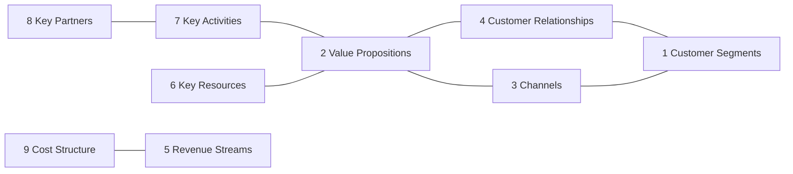
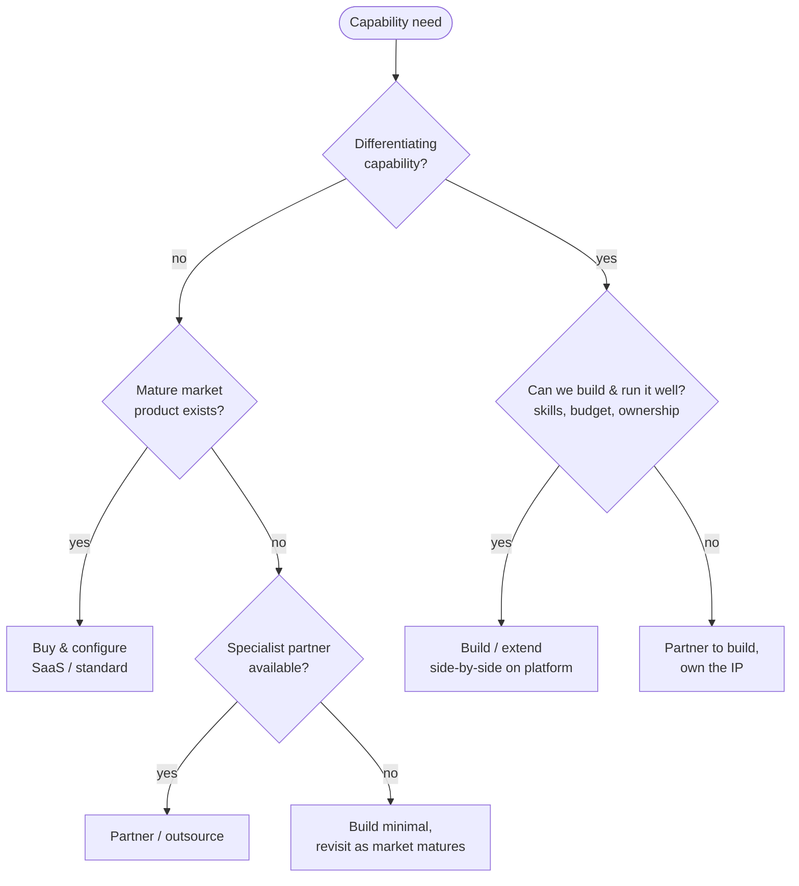

# Business Models, Build/Buy/Partner, TCO and Business Cases

> **TL;DR** Use the **Business Model Canvas** (9 blocks) to describe how an organization creates, delivers and captures value — and to see what IT must support. Use **Lean Canvas** for new ventures and the **Value Proposition Canvas** to fit offers to customer jobs, pains and gains. Decide **build / buy / partner** on differentiation, market maturity and TCO. Make investment decisions with a concise **business case**: problem, options (including do-nothing), costs (5–7 year **TCO**), benefits, financials (NPV, IRR, payback, ROI), risks, and a benefits realization plan.

---

## 1. Business Model Canvas

Alexander Osterwalder & Yves Pigneur, *Business Model Generation* (2010); Strategyzer.

| # | Block | Question | Example (B2B technical wholesaler) |
|---|---|---|---|
| 1 | **Customer Segments** | For whom are we creating value? | Installers, OEM manufacturers, facility managers |
| 2 | **Value Propositions** | What value do we deliver; which problems do we solve? | Next-day delivery of 80k SKUs, technical advice, project pricing |
| 3 | **Channels** | Through which channels do we reach and deliver? | Webshop, EDI, branch counters, account managers |
| 4 | **Customer Relationships** | What type of relationship does each segment expect? | Self-service for small installers, dedicated account management for OEMs |
| 5 | **Revenue Streams** | For what are customers willing to pay, and how? | Product margin, delivery fees, service contracts |
| 6 | **Key Resources** | What assets are required? | Distribution centre, inventory, product data, ERP/WMS, technical staff |
| 7 | **Key Activities** | What must we do well? | Purchasing, inventory management, logistics, technical advice |
| 8 | **Key Partnerships** | Who are key partners and suppliers? | Manufacturers, carriers, ERP/IT partners |
| 9 | **Cost Structure** | What are the most important costs? | Cost of goods, logistics, staff, IT |

*Canvas layout: left side = efficiency (partners, activities, resources, costs); right side = value (relationships, channels, segments, revenue); center = value proposition.*

**Using BMC as an architect:**

- Key activities ≈ core capabilities → capability map.
- Channels and relationships → customer-facing systems (CRM, portals, EDI).
- Key resources include **data** and **systems** — make them explicit.
- Changes in the business model (e.g. from product sales to subscription/service) → ERP impacts (contract billing, revenue recognition, service management).
- Fill a **current** and a **future** canvas; the delta drives the IT roadmap.

### 1.1 Business model patterns (Osterwalder et al.)

Unbundling, long tail, multi-sided platforms, freemium, open business models; plus later patterns: subscription, razor-and-blades, servitization (product-as-a-service), marketplace, licensing.

---

## 2. Lean Canvas (link)

Ash Maurya's adaptation for startups/new products (*Running Lean*). Replaces several BMC blocks:

| Lean Canvas | Replaces BMC |
|---|---|
| Problem | Key Partners |
| Solution | Key Activities |
| Key Metrics | Key Resources |
| Unfair Advantage | Customer Relationships |
| Unique Value Proposition, Customer Segments, Channels, Revenue Streams, Cost Structure | (kept) |

Use for new digital products/ventures where problem–solution fit is unknown; see [../02-product-management/README.md](../02-product-management/README.md).

## 3. Value Proposition Canvas (link)

Zooms into BMC's Value Proposition and Customer Segment.

| Customer profile | Value map |
|---|---|
| **Customer jobs** (functional, social, emotional) | **Products & services** |
| **Pains** (obstacles, risks, undesired outcomes) | **Pain relievers** |
| **Gains** (required, expected, desired, unexpected outcomes) | **Gain creators** |

**Fit** = pain relievers and gain creators address the most important jobs, pains and gains. Works well for internal IT services too (e.g. "employee onboarding" as a job for hiring managers). More in [../02-product-management/README.md](../02-product-management/README.md).

---

## 4. Operating model

The business model says *what*; the operating model says *how* the organization delivers it.

| Element | Questions |
|---|---|
| Processes / value streams | Which end-to-end processes, standardized where? |
| Organization | Structure, roles, centralization vs decentralization, shared services |
| Locations | Where work is done |
| Information & technology | Systems, data, integration |
| Suppliers / partners | What is sourced |
| Management system | Governance, KPIs, planning cycles |

**Ross, Weill & Robertson operating model matrix** (*Enterprise Architecture as Strategy*, 2006) — degree of **process standardization** x **process integration**:

| | Low standardization | High standardization |
|---|---|---|
| **High integration** | **Coordination** (shared customers/data, unique processes per unit) | **Unification** (single ERP, standard processes, shared data) |
| **Low integration** | **Diversification** (independent units, shared services only) | **Replication** (standard processes replicated, local data) |

Implications for ERP: Unification → single global instance; Replication → template rollout (copies) per unit; Coordination → shared CRM/MDM, varied ERPs; Diversification → two-tier or independent ERPs.

---

## 5. Build, buy, partner

| Factor | Favors **Build** | Favors **Buy** (SaaS/COTS) | Favors **Partner** (outsource/alliance/BPO) |
|---|---|---|---|
| Strategic differentiation | High; core IP | Low; commodity/best practice | Low–medium; non-core |
| Market maturity (Wardley) | Genesis/custom | Product/commodity | Product/commodity with service component |
| Time-to-value | Can wait | Need quickly | Need quickly with capacity |
| Internal capabilities | Strong engineering, product management | Limited dev, strong business ownership | Missing capabilities |
| Control needs | Full control over roadmap and data | Accept vendor roadmap | Contractual control |
| Cost profile | High upfront + maintenance | Subscription, predictable | Service fees |
| Risk | Delivery and key-person risk | Vendor lock-in, fit risk | Dependency, quality, exit |

**Hybrid answers are normal:** buy the ERP, build the pricing engine side-by-side, partner for payroll processing and managed security.

---

## 6. Total cost of ownership (TCO)

Gartner popularized TCO (late 1980s) for IT. Count all costs over the lifecycle (typically 5–7 years for ERP/core systems, 3–5 for others).

| Category | One-time | Recurring |
|---|---|---|
| Software | License purchase (perpetual) | Subscription, maintenance (≈18–22% of perpetual license p.a.), add-on apps, price indexation |
| Implementation | Partner services, project management, configuration, extensions, integration build, data migration | — |
| Internal | Project team time, backfill, training, change management | Application management, key users, admins |
| Infrastructure | Hardware, environments (if not SaaS) | Hosting/cloud, backup, DR, network, monitoring |
| Integration | Build interfaces, iPaaS setup | iPaaS subscription, maintenance |
| Operations | — | Support contracts, upgrades/release testing, security, audits |
| Exit / decommission | Legacy archiving, data extraction, parallel run | Legacy read-only licenses |
| Risk/contingency | 15–25% of one-time | — |

**Hidden costs often missed:** testing every SaaS release; user licence growth; storage/capacity overages; API call limits; premium support tiers; specialist skills market rates; end-of-contract price jumps; exit costs.

**Cloud vs on-prem comparisons:** compare like-for-like (include staff, DR, security, refresh cycles, power); see FinOps in [../06-cloud-architecture/README.md](../06-cloud-architecture/README.md).

---

## 7. Business case

### 7.1 Structure

| Section | Content |
|---|---|
| 1. Executive summary | Recommendation, investment, key benefits, payback — on one page |
| 2. Problem / opportunity | Diagnosis, current pains with data, strategic link (Rumelt kernel) |
| 3. Objectives and scope | SMART objectives, in/out of scope |
| 4. Options | **Do nothing / minimum**, option A, option B (… 3–4 max) with pros/cons |
| 5. Costs | One-time and recurring, TCO 5–7 years per option |
| 6. Benefits | Quantified (financial: cost savings, revenue, avoided costs; non-financial: risk, compliance, satisfaction), owner per benefit, timing |
| 7. Financial analysis | Cash flows, NPV, IRR, payback, ROI; sensitivity analysis |
| 8. Risks | Top risks, mitigations, risk-adjusted view |
| 9. Implementation approach | Phasing, timeline, resources, governance |
| 10. Benefits realization plan | KPIs, baseline, targets, owners, measurement dates |
| 11. Recommendation & decision requested | Clear ask: budget, people, decision date |

One-page version in [templates.md](templates.md#6-business-case-one-pager). PRINCE2 business case and project financials in [../03-project-management/README.md](../03-project-management/README.md).

### 7.2 Financial measures (summary)

| Measure | Formula / meaning | Notes |
|---|---|---|
| **ROI** | (Total benefits − total costs) / total costs | Simple; ignores timing |
| **Payback period** | Time until cumulative net cash flow ≥ 0 | Liquidity/risk view; ignores later benefits |
| **NPV** | Σ (net cash flow_t / (1 + r)^t) − initial investment | r = discount rate (WACC or hurdle rate, e.g. 8–12%); NPV > 0 → creates value |
| **IRR** | Discount rate at which NPV = 0 | Compare to hurdle rate |
| **TCO** | Lifecycle cost | Basis for cost side |
| **Cost of delay** | Value lost per period of delay | Prioritization — [../04-agile-kanban-scrum/README.md](../04-agile-kanban-scrum/README.md) |

**Worked example (simplified, 5 years, discount rate 10%):**

| Year | 0 | 1 | 2 | 3 | 4 | 5 |
|---|---|---|---|---|---|---|
| Costs (€k) | −600 | −120 | −120 | −120 | −120 | −120 |
| Benefits (€k) | 0 | 150 | 300 | 350 | 350 | 350 |
| Net cash flow | −600 | 30 | 180 | 230 | 230 | 230 |
| Discount factor | 1.000 | 0.909 | 0.826 | 0.751 | 0.683 | 0.621 |
| PV | −600 | 27 | 149 | 173 | 157 | 143 |

NPV ≈ +49k → marginally positive; payback in year 4 (cumulative: −600, −570, −390, −160, +70). ROI (undiscounted) = (1,500 − 1,200) / 1,200 = 25%. Sensitivity: if benefits ramp up one year later, NPV turns negative → manage adoption risk.

### 7.3 Benefits: types and credibility

| Type | Example | Credibility tips |
|---|---|---|
| Cash-releasing | License savings from retiring 3 apps, reduced temp staff | Most credible; ensure contracts can actually be terminated |
| Non-cash-releasing efficiency | 2 FTE capacity released in AP | State how capacity will be used (growth without hiring?) |
| Revenue | Faster quoting → higher win rate | Use conservative assumptions, test |
| Cost avoidance | Avoid legacy end-of-support upgrade cost, avoid fines | Show evidence of the avoided cost |
| Risk reduction | Lower probability of ransomware impact | Use expected loss (probability x impact) cautiously |
| Strategic / enabling | Enables acquisitions integration | Describe qualitatively; tie to strategy |

**Benefits dependency network:** IT enablers → business changes → benefits → objectives (Ward & Daniel, Cranfield). Benefits only appear when business changes happen.

### 7.4 Benefits realization plan

| Benefit | KPI | Baseline (date) | Target | Measured how | When | Owner | Business change required |
|---|---|---|---|---|---|---|---|
| Faster supplier invoice processing | Average cycle time (days) | 9.5 (Jan 2026) | 3 | Process mining dashboard | Go-live + 3, + 6, + 12 months | AP lead | E-invoicing, approval matrix in ERP |
| Lower licence cost | Annual licence € | €310k | €220k | Contract register | Year 2 | IT manager | Decommission 3 legacy apps |
| Fewer stock-outs | Order lines delayed by stock-out % | 6.2% | 3% | ERP report | Monthly | Supply chain manager | S&OP process, forecast model |
| Better compliance | Open high audit findings | 7 | 0 | Audit report | Next audit | Controller | Role design with SoD |

**Post-implementation review (PIR)** 6–12 months after go-live: benefits achieved vs plan, lessons learned, corrective actions, close or extend benefit tracking.

---

## 8. Multi-criteria decision analysis (MCDA)

When options differ in hard-to-monetize aspects (risk, strategic fit, user experience), complement NPV with a weighted scoring.

| Criterion | Weight | Option A: upgrade legacy | Option B: SaaS ERP | Option C: best-of-breed suite |
|---|---|---|---|---|
| Strategic fit | 25% | 2 | 5 | 4 |
| 5-year TCO (inverse) | 25% | 4 | 3 | 2 |
| Implementation risk (inverse) | 20% | 4 | 3 | 2 |
| Functional fit | 15% | 2 | 4 | 5 |
| Vendor viability & ecosystem | 15% | 2 | 5 | 3 |
| **Weighted score (1–5)** | 100% | **2.90** | **3.95** | **3.10** |

**Good practice:** agree criteria and weights *before* scoring; score independently, then discuss; run sensitivity on weights; record rationale (it becomes the decision record); combine with financials — never let a score hide a negative NPV without explicit discussion.

### 8.1 Real options and staged investment

Large uncertain investments can be structured as **options**: fund discovery/pilot first (small, cheap), with explicit go/no-go criteria for scaling. This limits downside and makes learning explicit — similar to Three Horizons H3 bets and agile funding. State in the business case which decision points exist and what evidence will trigger them.

### 8.2 Pricing and revenue model basics (for business model changes)

| Revenue model | Description | ERP/IT implications |
|---|---|---|
| Transactional (one-off sale) | Price per unit/order | Standard O2C |
| Subscription / recurring | Periodic fee | Contract billing, deferred revenue (IFRS 15), churn metrics, CRM–ERP integration |
| Usage-based / pay-per-use | Fee per consumption | Metering data ingestion, rating, invoicing at scale |
| Servitization / product-as-a-service | Asset remains owned, service paid | Asset management, service contracts, IoT data, balance sheet impact |
| Licensing | Fee for IP use | Royalty calculation, contract management |
| Marketplace / platform | Commission on transactions | Multi-party settlement, KYC, payouts |

---

## When to use / when not

| Tool | Use | Not |
|---|---|---|
| BMC | Understanding/communicating a business model, impact of model change on IT | Detailed operational design |
| Build/buy/partner tree | Every significant capability decision | Small tools (just use the standard) |
| Full business case | Investments > threshold (e.g. €100k) or strategic | Small changes — use a one-pager |
| NPV/IRR | Comparing options with different cash flow timing | When benefits are mostly qualitative — use multi-criteria analysis |

## Common mistakes

- Comparing options without a "do nothing" baseline (which also has cost and risk).
- Counting FTE savings that will never be cashed or redeployed.
- Ignoring internal costs and the cost of change (training, productivity dip after go-live).
- Optimism bias: assume benefits ramp slower and costs run higher (reference-class forecasting — [../10-laws-principles-mental-models/README.md](../10-laws-principles-mental-models/README.md)).
- No owner for benefits; no post-implementation review.

## References

- Strategyzer (Business Model Canvas, Value Proposition Canvas): https://www.strategyzer.com/
- Wikipedia — Business Model Canvas: https://en.wikipedia.org/wiki/Business_Model_Canvas
- Wikipedia — Total cost of ownership: https://en.wikipedia.org/wiki/Total_cost_of_ownership
- Wikipedia — Net present value: https://en.wikipedia.org/wiki/Net_present_value
- Wikipedia — Internal rate of return: https://en.wikipedia.org/wiki/Internal_rate_of_return
- Wikipedia — Business case: https://en.wikipedia.org/wiki/Business_case
- Wikipedia — Make-or-buy decision: https://en.wikipedia.org/wiki/Make-or-buy_decision
- MIT CISR (operating models research): https://cisr.mit.edu/
- Related: [strategy-frameworks.md](strategy-frameworks.md), [erp-implementation-selection.md](erp-implementation-selection.md), [../03-project-management/README.md](../03-project-management/README.md)
