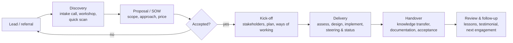
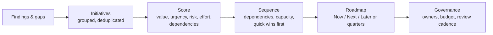
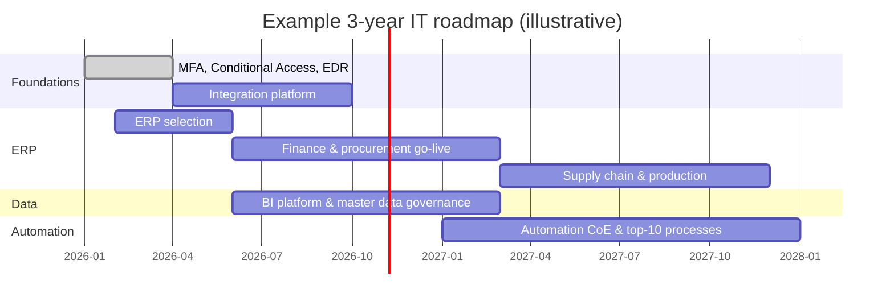

# Consultancy Practice: Engagements, Assessments, Maturity, Roadmaps

> **TL;DR** A consulting engagement runs **discovery → proposal → delivery → handover**. Win trust in discovery with sharp questions and a clear diagnosis; write proposals around outcomes, scope boundaries and assumptions; choose a **pricing model** (T&M, fixed, value-based, retainer) that matches uncertainty; assess current state systematically across **business, applications, data, infrastructure, security, people**; benchmark with **maturity models**; and deliver a prioritized **roadmap** and executive-ready story. Hand over so the client can continue without you.

---

## 1. Engagement lifecycle

| Phase | Goals | Key outputs | Pitfalls |
|---|---|---|---|
| **Discovery** | Understand the real problem, stakeholders, constraints, budget, decision process | Problem statement, hypotheses, stakeholder map, go/no-go to propose | Solving the stated symptom; talking more than listening |
| **Proposal** | Agree outcome, scope, approach, price, terms | Proposal / SOW, plan, assumptions, risks | Vague scope, unpriced assumptions |
| **Delivery** | Produce outcomes, keep stakeholders aligned | Deliverables, status reports, decision log, change requests | Scope creep, silent drift, no client ownership |
| **Handover** | Transfer knowledge and ownership | Documentation, training, run-book, acceptance sign-off | Dependency on consultant; nothing written down |
| **Review** | Learn, measure satisfaction, follow-up | Lessons learned, case study, next steps | Skipping it |

### 1.1 Discovery: question bank

| Theme | Questions |
|---|---|
| Trigger | Why now? What happens if you do nothing for 12 months? |
| Outcomes | What would success look like in 12 months? How would you measure it? |
| Problem | Where does it hurt most? Can you show me an example? How often? What does it cost? |
| History | What has been tried before? Why didn't it work? |
| Stakeholders | Who decides? Who is affected? Who could block? Who pays? |
| Constraints | Budget range, deadlines (contract end, end of support, audit), regulation, capacity |
| Landscape | Key systems, partners, contracts, IT team, recent changes |
| Readiness | Sponsorship, internal capacity, change appetite |
| Decision process | How will you choose a partner/solution? Timeline? |

### 1.2 Discovery workshop agenda (half day, 4 h)

| Time | Block | Method |
|---|---|---|
| 0:00–0:20 | Welcome, goals, agenda, introductions | Round: role + "one thing that must change" |
| 0:20–0:50 | Business context and strategy | Sponsor presents; BMC/strategy-on-a-page sketch |
| 0:50–1:40 | Pain points and opportunities per end-to-end process (O2C, P2P, R2R, H2R...) | Silent brainstorming on stickies, cluster, dot-vote |
| 1:40–1:55 | Break | |
| 1:55–2:40 | Current landscape: systems, data, integrations, people | Draw landscape on whiteboard; capture issues |
| 2:40–3:20 | Desired outcomes and success criteria | "Headlines from the future", KPI candidates |
| 3:20–3:45 | Constraints, risks, priorities | Impact/effort matrix |
| 3:45–4:00 | Next steps, owners, follow-up | Recap decisions and actions |

Facilitation techniques (Liberating Structures, 1-2-4-All, dot voting): [../09-leadership-teams-facilitation/README.md](../09-leadership-teams-facilitation/README.md).

---

## 2. Proposal / Statement of Work (SOW) template

| Section | Content |
|---|---|
| 1. Context | Client situation and trigger in client's words |
| 2. Objectives & outcomes | What will be different; success criteria/KPIs |
| 3. Scope | In scope (activities and deliverables); **explicitly out of scope** |
| 4. Approach | Phases, methods, workshops, key milestones |
| 5. Deliverables | List with description, format, acceptance criteria |
| 6. Planning | Timeline, milestones, dependencies |
| 7. Team & roles | Consultant team, client roles required (sponsor, project lead, SMEs) with time commitment |
| 8. Assumptions | Client availability, access to systems/data, decision lead times, environments, third parties |
| 9. Risks | Top risks and mitigations |
| 10. Commercials | Pricing model, fees, expenses, invoicing schedule, rate card for changes |
| 11. Change control | How scope changes are requested, estimated and approved |
| 12. Governance | Steering committee, status cadence, escalation |
| 13. Terms | Reference to general terms (e.g. NLdigital Terms in NL IT sector), IP, confidentiality, liability cap, data processing (DPA if personal data) |
| 14. Acceptance | Signature block, validity of offer |

**Writing tips:** lead with the client's problem, not your credentials; one clear recommended option (with alternatives if useful); quantify value; make assumptions explicit — every unwritten assumption becomes your cost.

---

## 3. Pricing models

| Model | How | Fits | Risk for client | Risk for consultant |
|---|---|---|---|---|
| **Time & materials (T&M)** | Hourly/daily rate x actual time | Uncertain scope, advisory, agile delivery | Budget overrun | Low (but utilization) |
| **T&M with cap (not-to-exceed)** | T&M up to maximum | Moderate uncertainty | Lower | Medium |
| **Fixed price** | Fixed fee for defined deliverables | Clear scope (assessment, selection, defined implementation package) | Low (if scope right); change requests | High — estimate risk; price contingency |
| **Phased fixed price** | Fixed price per phase, re-estimated at gates | Discovery → design → build | Low–medium | Medium |
| **Value-based** | Fee tied to value delivered to client | Strong value link, trust, measurable outcomes | Pays for value | Requires measurable outcomes and trust |
| **Outcome/success fee** | Partially contingent on achieving KPIs | Cost reduction, licensing negotiations | Aligned incentives | Attribution disputes |
| **Retainer** | Fixed monthly fee for availability/capacity (e.g. fractional CIO/architect, X days/month) | Ongoing advisory, governance roles | Paying for unused time | Over-servicing |
| **Subscription / managed service** | Recurring fee for defined service | Application management, managed IT | Lock-in | Margin depends on efficiency |

**Fixed-price estimation tips:** decompose to deliverables; three-point estimates; explicit contingency (10–25%); limit revision rounds; define acceptance; change-request rate card.

---

## 4. Current-state assessment checklist

Use as structured interview and document-review guide. Score each area 1–5 (see maturity scales below). Full checklist in [templates.md](templates.md#5-it-assessment-checklist).

| Area | Check | Evidence sources |
|---|---|---|
| **Business** | Strategy and objectives clear? Processes documented and owned? KPIs measured? Pain points and volumes? Growth plans (M&A, internationalization)? | Strategy docs, org chart, KPI reports, interviews |
| **Applications** | Inventory complete? Owners? Overlaps? End-of-life? Customizations? Licensing? User satisfaction? Shadow IT? | Inventory, SSO logs, finance ledger, contracts, surveys |
| **Data** | Master data ownership and quality? Single source of truth for customers/items? Reporting landscape (Excel vs BI)? Data governance? Retention? | Data samples, report inventory, BI tools |
| **Integration** | Interface catalog? Point-to-point vs platform? Monitoring and error handling? Manual file transfers? | Interface lists, middleware config, interviews |
| **Infrastructure & cloud** | Hosting model, age of hardware, network, cloud landing zone, backup, DR, monitoring, capacity | CMDB/asset lists, diagrams, backup reports |
| **Security & compliance** | Policies, MFA coverage, EDR, patching, privileged access, logging, incident response, supplier security, ISO 27001/NIS2/GDPR status | Policies, Secure Score, audit reports, pen test results |
| **IT operations** | Service desk, SLAs, incident/change processes, documentation, knowledge base, metrics | ITSM tool reports |
| **People & organization** | IT team size and skills, key-person risks, sourcing model, partner performance, IT-business relationship, governance | Org chart, contracts, interviews |
| **Finance** | IT budget, run/grow/transform split, contract renewals, cost per user | Budget, ledger, contract register |
| **Projects & demand** | Portfolio, prioritization process, project success rate, capacity | Project list, steering minutes |

**Interview plan (typical mid-size assessment, 2–4 weeks):** CEO/MD, CFO, COO/operations, commercial director, HR, IT manager, key users per process (2–3 per department), main IT partners. 45–60 minutes each; take notes in a common template; validate findings in a feedback session before the final report.

**Assessment report structure:** executive summary (1 page: key findings, top risks, top recommendations) → context and approach → findings per area with scores and heat map → risks register → recommendations (quick wins, structural) → roadmap → appendix (interviews, inventories).

---

## 5. Maturity models

### 5.1 CMMI (Capability Maturity Model Integration)

Originally SEI (Carnegie Mellon), now ISACA's CMMI Institute; CMMI V3.0 released 2023.

| Level | Name | Characteristics |
|---|---|---|
| 1 | **Initial** | Unpredictable, reactive; success depends on heroes |
| 2 | **Managed** | Projects planned, performed, measured and controlled at project level |
| 3 | **Defined** | Organization-wide standards and processes; proactive; tailored per project |
| 4 | **Quantitatively Managed** | Measured and controlled with quantitative objectives and statistics |
| 5 | **Optimizing** | Continuous improvement, innovation, responsive to change |

(CMMI V2.0+ also defines level 0 "Incomplete" for practice areas.)

**Generic 1–5 scale for any domain assessment:**

| Score | Label | Description |
|---|---|---|
| 1 | Ad hoc | No defined process; person-dependent |
| 2 | Repeatable | Some practices repeated; informal; partially documented |
| 3 | Defined | Documented, standard, roles assigned, consistently applied |
| 4 | Managed | Measured with KPIs, actively controlled |
| 5 | Optimized | Continuously improved, automated, benchmark level |

### 5.2 Data maturity

| Model | Notes |
|---|---|
| **DAMA-DMBOK** knowledge areas (data governance, architecture, modeling, storage, security, integration, documents & content, reference & master data, warehousing & BI, metadata, data quality) | Assess each area 1–5 |
| **DCAM** (EDM Council) | Data management capability assessment, finance-oriented |
| **CMMI Data Management Maturity (DMM)** | Now integrated into CMMI |
| **Gartner analytics ascendancy** | Descriptive → diagnostic → predictive → prescriptive |

Simple data maturity ladder: 1 Spreadsheets & silos → 2 Central reporting (some BI) → 3 Governed data platform with owners and definitions → 4 Data products and self-service analytics with quality KPIs → 5 Data-driven decisions, advanced analytics/AI embedded. See [../07-data-ai-architecture/README.md](../07-data-ai-architecture/README.md).

### 5.3 DevOps / delivery maturity

| Dimension | Low | High |
|---|---|---|
| Version control | Partial, manual copies | Everything as code (app, infra, config) |
| CI/CD | Manual builds/deployments | Automated pipelines, trunk-based |
| Testing | Manual | Automated test pyramid |
| Environments | Hand-built | IaC, ephemeral |
| Monitoring | Reactive | Observability, SLOs |
| Culture | Silos dev/ops | Shared ownership, blameless postmortems |

**DORA metrics** (deployment frequency, lead time for changes, change failure rate, time to restore / failed deployment recovery time) are the standard outcome measure — [../08-engineering/README.md](../08-engineering/README.md).

### 5.4 Other maturity models

Gartner ITScore (various IT domains), BPM maturity (PEMM, Rosemann/de Bruin), COBIT capability levels, Data Protection maturity, NIST CSF tiers (Partial, Risk Informed, Repeatable, Adaptive), C2M2 (cybersecurity capability maturity model, energy-origin).

**Using maturity models wisely:** score with evidence, not opinion; target maturity depends on importance (not everything needs level 4); present as a gap (current vs target), not a grade; avoid false precision.

---

## 6. Roadmap building

### 6.1 From findings to roadmap

| Initiative scoring | Weight |
|---|---|
| Business value (strategic alignment, financial benefit) | 30% |
| Risk reduction (security, compliance, continuity) | 25% |
| Urgency (deadlines, end of support, contract dates) | 15% |
| Effort/cost (inverse) | 15% |
| Enabler for other initiatives | 15% |

**Sequencing rules:** foundations first (identity, security baseline, data ownership, integration platform) but deliver visible quick wins in the first 90 days; respect hard dates (contract renewals, end of support, regulatory deadlines); don't overload business teams (one major change per department at a time); align with business calendar (avoid go-lives at year-end close or peak season).

### 6.2 Roadmap formats

| Format | Use |
|---|---|
| **Now / Next / Later** | Strategic, uncertainty-tolerant; good for executives |
| **Quarterly swimlanes** (by domain: ERP, data, workplace, security) | Planning and dependencies |
| **Capability-based** (capability increments per period) | EA-driven, links to capability map |
| **Transition architectures / plateaus** | TOGAF Phase E/F; show stable intermediate states |
| **Gantt** | Detailed project plans only |

---

## 7. Executive presentation

**Structure (Minto Pyramid / SCQA):**

1. **Situation** — shared context.
2. **Complication** — what changed / the problem, with numbers.
3. **Question** — implied decision.
4. **Answer** — recommendation first, then supporting arguments (3 max), then evidence.

**Slide rules:** action titles (the title states the conclusion: "Five ERPs cost €1.2M/yr and block integration of acquisitions"), one message per slide, 10–12 slides max for a board, appendix for detail, clear ask on the final slide (decision, budget, owner, date). More: [../09-leadership-teams-facilitation/README.md](../09-leadership-teams-facilitation/README.md).

**Typical 10-slide board deck:** 1. Recommendation & ask; 2. Context and objectives; 3. Key findings (heat map); 4. Root causes; 5. Options compared; 6. Recommended option and target state; 7. Roadmap; 8. Costs & benefits (business case); 9. Risks & mitigations; 10. Decision requested and next steps.

---

## 8. Deliverable templates (overview)

| Deliverable | Content | Template |
|---|---|---|
| Proposal / SOW | See §2 | Above |
| Assessment report | See §4 | [templates.md](templates.md#5-it-assessment-checklist) |
| Capability map | L1–L2 with heat map | [templates.md](templates.md#2-capability-map-skeleton) |
| Application inventory | Columns | [templates.md](templates.md#3-application-inventory-columns) |
| Architecture principles | 10–15 principles | [templates.md](templates.md#1-architecture-principles-15-examples) |
| ERP selection scoring | Weighted matrix | [templates.md](templates.md#4-erp-selection-scoring-matrix) |
| Business case | One-pager | [templates.md](templates.md#6-business-case-one-pager) |
| Roadmap | Now/Next/Later + quarterly view | §6 |
| Decision log / ADR | Context, decision, consequences | [../05-software-architecture/README.md](../05-software-architecture/README.md) |
| Status report | RAG per workstream, progress, risks, decisions needed | [../03-project-management/README.md](../03-project-management/README.md) |
| Handover pack | Architecture overview, configuration docs, runbooks, contacts, open issues, training materials | §9 |

---

## 9. Handover

**Checklist:**

- [ ] All deliverables accepted and stored in client-owned repository (not consultant's drive).
- [ ] Architecture and configuration documented (current state after the engagement).
- [ ] Credentials, admin accounts, licences transferred to client ownership; consultant access revoked.
- [ ] Runbooks for operational tasks; support contacts and escalation paths.
- [ ] Open issues and recommendations list with owners.
- [ ] Knowledge transfer sessions held and recorded; client staff demonstrated tasks themselves.
- [ ] Decision log and rationale handed over.
- [ ] Benefits measurement plan agreed with owners.
- [ ] Final review meeting: lessons learned, satisfaction, follow-up options.

## 10. Professional practice notes

- **Independence**: disclose vendor partnerships/commissions when advising on selection.
- **Confidentiality**: NDA before discovery; anonymize case examples.
- **Data protection**: if you access personal data, a processor agreement may be needed.
- **Scope discipline**: log every request; small favors accumulate.
- **Trusted advisor equation** (Maister, Green & Galford): Trust = (Credibility + Reliability + Intimacy) / Self-orientation.
- **Make the client the hero**: build client capability; success = client can run without you.

## When to use / when not

| Model | Use | Not |
|---|---|---|
| Fixed price | Defined assessments, selections | Open-ended transformations |
| Retainer | Fractional architect/CIO roles | Defined one-off deliverables |
| Maturity models | Benchmarking, prioritizing improvements | As a goal ("reach level 5 everywhere") |

## Common mistakes

- Proposing before understanding the decision process and budget.
- Over-delivering on documents, under-delivering on decisions and change.
- Recommendations without owners, sequence or cost.
- Ignoring client capacity — roadmap needs people who also run daily operations.
- No handover → client dependency and reputational risk.

## References

- CMMI Institute (ISACA): https://cmmiinstitute.com/
- Wikipedia — Capability Maturity Model Integration: https://en.wikipedia.org/wiki/Capability_Maturity_Model_Integration
- DAMA International (DMBOK): https://www.dama.org/
- DORA research: https://dora.dev/
- NIST Cybersecurity Framework: https://www.nist.gov/cyberframework
- Wikipedia — Minto Pyramid principle (via Barbara Minto): https://en.wikipedia.org/wiki/Barbara_Minto
- Wikipedia — Statement of work: https://en.wikipedia.org/wiki/Statement_of_work
- NLdigital (Dutch IT sector association, NLdigital Terms): https://www.nldigital.nl/
- Related: [templates.md](templates.md), [../03-project-management/README.md](../03-project-management/README.md), [../09-leadership-teams-facilitation/README.md](../09-leadership-teams-facilitation/README.md)
