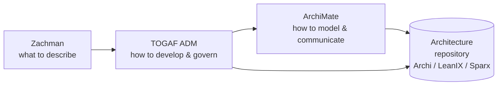
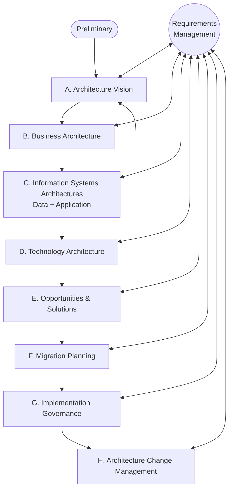
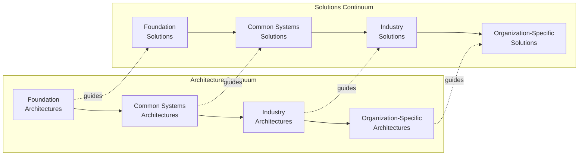
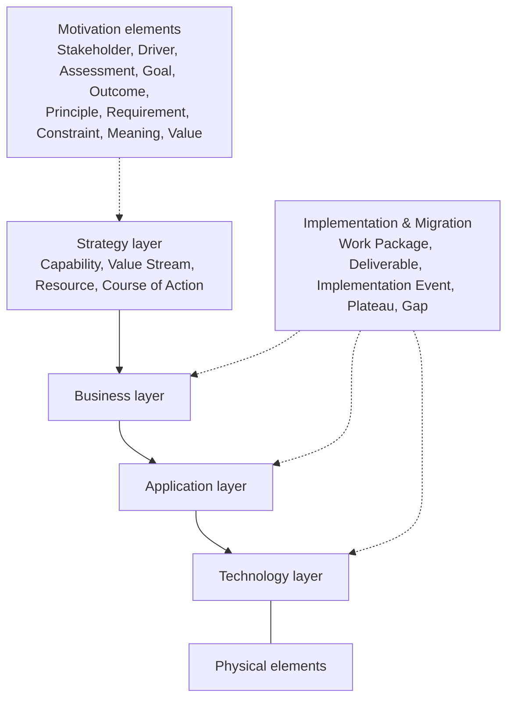

# EA Frameworks: TOGAF 10, ArchiMate 3.2, Zachman

> **TL;DR** TOGAF is a *method* (the ADM) plus a content model and repository structure for doing enterprise architecture. ArchiMate is the *modeling language* (notation) to draw the result across strategy, business, application, technology and migration layers. Zachman is a *classification schema* (6x6 ontology) to check you have described the enterprise from every perspective. Use them as toolkits, not religions: tailor TOGAF, model only the ArchiMate views stakeholders actually read, and use Zachman as a completeness checklist.

---

## 1. How the three relate

| Framework | What it is | Answers | Typical use in a mid-size organization |
|---|---|---|---|
| **TOGAF 10** (The Open Group) | Process + content framework + capability guidance | *How* do we develop and govern architecture? | Tailored ADM cycle for a transformation (e.g. ERP replacement), principles, architecture board |
| **ArchiMate 3.2** (The Open Group) | Modeling language with ~60 element types and 11 relationship types | *How* do we describe and visualize architecture consistently? | Application landscape, layered views, capability maps, migration plateaus |
| **Zachman Framework** (John Zachman) | Ontology / classification grid (6 interrogatives x 6 perspectives) | *What* descriptive representations exist and are we missing any? | Completeness check, artefact taxonomy, explaining EA to executives |

---

## 2. TOGAF Standard, 10th Edition

Released April 2022. Restructured into:

- **TOGAF Fundamental Content** — the stable core: Introduction & Core Concepts, Architecture Development Method (ADM), ADM Techniques, Applying the ADM, Architecture Content, Enterprise Agility & the Architecture Capability (governance, repository, etc.).
- **TOGAF Series Guides** — modular, evolving guidance: e.g. Business Architecture, Business Capabilities, Value Streams, Information Mapping, Digital Enterprise / Agile architecture, Security architecture, Government reference model, Leader's guide to establishing an EA capability.

> Key change vs 9.2: the core is smaller and more stable; practical "how-to" moved into guides that can be updated independently. Content is otherwise largely compatible with 9.2 — certification (TOGAF Enterprise Architecture Foundation / Practitioner, formerly Level 1/2) changed naming. *Verify current certification names.*

### 2.1 Architecture Development Method (ADM)

| Phase | Purpose | Key inputs | Key outputs / deliverables | Typical questions |
|---|---|---|---|---|
| **Preliminary** | Prepare the organization to do architecture: scope, principles, framework tailoring, governance, tools | Board strategy, existing frameworks, governance model | Organizational model for EA, tailored framework, **Architecture Principles**, initial repository, Request for Architecture Work template | Who sponsors EA? Which framework parts do we use? What is the architecture board? |
| **A. Architecture Vision** | Define scope, stakeholders, high-level target and value; get approval | Request for Architecture Work, business goals & drivers, principles | **Statement of Architecture Work**, Architecture Vision, stakeholder map, business scenarios, capability assessment, Communications Plan | What problem? Which stakeholders and concerns? What is in/out of scope? |
| **B. Business Architecture** | Baseline and target business: capabilities, value streams, organization, processes, information | Vision, principles, business strategy | Baseline/target business architecture, gap analysis, business requirements, candidate roadmap components | What capabilities change? Which processes, roles, locations? |
| **C. Information Systems Architectures** | Baseline and target **Data** and **Application** architecture | Phase B outputs | Data entity/component catalogs, application portfolio catalog, application communication diagrams, gaps | Which applications support which capabilities? Where is data mastered? |
| **D. Technology Architecture** | Baseline and target platforms, infrastructure, standards | Phase C outputs | Technology standards catalog, platform decomposition, environments and locations, gaps | Which hosting, network, identity, integration platforms? |
| **E. Opportunities & Solutions** | Consolidate gaps into work packages; decide build/buy/reuse; define Transition Architectures | Gaps from B–D | Consolidated gaps/solutions/dependencies matrix, **Transition Architectures**, Implementation & Migration strategy | What projects? In what grouping? Buy or build? |
| **F. Migration Planning** | Sequence work packages by value, risk, cost, dependencies; finalize roadmap | Phase E outputs, portfolio constraints | **Implementation and Migration Plan**, finalized Architecture Roadmap, cost/benefit per package | What order? Which plateaus? What does it cost? |
| **G. Implementation Governance** | Ensure projects conform to the architecture | Plan, Architecture Contracts | **Architecture Contracts**, compliance assessments, change requests | Are projects building what was agreed? Approved dispensations? |
| **H. Architecture Change Management** | Monitor technology/business change; decide whether to start new cycle | Change requests, performance metrics | Architecture updates, new Request for Architecture Work | Do we patch, iterate, or start a new ADM cycle? |
| **Requirements Management** | Central continuous process: store, prioritize, trace requirements through all phases | Requirements from every phase | Architecture Requirements Specification, Requirements Impact Assessment | What changed? What is the impact on the current phase? |

**ADM iteration patterns** (from "Applying the ADM"):

- **Architecture Capability iteration** — Preliminary + A to set up/adjust the EA practice.
- **Architecture Development iteration** — cycles over B, C, D to converge baseline/target.
- **Transition Planning iteration** — E and F to build roadmap.
- **Architecture Governance iteration** — G and H.
- Levels: Strategic architecture (enterprise, multi-year) → Segment architecture (domain/program) → Capability architecture (single capability increment). Agile delivery usually sits under Capability architecture.

**Practical tailoring for a mid-size organization (200–2,000 FTE):**

| Full TOGAF | Tailored, pragmatic |
|---|---|
| All deliverables per phase | Vision on 2 pages, one capability map, one application landscape, a roadmap, principles, ADRs |
| Separate Data and Application phases | Combined "information systems" workshop; data ownership table |
| Formal Architecture Contracts | Solution design review checklist + signed-off ADR at project gate |
| Architecture Board monthly with minutes | Fortnightly 45-min design authority with decision log |
| Full repository | Archi model in Git, or SaaS EA tool (LeanIX) when > ~150 applications |

### 2.2 ADM Techniques (selection)

| Technique | Purpose |
|---|---|
| Architecture Principles | Enduring rules guiding decisions (template below) |
| Stakeholder Management | Map power/interest, concerns, viewpoints per stakeholder |
| Architecture Patterns | Reusable solution idea with context, problem, forces |
| Gap Analysis | Baseline vs target matrix: included / eliminated / new |
| Migration Planning Techniques | Implementation factor matrix, consolidated gaps matrix, business value assessment, Transition Architecture state evolution table |
| Interoperability Requirements | Degrees of information/technical interoperability between systems |
| Business Transformation Readiness Assessment | Readiness factors (vision, sponsorship, funding, governance, skills, culture) rated and risk-mitigated |
| Risk Management | Initial vs residual risk classification |
| Capability-Based Planning | Plan in terms of business capabilities increments, not projects |
| Business Scenarios | Structured problem → environment → objectives → actors → roles → results narrative |

**Gap analysis matrix (TOGAF style):**

| Baseline \ Target | Target ABB 1 | Target ABB 2 | New ABB 3 | Eliminated |
|---|---|---|---|---|
| Baseline ABB 1 | Included | | | |
| Baseline ABB 2 | | Enhanced | | |
| Baseline ABB 4 | | | | Intentionally eliminated? / Accidentally omitted? |
| New | | | Gap: to develop or procure | |

### 2.3 Architecture Content Framework (ACF)

Three categories of work products:

| Type | Definition | Example |
|---|---|---|
| **Deliverable** | Contractually specified, formally reviewed and signed off output | Architecture Definition Document, Statement of Architecture Work, Roadmap |
| **Artifact** | Architectural work product describing one aspect: **catalog** (list), **matrix** (relationships), **diagram** (picture) | Application Portfolio Catalog, Application/Function Matrix, Application Communication Diagram |
| **Building Block** | Reusable component of business, IT or architectural capability | **ABB** (Architecture Building Block: required capability, e.g. "Customer data management") vs **SBB** (Solution Building Block: concrete product, e.g. "Dynamics 365 Customer Insights") |

**Content Metamodel** (core entities): Actor, Role, Organization Unit, Business Service, Function, Process, Event, Control, Product, Contract, Measure, Driver, Goal, Objective, Course of Action, Capability, Value Stream; Data Entity, Logical/Physical Data Component; Information System Service, Logical/Physical Application Component; Technology Service, Logical/Physical Technology Component; Principle, Constraint, Assumption, Requirement, Gap, Work Package, Location.

**Common artifacts per phase:**

| Phase | Catalogs | Matrices | Diagrams |
|---|---|---|---|
| Preliminary | Principles catalog | — | — |
| A | Stakeholder catalog | Stakeholder map matrix | Value chain diagram, Solution concept diagram, Business model diagram |
| B | Organization/Actor, Role, Business service/function, Location, Process/Event/Control/Product, Contract/Measure, Capability, Value stream | Business interaction, Actor/Role, Value stream/Capability, Strategy/Capability, Capability/Organization | Business footprint, Functional decomposition, Product lifecycle, Goal/objective/service, Organization decomposition, Process flow, Event, Business capability map, Value stream map |
| C – Data | Data entity/Data component catalog | Data entity/Business function, Application/Data | Conceptual/logical data, Data dissemination, Data security, Data migration, Data lifecycle |
| C – Application | Application portfolio, Interface catalog | Application/Organization, Role/Application, Application/Function, Application interaction | Application communication, Application & user location, Application use-case, Enterprise manageability, Process/Application realization, Software engineering, Application migration, Software distribution |
| D | Technology standards, Technology portfolio | Application/Technology | Environments & locations, Platform decomposition, Processing, Networked computing/hardware, Network & communications |
| E | — | — | Project context, Benefits diagram |
| Req. Mgmt | Requirements catalog | — | — |

### 2.4 Enterprise Continuum and Architecture Repository

The **Enterprise Continuum** is a view of the repository that classifies assets from generic to specific.

| Level | Architecture example | Solution example |
|---|---|---|
| Foundation | TOGAF Technical Reference Model (TRM) | Generic OS, programming languages, cloud IaaS |
| Common Systems | Security architecture, network architecture, Integrated Information Infrastructure Reference Model (III-RM) | IAM product, iPaaS, EDR suite |
| Industry | BIAN (banking), ACORD (insurance), TM Forum (telco), Dutch government GEMMA / NORA | Industry ERP verticals, sector SaaS |
| Organization-specific | Your target architecture | Your configured ERP tenant |

**Architecture Repository** components:

| Component | Content |
|---|---|
| Architecture Metamodel | Tailored content metamodel and method |
| Architecture Capability | Parameters, structures, processes for the EA function itself |
| Architecture Landscape | Baseline, transition, target views at Strategic / Segment / Capability levels |
| Standards Information Base (SIB) | Standards (legal, industry, organizational) with lifecycle status: trial, active, deprecated, obsolete |
| Reference Library | Reference architectures, patterns, templates, guidelines |
| Governance Log | Decisions, compliance assessments, dispensations, capability assessments, calendar |
| Architecture Requirements Repository | All requirements authorized by the board |
| Solutions Landscape | SBBs deployed |

### 2.5 Architecture Principles

**Template (TOGAF):**

| Field | Content |
|---|---|
| **Name** | Short, memorable, the essence of the rule. Avoid ambiguous words like "support", "open", "consider". |
| **Statement** | Succinct, unambiguous rule. |
| **Rationale** | Business benefits of adhering; link to business principles/drivers. |
| **Implications** | Requirements for business and IT to carry out the principle: resources, costs, activities, what changes. Answer "how does this affect me?" |

**Quality criteria for a principle set:** understandable, robust (enables good decisions, precise enough to resolve ambiguous situations), complete, consistent (may compete but must be balanced), stable (amendment process exists).

**TOGAF example principle categories:** Business (Primacy of Principles, Maximize Benefit to the Enterprise, Information Management is Everybody's Business, Business Continuity, Common Use Applications, Service Orientation, Compliance with Law, IT Responsibility, Protection of Intellectual Property), Data (Data is an Asset, Data is Shared, Data is Accessible, Data Trustee, Common Vocabulary and Data Definitions, Data Security), Application (Technology Independence, Ease-of-Use), Technology (Requirements-Based Change, Responsive Change Management, Control Technical Diversity, Interoperability).

**Worked example:**

> **Name:** Reuse before buy before build
> **Statement:** New capability needs are first met by existing platforms, then by configuring standard (SaaS/COTS) products, and only then by custom development.
> **Rationale:** Reduces TCO, integration effort and support burden; concentrates engineering effort on differentiating capabilities.
> **Implications:** Every solution proposal must document reuse and buy options considered; the application portfolio must be current and searchable; custom build requires architecture board approval and a named owning team; product roadmaps of strategic vendors are monitored.

See [templates.md](templates.md#1-architecture-principles-15-examples) for 15 ready-made principles.

### 2.6 Architecture governance in TOGAF

- **Architecture Board**: cross-organization group responsible for consistency, enforcing compliance, approving dispensations, owning the Governance Log.
- **Architecture Compliance** levels: Irrelevant, Consistent, Compliant, Conformant, Fully Conformant, Non-conformant.
- **Architecture Contract**: joint agreement between development partners and sponsors on deliverables, quality and fitness-for-purpose.
- **Dispensation**: time-boxed, approved deviation with conditions and expiry.

More practical guidance in [ea-practice-capabilities-portfolio.md](ea-practice-capabilities-portfolio.md#7-architecture-governance).

---

## 3. ArchiMate 3.2

Open Group modeling language, version 3.2 published in 2022 (3.1 in 2019, 3.0 in 2016). Aligned with TOGAF but usable independently.

### 3.1 The framework

Core framework = Business, Application, Technology layers x three aspects:

| | **Passive structure** (what is acted on) | **Behavior** (what is done) | **Active structure** (who/what acts) |
|---|---|---|---|
| **Business** | Business Object, Contract, Representation, Product (composite) | Business Process, Function, Interaction, Event, Service | Business Actor, Role, Collaboration, Interface |
| **Application** | Data Object | Application Process, Function, Interaction, Event, Service | Application Component, Collaboration, Interface |
| **Technology** | Artifact | Technology Process, Function, Interaction, Event, Service | Node, Device, System Software, Technology Collaboration, Technology Interface, Path, Communication Network |
| **Physical** | Material | (technology behavior) | Equipment, Facility, Distribution Network |

Plus the **Motivation** aspect and the **Strategy** and **Implementation & Migration** layers.

### 3.2 Key elements by layer

| Layer | Element | Meaning | Example |
|---|---|---|---|
| Strategy | **Capability** | An ability the organization possesses (what, not how) | "Demand forecasting" |
| | **Value Stream** | Sequence of value-adding stages for a stakeholder | "Order to cash" stages: Quote → Order → Fulfil → Invoice → Collect |
| | **Resource** | Asset owned/controlled | "Fleet", "Customer data", "Planners" |
| | **Course of Action** | Approach/plan to configure capabilities and resources | "Consolidate onto single ERP" |
| Motivation | Stakeholder / Driver / Assessment | Who cares / why / what is the finding | CFO / Cost pressure / "Month-end close takes 12 days" |
| | Goal / Outcome | Desired end state / measurable result | "Faster close" / "Close in 5 days by Q4" |
| | Principle / Requirement / Constraint | Norms / needs / limits on the design | "Cloud first" / "Support multi-currency" / "Data in EU" |
| | Meaning / Value | Interpretation / worth | |
| Business | Business Actor / Role | Entity performing behavior / responsibility | "Supplier", "Accounts payable clerk" |
| | Business Process / Function | Sequenced behavior with result / grouping by skill or resource | "Handle supplier invoice" / "Accounts payable" |
| | Business Event | Something that happens | "Invoice received" |
| | Business Service | Externally visible behavior offered | "Supplier payment" |
| | Business Object | Concept used in business | "Invoice" |
| | Product | Coherent offering of services + contract | "Managed IT bundle" |
| Application | Application Component | Encapsulated deployable application | "Exact Online", "Custom portal" |
| | Application Service / Interface | Exposed functionality / access point | "Invoice registration service" / "REST API" |
| | Data Object | Data structured for automated processing | "Invoice record" |
| Technology | Node / Device / System Software | Computational resource / hardware / software environment | "Azure App Service", "Laptop", "SQL Server" |
| | Technology Service | Exposed tech functionality | "Managed database service" |
| | Artifact | Deployable piece of data/software | "portal.zip", "db schema" |
| | Communication Network / Path | Network / logical link | "WAN", "VPN to supplier" |
| Physical | Equipment / Facility / Distribution Network / Material | Physical machines, sites, transport, goods | "Packaging line", "DC Venlo", "Trucks", "Pallets" |
| Impl. & Migration | Work Package | Series of actions with goal and time | "Phase 1 finance go-live" |
| | Deliverable | Precisely defined result | "Migrated GL" |
| | Plateau | Relatively stable architecture state | "Baseline 2026", "Transition 1", "Target 2028" |
| | Gap | Difference between two plateaus | "AP automation missing" |
| | Implementation Event | State change related to implementation | "Go-live" |

**Generic elements / composite:** Grouping (aggregate any concepts), Location (place).

### 3.3 Relationships

| Category | Relationship | Notation (informal) | Meaning | Example |
|---|---|---|---|---|
| Structural | **Composition** | Line with filled diamond | Whole consists of parts that cannot exist alone | Application component *composed of* modules |
| | **Aggregation** | Line with hollow diamond | Whole groups parts that may exist independently | Grouping "Finance apps" aggregates components |
| | **Assignment** | Dot at source, arrow at target | Who/what performs behavior; allocation | Role *assigned to* process; artifact *assigned to* node |
| | **Realization** | Dashed line, hollow triangle | Concrete entity realizes abstract | Application component *realizes* application service; process *realizes* service |
| Dependency | **Serving** | Line, open arrowhead | Provides functionality to | Application service *serves* business process |
| | **Access** | Dotted line, small arrowhead (read/write) | Behavior reads/writes passive element | Process *accesses* invoice (write) |
| | **Influence** | Dashed line with +/- | Affects motivation element | Driver *influences* goal (+) |
| | **Association** | Plain line (optionally directed) | Unspecified relationship | Any |
| Dynamic | **Triggering** | Solid line, filled arrowhead | Temporal/causal precedence | Event *triggers* process |
| | **Flow** | Dashed line, filled arrowhead | Transfer of information/goods | Process A *flows* order to process B |
| Other | **Specialization** | Line, hollow triangle | Is-a-kind-of | "Customer" specializes "Business partner" |
| | **Junction** (And/Or) | Dot | Combine relationships of same type | |

**Derivation rules** let you infer an indirect relationship from a chain (e.g. component → realizes service → serves process ⇒ component serves process). Version 3.1/3.2 formalized "valid" vs "potential" derivations — use them to simplify views without losing correctness.

**Cross-layer dependencies to remember:**

- Business ↔ Application: application service **serves** business behavior; application process/function can **realize** business process/function (automation); data object **realizes** business object.
- Application ↔ Technology: technology service **serves** application component; artifact **realizes** application component or data object.
- Strategy: capability is **realized by** behavior/active structure elements; value stream stage is **served by** capabilities.
- Motivation: core elements **realize** requirements; requirements **realize** goals/outcomes.

### 3.4 Viewpoints

ArchiMate 3.x provides a viewpoint mechanism plus example viewpoints. Choose by stakeholder concern.

| Category | Viewpoint | Audience | Shows |
|---|---|---|---|
| Composition | Organization | Managers, HR | Actors, roles, departments, collaborations |
| | Application Structure | Solution architects | Internal structure of application components |
| | Information Structure | Data architects | Business/data objects and relations |
| | Technology | Infra architects | Nodes, system software, networks |
| | Layered | Everyone (overview) | Stack from business to tech |
| | Physical | Operations, logistics | Equipment, facilities, networks |
| Support | Product | Product owners, sales | Product with services, contracts |
| | Application Usage | Business + IT | Which processes use which applications |
| | Technology Usage | Infra + app owners | Which apps use which tech services |
| Cooperation | Business Process Cooperation | Process owners | Relationships between processes |
| | Application Cooperation | Integration architects | Integration landscape, flows between apps |
| Realization | Service Realization | Service owners | How services are realized |
| | Implementation and Deployment | DevOps, infra | Artifacts deployed on nodes |
| Motivation | Stakeholder, Goal Realization, Requirements Realization, Motivation | Executives, BA | Drivers → goals → requirements → realizing elements |
| Strategy | Strategy, Capability Map, Value Stream, Outcome Realization, Resource Map | Executives, strategists | Capabilities, value streams, resources, courses of action |
| Impl. & Migration | Project, Migration, Implementation and Migration | PMO, program managers | Work packages, plateaus, gaps |

**Practical "minimum viable views" for an ERP transformation:**

1. Capability map (heat-mapped) — strategy viewpoint.
2. Value stream → capability cross-map for O2C and P2P.
3. Application cooperation view (current and target) — integration landscape.
4. Layered view for the ERP solution (business process → app services → ERP modules → SaaS tenant).
5. Migration view with plateaus (baseline → transition 1 → target).

### 3.5 Modeling conventions that keep models useful

- Name behavior with **verb + noun** ("Approve invoice"), structure with **nouns** ("Accounts payable clerk"), services in **noun/gerund** form ("Invoice processing").
- One element per real thing; reuse elements across views (the model is the truth, views are projections).
- Use **Grouping** and colors for heat maps; document the color legend in the view.
- Keep views < ~20 elements; split by audience rather than cramming.
- Add properties (owner, lifecycle, cost, criticality) to application components — this turns a drawing into a queryable portfolio.
- Store Archi models in Git (coArchi plugin) for versioning and collaboration.

### Common ArchiMate mistakes

| Mistake | Fix |
|---|---|
| Drawing everything with association | Use the specific relationship (serving, realization, access) |
| Confusing function and process | Function = stable grouping (by capability/skill); process = flow with start and result |
| Using business process boxes for application functionality | Model application process/function and let it serve or realize the business process |
| Mixing capability with organization unit | Capabilities are org-agnostic; map units to capabilities separately |
| Huge single view "the architecture" | Multiple views per concern and stakeholder |
| No legend, nonstandard colors | Agree house style; ArchiMate default colors: yellow business, blue application, green technology |

---

## 4. Zachman Framework

Created by John Zachman (1987 IBM Systems Journal article; matured into Framework 3.0, 2011). An **ontology**, not a method: every cell is a distinct, primitive descriptive representation.

### 4.1 The 6x6 grid

| Perspective (row) \ Interrogative (column) | **What** (Inventory / Data) | **How** (Process / Function) | **Where** (Distribution / Network) | **Who** (Responsibility / People) | **When** (Timing / Time) | **Why** (Motivation) |
|---|---|---|---|---|---|---|
| **Executive** — Scope Contexts (Planner) | Inventory identification: list of things important to the business | Process identification: list of processes | Distribution identification: list of locations | Responsibility identification: list of organizations | Timing identification: list of events/cycles | Motivation identification: list of goals/strategies |
| **Business Management** — Business Concepts (Owner) | Semantic model (entities, relationships) | Business process model | Business logistics / distribution | Workflow / responsibility model | Master schedule | Business plan (ends/means) |
| **Architect** — System Logic (Designer) | Logical data model | System/application architecture | Distributed system architecture | Human interface architecture | Processing structure | Business rule model |
| **Engineer** — Technology Physics (Builder) | Physical data model | Technology design / system design | Technology architecture | Presentation architecture | Control structure | Rule design |
| **Technician** — Tool Components (Implementer) | Data definition | Program | Network architecture / configuration | Security architecture | Timing definition | Rule specification |
| **Enterprise** — Operations Instances (User) | Actual data | Actual functions | Actual networks | Actual organization | Actual schedule | Actual strategy |

*Cell wording paraphrased; see zachman.com for the canonical 3.0 labels.*

### 4.2 Rules of the framework (paraphrased)

1. Columns have no order.
2. Each column has a simple, generic model (thing–relationship–thing).
3. Each cell model specializes its column's generic model.
4. Each column is unique.
5. Each row represents a distinct, unique perspective.
6. Each cell is unique.
7. Combining all cells in a row forms a complete model from that perspective.
8. Do not create diagonal relationships between cells (avoid mixing columns and rows in one primitive).

### 4.3 How to use it

- **Completeness check** on an architecture or ERP design dossier: tick which cells you have (e.g. you often have How/Architect and What/Engineer, but no Why/Business Management → missing business rules).
- **Communication**: explains why executives need different artefacts than developers.
- **Taxonomy** for the repository: tag artefacts by row and column.
- Not a process: pair with TOGAF ADM or another method.

---

## 5. Other frameworks worth knowing

| Framework | Origin | Note |
|---|---|---|
| **FEAF** | US Federal government | Reference models (performance, business, data, application, infrastructure, security) |
| **DoDAF / MODAF / NAF** | Defence | Viewpoint-heavy; NATO Architecture Framework (NAF v4) |
| **Gartner EA approach** | Gartner | Business-outcome-driven, "just enough" EA |
| **IT4IT** | The Open Group | Reference architecture for running the IT function as a value chain (Strategy to Portfolio, Requirement to Deploy, Request to Fulfil, Detect to Correct) |
| **NORA / GEMMA** | Dutch government | NORA: Nederlandse Overheid Referentie Architectuur; GEMMA for municipalities |
| **BIAN** | Banking | Service-domain reference model |
| **eTOM / TM Forum** | Telecom | Business process framework |
| **APQC PCF** | APQC | Cross-industry Process Classification Framework — excellent starting point for process and capability lists |
| **C4 model** | Simon Brown | Software architecture (context, container, component, code) — see [../05-software-architecture/README.md](../05-software-architecture/README.md) |

## When to use / when not

| Use | Don't |
|---|---|
| TOGAF ADM to structure a multi-year transformation, a large ERP replacement, a merger IT integration | For a single application project — use solution architecture + ADRs |
| ArchiMate when > ~30 applications or several architects need a shared language | When the audience only needs one box-and-line picture for a single decision |
| Zachman as a checklist for completeness | As a plan of work; filling all 36 cells is not a goal |
| Principles to make recurring decisions fast | As wall decoration with no implications or enforcement |

## Common mistakes

- Running the ADM "waterfall" end-to-end before delivering anything; iterate and deliver value per cycle.
- Producing all TOGAF artifacts because the book lists them; select per stakeholder concern.
- Architecture repository that nobody updates — tie updates to change/project gates.
- Principles without implications; or 40 principles nobody remembers (aim for 10–15).
- Models drawn in PowerPoint/Visio only: no reuse, no queries, inconsistency.
- EA team detached from delivery: ivory tower. Embed architects in programs, keep the board lightweight.

## References

- The Open Group — TOGAF Standard: https://www.opengroup.org/togaf
- The Open Group — ArchiMate 3.2 Specification: https://pubs.opengroup.org/architecture/archimate3-doc/
- The Open Group — ArchiMate overview: https://www.opengroup.org/archimate-forum/archimate-overview
- Zachman International: https://zachman.com/
- Wikipedia — TOGAF: https://en.wikipedia.org/wiki/The_Open_Group_Architecture_Framework
- Wikipedia — ArchiMate: https://en.wikipedia.org/wiki/ArchiMate
- Wikipedia — Zachman Framework: https://en.wikipedia.org/wiki/Zachman_Framework
- Archi (free ArchiMate tool): https://www.archimatetool.com/
- APQC Process Classification Framework: https://www.apqc.org/process-frameworks
- Wikipedia — IT4IT: https://en.wikipedia.org/wiki/IT4IT
- Related: [ea-practice-capabilities-portfolio.md](ea-practice-capabilities-portfolio.md), [templates.md](templates.md), [../05-software-architecture/README.md](../05-software-architecture/README.md)
