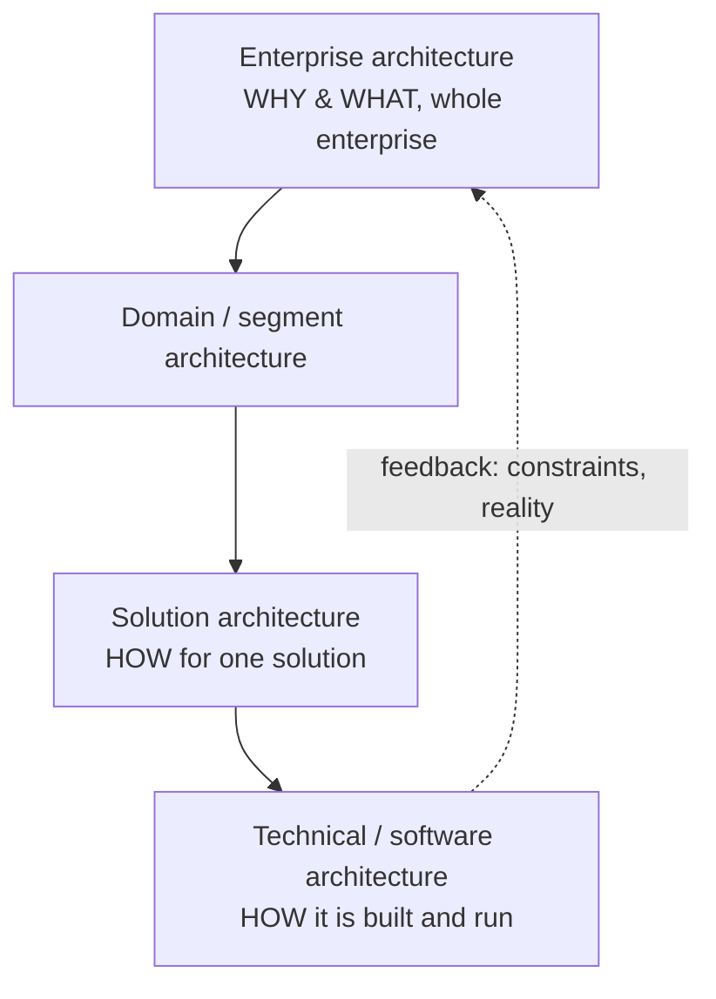
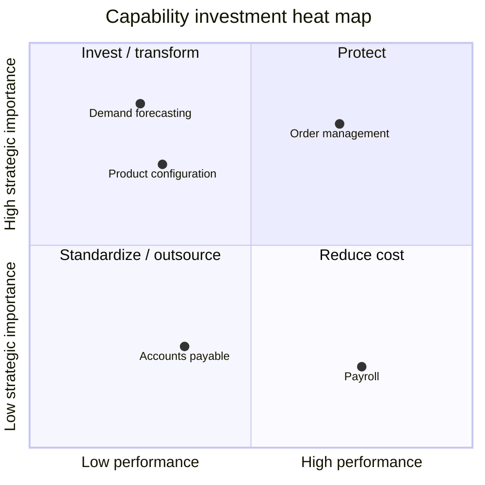
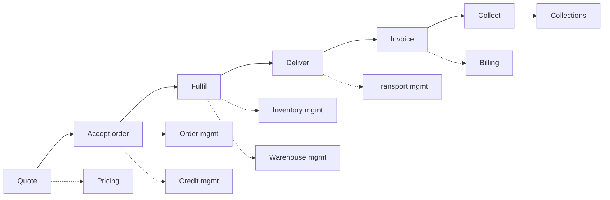
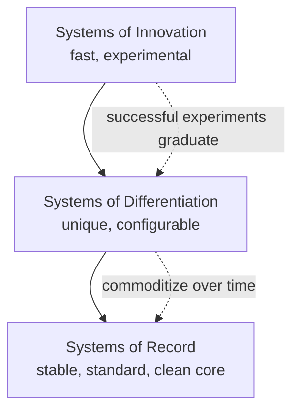
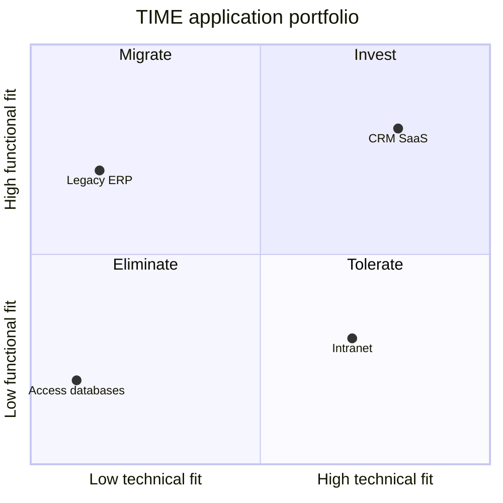
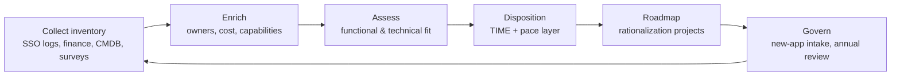
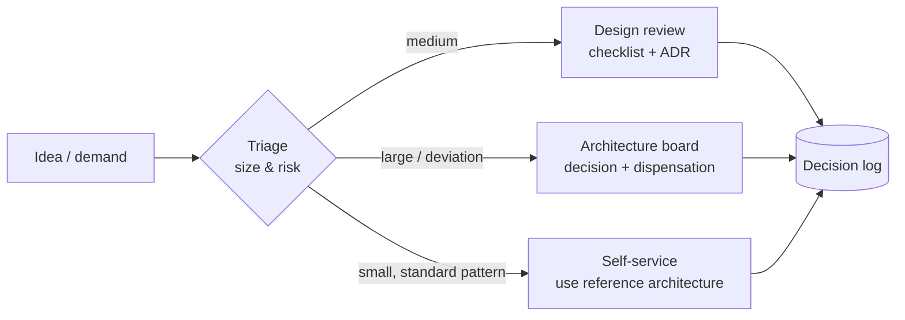

# EA Practice: Capabilities, Portfolio, Governance, Radar, Tools

> **TL;DR** The working toolkit of an enterprise architect: a **business capability map** (stable "what" of the business) heat-mapped for investment decisions; **value streams** to show how value flows across capabilities; **application portfolio management** with the **TIME** model (Tolerate, Invest, Migrate, Eliminate) and Gartner's **pace layers** (record, differentiation, innovation) to decide what to standardize vs. innovate; lightweight **architecture governance**; a **technology radar** for standards; **reference architectures**; and a suitable **EA tool**. Keep it light, data-driven and tied to funding decisions.

---

## 1. Architecture roles

| Role | Scope | Horizon | Main artefacts | Typical counterpart |
|---|---|---|---|---|
| **Enterprise architect** | Whole organization; business + IT | 2–5 years | Capability map, target landscape, principles, roadmap, portfolio decisions | CIO, CFO, board, business unit heads |
| **Business architect** | Business model, capabilities, value streams, organization | 1–5 years | Capability map, value streams, operating model | COO, process owners |
| **Domain / segment architect** | One domain (e.g. finance, supply chain, data) | 1–3 years | Domain target architecture, domain roadmap | Domain leads |
| **Solution architect** | One solution / program / project | Months – 2 years | Solution design, integration design, ADRs, NFRs, cost model | Project manager, product owner, vendors |
| **Technical / infrastructure architect** | Platforms, hosting, network, security tech | 1–3 years | Platform standards, landing zone, reference implementations | Ops, engineering |
| **Data architect** | Data models, master data, analytics platform | 1–3 years | Data model, data flows, MDM design | Data owners, BI |
| **Security architect** | Security controls across layers | 1–3 years | Security architecture, threat models, control mapping | CISO |
| **Software architect** | Internal structure of a software system | Months – years | C4, quality attributes, code-level patterns | Dev team — see [../05-software-architecture/README.md](../05-software-architecture/README.md) |

In a mid-size organization these roles are often combined in one or two people. Keep the distinction in mind to avoid doing solution detail at enterprise level (or the reverse).

---

## 2. Business capability maps

### 2.1 Definitions

- **Business capability**: what the business does or can do to achieve its objectives, independent of who does it, how, or with which system. Expressed as a **noun** (e.g. "Supplier management", "Demand forecasting").
- Capabilities are **stable** (change rarely), whereas processes, organizations and applications change often. That stability makes them the best anchor for mapping and investment.
- Capability ≠ process (process = how, sequence), ≠ function/department (org structure), ≠ application.

### 2.2 Structure

| Level | Content | Count (typical) |
|---|---|---|
| L0 | Categories: Strategic / Core (customer-facing, value-producing) / Supporting | 3 |
| L1 | Major capability areas (e.g. "Finance management") | 8–15 |
| L2 | Capabilities (e.g. "Accounts payable") | 40–100 |
| L3 | Sub-capabilities (only where decisions need it) | as needed |

Rules of thumb: MECE (mutually exclusive, collectively exhaustive) at each level; 3–10 children per parent; name with nouns; one page for L1–L2.

### 2.3 How to build one (step by step)

1. **Purpose first**: what decision will it support (ERP scope, investment, sourcing, M&A)? This determines depth.
2. **Start from a reference**: APQC PCF, industry models (BIAN, eTOM), vendor process maps, or the skeleton in [templates.md](templates.md#2-capability-map-skeleton). Never start from the org chart.
3. **Draft L1** with 2–3 senior people in a 2-hour workshop; validate against strategy and value streams ("can we deliver each value stream stage with these?").
4. **Decompose to L2** with domain experts; write a one-sentence definition per capability.
5. **Test**: walk through 3 real scenarios (new customer order, supplier invoice, new hire). Every step should land on a capability.
6. **Validate** with business leads; freeze version 1.0; manage changes via the architecture board.
7. **Map** applications, processes, organizations, data and projects to capabilities (many-to-many).
8. **Assess and heat-map** (below).
9. **Use** it in portfolio and investment discussions — otherwise it decays.

### 2.4 Heat-mapping

Rate each L2 capability on a few dimensions; color code.

| Dimension | Scale | Question |
|---|---|---|
| Strategic importance | 1–5 | How much does this capability drive our strategy/differentiation? |
| Performance / maturity | 1–5 (CMMI-like) | How well do we perform it today? |
| Gap (importance − performance) | derived | Where must we invest? |
| IT support quality | 1–5 | How well do applications support it? |
| Cost | € / FTE | What does it cost? |
| Risk | L/M/H | Compliance, continuity, key-person risk |
| Pace layer | Record / Differentiation / Innovation | How should it be sourced and changed? |

**Reading the map:**

| Importance | Performance | Action |
|---|---|---|
| High | Low | **Invest / transform** (red, priority) |
| High | High | **Protect / maintain** advantage |
| Low | Low | **Standardize / outsource / buy commodity** |
| Low | High | **Possibly over-invested** — reduce cost |

### 2.5 Capability-based planning

- Express roadmap items as **capability increments** ("Demand forecasting: from spreadsheet to statistical forecast with S&OP") rather than projects.
- Link each increment to an outcome/KPI and a value stream stage.
- Projects become means to realize capability increments; the portfolio is prioritized on capability gaps.

---

## 3. Value streams

**Value stream (business architecture sense)**: end-to-end sequence of value-adding stages that deliver an outcome to a triggering stakeholder. Named "verb–noun" or "trigger-to-outcome" (e.g. "Acquire customer", "Order to cash", "Hire to retire").

Different from the Lean **value stream map** (which maps process steps, wait times and waste — see [business-analysis.md](business-analysis.md#6-value-stream-mapping)).

| Element | Description | Example (Order to cash) |
|---|---|---|
| Triggering stakeholder | Who initiates | Customer |
| Stages | 4–8 value-adding stages | Quote → Accept order → Fulfil → Deliver → Invoice → Collect |
| Value item per stage | What value is produced | Price agreed; order confirmed; goods picked; goods received; invoice issued; cash received |
| Entrance/exit criteria | When a stage starts/ends | |
| Participating stakeholders | Who else is involved | Sales, warehouse, carrier, finance |
| Capabilities enabling each stage | Cross-map | Pricing, Order management, Warehouse management, Transport management, Billing, Credit & collections |

**Value stream → capability cross-mapping** is the most persuasive artefact for executives: it shows which weak capabilities slow down the stages that matter.

---

## 4. Gartner pace-layered application strategy

Introduced by Gartner (2012). Classify applications (or capabilities) by rate of change and differentiation:

| Layer | Characteristics | Change rate | Governance | Sourcing | Examples |
|---|---|---|---|---|---|
| **Systems of Record** | Established packaged or legacy apps supporting core transaction processing and master data; regulatory; little differentiation | Slow (years); stable | Strict, change control, clean core | Buy standard (ERP, HRIS, payroll), SaaS | ERP GL/AP/AR, HR master, payroll |
| **Systems of Differentiation** | Apps enabling unique company processes or industry-specific capabilities | Medium (months–1 year) | Moderate, product-oriented | Configure + extend; low-code; side-by-side apps | Pricing engine, customer portal, planning tool, MES configuration |
| **Systems of Innovation** | New apps built ad hoc for emerging requirements or experiments | Fast (weeks–months) | Light; sandbox; kill quickly | Build, low-code, SaaS trials, AI pilots | AI copilots, IoT pilots, new channel experiments |

**Implications:**

- Keep the **record** layer clean and standard ([erp-implementation-selection.md](erp-implementation-selection.md#1-clean-core--keep-the-core-clean)); put differentiation in a layer above with APIs/events.
- Different funding, governance, testing and release cadences per layer.
- Map pace layers onto Wardley evolution: innovation ≈ genesis/custom, record ≈ product/commodity ([strategy-frameworks.md](strategy-frameworks.md#11-wardley-mapping)).

---

## 5. Application portfolio management (APM)

### 5.1 Purpose

Know what you have, what it costs, how good it is, and decide what to do with it. Drives rationalization (fewer apps, lower cost, lower risk), and anchors roadmaps.

### 5.2 Application inventory — core attributes

See full column list in [templates.md](templates.md#3-application-inventory-columns). Minimum viable set:

| Attribute | Why |
|---|---|
| Name, ID, description | Identification |
| Business owner, IT owner/application manager | Accountability |
| Capabilities supported | Overlap and gap analysis |
| Users (number, departments) | Impact, licensing |
| Vendor, product, version, hosting model (SaaS/PaaS/IaaS/on-prem) | Lifecycle, risk |
| Lifecycle status (plan, phase-in, active, phase-out, retired) + end-of-support date | Roadmap |
| Annual cost (license, hosting, support, internal FTE) | TCO, rationalization |
| Business criticality (BIA tier), RTO/RPO | Continuity, NIS2 |
| Data classification, personal data (Y/N) | GDPR, security |
| Interfaces (count, to which apps) | Complexity, change impact |
| Functional fit (1–5), technical fit (1–5) | TIME |
| TIME disposition, pace layer | Decision |

### 5.3 The TIME model (Gartner)

Two axes: **business value / functional fit** and **technical quality / technical fit**.

| | Low technical fit | High technical fit |
|---|---|---|
| **High functional fit (business value)** | **Migrate** — valuable but technically weak: re-platform, upgrade, move to a modern platform while keeping functionality | **Invest** — strategic: enhance, extend, fund roadmap |
| **Low functional fit (business value)** | **Eliminate** — retire, consolidate, decommission; plan data archiving | **Tolerate** — technically fine, limited value: keep running, minimal investment, re-evaluate |

**Scoring guidance:**

| Functional fit criteria (1–5) | Technical fit criteria (1–5) |
|---|---|
| Covers required functionality | Vendor support / end-of-life status |
| User satisfaction | Security posture (patching, MFA/SSO support) |
| Process efficiency (workarounds needed?) | Integration capability (APIs, standards) |
| Data quality produced | Scalability / performance |
| Strategic alignment | Skills availability, documentation |
| Regulatory compliance | Hosting / platform alignment with standards |

Average or weight; threshold at 3 for the quadrant. Discuss borderline cases explicitly.

**Other rationalization dispositions** (Gartner "5 Rs"/cloud migration variants): Rehost, Replatform, Refactor, Rebuild, Replace, Retire, Retain. TIME is the portfolio-level decision; the R chosen is the execution approach. See [../06-cloud-architecture/README.md](../06-cloud-architecture/README.md).

### 5.4 APM process

- **Discovery sources**: SSO/IdP app list (Entra ID enterprise apps), finance/creditor ledger (SaaS subscriptions), expense claims, CASB/network logs, endpoint software inventory (Intune), interviews.
- **Refresh** at least annually; tie new-application intake to the portfolio (no purchase without registration).
- **KPIs**: number of apps per capability, % apps with owner, % end-of-life, annual run cost, # of apps eliminated.

### Common APM mistakes

- Spreadsheet built once, never updated. Assign owners; integrate with procurement and IAM.
- Rating apps only by IT; business users must score functional fit.
- Retiring an app without data retention/archiving plan (legal retention: e.g. Dutch fiscal retention period of 7 years for financial records — *verify for your case*).
- Counting apps instead of cost/risk; 30 tiny tools may matter less than one fragile Access database used for invoicing.

---

## 6. Reference architectures

A **reference architecture** is a reusable, generalized architecture for a domain or problem type, providing vocabulary, building blocks, patterns and standards.

| Type | Examples |
|---|---|
| Industry | BIAN (banking), TM Forum (telco), ACORD (insurance), NORA/GEMMA (Dutch public sector), ISA-95 (manufacturing integration levels) |
| Technology / cloud | Microsoft Azure Architecture Center reference architectures, AWS Well-Architected, Azure Landing Zones — [../06-cloud-architecture/README.md](../06-cloud-architecture/README.md) |
| Vendor | SAP reference architecture, Dynamics 365 implementation guides |
| Internal | Your standard "web app on Azure", "integration via iPaaS", "ERP extension" patterns |

**Internal reference architecture template:**

1. Context & scope (when to use, when not)
2. Principles and constraints applied
3. Logical view (building blocks, ArchiMate or C4)
4. Physical/technology view (approved products/services)
5. Integration and data flows
6. Security controls (identity, network, secrets, logging)
7. Operations (monitoring, backup, DR, ownership)
8. Cost model and sizing
9. Example implementations / IaC modules
10. Decision records and exceptions

**ISA-95 levels** (manufacturing, useful for ERP–MES boundary): Level 4 business planning & logistics (ERP), Level 3 manufacturing operations management (MES), Level 2 supervisory control (SCADA/HMI), Level 1 sensing & manipulation (PLC), Level 0 physical process.

---

## 7. Architecture governance

### 7.1 Governance bodies

| Body | Purpose | Cadence | Members |
|---|---|---|---|
| **Architecture board / Enterprise Architecture Review Board** | Approve principles, standards, target architectures, major deviations | Monthly / quarterly | CIO/CTO (chair), lead architects, business representatives, security |
| **Design authority / solution review** | Review solution designs at project gates; decisions logged as ADRs | Weekly / fortnightly | Lead architect, solution architects, security, ops |
| **Technical / standards forum** | Maintain technology radar and standards | Monthly | Architects, senior engineers |
| **IT steering committee / portfolio board** | Funding and prioritization | Monthly / quarterly | Executives, CIO, finance |

### 7.2 Lightweight governance process

**Design review checklist (excerpt):**

- [ ] Business capability and owner identified; fits target landscape?
- [ ] Reuse checked (existing apps/platforms in the portfolio)?
- [ ] Buy/configure/build decision justified?
- [ ] Data: master data source, ownership, classification, retention, GDPR basis?
- [ ] Integration: via approved integration platform/API standards; no point-to-point DB links?
- [ ] Identity: SSO via corporate IdP; role model; JML automated?
- [ ] Security: threat assessment, logging, vulnerability management, supplier assessment?
- [ ] Operations: monitoring, backup/restore tested, RTO/RPO defined, support model, runbook?
- [ ] Cost: TCO 5 years, licensing model understood, exit costs?
- [ ] Compliance: NIS2/ISO 27001 controls, contract clauses (DPA, audit rights, exit)?
- [ ] Lifecycle: version strategy, upgrade cadence, decommissioning plan of what it replaces?

### 7.3 Principles for governance that works

- **Guardrails, not gates**: publish standards and patterns so most decisions need no meeting.
- **Decide fast**: SLA for review (e.g. 5 working days).
- **Architecture Decision Records** (ADRs) for traceability — format in [../05-software-architecture/README.md](../05-software-architecture/README.md).
- **Dispensations with expiry**: allow deviation with remediation date.
- **Measure**: % projects reviewed, review lead time, # dispensations open, technical-debt items.

---

## 8. Technology radar

Popularized by ThoughtWorks (published twice a year since 2010). Blips placed in **quadrants** and **rings**.

| ThoughtWorks quadrants | Rings |
|---|---|
| Techniques | **Adopt** — strong recommendation, proven |
| Tools | **Trial** — worth pursuing, use on a project that can handle risk |
| Platforms | **Assess** — explore to understand impact |
| Languages & Frameworks | **Hold** — proceed with caution / do not start new use |

### Building your own radar (enterprise variant)

1. **Define quadrants** relevant to you, e.g.: Business applications & SaaS; Platforms & infrastructure; Data, integration & AI; Development & tooling.
2. **Collect blips** from architects, engineers, ops, security (survey or workshop): name, quadrant, proposed ring, rationale, owner.
3. **Assess** in a standards forum; agree ring and short description (why + where it applies).
4. **Publish** — ThoughtWorks' "Build Your Own Radar" tool renders a radar from a Google Sheet/CSV; or a simple Markdown table in the intranet.
5. **Connect to governance**: "Adopt" = default choice, no review needed; "Hold" = requires dispensation for new use.
6. **Refresh** every 6 months; show movements (new, moved in/out).

**Example enterprise radar entries:**

| Blip | Quadrant | Ring | Rationale |
|---|---|---|---|
| Entra ID SSO (OIDC/SAML) for all apps | Platforms | Adopt | Single identity, JML automation |
| Power Automate cloud flows for departmental workflows | Data, integration & AI | Adopt (with CoE governance) | Fast, licensed in M365 |
| Power Automate desktop (RPA) | Data, integration & AI | Trial | Only where no API exists |
| Point-to-point file exchange via FTP | Data, integration & AI | Hold | Use iPaaS/SFTP with monitoring |
| MS Access line-of-business apps | Business applications | Hold | Migrate to Dataverse/ERP |
| LLM copilots on internal documents | Data, integration & AI | Assess | Governance and data leakage to evaluate |

---

## 9. EA tools

| Tool | Type | Strengths | Fits |
|---|---|---|---|
| **Archi** | Free, open-source ArchiMate modeler | Full ArchiMate 3.2, CSV import/export, scripting (jArchi), coArchi Git collaboration | Single architect or small team, consulting, learning |
| **Sparx Enterprise Architect** | Desktop multi-language modeler (UML, SysML, BPMN, ArchiMate) | Very broad, cheap per seat, repository in DBMS | Engineering-heavy orgs, model-driven development |
| **SAP LeanIX** | SaaS EA management (fact sheets, APM, surveys, SaaS discovery) | Fast APM, collaborative data collection, integrations (ServiceNow, Signavio, SSO), reports | Mid-to-large orgs with 150+ apps; SAP transformation |
| **Ardoq** | SaaS graph-based EA | Flexible metamodel, scenarios | Data-driven EA teams |
| **BiZZdesign (Horizzon)** | Enterprise EA suite | ArchiMate + BPMN + risk/GRC | Large, regulated orgs (NL origin) |
| **MEGA HOPEX** | Enterprise EA/GRC suite | Governance, risk, compliance | Large regulated enterprises |
| **Avolution ABACUS** | EA modeling & analytics | Analytics, algorithms | Large enterprises |
| **ServiceNow APM / CSDM** | ITSM-integrated APM | Uses CMDB | ServiceNow shops |
| **Draw.io / Visio** | Drawing | Quick, ubiquitous; ArchiMate shapes available | Small orgs, one-off diagrams (no model) |

**Selection questions:** number of applications and contributors; need for modeling vs. inventory; integration with CMDB/ITSM/IdP; who maintains data (business owners → SaaS with surveys); budget; ArchiMate conformance; export/exit.

---

## 10. Setting up an EA capability in a mid-size organization (90-day plan)

| Weeks | Activities | Outputs |
|---|---|---|
| 1–3 | Stakeholder interviews (CEO, CFO, COO, IT), collect strategy, list known pains | Stakeholder map, issues list |
| 3–6 | Capability map v1, application inventory v1 (SSO + finance data), integration sketch | Capability map, inventory, landscape diagram |
| 6–9 | Heat-map, TIME assessment, quick wins, principles draft | Heat map, TIME portfolio, 10–15 principles |
| 9–12 | Target landscape, 3-year roadmap draft, governance proposal (design authority + board), radar v1 | Roadmap, governance charter, radar |

## When to use / when not

| Use | Don't |
|---|---|
| Capability map for investment, ERP scoping, M&A, sourcing | As an org chart in disguise |
| TIME when portfolio > ~30 apps or cost reduction is needed | With only IT opinions — no business scoring |
| Pace layers to decide governance and sourcing per app | As a label without differentiated process |
| Radar to communicate standards | As a hype list without governance consequences |

## Common mistakes

- Starting with the tool before the questions and data owners.
- Capability maps at L4 detail: unusable for executives.
- Value streams confused with processes (too many steps, swimlanes).
- Governance that only says "no" — architects must provide paved roads.
- EA reporting to IT only, invisible to business strategy.

## References

- Gartner — Pace-layered application strategy (Wikipedia overview): https://en.wikipedia.org/wiki/Pace_layering
- Wikipedia — Application portfolio management: https://en.wikipedia.org/wiki/Application_portfolio_management
- SAP LeanIX: https://www.leanix.net/
- ThoughtWorks Technology Radar: https://www.thoughtworks.com/radar
- ThoughtWorks Build Your Own Radar: https://www.thoughtworks.com/radar/byor
- Archi: https://www.archimatetool.com/
- Sparx Systems Enterprise Architect: https://sparxsystems.com/
- Business Architecture Guild (BIZBOK): https://www.businessarchitectureguild.org/
- The Open Group — TOGAF Series Guide on Business Capabilities (via TOGAF library): https://www.opengroup.org/togaf
- APQC Process Classification Framework: https://www.apqc.org/process-frameworks
- Wikipedia — Business capability: https://en.wikipedia.org/wiki/Business_capability
- Wikipedia — ANSI/ISA-95: https://en.wikipedia.org/wiki/ANSI/ISA-95
- Related: [ea-frameworks-togaf-archimate-zachman.md](ea-frameworks-togaf-archimate-zachman.md), [templates.md](templates.md), [../06-cloud-architecture/README.md](../06-cloud-architecture/README.md)
