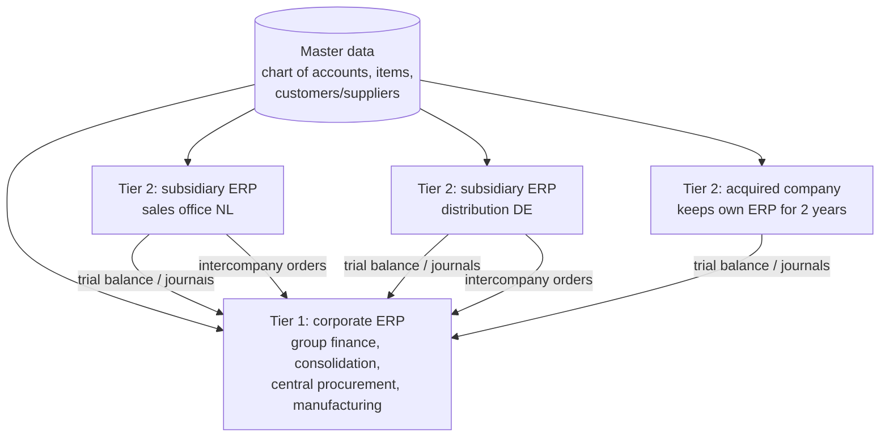
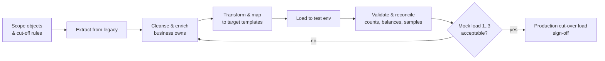
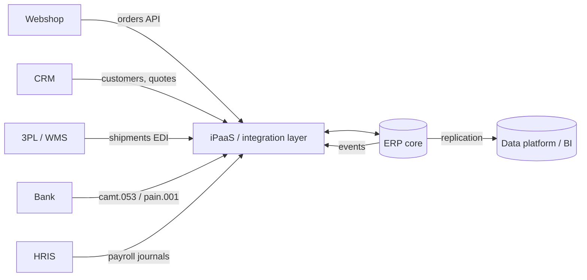

# ERP Strategy, Selection & Implementation

> **TL;DR** Treat ERP as a business transformation with a **clean core**: adopt standard processes (**fit-to-standard**), extend side-by-side via APIs and low-code, and customize the core only for legal or truly differentiating needs. Select with a structured process (requirements → long list → RFI → shortlist → scripted demos → reference checks → TCO → negotiation) and a weighted **scoring matrix**. Most ERP failures stem from business causes — weak sponsorship, scope creep, customization, poor data and change management — not from the software.

---

## 1. Clean core / keep the core clean

**Idea** (popularized by SAP, applicable to every ERP): keep the ERP core as close to vendor standard as possible so upgrades are cheap and fast, and put differentiation outside the core behind stable, released interfaces.

| Dimension | Clean | Not clean |
|---|---|---|
| **Processes** | Standard/best-practice processes, configured | Re-engineered core processes to mirror legacy |
| **Extensions** | Side-by-side (separate app/platform using public APIs/events) or in-app extensions using released extension points | Modifications of vendor code, direct table writes |
| **Data** | Clean master data, governed | Duplicates, custom fields everywhere |
| **Integration** | Via released APIs, events, iPaaS | Direct DB access, file drops without monitoring |
| **Operations** | Current release, regular updates | Frozen versions, skipped updates |

**Extension options by vendor (examples):**

| Vendor | In-app (upgrade-safe) | Side-by-side |
|---|---|---|
| SAP S/4HANA | Key-user extensibility, developer extensibility (ABAP Cloud, released APIs only) | SAP BTP (CAP, Build apps, Integration Suite) |
| D365 Finance & SCM | X++ extensions (Chain of Command, event handlers) — overlayering no longer allowed | Power Platform, Dataverse (dual-write/virtual entities), Azure |
| Business Central | AL extensions (per-tenant or AppSource apps); no base app modification in SaaS | Power Platform, Azure Functions via APIs |
| NetSuite | SuiteScript, SuiteFlow, custom records | External apps via REST/SuiteTalk |
| Odoo | Custom modules (inheritance) | External apps via XML-RPC/JSON-RPC/REST |
| AFAS | Configuration, free fields, workflows, GetConnectors/UpdateConnectors (API) | External apps via connectors |

**Extension decision ladder:** 1. Can we change the process to standard? 2. Can configuration do it? 3. Is there a certified add-on/app? 4. Can a side-by-side app/low-code do it via API? 5. Only then: in-app extension in the released framework. Never: core modification.

---

## 2. Fit-to-standard vs fit-gap

| | Fit-gap (traditional) | Fit-to-standard (modern) |
|---|---|---|
| Starting point | Document as-is and to-be requirements, then find gaps in the product | Show the product's standard process with demo data, then identify deltas |
| Bias | Toward recreating legacy → customization | Toward adopting standard |
| Workshops | Requirements gathering | Demo-and-discuss (show, tell, decide) |
| Outcome | Long gap list, custom development | Configuration decisions, a short validated delta list |
| Fits | Highly specialized operations | Most finance, procurement, HR, standard logistics |

**Fit-to-standard workshop flow (per process area):**

1. Pre-configured system with standard scope items/best practices and realistic demo data.
2. Walk through end-to-end process (e.g. P2P) on screen.
3. Business confirms fit, identifies deltas; for each delta ask: *legal requirement? competitive differentiator? measurable value?* If none → adopt standard.
4. Log decisions (configuration values, delta classification) in a backlog.
5. Delta review board approves/rejects; approved deltas get solution design (config, add-on, side-by-side, extension).

**Delta classification:** Fit (standard) · Configuration · Add-on/ISV · Side-by-side extension · Core extension (requires board approval) · Process change (business adapts) · Reject.

---

## 3. Build vs buy vs configure

| Option | When | Risks |
|---|---|---|
| **Buy & configure** (SaaS/COTS) | Capability is commodity or best practice (finance, HR, payroll, procurement) — systems of record | Vendor lock-in, standard may not fit niche |
| **Buy & extend** | Mostly standard + some differentiation | Extension sprawl, upgrade effort |
| **Build** (custom) | Capability is core differentiator, no market product, or needs unique data/IP | Cost, key-person risk, maintenance, security |
| **Low-code** | Departmental/differentiating, moderate complexity | Platform governance, licensing |
| **Partner/BPO** | Non-core capability with service providers (payroll bureau, outsourced AP) | Control, data access, exit |

**Decision drivers:** strategic differentiation (pace layer, Wardley evolution), market availability, TCO (5–7 years), time-to-value, risk, skills, integration effort, data ownership, exit options. More in [business-models-and-business-cases.md](business-models-and-business-cases.md#5-build-buy-partner).

---

## 4. Two-tier ERP

Corporate headquarters on a Tier-1 ERP (e.g. SAP S/4HANA, D365 F&SCM); subsidiaries, sales offices or acquired companies on a lighter, cheaper ERP (Business Central, NetSuite, Exact, Odoo), integrated for consolidation, intercompany and master data.

| Pros | Cons |
|---|---|
| Lower cost and faster rollouts for small entities | Integration complexity (intercompany, consolidation, master data) |
| Local fit (localization, simplicity) | Two skill sets, two vendors |
| M&A flexibility | Group reporting consistency requires harmonized CoA and master data |

**Integration patterns:** consolidation (trial balance mapping to group CoA), intercompany automation (PO in one = SO in other), master data distribution (items, customers), shared services (central AP).

---

## 5. ERP selection process

```mermaid
flowchart LR
  A[1. Vision &<br/>business case] --> B[2. Process & requirements<br/>capability scope, key scenarios]
  B --> C[3. Market scan<br/>long list 8-12]
  C --> D[4. RFI<br/>knock-out criteria]
  D --> E[5. Shortlist 3-4<br/>RFP / scenarios]
  E --> F[6. Scripted demos<br/>with own data]
  F --> G[7. Reference visits<br/>& partner due diligence]
  G --> H[8. TCO & risk<br/>scoring, best-and-final offer]
  H --> I[9. Negotiation<br/>& contract]
  I --> J[10. Decision &<br/>implementation planning]
```

| Step | Key activities | Tips |
|---|---|---|
| 1. Vision | Why change, objectives, scope, budget envelope, sponsor | Quantified benefits and constraints (e.g. go-live before legacy end of support) |
| 2. Requirements | Capability map, end-to-end scenarios, key differentiators, NFRs, integrations, data volumes, Dutch localization | 50–150 *meaningful* requirements + 8–15 scenarios beats 1,000-line spreadsheets |
| 3. Long list | Analyst reports, peers, partner landscape, industry fit | Select **vendor + implementation partner** combinations |
| 4. RFI | Knock-out criteria (cloud, localization, industry, size, references, pricing model) | Short; eliminate early |
| 5. Shortlist / RFP | Detailed requirements, scenario scripts, commercial template, implementation approach | Same structure for all to compare |
| 6. Scripted demos | Vendors demo *your* scenarios with *your* sample data; scoring by users per scenario | Avoid vendor-led "beauty contests"; include "a day in the life" and exceptions |
| 7. References | Customers of similar size/industry implemented by the **same partner** | Ask about overruns, partner team stability, post-go-live support |
| 8. TCO & risk | 5–7 year TCO; risk assessment; final scoring | Include internal costs and backfill |
| 9. Negotiation | Licenses, price caps on renewals, implementation contract (fixed vs T&M), SLAs, exit & data return, escrow (on-prem) | Negotiate before signing user volumes; protect against annual increases |
| 10. Decision | Board approval, implementation plan, governance | Document decision rationale |

**Scoring matrix**: see [templates.md](templates.md#4-erp-selection-scoring-matrix). Typical weights: functional fit 35%, technical/integration 15%, vendor & partner 20%, cost/TCO 20%, implementation approach & risk 10%.

**TCO components (5–7 years):** subscription/license, implementation partner, internal project team (backfill), data migration, integrations/iPaaS, add-ons/ISV apps, testing tools, training, change management, hardware/hosting (if not SaaS), support & maintenance (on-prem ~18–22% of license p.a.), upgrades, decommissioning legacy, contingency (15–25%).

---

## 6. Master data in ERP

| Domain | Examples | Typical owner | Common issues |
|---|---|---|---|
| **Customer** | Legal name, KvK number, VAT ID, addresses, payment terms, credit limit | Sales ops / credit control | Duplicates, inconsistent naming, outdated addresses |
| **Supplier / vendor** | Legal name, VAT ID, IBAN, payment terms | Procurement / AP | Bank detail fraud, duplicates |
| **Item / material / product** | Code, description, UoM, conversion, weight, BOM, routing, lead time, cost, classification (e.g. GS1 GTIN, commodity code) | Product management / supply chain | Incomplete planning parameters, multiple UoMs wrong |
| **Chart of accounts & dimensions** | GL accounts, cost centers, projects | Controller | Too many accounts, misuse of dimensions |
| **Employee** | Personal data, position, cost center | HR | Not synced with IAM |
| **Assets / locations / prices** | Fixed assets, warehouses, price lists | Various | |

**Master data governance essentials:**

- **Data owner** (accountable, business), **data steward** (maintains quality), **data custodian** (IT, technical).
- Data standards: definitions, mandatory fields, formats, naming conventions, validation rules, golden record source.
- **Create/change workflow** with approval for critical fields (bank accounts, credit limits, prices).
- Data quality KPIs: completeness, uniqueness (duplicates), validity, accuracy, timeliness, consistency.
- **MDM approaches:** registry, consolidation, coexistence, centralized (hub). In mid-size orgs, the ERP itself is usually the master hub; consider dedicated MDM only with multiple ERPs/channels.
- External validation: KvK (Dutch Chamber of Commerce) API, VIES VAT validation, IBAN check, address validation (postcode API).

**Data migration approach:**

**Migrate:** master data (active only), open items (AR/AP, open orders, open POs), stock quantities and values, GL opening balances (often per period for the current year), fixed assets with accumulated depreciation. **Archive, don't migrate:** closed historical transactions (keep legacy read-only or archive for legal retention).

---

## 7. ERP integration patterns

| Pattern | Use | Examples |
|---|---|---|
| **Synchronous API (REST/OData/SOAP)** | Real-time lookups, order creation from webshop | Stock availability check, price calculation |
| **Asynchronous messaging / events** | Decoupled, reliable, high-volume | Order created → warehouse, invoice posted → CRM; Azure Service Bus, SAP Event Mesh, Business Events (D365/BC) |
| **Batch / file** | Large volumes, periodic | Bank statements (camt.053), payment files (pain.001), EDI files, nightly price updates |
| **EDI** | B2B documents with trading partners | EDIFACT/X12 ORDERS, DESADV, INVOIC; GS1 standards; via EDI provider/VAN |
| **iPaaS hub** | Central mapping, monitoring, retry, many systems | Logic Apps, Boomi, MuleSoft, SAP Integration Suite, Frends, Alumio (NL) |
| **Data replication to analytics** | Reporting, data warehouse, lakehouse | Synapse Link / Fabric Link (D365), SAP Datasphere, CDC tools — [../07-data-ai-architecture/README.md](../07-data-ai-architecture/README.md) |
| **UI integration** | Embedding views | Power Apps embedded, iframes, SAP Fiori launchpad |

**Integration principles:** master data flows *from* the system of record; one integration platform with monitoring and alerting; idempotent messages; error queues with business-readable errors and owners; no direct database writes; versioned APIs; document every interface in an interface catalog (source, target, trigger, frequency, volume, owner, error handling). Patterns background: [../05-software-architecture/README.md](../05-software-architecture/README.md).

---

## 8. ERP UX considerations

- ERP users are often **power users** doing high-volume data entry: keyboard navigation, bulk edit, fast search, saved views matter more than visual polish.
- **Role-based workspaces** (D365 workspaces, SAP Fiori role launchpads, BC role centers) — configure per role, remove unused fields and menus.
- **Occasional users** (approvers, requesters) should not use the full ERP: approvals via mobile/Teams/e-mail, requests via simple portals or Power Apps.
- Exception-based work: queues and alerts instead of reports to scan.
- Consistent master data and defaulting reduces typing and errors (poka-yoke).
- Training and in-app guidance (digital adoption platforms) — UX debt in ERP is real and costly.
- Enterprise UX patterns and forms design: [../01-ux-ui/README.md](../01-ux-ui/README.md).

---

## 9. Implementation approach

| Phase (generic; cf. SAP Activate, Microsoft Success by Design) | Key outputs |
|---|---|
| **Prepare / Initiate** | Charter, governance, team, plan, environments |
| **Explore / Analyze** | Fit-to-standard workshops, delta backlog, solution design, data & integration design |
| **Realize / Build** | Configuration and extensions in sprints, integrations, data migration cycles, unit/integration tests |
| **Test** | System integration test (SIT), end-to-end scenario test, performance, user acceptance test (UAT), security/roles (SoD) test |
| **Deploy** | Training, cut-over plan and rehearsals, go/no-go, data load, go-live |
| **Run / Hypercare** | 4–8 weeks hypercare, stabilization, handover to support, benefits tracking |

**Go-live strategies:** big bang (all at once) vs phased (by module, site or country) vs parallel run (rare in modern ERP; costly). Choose based on risk, integration between entities, and team capacity.

**Cut-over checklist (excerpt):** legacy freeze moments; final data loads and reconciliation sign-off; open orders and stock counts; opening balances; integrations switched; user access and roles active; printers/labels/documents; bank connectivity tested; support desk staffed; rollback criteria defined.

Project management practices (PRINCE2/PMBOK, risk, contracts): [../03-project-management/README.md](../03-project-management/README.md).

---

### 9.1 Test strategy

| Test level | Purpose | Who | Entry / exit |
|---|---|---|---|
| Unit / configuration test | Each setup item and extension works | Partner consultants/developers | Per sprint |
| Integration test (SIT) | Interfaces and end-to-end data flows across systems | Partner + integration team | All interfaces built; exit: no open critical defects |
| End-to-end scenario test | Full business processes (O2C, P2P, R2R) with realistic data and roles | Key users + partner | Migrated test data available |
| Data migration validation | Counts, balances, samples reconcile | Data owners + finance | Each mock load |
| Role & SoD test | Users can do their job and nothing more | Security/key users | Role design approved |
| Performance test | Batch jobs (MRP, invoicing runs), peak volumes | Partner/IT | Production-like volumes |
| UAT | Business accepts solution for go-live | Process owners, key users | Exit: signed acceptance, workarounds documented |
| Regression (post go-live) | Each SaaS update/release doesn't break processes | Application management, test automation | Before every vendor update window |

**Defect severity:** Critical (blocks process, no workaround — blocks go-live) · High (workaround painful) · Medium · Low. **Go/no-go criteria** example: 0 critical, ≤ 5 high with agreed workarounds, data reconciliation signed, cut-over rehearsal successful, 95% users trained, support model ready.

### 9.2 After go-live: ERP Center of Excellence

| Element | Content |
|---|---|
| Ownership | Business process owners + ERP product owner; application management team (internal or partner) |
| Release management | Vendor update calendar (SaaS: typically several major updates per year — *verify vendor cadence*), regression test set, communication |
| Backlog | Single prioritized backlog for change requests; capacity per quarter |
| Key-user network | Super-users per department for first-line support, training, testing |
| Continuous improvement | KPI dashboards, process mining, quarterly roadmap with business |
| Governance | Clean core rules, design authority for extensions, technical debt register |
| Licences | Quarterly review of user licences vs roles and actual usage |

---

## 10. Why ERP implementations fail

| Cause | Symptoms | Prevention |
|---|---|---|
| Weak executive sponsorship | Decisions escalate endlessly, business absent | Business-led steering committee, CEO/CFO sponsor, decision SLAs |
| Treated as IT project | Business users not released, IT decides processes | Process owners accountable; business team members 50–100% allocated with backfill |
| Excessive customization | Rebuilding legacy, long build, upgrade pain | Fit-to-standard, delta board, clean core principle |
| Unclear scope / scope creep | Budget and timeline overrun | Firm scope baseline, change control, phase 2 backlog |
| Poor data quality / late migration | Failed go-live, wrong stock/balances | Start data cleansing at project start; 3+ mock loads |
| Underestimated change management & training | Low adoption, workarounds, Excel shadow systems | Change plan, super-users, role-based training, communication |
| Wrong partner / weak team | Junior consultants, turnover | Reference checks, named key staff in contract |
| Insufficient testing | Production defects, broken integrations | End-to-end scenario testing with real data, UAT by business |
| Unrealistic timeline/budget | Corners cut in testing/training | Benchmarks, contingency 15–25%, go/no-go criteria |
| Integration complexity underestimated | Late discovery of interfaces | Interface inventory early, iPaaS, integration testing |
| No benefits management | "Live but no value" | Baseline KPIs, benefit owners, post-go-live tracking |

Well-known cautionary cases include Hershey (1999, order fulfilment disruption at go-live), Lidl (abandoned SAP project, 2018), and various public-sector programs — the lessons above recur in nearly all.

## When to use / when not

| Approach | Use | Avoid |
|---|---|---|
| Fit-to-standard | Commodity processes, SaaS ERP | Truly unique operations without product fit |
| Two-tier | Multi-entity groups with diverse subsidiary needs | Tightly integrated operations across entities |
| Big bang | Small orgs, tightly coupled modules | Large multi-site where risk must be contained |
| Custom build of ERP core | Almost never | — |

## Common mistakes

- Buying on demo glamour; skipping scripted scenario demos and partner references.
- Signing a license for maximum users before the design is known.
- Leaving data migration to the last two months.
- Allowing every department a custom report → hundreds of reports; use a data platform.
- No hypercare budget; consultants leave on go-live day.

## References

- SAP S/4HANA (product, RISE/GROW, Activate): https://www.sap.com/products/erp/s4hana.html
- Microsoft Dynamics 365 documentation (incl. Success by Design guidance): https://learn.microsoft.com/dynamics365/
- Microsoft — Business Central development (AL): https://learn.microsoft.com/dynamics365/business-central/dev-itpro/developer/devenv-dev-overview
- Wikipedia — Enterprise resource planning (implementation section): https://en.wikipedia.org/wiki/Enterprise_resource_planning
- Wikipedia — Master data management: https://en.wikipedia.org/wiki/Master_data_management
- Wikipedia — Electronic data interchange: https://en.wikipedia.org/wiki/Electronic_data_interchange
- Wikipedia — Total cost of ownership: https://en.wikipedia.org/wiki/Total_cost_of_ownership
- Peppol: https://peppol.org/
- Related: [erp-modules-processes-vendors.md](erp-modules-processes-vendors.md), [templates.md](templates.md), [../03-project-management/README.md](../03-project-management/README.md), [../05-software-architecture/README.md](../05-software-architecture/README.md)
