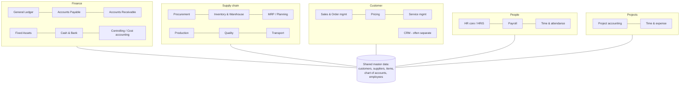
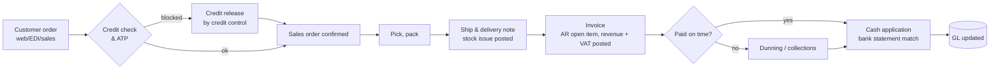
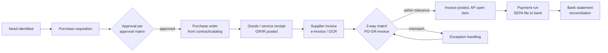
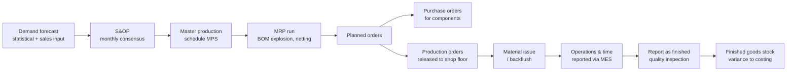
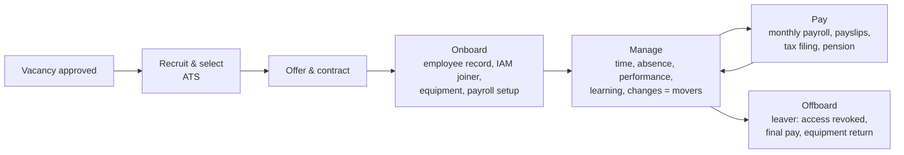

# ERP: Modules, End-to-End Processes, Vendors

> **TL;DR** An ERP is the integrated **system of record** for money, goods, people and production, built on one data model and shared master data. Think in **end-to-end processes** — order-to-cash, procure-to-pay, record-to-report, plan-to-produce, hire-to-retire — not in modules. Vendor choice depends mostly on company size, industry, country (localization, e.g. Dutch VAT/XAF/payroll), and ecosystem: SAP S/4HANA and D365 Finance & Operations for larger/complex, Business Central, NetSuite, Exact, AFAS, Odoo for SMB/mid-market, Infor for industry-specific manufacturing/distribution.

---

## 1. ERP module map

### 1.1 Modules in detail

| Module | Core functions | Key master data | Key documents/transactions | Typical KPIs |
|---|---|---|---|---|
| **General Ledger (GL)** | Chart of accounts, journals, periods, consolidation, intercompany, multi-currency, financial statements | Chart of accounts, dimensions (cost center, department, project), fiscal calendar, currencies | Journal entry, recurring entry, accruals, period close | Days to close, # manual journals |
| **Accounts Payable (AP)** | Vendor invoices, matching, approvals, payment runs, vendor statements | Vendors, payment terms, bank accounts | Vendor invoice, payment proposal, payment file (SEPA pain.001) | DPO, invoice cycle time, touchless rate, early payment discounts |
| **Accounts Receivable (AR)** | Customer invoices, cash application, dunning, credit management | Customers, credit limits, payment terms | Sales invoice, payment receipt, bank statement (camt.053), dunning letter | DSO, overdue %, bad debt |
| **Fixed Assets** | Acquisition, depreciation, disposal, revaluation | Asset classes, depreciation methods | Asset acquisition, depreciation run | — |
| **Cash & Bank / Treasury** | Bank reconciliation, cash forecasting, payments | Bank accounts | Bank statement import, reconciliation | Cash forecast accuracy |
| **Controlling / Cost accounting** | Cost centers, profit centers, allocations, product costing, budgets | Cost centers, cost elements, activity types | Allocation cycles, budget entries | Budget variance |
| **Procurement / Purchasing** | Requisitions, RFQ, purchase orders, contracts, vendor evaluation | Vendors, purchase info records/price lists, catalogs | Purchase requisition, PO, goods receipt | PO coverage, maverick spend, lead time |
| **Inventory / Warehouse (WMS)** | Stock levels, locations/bins, movements, counts, lot/serial, valuation (FIFO, standard, moving average) | Items/materials, warehouses, units of measure | Goods receipt/issue, transfer, stock count | Inventory turns, accuracy, OTIF |
| **MRP (Material Requirements Planning)** | Net requirements from demand (forecast + orders) minus stock + scheduled receipts, using BOM and lead times → planned orders | BOM, routing, lead times, lot sizing, safety stock | Planned purchase/production orders | Shortages, excess stock |
| **MRP II (Manufacturing Resource Planning)** | Extends MRP with capacity planning (CRP), master production schedule (MPS), S&OP, shop floor control, costing | Work centers, capacities, calendars | MPS, capacity plans | Capacity utilization, schedule adherence |
| **Production / Manufacturing** | Production orders, routing operations, backflushing, shop floor, discrete/process/repetitive/lean | BOM/formula, routing, work centers | Production order, material issue, report as finished | OEE (with MES), yield, scrap |
| **Quality management** | Inspection plans, non-conformance, CAPA, certificates | Inspection characteristics | Quality order, non-conformance | First-pass yield, complaints |
| **Sales / Order management** | Quotes, sales orders, ATP (available-to-promise), pricing, delivery, returns | Customers, price lists, discounts, items | Quote, sales order, delivery, invoice, credit note | Order cycle time, OTIF, perfect order rate |
| **Service management** | Service contracts, cases, field service, warranty | Installed base, service items | Service order | First-time fix, SLA |
| **Project accounting** | Project budgets, WBS, time/expense, WIP, revenue recognition, billing | Projects, WBS, rates | Timesheet, expense, project invoice | Utilization, margin, WIP |
| **HR / Payroll** | Employee master, organization, contracts, absence, payroll | Employees, positions, salary scales | Hire, change, termination, payslip | See §4 |

**Bill of Materials (BOM) types:** engineering BOM (design), manufacturing BOM (production), sales/configurable BOM, phantom BOM, formula/recipe (process manufacturing).

**MRP logic in one line:** Net requirement = gross requirement − on-hand − scheduled receipts + safety stock → lot-size → offset by lead time → planned order.

---

## 2. End-to-end processes ("X-to-Y")

| Process | Scope | Main modules | Typical owner |
|---|---|---|---|
| **Order-to-Cash (O2C)** | Customer inquiry/order → delivery → invoice → cash collection | Sales, inventory, warehouse, transport, AR, GL | Commercial director / CFO |
| **Procure-to-Pay (P2P)** | Need → requisition → PO → goods receipt → invoice → payment | Procurement, inventory, AP, GL | Procurement + finance |
| **Source-to-Contract (S2C)** | Spend analysis, sourcing, tender, supplier selection, contract | Sourcing / contract mgmt | Procurement |
| **Record-to-Report (R2R)** | Transactions → GL → close → consolidation → reporting | GL, FA, controlling, consolidation | Controller |
| **Plan-to-Produce (P2P / Plan-to-Make)** | Demand plan → S&OP → MPS → MRP → production → finished goods | Planning, production, inventory, quality | Operations / supply chain |
| **Hire-to-Retire (H2R)** | Recruit → onboard → manage/develop → pay → offboard | HRIS, payroll, IAM | HR director |
| **Forecast-to-Plan / Plan-to-Perform** | Budget, forecast, performance management | FP&A tools, GL | CFO |
| **Issue-to-Resolution / Service** | Customer issue → service → resolution | Service, CRM | Service manager |
| **Acquire-to-Retire (A2R)** | Asset acquisition → depreciation → maintenance → disposal | FA, maintenance (EAM) | Finance / facilities |
| **Lead-to-Cash / Quote-to-Cash** | Extends O2C front-end with CRM and CPQ | CRM, CPQ, ERP | Sales |

### 2.1 Order-to-Cash

**Key controls:** credit limits, price/discount authorization, delivery-before-invoice, revenue recognition (IFRS 15 / local GAAP), VAT determination (incl. EU intra-community, reverse charge, OSS for B2C distance sales), segregation of duties (order entry vs credit release vs cash application).

### 2.2 Procure-to-Pay

**Matching:** 2-way (PO–invoice) for services; 3-way (PO–GR–invoice) for goods; 4-way adds inspection. **Controls:** vendor master changes (especially bank account) with four-eyes and call-back verification (invoice fraud prevention), no PO no pay policy, duplicate invoice check, payment approval separate from invoice entry.

### 2.3 Record-to-Report

```mermaid
flowchart LR
  A[Sub-ledgers close<br/>AP, AR, inventory, FA, payroll] --> B[Accruals & deferrals]
  B --> C[Depreciation run]
  C --> D[Intercompany reconciliation<br/>& eliminations]
  D --> E[FX revaluation]
  E --> F[Allocations]
  F --> G[Balance sheet reconciliations]
  G --> H[Trial balance review]
  H --> I[Consolidation]
  I --> J[Management & statutory reporting<br/>VAT return, XBRL/filings]
  J --> K[Period lock]
```

**Fast close practices:** close calendar with owners, continuous accounting (daily reconciliations), materiality thresholds for accruals, automated bank reconciliation, intercompany via standardized process, reporting from a single source (data warehouse / ERP analytics).

### 2.4 Plan-to-Produce

### 2.5 Hire-to-Retire

Identity lifecycle detail: [it-management-itil-cobit.md](it-management-itil-cobit.md#9-identity-lifecycle-joiner-mover-leaver).

---

## 3. Major ERP vendors

*Market positions, product names and licensing change frequently — verify current status.*

| Vendor / product | Segment | Deployment | Strengths | Considerations | Dutch relevance |
|---|---|---|---|---|---|
| **SAP S/4HANA** (Cloud Public Edition, Cloud Private Edition via RISE with SAP, on-prem) | Large enterprise, upper mid-market; GROW with SAP for mid-size public cloud | SaaS / private cloud / on-prem | Depth in finance, supply chain, manufacturing, industry solutions; huge ecosystem; BTP for extensions | Cost, complexity, implementation duration; ECC end of mainstream maintenance 2027 (optional extended to 2030) — *verify* | Many NL multinationals; strong partner network |
| **Microsoft Dynamics 365 Finance & Supply Chain Management** (formerly Finance & Operations / AX) | Upper mid-market, enterprise | SaaS (Microsoft-managed) | Strong manufacturing/distribution, multi-entity, Power Platform & Azure integration, X++ extensions model | Implementation complexity similar to Tier 1; partner quality varies | Widely used in NL mid-to-large |
| **Microsoft Dynamics 365 Business Central** (formerly NAV/Navision) | SMB to lower mid-market (≈10–500 users) | SaaS (also on-prem) | Fast implementation, AL extensions via AppSource, strong M365/Power Platform integration, Dutch localization | Scales poorly for very complex manufacturing; extension sprawl | Very large NL partner ecosystem |
| **Oracle NetSuite** | SMB to mid-market, fast-growing, multi-entity (OneWorld) | SaaS only | True multi-tenant cloud, multi-subsidiary consolidation, SuiteScript/SuiteFlow customization | Pricing per module/user grows; localization depth via partners | Used by international scale-ups, subsidiaries |
| **Oracle Fusion Cloud ERP** | Enterprise | SaaS | Finance/EPM strength | Enterprise-scale implementation | Larger corporates |
| **Exact** (Exact Online; Exact Globe+; Exact Synergy) | Small and mid-size, accountancy-connected | SaaS (Online), on-prem (Globe) | Dutch origin, strong NL fiscal localization, accountant collaboration, industry editions (wholesale, manufacturing, project) | Limited for complex manufacturing/large multi-national | Very widespread in NL/BE SMB |
| **AFAS Profit** (AFAS Software) | Mid-size, notably HR & payroll, finance, CRM, projects | SaaS | Integrated HRM + payroll + finance, strong NL payroll, "standard software, no customization" philosophy, AFAS Focus for small businesses | Limited logistics/manufacturing depth; NL/BE-centric | Very popular in NL for HR/payroll, non-profit, services |
| **Odoo** (Community open-source / Enterprise) | Small to mid-size | SaaS (Odoo Online / Odoo.sh) or self-hosted | Broad modular suite, low license cost, Python customization, quick to start | Upgrades of heavily customized instances; partner quality varies; open-source vs enterprise feature split | Growing in NL SMB |
| **Infor** (CloudSuite: M3, LN, SyteLine/CSI, etc.) | Mid-to-large, industry-specific (manufacturing, distribution, food & beverage, fashion) | SaaS (AWS) / on-prem | Deep industry functionality (process manufacturing, discrete, equipment) | Ecosystem smaller than SAP/Microsoft | Used in NL manufacturing (LN heritage from Baan, Dutch origin) |
| **Unit4** (ERPx) | Mid-size services, public sector, education, non-profit | SaaS | People-centric services organizations | Less for manufacturing | Dutch origin; public/education sector |
| **Visma** (incl. Raet/Youforce for HR, various ERPs) | SMB & public sector | SaaS | Nordic/NL payroll and HR | Product portfolio fragmented | Visma Raet/Youforce common in NL HR/payroll |
| **Epicor, IFS, Sage, Acumatica** | Mid-market; IFS for asset-intensive/service | SaaS / on-prem | IFS: EAM, field service, project-based manufacturing | — | Selected sectors |

**Rough fit by size (heuristic, not a rule):**

| Size (employees / complexity) | Typical shortlist |
|---|---|
| < 50, simple trade/services | Exact Online, AFAS Focus/Profit, Odoo, Business Central |
| 50–500, NL-centric, services/HR-heavy | AFAS Profit, Exact, Business Central, Unit4 |
| 50–1,000, distribution/light manufacturing | Business Central, Exact Globe+/Online Manufacturing, Odoo, NetSuite, Infor SyteLine |
| 500–5,000, international, complex supply chain | D365 Finance & SCM, SAP S/4HANA (GROW/RISE), Infor CloudSuite, IFS, NetSuite (finance-led) |
| > 5,000, multinational | SAP S/4HANA, Oracle Fusion, D365 F&SCM |

### 3.1 Dutch-specific functional checks

- VAT (btw) returns, ICP declaration (intra-community supplies), reverse charge, OSS.
- XAF audit file export (Auditfile Financieel) for the Belastingdienst.
- SEPA payments/direct debits (pain.001/pain.008), bank statement camt.053, Dutch banks' connectivity.
- E-invoicing: **Peppol/SI-UBL** (mandatory for invoicing Dutch central government via Digipoort/Peppol); EU **ViDA** e-invoicing/digital reporting mandates being phased in — *verify current status*.
- **SBR** (Standard Business Reporting) for filings with XBRL (e.g. annual accounts to KvK).
- Payroll: loonaangifte, pension fund connectivity, CAO (collective labour agreement) rules, WKR (werkkostenregeling) — usually in specialized payroll (AFAS, Nmbrs, Loket.nl, Visma Raet, ADP) rather than general ERP.

---

## 4. HR systems: HRIS and payroll basics

| Component | Function | Examples |
|---|---|---|
| **Core HR / HRIS** | Employee master, organization, positions, contracts, documents, self-service | AFAS, Workday, SAP SuccessFactors, Visma Raet/Youforce, HiBob, Personio |
| **Payroll** | Gross-to-net, taxes, social security, pension, payslips, payroll journals to GL | AFAS, Nmbrs, Loket.nl, ADP, Visma Raet |
| **Time & attendance / workforce mgmt** | Clocking, schedules, absence, overtime | Various, often industry-specific |
| **Recruitment (ATS)** | Vacancies, candidates, offer | Recruitee (NL), Greenhouse, Workday |
| **Learning (LMS)**, performance, compensation | Talent management | Various |

**Architecture considerations:**

- **HR is the source of truth for identity**: HRIS → IAM (Entra ID provisioning) drives joiner-mover-leaver automation.
- Payroll output → GL journal (cost center allocation) → ERP.
- Highly sensitive personal data (BSN, salary, health/absence) — GDPR special categories / strict access; Dutch rules restrict BSN processing to legal bases.
- Payroll is country-specific; multinational orgs often use a global HRIS + local payroll providers.
- Absence registration: in NL, medical details must not be registered by the employer (only via occupational health service/arbodienst) — design absence data fields accordingly.

**"BRP"** in Dutch context refers to the *Basisregistratie Personen* (government personal records database) — relevant to government/municipal systems, not a commercial HR product.

---

## 5. ERP data model essentials

| Concept | Description |
|---|---|
| **Legal entity / company code** | Separate books; intercompany between entities |
| **Organizational structure** | Company → site/plant → warehouse → location/bin; sales organization; purchasing organization; cost/profit centers |
| **Financial dimensions** | Cost center, department, project, product line — define once, used in all postings |
| **Posting profiles / account determination** | Rules mapping transactions to GL accounts automatically |
| **Number sequences** | Document numbering (legal requirements for invoices: unbroken sequence) |
| **Document flow** | Quote → order → delivery → invoice linked for audit trail |
| **Sub-ledger to GL** | Every operational transaction posts financial impact automatically (integration is the point of ERP) |

## 6. ERP KPI dashboard (by process)

| Process | KPI | Formula / definition | Typical target direction |
|---|---|---|---|
| O2C | DSO (days sales outstanding) | (Accounts receivable / revenue) x days in period | ↓ |
| O2C | OTIF | Orders delivered complete and on time / total orders | ↑ (95%+) |
| O2C | Perfect order rate | Orders without any error (delivery, documentation, invoice) / total | ↑ |
| O2C | Order-to-ship cycle time | Order confirmation → shipment | ↓ |
| P2P | DPO (days payables outstanding) | (Accounts payable / COGS) x days | Policy-dependent |
| P2P | Touchless invoice rate | Invoices posted without manual intervention / total | ↑ |
| P2P | PO compliance | Spend with PO / total addressable spend | ↑ |
| P2P | Invoice cycle time | Receipt → posted/approved | ↓ |
| R2R | Days to close | Period end → management accounts released | ↓ (≤ 5 working days) |
| R2R | Manual journal entries | Count / value per period | ↓ |
| Inventory | Inventory turns | COGS / average inventory | ↑ |
| Inventory | Stock accuracy | Counted = system / counted items | ↑ (98%+) |
| Plan-to-produce | Forecast accuracy | 1 − MAPE (or weighted) | ↑ |
| Plan-to-produce | Schedule adherence | Orders completed as planned / total | ↑ |
| H2R | Time to productivity for joiners | Start date → full access & equipment | ↓ (day 1) |
| Cash | Cash conversion cycle | DIO + DSO − DPO | ↓ |

## 7. Glossary

| Term | Meaning |
|---|---|
| ATP / CTP | Available-to-promise / capable-to-promise (considering capacity) |
| BOM | Bill of materials |
| CoA | Chart of accounts |
| COGS | Cost of goods sold |
| DDMRP | Demand Driven MRP — buffer-based planning variant |
| GR/IR | Goods receipt / invoice receipt clearing account |
| ICP | Intra-community supplies declaration (EU VAT) |
| MES | Manufacturing execution system |
| MPS | Master production schedule |
| S&OP / IBP | Sales and operations planning / integrated business planning |
| SoD | Segregation of duties |
| UoM | Unit of measure |
| WMS / TMS | Warehouse / transport management system |
| XAF | Dutch XML Auditfile Financieel |

---

## When to use an ERP / when not

| Use ERP for | Don't force into ERP |
|---|---|
| Financial transactions, inventory, orders, procurement, production — records with legal/financial impact | Highly differentiating customer experiences (portal, configurator) → build/extend outside |
| Single source for master data of finance/supply chain | Collaboration, documents, ad hoc workflows → M365/low-code |
| Standard processes where best practice suffices | Advanced analytics → data platform |

## Common mistakes

- Selecting modules instead of designing end-to-end processes — handoffs break between modules.
- Underestimating master data cleansing and ownership (see [erp-implementation-selection.md](erp-implementation-selection.md#6-master-data-in-erp)).
- Reproducing legacy reports and screens 1:1.
- Ignoring segregation of duties in role design.
- Treating ERP as an IT project — it is a business transformation.

## References

- Wikipedia — Enterprise resource planning: https://en.wikipedia.org/wiki/Enterprise_resource_planning
- Wikipedia — Material requirements planning: https://en.wikipedia.org/wiki/Material_requirements_planning
- Wikipedia — Manufacturing resource planning: https://en.wikipedia.org/wiki/Manufacturing_resource_planning
- Wikipedia — Procure-to-pay: https://en.wikipedia.org/wiki/Procure-to-pay
- SAP S/4HANA: https://www.sap.com/products/erp/s4hana.html
- Microsoft Dynamics 365 Business Central docs: https://learn.microsoft.com/dynamics365/business-central/
- Microsoft Dynamics 365 Finance docs: https://learn.microsoft.com/dynamics365/finance/
- Oracle NetSuite: https://www.netsuite.com/
- Exact: https://www.exact.com/
- AFAS Software: https://www.afas.nl/
- Odoo: https://www.odoo.com/
- Infor: https://www.infor.com/
- Unit4: https://www.unit4.com/
- Peppol (OpenPeppol): https://peppol.org/
- Wikipedia — Sales and operations planning: https://en.wikipedia.org/wiki/Sales_and_operations_planning
- Related: [erp-implementation-selection.md](erp-implementation-selection.md), [../03-project-management/README.md](../03-project-management/README.md)
