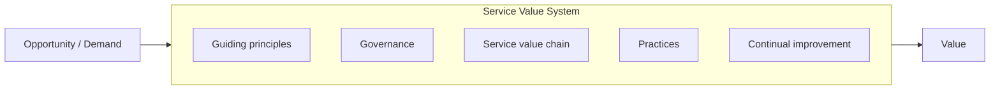
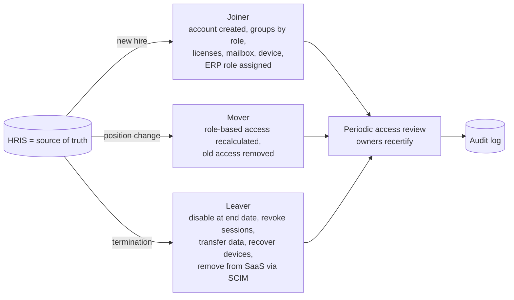
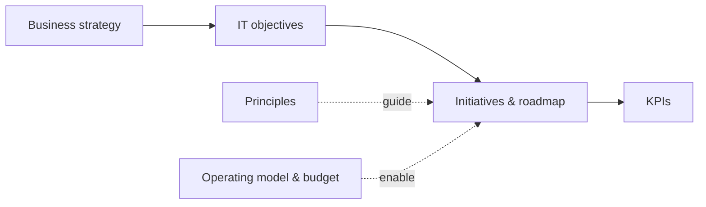

# IT Management: ITIL 4, COBIT 2019, ISO/IEC 20000 and Running a Small IT Function

> **TL;DR** ITIL 4 describes *how to manage IT services* (service value system, value chain, 7 guiding principles, 34 practices, 4 dimensions). COBIT 2019 describes *how to govern and manage enterprise IT* (40 objectives in 5 domains, with design factors). ISO/IEC 20000-1 is the *certifiable* service management standard. For a small IT team, adopt a minimum viable set — service desk, incident, request, change, asset/configuration, supplier, access (JML), continuity, security — and add strategy on a page, budgeting (run/grow/transform), SaaS and shadow-IT management, and endpoint management.

---

## 1. ITIL 4

Published by AXELOS (now part of PeopleCert) in 2019; ITIL 4 Foundation, Managing Professional, Strategic Leader, Practice Manager streams. *PeopleCert has announced further evolution of ITIL beyond version 4 — verify current status and certification paths.*

### 1.1 Service Value System (SVS)

| Component | Description |
|---|---|
| **Guiding principles** | Recommendations that guide decisions in all circumstances |
| **Governance** | Means by which the organization is directed and controlled (evaluate, direct, monitor) |
| **Service value chain** | Operating model of six interconnected activities |
| **Practices** | Sets of organizational resources designed for performing work or accomplishing an objective (34) |
| **Continual improvement** | Recurring activity at all levels (the continual improvement model) |

**Key definitions:** *Service* — a means of enabling value co-creation by facilitating outcomes customers want to achieve, without the customer having to manage specific costs and risks. *Value* — perceived benefits, usefulness and importance. *Output* vs *outcome* — deliverable vs result for a stakeholder. *Utility* (fit for purpose) and *warranty* (fit for use: availability, capacity, security, continuity).

### 1.2 Service value chain

| Activity | Purpose |
|---|---|
| **Plan** | Shared understanding of vision, current status and improvement direction across the four dimensions and all products/services |
| **Improve** | Continual improvement of products, services and practices |
| **Engage** | Understanding of stakeholder needs, transparency, continual engagement and good relationships |
| **Design & transition** | Products and services continually meet stakeholder expectations for quality, costs and time to market |
| **Obtain/build** | Service components are available when and where needed and meet agreed specifications |
| **Deliver & support** | Services are delivered and supported according to agreed specifications and expectations |

**Value streams** are specific combinations of value chain activities and practices for a scenario (e.g. "restore a live service", "onboard a new employee", "develop a new service").

### 1.3 Seven guiding principles

| Principle | In practice |
|---|---|
| **Focus on value** | Everything links back to value for stakeholders; know who the customer is |
| **Start where you are** | Assess and reuse what exists before building new |
| **Progress iteratively with feedback** | Small, manageable steps; feedback loops |
| **Collaborate and promote visibility** | Work across boundaries; make work and information visible |
| **Think and work holistically** | No service/practice stands alone; consider the whole system |
| **Keep it simple and practical** | Minimum steps; eliminate what doesn't add value |
| **Optimize and automate** | Optimize first, then automate; humans where they add most value |

### 1.4 Four dimensions of service management

| Dimension | Covers |
|---|---|
| **Organizations and people** | Structure, roles, culture, skills, competencies |
| **Information and technology** | Information, knowledge, technologies needed (incl. AI, cloud, automation) |
| **Partners and suppliers** | Relationships with other organizations involved in design, delivery, support |
| **Value streams and processes** | How parts work together to create value; activities, workflows, controls |

External factors analyzed via **PESTLE** (political, economic, social, technological, legal, environmental).

### 1.5 The 34 practices

**General management practices (14)**

| # | Practice |
|---|---|
| 1 | Architecture management |
| 2 | Continual improvement |
| 3 | Information security management |
| 4 | Knowledge management |
| 5 | Measurement and reporting |
| 6 | Organizational change management |
| 7 | Portfolio management |
| 8 | Project management |
| 9 | Relationship management |
| 10 | Risk management |
| 11 | Service financial management |
| 12 | Strategy management |
| 13 | Supplier management |
| 14 | Workforce and talent management |

**Service management practices (17)**

| # | Practice |
|---|---|
| 15 | Availability management |
| 16 | Business analysis |
| 17 | Capacity and performance management |
| 18 | Change enablement |
| 19 | Incident management |
| 20 | IT asset management |
| 21 | Monitoring and event management |
| 22 | Problem management |
| 23 | Release management |
| 24 | Service catalogue management |
| 25 | Service configuration management |
| 26 | Service continuity management |
| 27 | Service design |
| 28 | Service desk |
| 29 | Service level management |
| 30 | Service request management |
| 31 | Service validation and testing |

**Technical management practices (3)**

| # | Practice |
|---|---|
| 32 | Deployment management |
| 33 | Infrastructure and platform management |
| 34 | Software development and management |

### 1.6 Key practice cheat sheet

| Practice | Essentials |
|---|---|
| **Incident management** | Restore normal service ASAP. Priority = impact x urgency. Major incident procedure. Swarming instead of rigid tiers is accepted in ITIL 4 |
| **Service request management** | Pre-defined, standard, low-risk requests (access, laptop, software) — catalog, automated fulfilment, approval rules |
| **Problem management** | Problem identification, control, error control; known errors and workarounds; root cause analysis |
| **Change enablement** | Maximize successful changes. Types: **standard** (pre-authorized, low risk), **normal** (assessed/authorized by change authority), **emergency**. Change authority decentralized where possible; CAB optional |
| **Service desk** | Single point of contact; omnichannel; empathy and understanding of business context |
| **Service level management** | SLAs based on outcomes, not just availability %; watermelon effect (green outside, red inside) — measure experience |
| **Service configuration management** | CMDB/configuration items and relationships — just enough to support incident, change, and impact analysis |
| **IT asset management** | Lifecycle of hardware/software/cloud assets; licenses; cost |
| **Knowledge management** | Knowledge articles, KCS (Knowledge-Centered Service) |
| **Supplier management** | Supplier strategy, contracts, performance, relationships |

**Priority matrix example:**

| Impact \ Urgency | High | Medium | Low |
|---|---|---|---|
| **High** (many users / critical service) | P1 (response 15 min, resolve 4 h) | P2 | P3 |
| **Medium** (department) | P2 (response 1 h, resolve 8 h) | P3 | P4 |
| **Low** (single user) | P3 (response 4 h, resolve 2 d) | P4 | P5 |

### 1.7 Continual improvement model

1. What is the vision? 2. Where are we now? 3. Where do we want to be? 4. How do we get there? 5. Take action. 6. Did we get there? 7. How do we keep the momentum going? Maintain a **continual improvement register (CIR)**.

---

## 2. COBIT 2019

ISACA framework for **governance and management of enterprise information and technology (EGIT)**. Distinguishes governance (board: evaluate, direct, monitor) from management (plan, build, run, monitor).

### 2.1 Structure

| Element | Content |
|---|---|
| **Six governance system principles** | Provide stakeholder value; holistic approach; dynamic governance system; governance distinct from management; tailored to enterprise needs; end-to-end governance system |
| **Three governance framework principles** | Based on conceptual model; open and flexible; aligned to major standards |
| **Components** (7) | Processes; organizational structures; principles, policies and frameworks; information; culture, ethics and behavior; people, skills and competencies; services, infrastructure and applications |
| **Design factors** (11) | Enterprise strategy; enterprise goals; risk profile; I&T-related issues; threat landscape; compliance requirements; role of IT; sourcing model for IT; IT implementation methods; technology adoption strategy; enterprise size |
| **Focus areas** | Tailored guidance (e.g. small and medium enterprises, information security, DevOps, cloud) |
| **Goals cascade** | Stakeholder drivers & needs → enterprise goals (13) → alignment goals (13) → governance & management objectives (40) |
| **Performance management** | Process capability levels 0–5 (CMMI-based) and focus area maturity levels |

### 2.2 40 objectives in five domains

| Domain | Type | # | Examples |
|---|---|---|---|
| **EDM** — Evaluate, Direct and Monitor | Governance | 5 | EDM01 Ensured governance framework setting and maintenance; EDM02 benefits delivery; EDM03 risk optimization; EDM04 resource optimization; EDM05 stakeholder engagement |
| **APO** — Align, Plan and Organize | Management | 14 | APO01 Managed I&T management framework; APO02 strategy; APO03 enterprise architecture; APO05 portfolio; APO06 budget and costs; APO09 service agreements; APO10 vendors; APO12 risk; APO13 security; APO14 data |
| **BAI** — Build, Acquire and Implement | Management | 11 | BAI01 programs; BAI02 requirements definition; BAI03 solutions identification and build; BAI05 organizational change; BAI06 IT changes; BAI09 assets; BAI10 configuration; BAI11 projects |
| **DSS** — Deliver, Service and Support | Management | 6 | DSS01 operations; DSS02 service requests and incidents; DSS03 problems; DSS04 continuity; DSS05 security services; DSS06 business process controls |
| **MEA** — Monitor, Evaluate and Assess | Management | 4 | MEA01 performance and conformance monitoring; MEA02 system of internal control; MEA03 compliance with external requirements; MEA04 assurance |

*Objective titles paraphrased.*

### 2.3 Using COBIT pragmatically

- As an **audit and control vocabulary**: auditors (and IT general controls, ITGC, in financial audits) often map to COBIT.
- Use design factors to **select priority objectives** (e.g. for an SME heavily dependent on ERP: APO10 vendors, APO12 risk, APO13 security, BAI06 changes, DSS04 continuity, DSS05 security).
- Combine: **COBIT** for "what must be governed"; **ITIL** for "how to run services"; **ISO 27001** for security management system.

**ITGC (IT general controls)** usually tested by external auditors: access management (provisioning, reviews, privileged access), change management (approval, testing, segregation dev/prod), IT operations (backup, job monitoring, incident), and sometimes program development.

---

## 3. ISO/IEC 20000-1:2018

International standard for a **service management system (SMS)**; certifiable. Harmonized structure (clauses 4–10: context, leadership, planning, support, operation, performance evaluation, improvement) like ISO 27001 and ISO 9001, making integrated management systems possible. Clause 8 covers operation: service portfolio, relationship and agreement (business relationship, SLM, supplier), supply and demand, service design/build/transition (change, release & deployment), resolution and fulfilment (incident, request, problem), service assurance (availability, continuity, security). ITIL can be used as guidance to meet ISO 20000 requirements.

---

## 4. ITSM for small IT teams (2-10 people)

### 4.1 Minimum viable ITSM

| Practice | Minimum | Tooling ideas |
|---|---|---|
| Service desk | One intake channel (portal + e-mail), ticket for everything, published hours/SLAs | Freshservice, Jira Service Management, TOPdesk (NL), HaloITSM, ServiceNow (larger), Zendesk |
| Incident | P1–P4 definitions, major incident playbook, status page/communication template | |
| Service request | Catalog of top 20 requests with forms and automation (accounts, software, hardware) | ITSM + Power Automate / Entra ID lifecycle workflows |
| Change | Standard changes list; lightweight weekly change review for normal changes; maintenance windows | |
| Problem | Monthly review of top recurring incidents | |
| Asset & configuration | Hardware/software inventory from endpoint management; application inventory; simple CMDB of critical services and dependencies | Intune, ITSM asset module |
| Knowledge | KB articles for top 50 questions; self-service | |
| Supplier | Supplier list with contracts, renewal dates, owners, SLAs | |
| Access (JML) | Automated from HR | Entra ID |
| Continuity | Backup + tested restore, DR for critical systems, incident response plan | |
| Security | Baseline controls (below) | |
| Reporting | Monthly: tickets, SLA, top issues, projects, risks | Power BI |

### 4.2 Operating rhythm

| Cadence | Activity |
|---|---|
| Daily | 15-min stand-up: P1/P2s, blockers, changes today |
| Weekly | Change review, ticket backlog grooming, project progress |
| Monthly | Service review with business (KPIs), problem review, patch compliance, security dashboard, license review |
| Quarterly | IT steering committee: roadmap, budget, risks; access reviews; DR/backup restore test |
| Yearly | IT strategy refresh, budget, supplier evaluations, penetration test, policy review, BIA update |

### 4.3 Key metrics

First contact resolution, mean time to resolve per priority, SLA compliance, backlog age, CSAT, % requests automated, change success rate, patch compliance, MFA coverage, backup success and restore test results.

---

## 5. Vendor (supplier) management

| Stage | Activities |
|---|---|
| **Segment** | Classify suppliers: **strategic** (high value, high risk — ERP vendor/partner, MSP, cloud), **tactical/leverage**, **commodity** (Kraljic matrix: profit impact vs supply risk) |
| **Select** | Requirements, due diligence: financial stability, security (ISO 27001 cert, SOC 2 report), GDPR (DPA), references, exit, sub-processors, data location |
| **Contract** | SLA (availability, response/resolution, service credits), price indexation caps, term & renewal notice, liability, audit rights, data processing agreement (Art. 28 GDPR), security obligations (NIS2 supply chain), exit plan & data return, escrow if needed |
| **Manage** | Supplier owner per contract; quarterly service reviews for strategic suppliers (KPIs, incidents, roadmap, improvement actions) |
| **Risk** | Concentration risk, sub-processor changes, security incidents, end-of-life of products |
| **Exit** | Data export formats, transition assistance, deletion confirmation |

**Contract register fields:** supplier, service, owner, start/end, notice period, auto-renewal, annual value, pricing model, SLA, DPA in place, security assessment date, criticality, exit plan.

Dutch public procurement and template terms (e.g. ARBIT, GIBIT for government; NLdigital Terms for IT suppliers) are common reference points — *verify which applies*.

---

## 6. IT budgeting

### 6.1 Run / Grow / Transform (Gartner)

| Category | Meaning | Typical share |
|---|---|---|
| **Run** the business | Keep the lights on: operations, maintenance, licenses, support, hosting | 60–75% |
| **Grow** the business | Improve/expand existing capabilities (new modules, more users, enhancements) | 15–25% |
| **Transform** the business | New business models, new capabilities, innovation | 5–15% |

Goal over time: reduce Run share through rationalization and automation to fund Grow/Transform.

### 6.2 Other budget views

| View | Use |
|---|---|
| **Capex vs Opex** | SaaS shifts spend to opex; accounting treatment of implementation costs (configuration in SaaS is often expensed — check with controller) |
| **Cost pools** (TBM — Technology Business Management): staff, outside services, hardware, software, facilities, telecom | Benchmark, transparency |
| **Towers**: end-user, network, compute, storage, applications, security, delivery | IT cost model |
| **By business capability/unit** | Showback/chargeback |
| **IT spend as % of revenue** | Benchmark varies strongly per industry (roughly 1–2% in manufacturing/distribution to 5–10% in finance/software) — *verify with current benchmarks* |
| **IT cost per employee / per user** | SME benchmark |

**Budget build checklist:** contract register (renewals, indexation — Dutch IT contracts often index annually by CBS figures), license true-ups (user growth), hardware replacement cycle (laptops 3–4 years, network 5–7 years), cloud consumption (FinOps — [../06-cloud-architecture/README.md](../06-cloud-architecture/README.md)), staff and training, projects (from roadmap with business cases), security (pen tests, tooling), contingency 5–10%.

---

## 7. Shadow IT and SaaS management

**Shadow IT**: IT systems or services used without IT's knowledge/approval. Driven by unmet needs, slow IT, easy SaaS signup.

| Risk | Example |
|---|---|
| Data leakage / GDPR | Customer data in a personal Dropbox or AI chat tool |
| Security | No SSO/MFA, no offboarding — ex-employees keep access |
| Cost | Duplicate subscriptions on credit cards |
| Continuity | Business-critical spreadsheet or Access DB owned by one person |
| Integration | Data silos, manual transfers |

**Approach: discover, assess, decide, enable**

1. **Discover**: IdP sign-in logs and OAuth consents (Entra ID enterprise apps), Microsoft Defender for Cloud Apps (CASB), expense/credit card statements, finance creditor list, browser extension inventory, surveys.
2. **Assess** per app: users, data processed, security posture, contract terms, overlap with existing tools.
3. **Decide**: sanction (bring under management: SSO, contract, DPA), replace with an existing tool, or block.
4. **Enable**: fast intake process (e.g. 5-day SaaS review), approved tool catalog, citizen-developer platform with guardrails (Power Platform), restrict user consent to OAuth apps.

**SaaS management lifecycle:** request → security/privacy review → contract & DPA → SSO/SCIM provisioning → license assignment by group → usage monitoring → renewal review (usage < 70%? reduce) → offboarding & data export. Tools: SaaS management platforms (e.g. Zylo, Productiv, Torii, LeanIX SaaS Management), or ITSM + IdP reports for smaller orgs.

---

## 8. Endpoint management basics

| Area | Baseline |
|---|---|
| **Enrollment** | Autopilot (Windows) / Apple Business Manager + MDM (macOS/iOS) / Android Enterprise; zero-touch for new devices |
| **Management** | Microsoft Intune (or Jamf for Apple, others); configuration profiles, compliance policies |
| **Compliance → access** | Conditional Access: only compliant devices access corporate data |
| **Security** | Disk encryption (BitLocker/FileVault), EDR (e.g. Defender for Endpoint), firewall, no local admin by default (LAPS / privilege management), screen lock |
| **Patching** | OS and app updates with rings (pilot → broad); target e.g. critical patches within 14 days; Windows Update for Business / Autopatch |
| **Applications** | Company portal, packaged apps, allow-listing where feasible |
| **BYOD** | App protection policies (MAM) without full device management |
| **Lifecycle** | Asset tag, assignment to user, warranty, replacement cycle, secure wipe and certified disposal |
| **Monitoring** | Compliance dashboards, vulnerability management (e.g. Defender Vulnerability Management) |

---

## 9. Identity lifecycle: joiner-mover-leaver

| Principle | Implementation |
|---|---|
| HR-driven provisioning | HRIS → Entra ID inbound provisioning (API-driven or connectors for Workday/SuccessFactors; others via middleware) |
| Role-based access control (RBAC) | Business roles → groups → app roles; dynamic groups on attributes (department, job title) |
| Least privilege | Default minimal; privileged roles via PIM (just-in-time) |
| SSO everywhere | SAML/OIDC; SCIM for de-provisioning in SaaS |
| Segregation of duties | Toxic combinations (e.g. create vendor + approve payment) checked in ERP role design |
| Access reviews | Quarterly for privileged & financial apps, yearly for others (Entra ID access reviews) |
| Leaver SLA | Access disabled on last working day (same hour for terminations for cause) |
| External identities | Guests/B2B with sponsors and expiry |
| Service accounts | Registered owners, managed identities where possible, no shared passwords |

**Mover** is the most neglected case: access accumulates ("privilege creep"). Recalculate rather than add.

---

## 10. IT strategy on a page

| Block | Content (example) |
|---|---|
| **Business context & ambition** | "Double export revenue by 2029 with same back-office headcount" |
| **IT mission** | "Reliable, secure, simple IT that lets employees focus on customers" |
| **Strategic objectives (3–5)** | 1. One integrated ERP across entities; 2. Automate top-10 manual processes; 3. Secure & compliant (NIS2-ready, ISO 27001-aligned); 4. Data-driven decisions (single BI platform); 5. Modern workplace |
| **Principles** | Cloud/SaaS first; buy before build; clean core; secure by default; data has an owner |
| **Key initiatives / roadmap** | Year 1: ERP selection & finance go-live, MFA/Conditional Access, BI foundation; Year 2: supply chain on ERP, integration platform, automation CoE; Year 3: customer portal, AI pilots |
| **Operating model** | Small internal IT (product owners/architects/service desk) + strategic partners (ERP partner, MSP) |
| **KPIs** | ERP adoption, # manual processes automated, SLA, security score, IT cost per employee |
| **Budget envelope** | Run/Grow/Transform split |
| **Risks & dependencies** | Key-person risk, partner capacity, data quality |

## When to use / when not

| Framework | Use | Not |
|---|---|---|
| ITIL 4 | Structure IT operations and service delivery | Implement all 34 practices in a 5-person team |
| COBIT 2019 | Board-level IT governance, audit alignment, control frameworks | As an operational how-to |
| ISO/IEC 20000-1 | When certification is commercially required (MSPs, outsourcers) | Small internal IT without external demand |

## Common mistakes

- Tool first (ServiceNow) before agreeing services, priorities and responsibilities.
- CAB that rubber-stamps everything weekly; use standard changes and risk-based approval.
- SLAs measured only on IT metrics, ignoring user experience (watermelon SLAs).
- JML handled by e-mail between HR and IT → orphaned accounts.
- No contract register → auto-renewals with price increases.
- Treating shadow IT purely as a policing problem instead of a demand signal.

## References

- AXELOS / PeopleCert — ITIL: https://www.axelos.com/
- ISACA — COBIT: https://www.isaca.org/resources/cobit
- ISO/IEC 20000-1:2018: https://www.iso.org/standard/70636.html
- Wikipedia — ITIL: https://en.wikipedia.org/wiki/ITIL
- Wikipedia — COBIT: https://en.wikipedia.org/wiki/COBIT
- Wikipedia — ISO/IEC 20000: https://en.wikipedia.org/wiki/ISO/IEC_20000
- Wikipedia — Shadow IT: https://en.wikipedia.org/wiki/Shadow_IT
- Wikipedia — Kraljic matrix: https://en.wikipedia.org/wiki/Kraljic_matrix
- Technology Business Management Council: https://www.tbmcouncil.org/
- Microsoft Entra ID governance (lifecycle workflows, access reviews): https://learn.microsoft.com/entra/id-governance/
- Microsoft Intune documentation: https://learn.microsoft.com/mem/intune/
- Related: [security-compliance-iso27001-nis2-gdpr.md](security-compliance-iso27001-nis2-gdpr.md), [ea-practice-capabilities-portfolio.md](ea-practice-capabilities-portfolio.md), [../06-cloud-architecture/README.md](../06-cloud-architecture/README.md)
