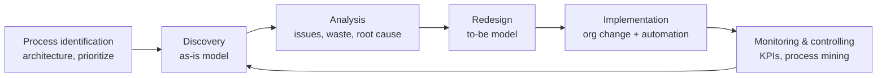
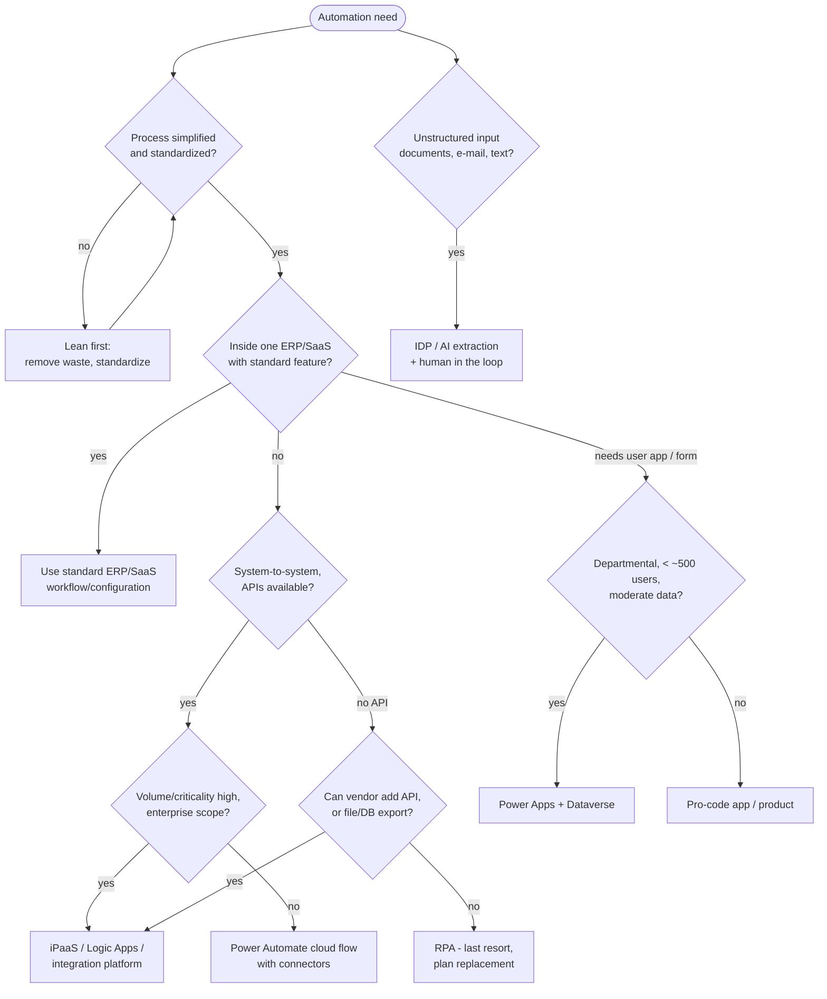
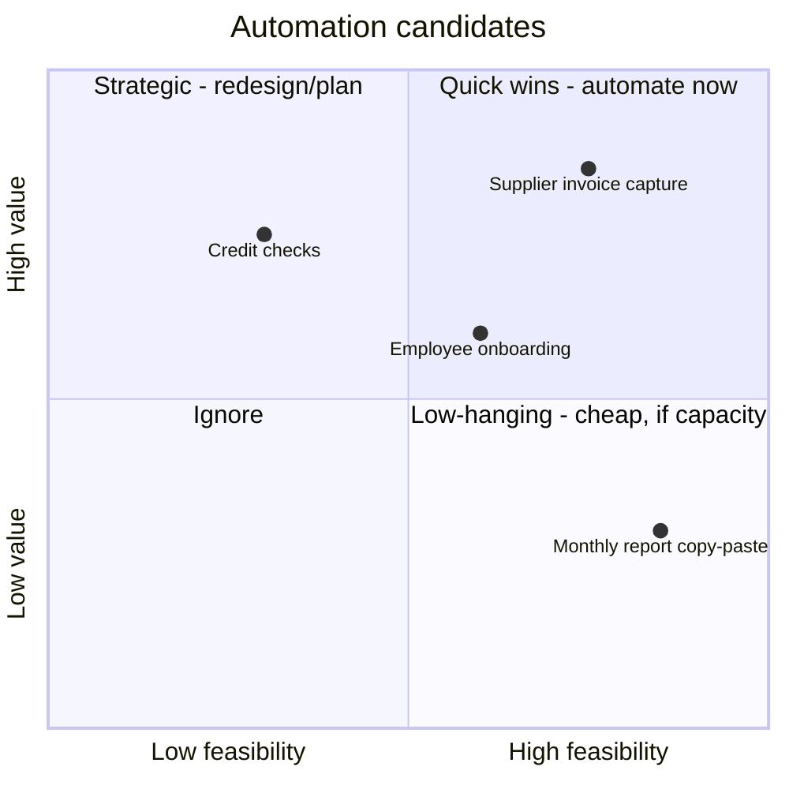
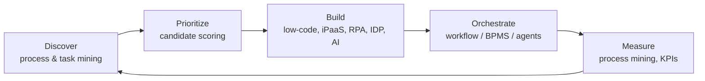

# Process Improvement & Automation: Lean Six Sigma, BPM, RPA, Low-Code

> **TL;DR** First **simplify** (Lean: remove waste), then **stabilize** (Six Sigma: reduce variation, DMAIC), then **automate** — in that order, or you automate the mess. Choose the automation technology by the shape of the problem: **API/iPaaS integration** for system-to-system flows, **ERP standard workflow** for in-ERP processes, **low-code** (Power Platform) for departmental apps and workflows, **RPA** only when there is no API, and **AI/IDP** for unstructured inputs. Score candidates objectively and govern citizen development through a Center of Excellence.

---

## 1. Lean, Six Sigma, Lean Six Sigma

| | Lean | Six Sigma | Lean Six Sigma |
|---|---|---|---|
| Origin | Toyota Production System (Ohno, Shingo); "Lean" coined by Krafcik (1988), popularized by Womack & Jones | Motorola (Bill Smith, 1986), GE (Jack Welch, 1990s) | Combination (2000s) |
| Focus | Flow, speed, waste elimination | Variation, defects, statistical control | Both |
| Core method | 5 principles, VSM, kaizen, 5S, pull, kanban | DMAIC, DMADV, statistics | DMAIC with Lean tools |
| Metric | Lead time, flow efficiency | DPMO, sigma level, Cp/Cpk | Both |

**Lean's five principles** (Womack & Jones, *Lean Thinking*): 1. Specify **value** from the customer's view; 2. Identify the **value stream**; 3. Make value **flow**; 4. Let the customer **pull**; 5. Pursue **perfection**.

Lean background and Kanban: [../04-agile-kanban-scrum/README.md](../04-agile-kanban-scrum/README.md). Quality thinkers (Deming, Juran, Shewhart): [../10-laws-principles-mental-models/README.md](../10-laws-principles-mental-models/README.md).

### 1.1 DMAIC (improve existing process)

| Phase | Goal | Key tools | Gate deliverable |
|---|---|---|---|
| **Define** | Problem, scope, customer, goal | Project charter, SIPOC, VOC → CTQ tree, stakeholder analysis | Signed charter with problem statement and SMART goal |
| **Measure** | Baseline performance, data validity | Data collection plan, operational definitions, MSA (Gage R&R), process map, VSM, baseline sigma/capability | Baseline metric, validated measurement |
| **Analyze** | Find and verify root causes | Fishbone, 5 Whys, Pareto, hypothesis testing, regression, scatter plots, process mining | Verified root causes (with data) |
| **Improve** | Develop, test and implement solutions | Brainstorming, solution selection matrix, pilot, DOE, FMEA, poka-yoke, future-state map | Piloted solution with measured improvement |
| **Control** | Sustain gains | Control plan, SPC charts, standard work, visual management, handover to process owner | Control plan, owner signed-off, benefits validated |

**Problem statement formula:** *What* is wrong, *where*, *when* since, *how big* (magnitude, in a metric), *impact* — without cause or solution.
> "Since January 2026, 18% of supplier invoices in the NL entity are paid after the due date (target < 3%), causing €42k lost early-payment discounts per quarter and supplier escalations."

### 1.2 DMADV / DFSS (design new process or product)

**Define – Measure – Analyze – Design – Verify.** Used when there is no process yet or when the existing one is beyond improvement. Related: IDOV (Identify, Design, Optimize, Validate). Tools: QFD (House of Quality), Kano, concept selection (Pugh matrix), simulation, pilot.

### 1.3 Belts and roles

| Role | Description | Typical training |
|---|---|---|
| **Executive sponsor / Champion** | Selects projects, removes barriers, owns benefits | 1–2 days |
| **White belt** | Awareness | Hours |
| **Yellow belt** | Team member; basic tools | 1–3 days |
| **Green belt** | Leads smaller projects part-time | ~1–2 weeks + project |
| **Black belt** | Leads complex projects full-time; coaches GBs; statistics | ~4 weeks + projects |
| **Master black belt** | Program leader, trainer, methodology owner | BB + experience |
| **Process owner** | Owns the process after Control phase | — |

Certification bodies vary (ASQ, IASSC, Lean Six Sigma Groep etc.); there is no single global standard (ISO 13053 describes the DMAIC methodology).

### 1.4 Sigma levels (with conventional 1.5σ long-term shift)

| Sigma level | DPMO (defects per million opportunities) | Yield (% defect-free) |
|---|---|---|
| 1 | 690,000 | 31% |
| 2 | 308,537 | 69.1% |
| 3 | 66,807 | 93.3% |
| 4 | 6,210 | 99.38% |
| 5 | 233 | 99.977% |
| 6 | 3.4 | 99.99966% |

DPMO = defects / (units x opportunities per unit) x 1,000,000. Most office processes run at 2–4σ. Don't chase 6σ for administrative processes; use it as a common language.

### 1.5 Process capability: Cp and Cpk (brief)

- **Cp** = (USL − LSL) / (6σ) — potential capability if centred.
- **Cpk** = min[(USL − μ) / (3σ), (μ − LSL) / (3σ)] — actual capability including centring.
- USL/LSL = upper/lower specification limits (customer requirement), μ = mean, σ = (short-term) standard deviation. **Pp/Ppk** use long-term (overall) σ.

| Cpk | Interpretation |
|---|---|
| < 1.0 | Not capable — defects expected |
| 1.0 – 1.33 | Marginal |
| ≥ 1.33 | Capable (common minimum) |
| ≥ 1.67 | Good (often required for critical characteristics) |
| 2.0 | Six Sigma level (short-term) |

Example: invoice processing time spec ≤ 5 days (only USL), μ = 3 days, σ = 0.8 → Cpk = (5−3)/(3·0.8) = 0.83 → not capable; reduce variation or mean.

### 1.6 Statistical process control (SPC) basics

- Control limits (UCL/LCL = mean ± 3σ of the process) ≠ specification limits (customer).
- Common cause vs special cause variation (Shewhart, Deming). React to special causes; improve the system for common causes.
- Chart types: I-MR (individual values), X̄-R / X̄-S (subgroups), p/np (proportion defective), c/u (defect counts).
- Western Electric / Nelson rules to detect special causes (point outside limits, 7+ points on one side, trends).

### 1.7 Other Lean tools

| Tool | Use |
|---|---|
| **5S** (Sort, Set in order, Shine, Standardize, Sustain) | Workplace — also digital: shared drives, Teams channels |
| **Kaizen event** | 3–5 day focused improvement workshop |
| **Poka-yoke** | Mistake-proofing: mandatory fields, validation, dropdowns, duplicate checks |
| **Standard work** | Documented best current method; baseline for improvement |
| **Heijunka** | Level workload (e.g. spread invoice processing vs month-end peak) |
| **Gemba walk** | Go and see where the work happens |
| **A3** | One-page problem solving and communication |
| **Andon / visual management** | Make problems visible immediately (dashboards, queue alerts) |
| **SMED** | Quick changeover (manufacturing) |
| **OEE** | Availability x Performance x Quality (manufacturing equipment) |

---

## 2. BPM lifecycle

Business Process Management as a discipline (Dumas, La Rosa, Mendling, Reijers — *Fundamentals of BPM*):

| Phase | Output | Tools |
|---|---|---|
| Identification | **Process architecture** / landscape (levels 0–3), prioritized processes (importance, dysfunction, feasibility) | APQC PCF, capability map |
| Discovery | As-is BPMN | Interviews, workshops, process mining |
| Analysis | Issue register, quantified impact | VSM, RCA, simulation, queue analysis |
| Redesign | To-be BPMN, KPIs | Heuristics (below), benchmarking |
| Implementation | Changed process, IT, roles, training | Workflow/BPMS, ERP config, RPA, change management |
| Monitoring | Dashboards, conformance | Process mining, SPC |

**Process governance roles:** process owner (accountable end-to-end, cross-departmental), process manager/steward, process architect, BPM Center of Excellence.

**Redesign heuristics** (Reijers & Mansar, abridged): eliminate tasks; automate tasks; parallelize; resequence (move checks to where they matter); triage (split complex/simple cases); integrate with customer/supplier (self-service, e-invoicing); empowerment (fewer approvals, higher limits); case-based work (one owner per case); reduce contact points; buffer/batch removal; knock-out early (cheap checks that reject first).

**Process maturity**: Rummler-Brache (Improving Performance), Hammer's PEMM (Process and Enterprise Maturity Model — process enablers: design, performers, owner, infrastructure, metrics; enterprise capabilities: leadership, culture, expertise, governance).

---

## 3. Automation options

### 3.1 Technology landscape

| Option | What | Strengths | Weaknesses | Examples |
|---|---|---|---|---|
| **ERP standard / configuration** | Built-in workflows, approvals, rules, scheduled jobs | Supported, upgrade-safe, single data model | Limited flexibility | D365 workflows, SAP Flexible Workflow, Business Central approval workflows |
| **API integration / iPaaS** | System-to-system via APIs, events, mappings | Robust, scalable, monitored, real-time | Requires APIs and integration skills | Azure Logic Apps, Azure Integration Services, MuleSoft, Boomi, Workato, SAP Integration Suite |
| **Workflow / BPMS** | Long-running human + system processes | Process visibility, SLAs, audit | Another platform to run | Camunda, Flowable, Pega, Appian, ServiceNow |
| **Low-code apps** | Forms, data apps, simple workflows by citizen or pro devs | Speed, M365 integration, governance tooling | Licensing complexity, sprawl risk, scaling limits | Power Apps + Dataverse, Power Automate, OutSystems, Mendix |
| **RPA** | Software robots mimicking UI interactions | Works when no API; quick on legacy | Brittle (UI changes), maintenance, license cost, credentials management | Power Automate desktop, UiPath, Automation Anywhere, Blue Prism |
| **Intelligent document processing (IDP)** | OCR + ML extraction from documents | Unstructured → structured | Accuracy tuning, human-in-the-loop | Azure AI Document Intelligence, AI Builder, ABBYY, Rossum |
| **Scripts / custom code** | Python, PowerShell, Azure Functions | Total flexibility, cheap runtime | Needs dev skills, ownership, ALM | Azure Functions, scheduled scripts |
| **AI agents / LLM-assisted** | Classification, summarization, drafting, agentic task execution | Handles language/judgment-light tasks | Non-deterministic; governance, cost, accuracy | Copilot Studio, Azure OpenAI, other LLM APIs — see [../07-data-ai-architecture/README.md](../07-data-ai-architecture/README.md) |

### 3.2 Decision guide

| Criterion | API / iPaaS | Low-code (Power Platform) | RPA |
|---|---|---|---|
| Interface available | API/events | Connectors (1,000+ for Power Platform) | UI only |
| Robustness | High | Medium–high | Low–medium |
| Speed to deliver | Medium | High | High |
| Maintenance | Low–medium | Medium | High (UI changes break bots) |
| Scale/volume | High | Medium (API request limits per license) | Low–medium (per bot) |
| Skills | Integration developers | Citizen + pro devs | RPA developers |
| Monitoring | Strong (Azure Monitor, etc.) | Medium (CoE Starter Kit, analytics) | Medium (orchestrator) |
| Typical use | Order sync ERP↔webshop, EDI, master data distribution | Request/approval apps, field inspections, onboarding checklists | Legacy desktop app with no API, government portal data entry |

### 3.3 Microsoft Power Platform

| Component | Purpose | Notes |
|---|---|---|
| **Power Apps** – canvas apps | Pixel-level designed apps, many data sources | Quick forms, mobile field apps |
| **Power Apps** – model-driven apps | Data-model-first apps on Dataverse | Forms/views/business process flows generated from schema; good for case management |
| **Power Pages** | External-facing websites on Dataverse | Portals for suppliers/customers |
| **Power Automate** – cloud flows | Event/schedule/instant triggered workflows with connectors | Approvals, notifications, integrations |
| **Power Automate** – desktop flows | RPA (attended/unattended) | Legacy UI automation |
| **Power Automate Process Mining** | Process and task mining | Built from former Minit acquisition |
| **Dataverse** | Managed relational data platform with security model (business units, security roles, row-level), auditing, business rules | Also D365 CE back-end; requires premium licensing |
| **Copilot Studio** | Build conversational agents/copilots | Formerly Power Virtual Agents |
| **AI Builder** | Prebuilt/custom AI models (document processing, classification) | Credit-based |
| **Power BI** | Analytics | See [../07-data-ai-architecture/README.md](../07-data-ai-architecture/README.md) |
| **Power Fx** | Low-code formula language | Excel-like |

**Azure Logic Apps** vs **Power Automate**: same workflow engine family and connector model. Logic Apps = Azure resource for pro developers, ARM/Bicep deployable, VNet integration (Standard plan), consumption or dedicated pricing, Azure Monitor; part of Azure Integration Services (with API Management, Service Bus, Event Grid, Functions). Power Automate = M365-licensed, citizen-friendly, user context. Rule: business-critical system integration → Logic Apps; personal/team productivity and approvals → Power Automate.

**Governance essentials (Power Platform):**

- Environment strategy: default (personal productivity), dev/test/prod per solution, sandbox for makers.
- **Data Loss Prevention (DLP) policies**: classify connectors as business / non-business / blocked.
- **Managed Environments**, solution-aware ALM (pipelines), service accounts / service principals for production flows (not personal accounts).
- **CoE Starter Kit** for inventory, orphaned apps, maker onboarding.
- Licensing: standard vs premium connectors, per-user vs per-app/pay-as-you-go, Dataverse capacity, API request limits — *verify current licensing*, it changes frequently.
- Fusion teams: citizen developers + IT pro developers + business owner.

### 3.4 RPA good practice

- Only for **stable, rule-based, high-volume, digital-input** processes on systems without API.
- Treat bots as **digital workers**: identity, least privilege, owner, credentials in vault, change management.
- Ask application owners to notify UI changes; regression test bots.
- Measure: bot utilization, exception rate, hours saved, cost per transaction.
- Plan **API replacement**: RPA is often a bridge until system modernization.

---

## 4. Automation candidate scoring

Score each candidate 1–5; weight; rank. Combine **value** and **feasibility**.

| Criterion | Weight | 1 (low) | 5 (high) |
|---|---|---|---|
| **Volume / frequency** | 15% | < 50 / month | > 2,000 / month |
| **Time per transaction / effort** | 15% | < 1 min | > 15 min |
| **Rule-based** (low judgment) | 15% | Mostly judgment | Fully rule-based |
| **Input standardization** (structured, digital) | 10% | Paper/free text | Structured digital |
| **Process stability** (low change rate) | 10% | Changes monthly | Stable > 1 year |
| **Error impact / compliance value** | 10% | Negligible | High financial/compliance risk |
| **Exception rate** (inverse) | 10% | > 30% exceptions | < 5% |
| **System accessibility** (API availability) | 10% | Citrix/legacy UI only | Modern API |
| **Strategic fit / user pain** | 5% | Low | High |

**Benefit estimate:** FTE hours saved = volume x time per transaction x automation rate; plus error reduction, cycle time, compliance. Subtract build + run cost (licenses, maintenance ~20–30%/yr of build for RPA). Payback < 12 months is a common threshold.

---

## 5. Hyperautomation

Gartner term (2019): business-driven, disciplined approach to rapidly identify, vet and automate as many business and IT processes as possible using multiple technologies (RPA, low-code, iPaaS, process mining, AI/ML, IDP, decision management, event-driven architecture).

**Building blocks:**

**Operating model:** Automation Center of Excellence (CoE) — owns pipeline, standards, platforms, reusable components, training, benefit tracking; federated delivery in business units.

**Risks:** automating broken processes; bot sprawl and shadow automation; unclear ownership; security of service accounts; AI hallucination in decision steps — keep human-in-the-loop for consequential decisions and log AI outputs.

### AI-assisted automation

- **Classification/routing** of e-mails, tickets, invoices.
- **Extraction** from documents (IDP) — with confidence thresholds and validation queue.
- **Summarization and drafting** (customer replies, meeting notes, requirement drafts).
- **Agents** executing multi-step tasks with tools/APIs — require guardrails, permissions, observability, evaluation.
- **EU AI Act** obligations may apply depending on use case risk class — *verify current status*.
- Architecture, RAG and agent design: [../07-data-ai-architecture/README.md](../07-data-ai-architecture/README.md).

---

## 6. Measuring automation and improvement

| KPI | Definition |
|---|---|
| Cycle time / lead time | Start to end per case |
| Touchless / straight-through processing rate | % cases without manual intervention |
| First-time-right | % cases without rework |
| Cost per transaction | Total process cost / volume |
| Exception rate | % cases needing human handling |
| Hours released (FTE capacity) | Validated, not theoretical |
| Bot / flow failure rate | Failed runs / total runs |
| Payback period, ROI | See [business-models-and-business-cases.md](business-models-and-business-cases.md) |

## When to use / when not

| Approach | Use when | Avoid when |
|---|---|---|
| DMAIC | Existing process with measurable problem, data available | Root cause obvious ("just do it" fix), or no data at all |
| DMADV | New process/product design | Incremental improvement |
| RPA | No API, stable UI, high volume | API exists, UI changes often, high exception rate |
| Low-code | Departmental needs, fast iteration, M365 shop | Core transactional system of record, very high volume, complex logic better in ERP |
| iPaaS | Cross-system integration, enterprise scale | One-off personal automation |

## Common mistakes

- Automating before simplifying ("paving the cow path").
- Business case counting theoretical FTE savings that never materialize (no redeployment plan).
- Production flows running under a personal account of an employee who then leaves.
- Hundreds of unmanaged Power Apps without DLP, owners or ALM.
- RPA as a permanent replacement for proper integration.
- Six Sigma bureaucracy for simple office problems; fit tool rigor to problem size.
- Ignoring change management: people need to trust and adopt the new process — [../09-leadership-teams-facilitation/README.md](../09-leadership-teams-facilitation/README.md).

## References

- Wikipedia — Lean Six Sigma: https://en.wikipedia.org/wiki/Lean_Six_Sigma
- Wikipedia — DMAIC: https://en.wikipedia.org/wiki/DMAIC
- Wikipedia — Six Sigma: https://en.wikipedia.org/wiki/Six_Sigma
- Wikipedia — Process capability index: https://en.wikipedia.org/wiki/Process_capability_index
- Wikipedia — Statistical process control: https://en.wikipedia.org/wiki/Statistical_process_control
- ASQ — Six Sigma resources: https://asq.org/quality-resources/six-sigma
- Lean Enterprise Institute: https://www.lean.org/
- Microsoft Power Platform documentation: https://learn.microsoft.com/power-platform/
- Power Platform CoE Starter Kit: https://learn.microsoft.com/power-platform/guidance/coe/starter-kit
- Azure Logic Apps documentation: https://learn.microsoft.com/azure/logic-apps/
- Wikipedia — Robotic process automation: https://en.wikipedia.org/wiki/Robotic_process_automation
- Related: [business-analysis.md](business-analysis.md), [../07-data-ai-architecture/README.md](../07-data-ai-architecture/README.md), [../04-agile-kanban-scrum/README.md](../04-agile-kanban-scrum/README.md)
