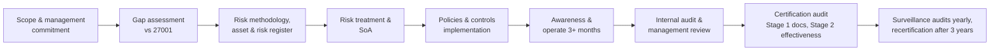
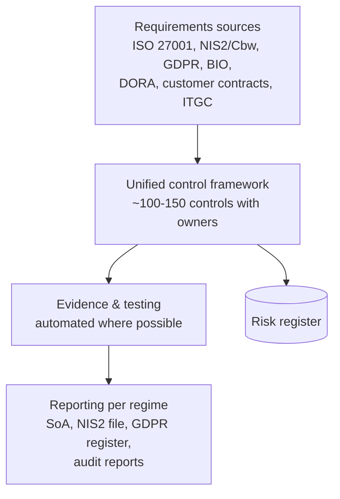
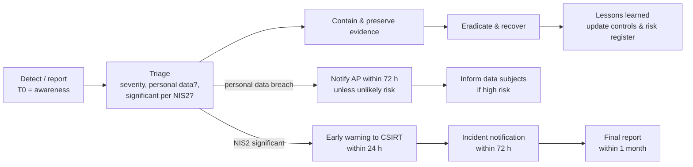

# Security & Compliance: ISO/IEC 27001:2022, NIS2 / Cyberbeveiligingswet, GDPR/AVG, BIO

> **TL;DR** **ISO/IEC 27001:2022** is the certifiable information security management system (ISMS): clauses 4–10 plus 93 Annex A controls in 4 themes (organizational 37, people 8, physical 14, technological 34). **NIS2** (EU Directive 2022/2555) imposes cybersecurity risk management, management accountability, supply-chain security and 24h/72h/1-month incident reporting on essential and important entities; the Netherlands transposes it in the **Cyberbeveiligingswet (Cbw)**. **GDPR/AVG** governs personal data. **BIO** is the Dutch government security baseline built on ISO 27001/27002. Build one integrated control set and map it to all regimes. *Regulatory content: verify current status.*

---

## 1. Landscape

| Regime | Type | Who | Certifiable? | Supervision (NL) |
|---|---|---|---|---|
| ISO/IEC 27001:2022 | Voluntary international standard (ISMS) | Anyone | Yes (accredited certification bodies) | Market / customers |
| ISO/IEC 27002:2022 | Guidance for controls | Anyone | No | — |
| NIS2 → Cyberbeveiligingswet | EU directive → national law | Essential & important entities in listed sectors (mostly ≥ medium size) | No (but certification can support evidence) | Sector supervisors; NCSC/CSIRTs for incidents — *verify* |
| GDPR / AVG + UAVG | EU regulation + Dutch implementation act | Anyone processing personal data | No general certification | Autoriteit Persoonsgegevens (AP) |
| BIO / BIO2 | Government baseline | Dutch government bodies (central, provinces, municipalities, water boards) | No (self-assessment, ENSIA for municipalities) | Internal/audit |
| DORA | EU regulation (applies from 17 Jan 2025) | Financial entities and critical ICT third-party providers | No | DNB / AFM |
| Cyber Resilience Act (CRA) | EU regulation (phased application, reporting obligations from 2026, main obligations 2027 — *verify*) | Manufacturers of products with digital elements | Conformity assessment / CE | Market surveillance |
| EU AI Act | EU regulation (phased 2025–2027 — *verify*) | Providers/deployers of AI systems | Conformity for high-risk | National authorities |
| NEN 7510 | Dutch healthcare information security standard (based on 27001) | Healthcare | Yes | IGJ / market |

---

## 2. ISO/IEC 27001:2022

Third edition published October 2022 (transition from 2013 version ended 31 October 2025). Amendment 1 (2024) added climate change considerations to context clauses.

### 2.1 Management system clauses (4–10)

| Clause | Content | Key evidence |
|---|---|---|
| 4 Context of the organization | Internal/external issues, interested parties and their requirements, **scope** of the ISMS | Context analysis, scope statement |
| 5 Leadership | Management commitment, information security **policy**, roles and responsibilities | Signed policy, RACI, management review minutes |
| 6 Planning | **Risk assessment** and **risk treatment** process, **Statement of Applicability (SoA)**, security objectives, planning of changes | Risk methodology, risk register, treatment plan, SoA |
| 7 Support | Resources, competence, awareness, communication, documented information | Training records, document control |
| 8 Operation | Operational planning and control, perform risk assessments and treatment | Implemented controls, risk reassessments |
| 9 Performance evaluation | Monitoring & measurement, **internal audit**, **management review** | KPIs, audit reports, review minutes |
| 10 Improvement | Continual improvement, nonconformity and corrective action | Corrective action log |

**Statement of Applicability (SoA):** for each of the 93 Annex A controls: applicable or not, justification, implementation status. Controls may also come from other sources (e.g. NIS2, BIO).

### 2.2 Annex A — 93 controls in 4 themes

**Theme 5 – Organizational controls (37)**

| # | Control | # | Control |
|---|---|---|---|
| 5.1 | Policies for information security | 5.20 | Addressing information security within supplier agreements |
| 5.2 | Information security roles and responsibilities | 5.21 | Managing information security in the ICT supply chain |
| 5.3 | Segregation of duties | 5.22 | Monitoring, review and change management of supplier services |
| 5.4 | Management responsibilities | 5.23 | Information security for use of cloud services *(new)* |
| 5.5 | Contact with authorities | 5.24 | Incident management planning and preparation |
| 5.6 | Contact with special interest groups | 5.25 | Assessment and decision on information security events |
| 5.7 | Threat intelligence *(new)* | 5.26 | Response to information security incidents |
| 5.8 | Information security in project management | 5.27 | Learning from information security incidents |
| 5.9 | Inventory of information and other associated assets | 5.28 | Collection of evidence |
| 5.10 | Acceptable use of information and other associated assets | 5.29 | Information security during disruption |
| 5.11 | Return of assets | 5.30 | ICT readiness for business continuity *(new)* |
| 5.12 | Classification of information | 5.31 | Legal, statutory, regulatory and contractual requirements |
| 5.13 | Labelling of information | 5.32 | Intellectual property rights |
| 5.14 | Information transfer | 5.33 | Protection of records |
| 5.15 | Access control | 5.34 | Privacy and protection of PII |
| 5.16 | Identity management | 5.35 | Independent review of information security |
| 5.17 | Authentication information | 5.36 | Compliance with policies, rules and standards |
| 5.18 | Access rights | 5.37 | Documented operating procedures |
| 5.19 | Information security in supplier relationships | | |

**Theme 6 – People controls (8):** 6.1 Screening · 6.2 Terms and conditions of employment · 6.3 Awareness, education and training · 6.4 Disciplinary process · 6.5 Responsibilities after termination or change of employment · 6.6 Confidentiality or non-disclosure agreements · 6.7 Remote working · 6.8 Information security event reporting.

**Theme 7 – Physical controls (14):** 7.1 Physical security perimeters · 7.2 Physical entry · 7.3 Securing offices, rooms and facilities · 7.4 Physical security monitoring *(new)* · 7.5 Protecting against physical and environmental threats · 7.6 Working in secure areas · 7.7 Clear desk and clear screen · 7.8 Equipment siting and protection · 7.9 Security of assets off-premises · 7.10 Storage media · 7.11 Supporting utilities · 7.12 Cabling security · 7.13 Equipment maintenance · 7.14 Secure disposal or re-use of equipment.

**Theme 8 – Technological controls (34)**

| # | Control | # | Control |
|---|---|---|---|
| 8.1 | User endpoint devices | 8.18 | Use of privileged utility programs |
| 8.2 | Privileged access rights | 8.19 | Installation of software on operational systems |
| 8.3 | Information access restriction | 8.20 | Networks security |
| 8.4 | Access to source code | 8.21 | Security of network services |
| 8.5 | Secure authentication | 8.22 | Segregation of networks |
| 8.6 | Capacity management | 8.23 | Web filtering *(new)* |
| 8.7 | Protection against malware | 8.24 | Use of cryptography |
| 8.8 | Management of technical vulnerabilities | 8.25 | Secure development life cycle |
| 8.9 | Configuration management *(new)* | 8.26 | Application security requirements |
| 8.10 | Information deletion *(new)* | 8.27 | Secure system architecture and engineering principles |
| 8.11 | Data masking *(new)* | 8.28 | Secure coding *(new)* |
| 8.12 | Data leakage prevention *(new)* | 8.29 | Security testing in development and acceptance |
| 8.13 | Information backup | 8.30 | Outsourced development |
| 8.14 | Redundancy of information processing facilities | 8.31 | Separation of development, test and production environments |
| 8.15 | Logging | 8.32 | Change management |
| 8.16 | Monitoring activities *(new)* | 8.33 | Test information |
| 8.17 | Clock synchronization | 8.34 | Protection of information systems during audit testing |

**11 new controls vs 2013:** 5.7, 5.23, 5.30, 7.4, 8.9, 8.10, 8.11, 8.12, 8.16, 8.23, 8.28. The 114 controls of 2013 were merged/restructured into 93.

**Control attributes (ISO/IEC 27002:2022)** for filtering: control type (preventive, detective, corrective), information security properties (confidentiality, integrity, availability), cybersecurity concepts (identify, protect, detect, respond, recover — NIST CSF aligned), operational capabilities, security domains (governance & ecosystem, protection, defence, resilience).

### 2.3 Implementation roadmap (mid-size, ~9–15 months to certification)

**Risk assessment essentials:** asset/process-based or scenario-based; likelihood x impact (e.g. 1–5 x 1–5); risk owner; treatment options **modify (mitigate), retain (accept), avoid, share (transfer)**; residual risk acceptance by risk owner.

**Minimum policy set:** information security policy; acceptable use; access control; classification & handling; supplier security; incident management; business continuity/backup; secure development/change; cryptography; remote working/mobile devices; HR security; logging & monitoring; vulnerability management; privacy.

---

## 3. NIS2 Directive (EU) 2022/2555

Replaces NIS1 (2016). Member states had to transpose by **17 October 2024**; many (including the Netherlands) were late. *Verify current status.*

### 3.1 Scope

| | **Essential entities** | **Important entities** |
|---|---|---|
| Typically | **Large** entities in **Annex I** (sectors of high criticality) + certain entities regardless of size (qualified trust service providers, TLD registries, DNS providers; public electronic communications providers at medium+; central government; entities designated by member state) | **Medium** entities in Annex I, and **medium and large** entities in **Annex II** (other critical sectors) |
| Supervision | **Ex ante** (proactive): audits, inspections, security scans | **Ex post** (reactive): after evidence/indication of non-compliance |
| Max fines | At least €10M or 2% of worldwide annual turnover (whichever higher) | At least €7M or 1.4% of worldwide annual turnover |

**Size thresholds (EU SME definition):** medium = 50–249 employees, or turnover > €10M and balance sheet > €10M (up to €50M turnover / €43M balance); large = ≥ 250 employees or turnover > €50M and balance sheet > €43M. Partner/linked enterprise rules can pull entities into scope.

| Annex I — sectors of high criticality | Annex II — other critical sectors |
|---|---|
| Energy (electricity, district heating, oil, gas, hydrogen) | Postal and courier services |
| Transport (air, rail, water, road) | Waste management |
| Banking | Manufacture, production and distribution of chemicals |
| Financial market infrastructures | Production, processing and distribution of food |
| Health (incl. labs, pharma R&D, critical medical devices) | Manufacturing (medical devices, computers/electronics/optical, electrical equipment, machinery, motor vehicles, other transport equipment) |
| Drinking water | Digital providers (online marketplaces, search engines, social networks) |
| Waste water | Research organizations |
| Digital infrastructure (IXPs, DNS, TLD, cloud, data centres, CDN, trust services, electronic communications) | |
| ICT service management B2B (managed service providers, managed security service providers) | |
| Public administration | |
| Space | |

**Important for mid-size organizations:** even if not in scope, you will feel NIS2 via **supply chain** requirements from in-scope customers (security clauses, questionnaires, certifications). MSPs and IT service providers are explicitly in scope (Annex I) at medium size and up.

### 3.2 Duties

| Article | Duty | Content |
|---|---|---|
| Art. 20 | **Governance** | Management bodies approve cybersecurity risk-management measures, oversee implementation, can be held **liable**; members must follow **training** (and encourage training of staff) |
| Art. 21 | **Cybersecurity risk-management measures** (all-hazards, proportionate) | At minimum: (a) risk analysis and information system security policies; (b) incident handling; (c) business continuity (backup management, disaster recovery, crisis management); (d) supply chain security; (e) security in acquisition, development and maintenance, incl. vulnerability handling and disclosure; (f) policies and procedures to assess effectiveness of measures; (g) basic cyber hygiene practices and cybersecurity training; (h) policies on cryptography and, where appropriate, encryption; (i) human resources security, access control policies and asset management; (j) multi-factor or continuous authentication, secured voice/video/text communications and secured emergency communications where appropriate |
| Art. 23 | **Incident reporting** of *significant incidents* to CSIRT/competent authority | **Early warning within 24 hours** (suspected malicious? cross-border impact?); **incident notification within 72 hours** (initial assessment, severity, impact, IoCs); intermediate reports on request; **final report within one month** (detailed description, root cause, mitigation, cross-border impact). Also inform recipients of services where appropriate |
| Art. 3/27 | **Registration** | Entities register with the national authority (name, sector, contact, IP ranges, member states) |
| Art. 24 | Use of certification schemes | Member states may require certified ICT products/services (EU cybersecurity certification) |
| Art. 32/33 | Supervision & enforcement | Inspections, audits, binding instructions, fines, temporary bans on management functions (essential) |

### 3.3 The Netherlands: Cyberbeveiligingswet (Cbw)

- Replaces the **Wbni** (Wet beveiliging netwerk- en informatiesystemen, NIS1 implementation).
- Core obligations (Dutch terms): **registratieplicht** (registration), **zorgplicht** (duty of care: risk management measures, detailed in an implementing decree — *Cyberbeveiligingsbesluit*), **meldplicht** (incident reporting), and governance/training obligations for management (*bestuurdersverantwoordelijkheid*).
- Supervision divided per sector (e.g. RDI — Rijksinspectie Digitale Infrastructuur — for digital infrastructure and several other sectors; IGJ for health; ILT for transport/water; DNB/AFM in finance) — *verify the current allocation*.
- Incident reporting to the **CSIRT** (NCSC for many sectors; Z-CERT for healthcare; sector CSIRTs) and the supervisor.
- Companion law: **Wet weerbaarheid kritieke entiteiten (Wwke)** transposing the EU **CER Directive** (physical resilience of critical entities).
- The bill was submitted to parliament in 2025; entry into force expected in 2026 — **verify current status** with the Dutch government (NCSC, RDI, Rijksoverheid) before advising. Organizations should not wait: obligations largely reflect ISO 27001 good practice.

### 3.4 NIS2 readiness checklist

- [ ] Determine applicability: sector (Annex I/II), size incl. linked/partner enterprises, essential vs important.
- [ ] Register with the competent authority when the registration window opens.
- [ ] Board: approve risk management framework, receive training, set reporting lines to management.
- [ ] Risk assessment covering all-hazards (incl. physical, supply chain).
- [ ] Implement Art. 21 measures — map to ISO 27001 Annex A (most are covered by 5.x, 6.3, 8.x).
- [ ] Supplier inventory and security requirements in contracts; assess critical ICT suppliers.
- [ ] Incident response plan with **24h/72h/1-month** reporting workflow, contacts, templates, decision criteria for "significant".
- [ ] BCP/DR with tested backups (immutable/offline copy), crisis management team.
- [ ] MFA everywhere; privileged access management; encryption policy.
- [ ] Vulnerability management and coordinated vulnerability disclosure (CVD) policy.
- [ ] Measure effectiveness (KPIs, internal audits, pen tests).
- [ ] Evidence file for supervisors.

---

## 4. GDPR / AVG basics for IT

Regulation (EU) 2016/679 applies since 25 May 2018. Dutch name: **Algemene verordening gegevensbescherming (AVG)**; national implementation: **Uitvoeringswet AVG (UAVG)**. Supervisor: **Autoriteit Persoonsgegevens (AP)**.

### 4.1 Principles (Art. 5)

| Principle | IT implication |
|---|---|
| Lawfulness, fairness, transparency | Lawful basis per processing; privacy notices |
| Purpose limitation | Don't reuse data for incompatible purposes (e.g. HR data for marketing) |
| Data minimisation | Only fields needed; review custom fields in ERP/CRM |
| Accuracy | Data quality processes, correction workflows |
| Storage limitation | Retention schedule and automated deletion/anonymization |
| Integrity and confidentiality | Security (Art. 32): access control, encryption, logging |
| Accountability | Demonstrate compliance: records, DPIAs, policies |

### 4.2 Lawful bases (Art. 6)

Consent · Contract · Legal obligation · Vital interests · Public task · Legitimate interests (with balancing test). **Special categories** (Art. 9: health, ethnicity, religion, biometrics for identification, trade union, sexual orientation, etc.) require an additional exception. Dutch specifics: **BSN** (citizen service number) may only be processed when a law permits it (e.g. payroll); health data of employees (sick leave reasons) must not be processed by the employer.

### 4.3 Key obligations for IT/architecture

| Article | Obligation | Practical artefact |
|---|---|---|
| Art. 12–22 | Data subject rights (access, rectification, erasure, restriction, portability, objection, automated decision-making) | DSAR process, ability to find/export/delete personal data across systems |
| Art. 25 | Data protection by design and by default | Privacy requirements in solution design reviews |
| Art. 28 | Processor contracts | **Data Processing Agreement (verwerkersovereenkomst)** with every SaaS/IT supplier processing personal data |
| Art. 30 | Records of processing activities | Register (verwerkingsregister) — link to application inventory |
| Art. 32 | Security of processing | Risk-based technical and organizational measures |
| Art. 33/34 | Breach notification | Notify AP **within 72 hours** of awareness (unless unlikely to result in risk); notify data subjects if high risk; keep internal breach register |
| Art. 35 | DPIA | Data Protection Impact Assessment for high-risk processing (e.g. large-scale monitoring, new tech, profiling; AP has a list of mandatory cases) |
| Art. 37–39 | DPO (FG – functionaris gegevensbescherming) | Mandatory for public bodies and core activities of large-scale monitoring/special categories |
| Art. 44–49 | International transfers | Adequacy (incl. EU–US Data Privacy Framework — *verify status*), SCCs + transfer impact assessment |

**Fines:** up to €20M or 4% of global annual turnover (higher tier).

**Integration with architecture:** tag applications and data objects with "contains personal data / special categories", lawful basis, retention, processor; use this in the application inventory ([templates.md](templates.md#3-application-inventory-columns)).

---

## 5. BIO — Baseline Informatiebeveiliging Overheid

- Common information security framework for all Dutch government layers (Rijk, provinces, municipalities, water boards), replacing earlier sector baselines (BIR, BIG, IBI, BIWA).
- Based on **ISO/IEC 27001 and 27002** with government-specific measures (overheidsmaatregelen) and **basisbeveiligingsniveaus (BBN)**.
- **BIO2** (updated to the 2022 versions of ISO 27001/27002, with a more risk-based approach) — *verify adoption status and effective date*.
- Municipalities account via **ENSIA** (Eenduidige Normatiek Single Information Audit).
- Relevant for suppliers to government: expect BIO requirements in contracts alongside GIBIT/ARBIT terms.

---

## 6. Building one integrated control framework

| Control area | ISO 27001 Annex A | NIS2 Art. 21(2) | GDPR |
|---|---|---|---|
| Risk management & policies | 5.1, 5.2, 5.4 + clause 6 | (a), (f) | Art. 24, 32 |
| Incident management | 5.24–5.28, 6.8 | (b) + Art. 23 | Art. 33–34 |
| Business continuity & backup | 5.29, 5.30, 8.13, 8.14 | (c) | Art. 32(1)(c) |
| Supplier security | 5.19–5.23 | (d) | Art. 28 |
| Secure development & vulnerabilities | 8.8, 8.25–8.29, 8.32 | (e) | Art. 25 |
| Awareness & hygiene | 6.3, 8.1, 8.7 | (g) | Art. 32(4), 39 |
| Cryptography | 8.24 | (h) | Art. 32(1)(a) |
| HR, access, assets | 5.9–5.18, 6.1–6.5, 8.2–8.5 | (i) | Art. 32 |
| MFA, secure communications | 8.5, 5.14 | (j) | Art. 32 |

**Baseline technical controls for an SME (high value, low cost):** MFA for all users (phishing-resistant for admins), Conditional Access, EDR on all endpoints, patching SLAs, immutable/offline backups with restore tests, e-mail security (SPF, DKIM, DMARC; Dutch "pas toe of leg uit" standards such as internet.nl checks), privileged access management, logging to a central SIEM/MDR service, security awareness and phishing simulations, asset and application inventory, vendor security reviews, incident response retainer.

---

## 7. Incident response with regulatory clocks

| Role | Responsibility |
|---|---|
| Incident manager | Coordinates response, timeline, decisions log |
| Security lead / MSSP | Technical analysis, containment, forensics |
| Privacy officer / DPO | Assess personal data impact, AP notification |
| Legal | Regulatory and contractual notification duties, evidence, law enforcement |
| Communications | Internal, customer and press communication |
| Management (board) | Decisions (e.g. shutdown, ransom policy — paying is strongly discouraged), accountability under NIS2 |
| Suppliers | Supply-chain incidents: contractual notification duties both ways |

**Preparation checklist:** contact list (CSIRT, AP, insurer, MSSP, legal, key suppliers) offline; decision criteria for "significant"; templates for 24h/72h/final reports; out-of-band communication channel; tabletop exercise at least yearly; offline backups and recovery runbooks; cyber insurance conditions known.

---

## When to use / when not

| Item | Use | Not |
|---|---|---|
| ISO 27001 certification | Customers/tenders demand it; NIS2 evidence; mature governance | Paper exercise without real risk management |
| NIS2 assessment | Any organization in listed sectors ≥ 50 FTE or supplying them | Ignoring because "the Dutch law is not yet in force" |
| DPIA | High-risk processing, new technologies, AI on personal data | Every small change (use a pre-scan/quick scan) |

## Common mistakes

- Treating ISO 27001 as documentation only; auditors increasingly test effectiveness.
- SoA excluding controls without real justification.
- No tested incident reporting process → missing the 24h NIS2 early warning.
- DPAs missing for "small" SaaS tools (shadow IT).
- Separate, duplicated control sets for each regime.
- Board not involved → NIS2 Art. 20 non-compliance and personal liability exposure.

## References

- ISO/IEC 27001:2022: https://www.iso.org/standard/27001
- Wikipedia — ISO/IEC 27001: https://en.wikipedia.org/wiki/ISO/IEC_27001
- Wikipedia — ISO/IEC 27002: https://en.wikipedia.org/wiki/ISO/IEC_27002
- European Commission — NIS2 Directive: https://digital-strategy.ec.europa.eu/en/policies/nis2-directive
- EUR-Lex — Directive (EU) 2022/2555: https://eur-lex.europa.eu/eli/dir/2022/2555/oj
- Wikipedia — NIS2 Directive: https://en.wikipedia.org/wiki/NIS2_Directive
- NCSC (Netherlands): https://www.ncsc.nl/
- Autoriteit Persoonsgegevens: https://www.autoriteitpersoonsgegevens.nl/
- EUR-Lex — GDPR (Regulation (EU) 2016/679): https://eur-lex.europa.eu/eli/reg/2016/679/oj
- Wikipedia — General Data Protection Regulation: https://en.wikipedia.org/wiki/General_Data_Protection_Regulation
- BIO (Baseline Informatiebeveiliging Overheid): https://www.digitaleoverheid.nl/
- European Commission — Cyber Resilience Act: https://digital-strategy.ec.europa.eu/en/policies/cyber-resilience-act
- European Commission — AI Act: https://digital-strategy.ec.europa.eu/en/policies/regulatory-framework-ai
- Internet.nl (test e-mail/web security standards): https://internet.nl/
- Related: [it-management-itil-cobit.md](it-management-itil-cobit.md), [../06-cloud-architecture/README.md](../06-cloud-architecture/README.md), [../05-software-architecture/README.md](../05-software-architecture/README.md)
