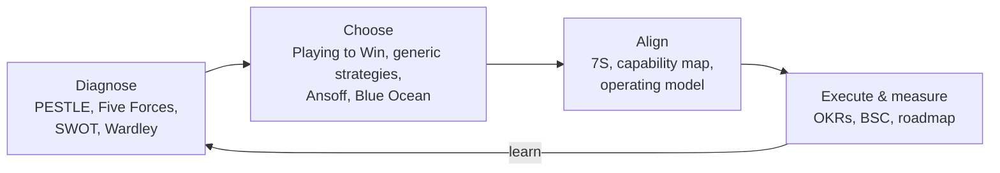
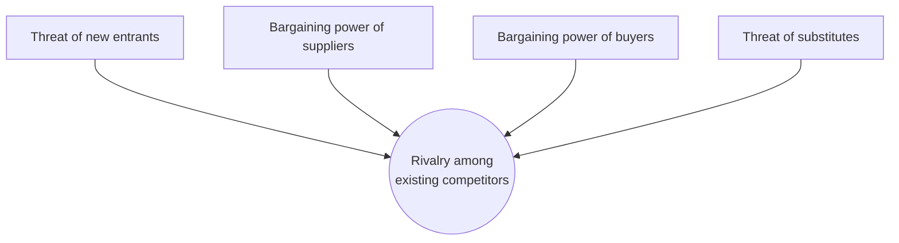
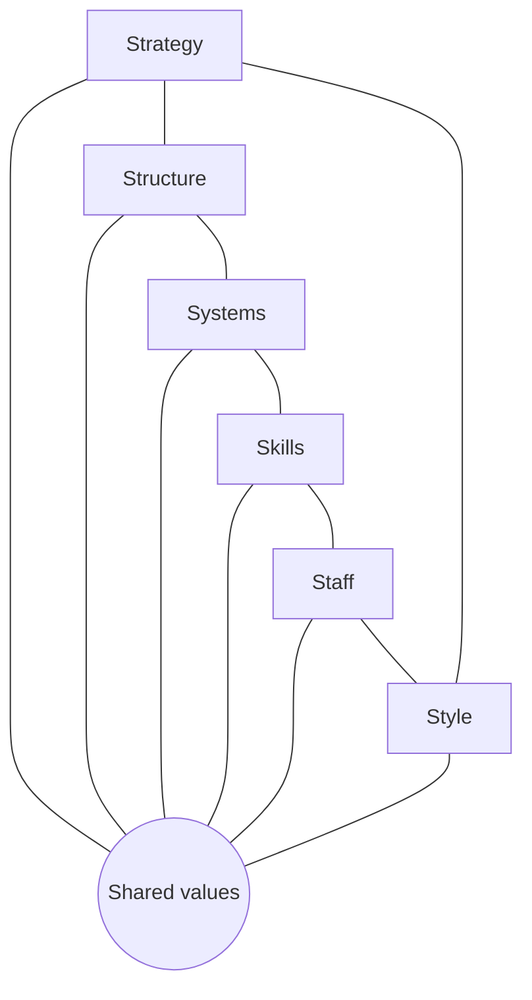
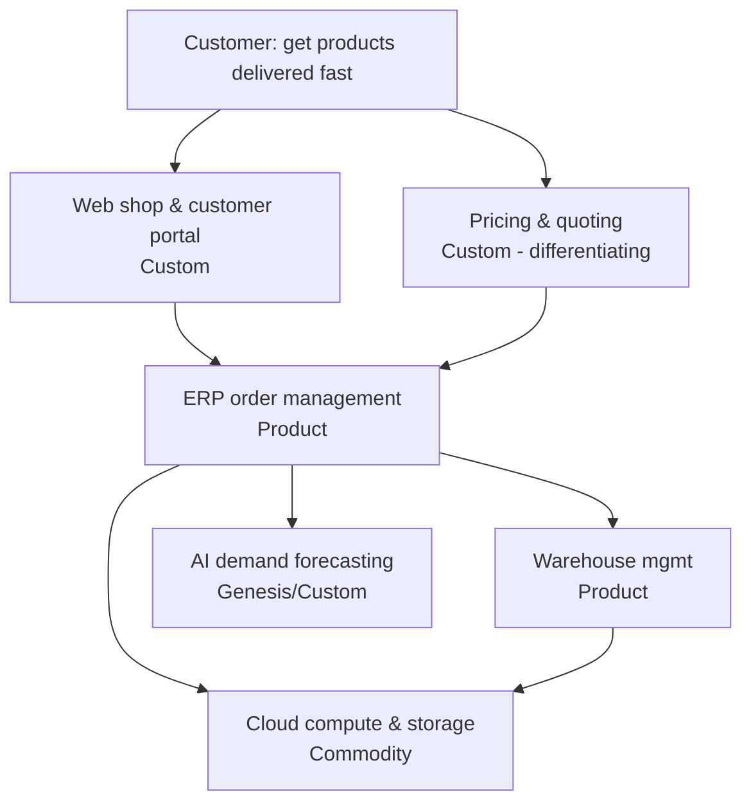
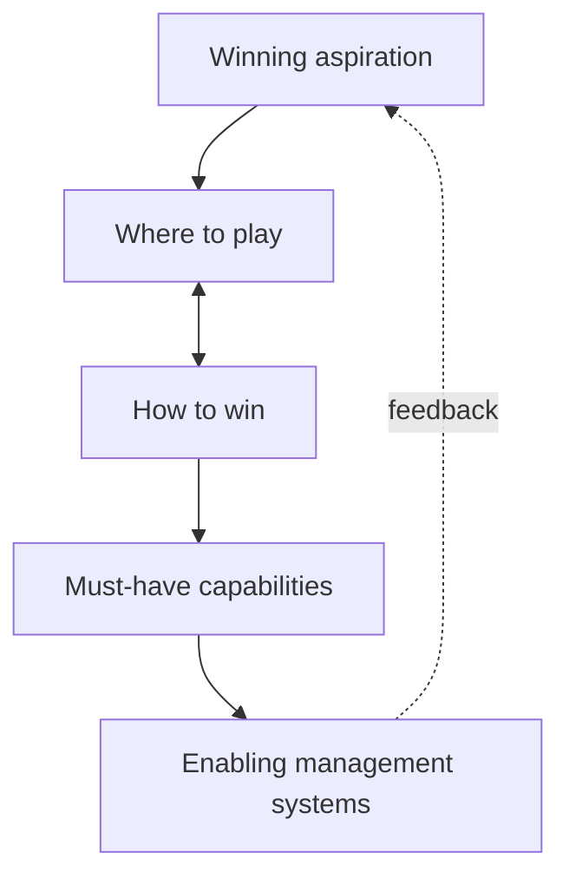
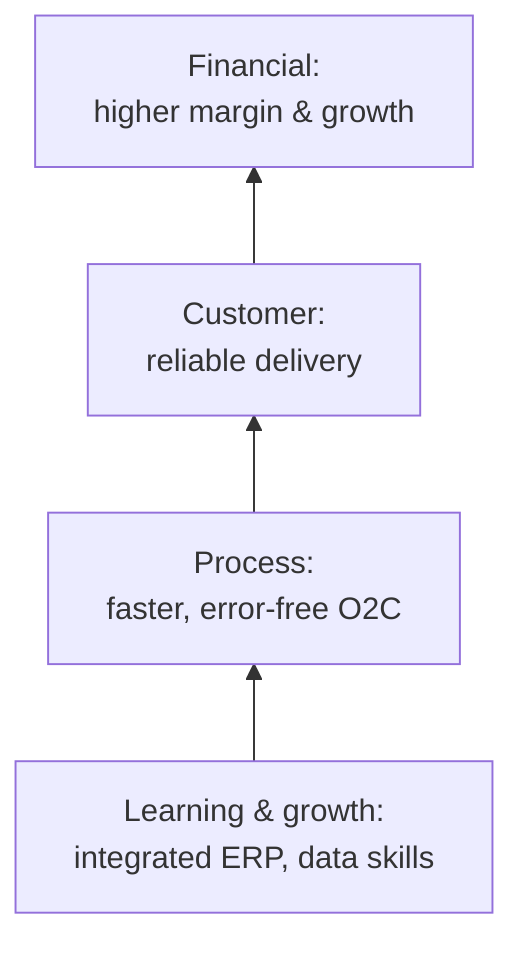

# Strategy Frameworks: Analysis, Choice, Execution

> **TL;DR** Strategy = a coherent set of choices about where to play and how to win, grounded in a sharp diagnosis. Use **analysis tools** to understand the environment (PESTLE, Porter's Five Forces, value chain, SWOT→TOWS, Wardley Maps), **choice frameworks** to decide (Porter's generic strategies, Ansoff, BCG, Blue Ocean, Playing to Win, Rumelt's kernel), and **execution frameworks** to deliver and measure (McKinsey 7S, Three Horizons, balanced scorecard, OKRs, digital transformation frameworks). No framework substitutes for judgment; pick 2–3 that fit the question.

---

## 1. Which tool for which question

| Question | Tools |
|---|---|
| What is happening in our environment? | PESTLE, Porter's Five Forces, Wardley Map (climate) |
| Where do we create value / cost? | Value chain, capability map, value streams |
| What is our position? | SWOT, BCG matrix, strategy canvas |
| Where should we grow? | Ansoff, Three Horizons, Blue Ocean |
| How do we compete? | Generic strategies, Playing to Win, Wardley gameplay |
| Is our strategy actually a strategy? | Rumelt's kernel (Good Strategy/Bad Strategy) |
| Is the organization aligned to execute? | McKinsey 7S |
| How do we measure and steer? | Balanced scorecard, OKRs |
| How do we transform digitally? | MIT digital transformation, Westerman's digital mastery, McKinsey/BCG digital frameworks, capability-based roadmap |

---

## 2. PESTLE

Macro-environment scan: **Political, Economic, Social, Technological, Legal, Environmental**. Variants: PEST, STEEP, STEEPLE (+Ethical).

| Factor | Example prompts | Example (Dutch mid-size distributor) |
|---|---|---|
| Political | Government stability, trade policy, subsidies | EU trade policy, tariffs, sanctions compliance |
| Economic | Growth, inflation, interest, labour costs, FX | Wage inflation, energy prices, financing costs |
| Social | Demographics, labour market, attitudes | Labour shortage in logistics and IT, ageing workforce |
| Technological | Automation, AI, platforms, cyber threats | Warehouse automation, AI forecasting, e-invoicing mandates |
| Legal | Regulation, compliance | NIS2/Cbw, CSRD sustainability reporting (scope changes — *verify*), GDPR, e-invoicing (ViDA) |
| Environmental | Climate, sustainability, resources | CO2 reporting, zero-emission zones in city logistics, packaging rules |

**Tip:** rate each factor by impact and likelihood; keep top 5–8; translate into implications ("so what?").

---

## 3. Porter's Five Forces

Michael Porter (HBR 1979; *Competitive Strategy* 1980). Industry structure determines profitability.

| Force | Drivers of high force |
|---|---|
| Threat of new entrants | Low barriers: low capital needs, no economies of scale, easy access to channels, weak brand loyalty, little regulation |
| Supplier power | Few suppliers, unique inputs, high switching costs, forward integration threat |
| Buyer power | Concentrated buyers, standardized products, low switching costs, price sensitivity, backward integration threat |
| Threat of substitutes | Attractive price-performance alternatives, low switching costs |
| Rivalry | Many equal competitors, slow growth, high fixed costs, low differentiation, high exit barriers |

Often added: **complementors** (Brandenburger & Nalebuff, "sixth force"). Use: industry attractiveness, IT vendor negotiation (assess ERP vendor's power over you — switching costs!).

---

## 4. Porter's generic strategies

| | Broad target | Narrow target (segment) |
|---|---|---|
| **Lower cost** | **Cost leadership** | **Cost focus** |
| **Differentiation** | **Differentiation** | **Differentiation focus** |

Risk: "stuck in the middle" — neither lowest cost nor clearly differentiated. IT implication: cost leaders standardize and automate (clean core, shared services); differentiators invest in systems of differentiation (customer experience, configurators, data).

---

## 5. Porter's value chain

| Support activities | |
|---|---|
| Firm infrastructure | General management, finance, legal, quality, **IT/ERP** |
| Human resource management | Recruitment, training, compensation |
| Technology development | R&D, process automation, product design |
| Procurement | Purchasing of inputs |

| Primary activities | | | | |
|---|---|---|---|---|
| **Inbound logistics** | **Operations** | **Outbound logistics** | **Marketing & sales** | **Service** |
| Receiving, warehousing, inventory | Production, assembly, packaging | Order processing, distribution | Pricing, channels, promotion | Installation, repair, support |

→ **Margin**. Use: locate cost drivers and differentiation sources; map applications onto activities (an early form of capability mapping).

---

## 6. SWOT and TOWS

| | Helpful | Harmful |
|---|---|---|
| **Internal** | **S**trengths | **W**eaknesses |
| **External** | **O**pportunities | **T**hreats |

**TOWS matrix** (Weihrich, 1982) turns SWOT into strategic options:

| | **Strengths** | **Weaknesses** |
|---|---|---|
| **Opportunities** | **SO** (maxi-maxi): use strengths to exploit opportunities | **WO** (mini-maxi): overcome weaknesses by exploiting opportunities |
| **Threats** | **ST** (maxi-mini): use strengths to counter threats | **WT** (mini-mini): minimize weaknesses and avoid threats (defensive) |

**Rules for a useful SWOT:** specific and evidence-based; relative to competitors; prioritized (top 3–5 each); always continue to TOWS options; avoid "strength: our people".

---

## 7. Ansoff matrix

Igor Ansoff (1957), growth strategies.

| | Existing products | New products |
|---|---|---|
| **Existing markets** | **Market penetration** (lowest risk) | **Product development** |
| **New markets** | **Market development** | **Diversification** (highest risk: related or unrelated) |

IT implications: market development (new countries) → ERP localization, multi-entity, multi-currency, two-tier ERP; product development → PLM, configurators; diversification → separate systems or platform.

---

## 8. BCG growth-share matrix

Boston Consulting Group (Bruce Henderson, 1970). Portfolio of business units/products by **market growth** and **relative market share**.

| | High relative market share | Low relative market share |
|---|---|---|
| **High market growth** | **Star** — invest to maintain | **Question mark** — invest selectively or divest |
| **Low market growth** | **Cash cow** — harvest, fund others | **Dog** — divest or reposition |

Limits: simplistic, market definition is arbitrary, ignores synergies. Analogy for application portfolios: TIME model ([ea-practice-capabilities-portfolio.md](ea-practice-capabilities-portfolio.md#53-the-time-model-gartner)).

---

## 9. McKinsey 7S

Peters & Waterman, Pascale & Athos (~1980). Seven interdependent elements must be aligned for change to succeed.

| Hard elements | Soft elements |
|---|---|
| **Strategy** — plan to build competitive advantage | **Shared values** (center) — core beliefs and culture |
| **Structure** — organization chart, reporting lines | **Style** — leadership style |
| **Systems** — processes and procedures, incl. IT | **Staff** — people, capabilities in aggregate |
| | **Skills** — distinctive competencies |

**Use in ERP/digital programs:** a new ERP changes **Systems**; check Structure (process owners?), Skills (data literacy), Style (decision-making), Shared values (standardization vs autonomy). Misalignment explains many failures.

---

## 10. Three Horizons of growth

Baghai, Coley & White, *The Alchemy of Growth* (McKinsey, 1999).

| Horizon | Focus | Time to profit | Metrics | Governance |
|---|---|---|---|---|
| **H1** | Extend and defend core business | Now | Profit, cash flow, efficiency | Operational excellence |
| **H2** | Build emerging businesses | 1–3 years (scaling) | Revenue growth, market share, customer acquisition | Entrepreneurial, investment |
| **H3** | Create options for future businesses | 3+ years | Milestones, learning, option value | Venture/experiment, small bets |

Common allocation heuristic: ~70/20/10 (H1/H2/H3) — adapt to context. Parallels: pace layers (record/differentiation/innovation), run/grow/transform IT budget.

---

## 11. Wardley mapping

Created by Simon Wardley (~2005). A map shows a **value chain** (y-axis: visibility to user, from user need at the top to invisible components at the bottom) against **evolution** (x-axis: Genesis → Custom-built → Product (+rental) → Commodity (+utility)). Maps have *position* and *movement*, unlike most business diagrams.

### 11.1 Evolution stages

| Characteristic | I. Genesis | II. Custom-built | III. Product (+rental) | IV. Commodity (+utility) |
|---|---|---|---|---|
| Ubiquity | Rare | Slowly increasing | Rapidly increasing | Widespread, stable |
| Certainty | Poorly understood | Rapid increases in learning | Rapid increases in use/fit | Commonly understood |
| Market | Undefined | Forming | Growing | Mature |
| Failure | High, tolerated | Moderate, unsurprising | Not tolerated, focus on constant improvement | Surprising, operational efficiency |
| Focus of value | High future worth | Seeking profit, ROI | High profitability | High volume, reducing margin |
| Approach | Explore, agile, in-house | Agile/lean, build | Lean, buy/configure | Six Sigma, outsource/utility |
| Example (today) | Novel AI agent workflows | Bespoke pricing engine | CRM, ERP, HRIS SaaS | Compute, storage, electricity, e-mail |

*Characteristics paraphrased from Wardley's evolution table.*

### 11.2 Example map (simplified)

*(Mermaid cannot plot the x-axis; draw real maps in OnlineWardleyMaps, Miro or on paper.)*

### 11.3 Strategy cycle

Purpose → Landscape (map) → Climate (patterns you cannot control) → Doctrine (universal good practice) → Leadership (context-specific gameplay) → Purpose... (adapted from Sun Tzu's five factors).

### 11.4 Climatic patterns (selection)

- **Everything evolves** through supply and demand competition.
- **Characteristics change** as components evolve (genesis vs commodity need different methods).
- **No one size fits all** — use agile, lean, Six Sigma, in-house, outsource appropriately.
- **Efficiency enables innovation** — commoditized components become building blocks for new genesis (componentization).
- **Inertia**: past success creates resistance to change.
- **Co-evolution**: practices co-evolve with technology (e.g. cloud → DevOps).
- **Higher-order systems create new sources of value.**
- **Competitors' actions will change the game.**
- **Shifts from product to utility tend to be punctuated equilibria (war)**.
- **No choice over evolution** — you can only choose how to respond.

### 11.5 Doctrine (selection, grouped in phases in Wardley's doctrine table)

| Category | Examples |
|---|---|
| Communication | Use a common language; challenge assumptions; focus on high situational awareness |
| Development | Know your users; focus on user needs; use appropriate methods (agile/lean/six sigma) per evolution stage; remove bias and duplication; use standards where appropriate |
| Operation | Manage inertia; think small (teams, contracts); manage failure |
| Learning | Use a systematic mechanism of learning; a bias towards data |
| Leading | Be transparent; move fast; think aptitude and attitude; strategy is iterative; there is no core |
| Structure | Small autonomous teams; pioneers–settlers–town planners (PST) |

### 11.6 Gameplay (selection)

| Gameplay | Description |
|---|---|
| **Open approaches** | Open-source/open standards to commoditize a component and undermine a competitor's differentiation |
| **ILC (Innovate–Leverage–Commoditize)** | Provide a commodity platform, observe what others build on it (sensing), commoditize successful patterns |
| **Tower and moat** | Build higher-order value while making it hard for others to follow |
| **Exploiting buyer/supplier power** | Use inertia or lock-in positions |
| **Fool's mate** | Force industrialization of a component that a competitor depends on |
| **FUD** | Fear, uncertainty, doubt to slow competitors' adoption (understand to defend against) |
| **Land grab / first mover / fast follower** | Timing plays depending on evolution |
| **Sensing engines** | Use consumption data to spot evolution early |

### 11.7 Using Wardley Maps in IT/ERP decisions

- Commodity components → **buy/utility** (SaaS ERP for GL, cloud IaaS).
- Product components → **configure standard**, avoid customization (clean core).
- Custom components that differentiate → **build or extend side-by-side** (pace layer: differentiation).
- Genesis → **experiment** with small teams, accept failure (pace layer: innovation).
- Spot **inertia** (e.g. heavily customized legacy ERP) and **co-evolving practices** (e.g. moving to SaaS requires new release management).

---

## 12. Blue Ocean Strategy

W. Chan Kim & Renée Mauborgne (2005). Create uncontested market space (blue ocean) instead of competing in existing ones (red ocean); pursue **differentiation and low cost simultaneously** (value innovation).

**Strategy canvas:** x-axis = competing factors; y-axis = offering level; plot your value curve vs competitors'. A good blue ocean curve shows **focus, divergence, and a compelling tagline**.

**ERRC grid (Four Actions Framework):**

| **Eliminate** — which factors the industry takes for granted should be eliminated? | **Raise** — which factors should be raised well above the industry standard? |
|---|---|
| **Reduce** — which factors should be reduced well below the industry standard? | **Create** — which factors should be created that the industry has never offered? |

Example (IT managed services for SMB): Eliminate long-term lock-in contracts; Reduce bespoke reporting; Raise security baseline and response speed; Create fixed-price "NIS2 readiness" package with board training.

Other tools: Six Paths framework, buyer utility map, three tiers of noncustomers.

---

## 13. Good Strategy / Bad Strategy (Richard Rumelt, 2011)

**Kernel of good strategy:**

| Element | Description | Example |
|---|---|---|
| **Diagnosis** | Defines/explains the nature of the challenge; simplifies complexity by identifying critical aspects | "Our growth is constrained because five acquired entities run five ERPs; we cannot see margin per customer and every new entity takes 18 months to integrate." |
| **Guiding policy** | Overall approach to cope with the diagnosis; creates advantage by channeling action | "Standardize on one cloud ERP and a common process model; differentiation lives outside the core." |
| **Coherent actions** | Coordinated, resource-committed steps that implement the guiding policy | "Freeze legacy customizations; select ERP by Q2; migrate finance of all entities in year 1; integration playbook for acquisitions; data platform for margin analysis." |

**Hallmarks of bad strategy:** **fluff** (buzzwords, superficial abstraction); **failure to face the challenge**; **mistaking goals for strategy** (ambitions without a plan); **bad strategic objectives** (a "dog's dinner" list of everything, or "blue-sky" objectives that are unachievable).

**Sources of power** Rumelt highlights: leverage, proximate objectives, chain-link systems, design, focus, growth (healthy), using advantage, dynamics, inertia and entropy.

---

## 14. Playing to Win (A.G. Lafley & Roger Martin, 2013)

Strategy as an integrated **cascade of five choices**:

| # | Choice | Question |
|---|---|---|
| 1 | **Winning aspiration** | What is our purpose; what does winning look like? |
| 2 | **Where to play** | Which geographies, customers, products, channels, value chain stages? |
| 3 | **How to win** | What is our competitive advantage (cost or differentiation) in the chosen place? |
| 4 | **Core capabilities** | Which capabilities, and how configured, are needed to win? |
| 5 | **Management systems** | Which systems, structures, measures support the capabilities and choices? |

Martin's "strategy choice structuring": generate possibilities → specify conditions that would have to be true → identify barriers → design tests → choose. Capabilities (box 4) link directly to the business capability map ([ea-practice-capabilities-portfolio.md](ea-practice-capabilities-portfolio.md#2-business-capability-maps)).

---

## 15. Balanced scorecard

Kaplan & Norton (HBR 1992; *The Balanced Scorecard* 1996). Measure performance across four perspectives; **strategy maps** (2004) show cause-and-effect between objectives.

| Perspective | Question | Example objective | Example KPI |
|---|---|---|---|
| **Financial** | How do we look to shareholders? | Improve operating margin | EBIT %, cost-to-serve |
| **Customer** | How do customers see us? | Reliable delivery | OTIF %, NPS |
| **Internal business process** | What must we excel at? | Efficient order-to-cash | Order cycle time, touchless order % |
| **Learning & growth** | How can we continue to improve and create value? | Digital skills; integrated systems | Training hours, % processes on ERP, engagement |

## 16. OKRs (link)

Objectives and Key Results (Andy Grove at Intel; John Doerr, *Measure What Matters*). Qualitative, inspiring objective + 2–5 measurable key results per quarter; ambitious (~70% achievement for stretch). Use OKRs for focus and alignment; use BSC/KPIs for steady-state health. Details: [../02-product-management/README.md](../02-product-management/README.md).

---

## 17. Digital transformation frameworks

| Framework | Core idea |
|---|---|
| **Westerman, Bonnet, McAfee — *Leading Digital* (MIT, 2014)** | Digital mastery = digital capabilities (customer experience, operations, business models) x leadership capabilities (vision, engagement, governance, IT-business relationship). Four types: beginners, fashionistas, conservatives, digital masters |
| **Ross, Beath, Mocker — *Designed for Digital* (MIT CISR, 2019)** | Five building blocks: shared customer insights, operational backbone (ERP!), digital platform, accountability framework, external developer platform |
| **Rogers — *The Digital Transformation Playbook* (2016)** | Five domains: customers, competition, data, innovation, value |
| **Capability-based transformation** | Target capability map + heat map → capability increments → roadmap |
| **Microsoft Cloud Adoption Framework / similar** | Strategy, plan, ready, adopt, govern, manage — for cloud; see [../06-cloud-architecture/README.md](../06-cloud-architecture/README.md) |

**Operational backbone first:** MIT CISR research suggests that a reliable, standardized operational backbone (clean ERP, master data) is a prerequisite for digital innovation — strong argument for clean core in mid-size organizations.

**Digital transformation checklist:**

- [ ] Clear business ambition and diagnosis (not "we need AI").
- [ ] Executive sponsorship and governance beyond IT.
- [ ] Operational backbone (ERP, data, integration) fit for purpose.
- [ ] Customer/user insight as input.
- [ ] Capability gaps and roadmap; funding by value streams or products.
- [ ] Skills and change management plan.
- [ ] Measured outcomes (BSC/OKR).

## When to use / when not

| Tool | Use | Avoid |
|---|---|---|
| SWOT | Workshop starter, quick synthesis | As the strategy itself |
| Five Forces | Industry-level analysis, vendor negotiation | Firm-internal problems |
| BCG | Multi-business portfolio | Single-product companies |
| Wardley | Technology/sourcing decisions, anticipating change | When the team won't invest time to learn mapping |
| Playing to Win | Making explicit choices, aligning leadership | Pure operational planning |
| Rumelt kernel | Testing whether a "strategy" is real | — (always useful) |

## Common mistakes

- Confusing goals, visions, or budgets with strategy (Rumelt's "bad strategy").
- Analysis paralysis: ten frameworks, no choices.
- Strategy without trade-offs: "we serve everyone, with the best quality, at the lowest price".
- IT strategy written without the business strategy, or as a list of projects.
- Treating frameworks as one-off exercises instead of living tools.

## References

- Wikipedia — PEST analysis: https://en.wikipedia.org/wiki/PEST_analysis
- Wikipedia — Porter's five forces analysis: https://en.wikipedia.org/wiki/Porter%27s_five_forces_analysis
- Wikipedia — Porter's generic strategies: https://en.wikipedia.org/wiki/Porter%27s_generic_strategies
- Wikipedia — Value chain: https://en.wikipedia.org/wiki/Value_chain
- Wikipedia — SWOT analysis: https://en.wikipedia.org/wiki/SWOT_analysis
- Wikipedia — Ansoff matrix: https://en.wikipedia.org/wiki/Ansoff_matrix
- Wikipedia — Growth–share matrix: https://en.wikipedia.org/wiki/Growth%E2%80%93share_matrix
- Wikipedia — McKinsey 7S Framework: https://en.wikipedia.org/wiki/McKinsey_7S_Framework
- Wikipedia — Blue Ocean Strategy: https://en.wikipedia.org/wiki/Blue_Ocean_Strategy
- Blue Ocean Strategy (official): https://www.blueoceanstrategy.com/
- Wikipedia — Wardley map: https://en.wikipedia.org/wiki/Wardley_map
- Learn Wardley Mapping: https://learnwardleymapping.com/
- Simon Wardley — Wardley Maps (Medium book): https://medium.com/wardleymaps
- Online Wardley Maps tool: https://onlinewardleymaps.com/
- Wikipedia — Balanced scorecard: https://en.wikipedia.org/wiki/Balanced_scorecard
- Wikipedia — OKR: https://en.wikipedia.org/wiki/OKR
- Wikipedia — Richard Rumelt: https://en.wikipedia.org/wiki/Richard_Rumelt
- MIT CISR: https://cisr.mit.edu/
- Related: [business-models-and-business-cases.md](business-models-and-business-cases.md), [../02-product-management/README.md](../02-product-management/README.md), [../10-laws-principles-mental-models/README.md](../10-laws-principles-mental-models/README.md)
