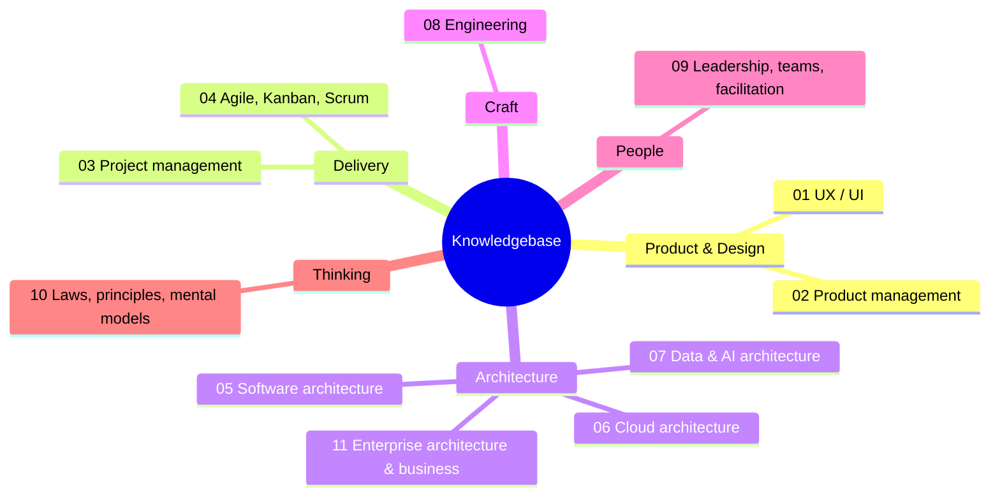

# Knowledgebase

> A personal reference map for building software end to end: from the first UX sketch, through product and delivery, to software, cloud, data and AI architecture, and the teams that run it.
> Dense, link-heavy, opinionated where useful. Not a course — a place to look things up.

## Map

| # | Section | What's in it |
|---|---|---|
| 01 | [UX / UI](01-ux-ui/README.md) | Laws of UX, heuristics, visual design, accessibility (WCAG 2.2), research methods, metrics (SUS, HEART), UI patterns, enterprise UX, design systems |
| 02 | [Product management](02-product-management/README.md) | Discovery, JTBD, strategy & OKRs, prioritization (RICE, WSJF, Kano), backlog & stories, roadmaps, product metrics, templates |
| 03 | [Project management](03-project-management/README.md) | PMBOK 7, PRINCE2, estimation & scheduling, EVM formulas, risk, governance, contracts, ERP implementation, templates |
| 04 | [Agile, Kanban, Scrum](04-agile-kanban-scrum/README.md) | Agile & Lean, Kanban Method deep dive, board design, cadences, flow metrics, Little's Law, Monte Carlo forecasting, Scrum, retros, scaling |
| 05 | [Software architecture](05-software-architecture/README.md) | Principles, GoF & enterprise patterns, architecture styles, DDD, distributed systems, integration & APIs, C4/arc42/ADRs, security, evolution |
| 06 | [Cloud architecture](06-cloud-architecture/README.md) | Well-Architected, CAF & landing zones, Azure deep dive, GCP, service mapping, Kubernetes, IaC, reliability (SLOs), observability, FinOps |
| 07 | [Data & AI architecture](07-data-ai-architecture/README.md) | Warehouse/lake/lakehouse, dimensional modeling, modern data stack, Fabric & Power BI, governance, SQL, ML, LLMs, RAG, agents |
| 08 | [Engineering](08-engineering/README.md) | TypeScript, React, Vue, CSS, Python, C#/.NET, testing, Git, CI/CD & DORA, code quality, developer experience |
| 09 | [Leadership, teams, facilitation](09-leadership-teams-facilitation/README.md) | Team Topologies, motivation, feedback, decision making, stakeholder communication, workshops & Liberating Structures, coaching, change |
| 10 | [Laws, principles, mental models](10-laws-principles-mental-models/README.md) | Eponymous laws, cognitive biases, mental models, systems thinking, statistics, Lean/quality thinkers, A–Z index |
| 11 | [Enterprise architecture & business](11-enterprise-architecture-business/README.md) | TOGAF, ArchiMate, capability maps, BPMN, Lean Six Sigma, ERP, ITIL 4, ISO 27001, NIS2, strategy tools, consultancy practice |

## Where to start for…

| Situation | Go to |
|---|---|
| Designing a screen or form | [UI patterns](01-ux-ui/README.md) → [Laws of UX](01-ux-ui/README.md) → [Accessibility](01-ux-ui/README.md) |
| Deciding what to build next | [Prioritization](02-product-management/README.md) → [Cost of Delay](04-agile-kanban-scrum/README.md) |
| Starting a project or engagement | [Project management](03-project-management/README.md) → [Consultancy practice](11-enterprise-architecture-business/README.md) |
| Setting up / fixing a Kanban board | [Kanban](04-agile-kanban-scrum/README.md) |
| "When will it be done?" | [Flow metrics & forecasting](04-agile-kanban-scrum/README.md) |
| Choosing an architecture style | [Software architecture](05-software-architecture/README.md) |
| Designing on Azure | [Cloud architecture](06-cloud-architecture/README.md) |
| Building a data platform or RAG/agent | [Data & AI](07-data-ai-architecture/README.md) |
| Structuring or leading a team | [Leadership & teams](09-leadership-teams-facilitation/README.md) |
| Running a workshop | [Facilitation](09-leadership-teams-facilitation/README.md) |
| Explaining a decision to the business | [Communication](09-leadership-teams-facilitation/README.md) → [Mental models](10-laws-principles-mental-models/README.md) |
| ERP selection or IT assessment | [Enterprise architecture & business](11-enterprise-architecture-business/README.md) |

## Conventions

- Every page starts with a **TL;DR**, ends with **References**.
- Links point to primary sources (standards, original authors, official docs) or Wikipedia.
- Fast-moving topics (cloud services, AI, regulation) are marked *verify current status*.
- Diagrams are [Mermaid](https://mermaid.js.org/) — render on GitHub and in most Markdown editors (Obsidian, VS Code).

## License

Personal notes. Content is paraphrased and summarized; all frameworks, laws and trademarks belong to their respective authors — follow the links for the originals.
